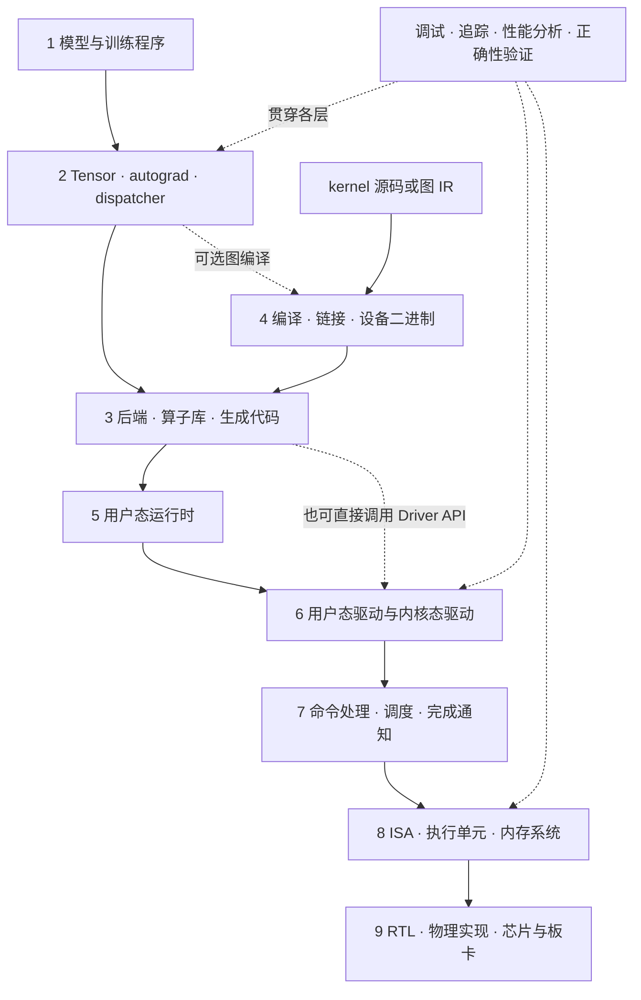
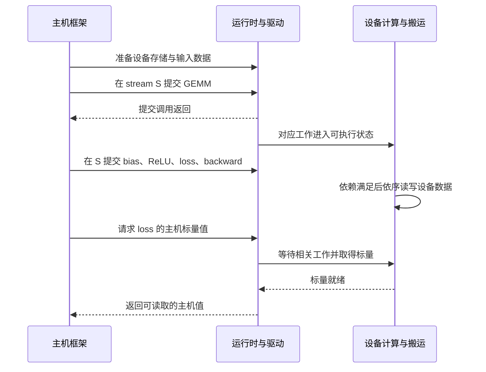
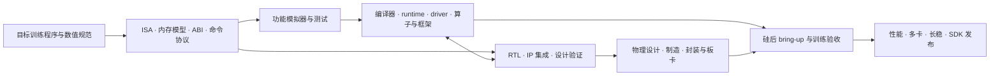

# 一段训练代码怎样落到芯片，自研训练加速器需要补齐哪些层？

一块训练芯片要承接完整的计算语义、数值规则、数据搬运和任务完成机制。模型代码给出数学关系，框架组织张量与求导，后端选择算子实现，工具链生成设备代码，运行时与驱动建立资源和执行顺序，芯片完成取数、运算和回写。每个边界都需要双方一致的接口与验证。

本文用 **9 层职责**组织这些概念。这是便于学习和分工的划分，同一套 SDK 可以合并或细分这些职责。贯穿全文的例子是一层矩阵乘法、bias、ReLU、均方误差及一次 SGD 更新。随后沿 NVIDIA CUDA 的公开接口与开源实现分析 GPU 路径，并给出从零研发一块主机连接式、可编程训练加速器的交付顺序。

本文的数值和 CPU 算子追踪经过真实运行。GPU 部分依据固定版本源码与官方规范分析。选取的 PyTorch、Triton 和 Linux GPU 内核模块来自各自当日默认分支，分别代表三个源码快照，实际安装组合需要另外核对兼容矩阵。本文的 CPU 环境未执行 CUDA、设备编译或芯片验证。

## 1. 先把一小步训练算清楚

### 1.1 Python 写了什么？

设输入 `X` 的形状为 `2×3`，权重 `W` 为 `3×4`，bias `b` 为 `4`，目标 `T` 为 `2×4`。完整可运行版本保存在本篇代码目录。这里只保留训练关系，数据来自自编的合成例子。

```python
A = X @ W + b
Y = torch.relu(A)
loss = (Y - T).square().mean()
loss.backward()

with torch.no_grad():
    W.add_(W.grad, alpha=-0.1)
    b.add_(b.grad, alpha=-0.1)
```

`X`、`W`、`b` 在示例中都开启 `requires_grad`，以便观察输入梯度如何向上一层传播。实际网络的原始输入常常无需梯度，中间层的输入通常需要梯度。这个选择会改变反向执行的工作量。完整数据与实现见附带文件。[合成数据](code/example_data.py)、[PyTorch 实现](code/walkthrough.py)

\[
X=\begin{bmatrix}1&-2&3\\-1&2&1\end{bmatrix},\quad
W=\begin{bmatrix}1&-1&2&0\\0&2&-1&1\\1&0&1&-2\end{bmatrix},\quad
b=\begin{bmatrix}1&-1&0&2\end{bmatrix}.
\]

\[
T=\begin{bmatrix}1&1&2&-1\\0&1&2&1\end{bmatrix},\quad
A=XW+b=\begin{bmatrix}5&-6&7&-6\\1&4&-3&2\end{bmatrix}.
\]

ReLU 对每个元素取 `max(a, 0)`，于是

\[
Y=\begin{bmatrix}5&0&7&0\\1&4&0&2\end{bmatrix},\qquad
L=\frac{1}{8}\sum_{i,j}(Y_{ij}-T_{ij})^2=\frac{58}{8}=7.25.
\]

第一行第一列可以手算。点积为 `1×1 + (-2)×0 + 3×1 = 4`，加 bias 得到 `5`，经过 ReLU 仍为 `5`。这个数字会一直对应到后面的地址、乘加指令与数值验证。

### 1.2 反向传播增加了哪些计算？

本例的所有 `A` 元素都远离 `0`，求导避开了 ReLU 的折点。记 `G=∂L/∂A`，逐元素链式法则给出

\[
G=\frac{2}{8}(Y-T)\odot\mathbf{1}_{A>0}
=\begin{bmatrix}1&0&1.25&0\\0.25&0.75&0&0.25\end{bmatrix}.
\]

其中 `⊙` 表示逐元素相乘。矩阵乘法的微分关系给出

\[
\frac{\partial L}{\partial W}=X^TG,qquad
\frac{\partial L}{\partial X}=GW^T,qquad
\frac{\partial L}{\partial b_j}=\sum_i G_{ij}.
\]

\[
\frac{\partial L}{\partial W}=
\begin{bmatrix}0.75&-0.75&1.25&-0.25\\-1.5&1.5&-2.5&0.5\\3.25&0.75&3.75&0.25\end{bmatrix},
\qquad
\frac{\partial L}{\partial b}=\begin{bmatrix}1.25&0.75&1.25&0.25\end{bmatrix}.
\]

SGD 用 `W←W−0.1∂L/∂W` 和 `b←b−0.1∂L/∂b` 更新参数。更新后 `W[0,0]=0.925`、`W[2,2]=0.625`，再次前向的标量参考损失为 `3.725390625`。这一步复算安排在 profiler 的训练步骤范围外。

| 阶段 | 矩阵工作 | 输出形状 | 常规 GEMM 计数 `2MNK` |
| --- | --- | --- | --- |
| 前向 | `(2×3) @ (3×4)` | `2×4` | `48 FLOP` |
| 输入梯度 | `(2×4) @ (4×3)` | `2×3` | `48 FLOP` |
| 权重梯度 | `(3×2) @ (2×4)` | `3×4` | `48 FLOP` |

三项合计 `144 FLOP`，这里使用一次乘加计作 `2 FLOP` 的常规口径。bias、ReLU、损失归约和 SGD 另有工作量。本次 CPU profiler 恰好记录到这三种形状的 `aten::mm`，各 `1` 次。框架的算子事件还包括包装、分配、视图和求导节点，完整记录保存在本篇目录。[CPU 合成运行](evidence/runs/03-demo.json)

## 2. 用 9 层职责建立全貌

| 层 | 负责的问题 | 本例中的输入与输出 | 自研芯片对应的交付 |
| --- | --- | --- | --- |
| 1．模型与训练程序 | 要计算什么函数，怎样训练？ | `X、W、b、T` → loss、更新后的参数 | 目标工作负载、数值和训练验收集 |
| 2．框架核心 | 张量是什么，怎样求导与分派？ | Python 调用 → ATen 操作、反向依赖 | 设备接入、张量语义、autograd 协作 |
| 3．后端与计算库 | 每个操作采用哪种算法和 kernel？ | `mm` → GEMM 实现、点算子、归约 | 核心算子库、算法选择、优化与回退策略 |
| 4．编译与设备代码工具链 | 怎样把程序生成可执行代码？ | kernel 源码／IR → 设备二进制与元数据 | 编译后端、汇编／链接、加载格式与 ABI |
| 5．用户态运行时 | 怎样管理设备工作及其先后关系？ | 指针、stream、函数句柄 → 异步任务 | memory、stream、event、module、launch API |
| 6．驱动与 OS 接口 | 怎样安全获得硬件资源？ | 进程请求 → 地址映射、队列、设备资源 | 用户态驱动、内核态驱动、资源隔离与恢复 |
| 7．设备控制与调度 | 怎样接收命令、启动并结束任务？ | 命令与依赖 → 计算／搬运引擎的工作 | 命令处理、调度、完成通知、固件或控制逻辑 |
| 8．ISA 与微架构 | 运算怎样落实到执行单元？ | 机器指令和数据 → 结果、计数器与异常 | 指令语义、执行单元、片上存储、内存与互连 |
| 9．芯片实现与板级系统 | 怎样让设计成为稳定工作的器件？ | RTL／物理设计 → 芯片、封装与板卡 | 验证、后端设计、制造测试、供电散热与 bring-up |

**编译生成代码和运行提交任务是两条相连的路径。** 库中的 kernel 常在发行包构建时已经编译。JIT 也可在首次遇到某种形状时生成代码。后续执行能够复用二进制或缓存。下面的箭头表示职责依赖，具体 API 调用可以跨过某些封装层。



PyTorch 官方的设备接入文档也覆盖运行时、算子、Python 前端以及 AMP、编译和分布式等扩展面。上述 9 层在这个接入面之外继续展开了驱动、硬件控制和芯片实现。[PyTorch 2.15 Accelerator Integration](https://docs.pytorch.org/docs/2.15/accelerator/index.html)

## 3. 第 1—2 层，Python 如何变成框架可执行的工作？

### 3.1 Python 对象、张量元数据和存储各在哪里？

`X @ W` 首先是一条由主机 CPU 解释或编译执行的 Python 表达式。PyTorch 的 Python 绑定进入 C++ 操作入口。一个 Tensor 携带 `shape`、`stride`、`dtype`、`device`、storage offset 和 storage 等信息。Python 对象和大部分管理信息在主机端，CUDA Tensor 的数值存储位于设备可访问的内存中。

本例连续 FP32 的 `X` 使用 `24 B` 数值存储，`W` 使用 `48 B`。`X[1,2]` 相对数据首地址的字节偏移为 `(1×3+2)×4=20 B`。只改视图的 shape／stride 可以不搬动数值。CUDA device pointer 的位模式可以存放在 CPU 的参数结构中，实际解引用则必须遵守设备地址映射和内存访问规则。更完整的张量地址例子见已有章节。[Tensor 的 shape、stride 与连续性](../../../../wiki/2026/10/2026-10-22-tensor-shape-stride-contiguity/README.md)

把数据放到 `device="cuda"` 会走设备分配与必要的数据复制路径。之后在同一设备上连续做 `mm`、ReLU 和 backward，张量可以持续留在设备内存。训练也需要主机的数据加载、解码和预处理，这些生产数据的工作可以与设备执行重叠。本文的固定小例子从已经构造好的张量开始。

### 3.2 框架怎样决定调用 CPU 还是 CUDA？

框架先明确操作的 schema，也就是名称、参数、返回值及别名／原地修改约定。Dispatcher 根据 Tensor 的设备等 dispatch key，以及当前的 autograd、autocast 等状态，选择相应的包装与后端实现。进入后端后，`dtype`、shape、stride、对齐和配置继续影响具体算法选择。

固定 PyTorch 快照中，二维 `matmul` 的 `_matmul_impl` 进入 `mm`。`native_functions.yaml` 中的 `mm` 委托到结构化的 `mm.out`，后者分别登记了 `CPU: mm_out_cpu` 和 `CUDA: mm_out_cuda`。这是本例从同一数学操作走向不同设备实现的明确连接点。[二维 matmul 源码](https://github.com/pytorch/pytorch/blob/7d191ca7274de43d574c2dbe35365fefd008babf/aten/src/ATen/native/LinearAlgebra.cpp#L2022-L2056)、[mm 的设备登记](https://github.com/pytorch/pytorch/blob/7d191ca7274de43d574c2dbe35365fefd008babf/aten/src/ATen/native/native_functions.yaml#L4139-L4156)

可以把这段路径读成

```text
Python X @ W
    → matmul 的语义与维度处理
    → 二维 mm
    → autograd 等包装与后端分派
    → CPU 或 CUDA 的具体实现
```

### 3.3 自动求导替芯片厂商完成了什么？

Eager autograd 在前向时记录需要的反向关系和保存值。调用 `loss.backward()` 后，求导引擎按依赖调度反向节点。`MmBackward0` 这样的节点最终会再次调用 Tensor 操作，后端继续负责实现它们。本次观察到的节点类型包括 `MeanBackward0`、`PowBackward0`、`ReluBackward0`、`AddBackward0`、`MmBackward0` 和 `AccumulateGrad`。[实际节点记录](evidence/runs/03-demo.json)

PyTorch 的导数定义把 `mm` 接到两个矩阵梯度函数，把 ReLU 接到 `threshold_backward`，把全元素均值的梯度按元素数缩放并展开。新设备如果正确实现这些底层操作及相关张量语义，可以复用框架已有的求导规则。新增自定义操作或融合操作时，还需要定义相应导数、分解或 autograd 接入。[mm 导数](https://github.com/pytorch/pytorch/blob/7d191ca7274de43d574c2dbe35365fefd008babf/tools/autograd/derivatives.yaml#L1239-L1243)、[ReLU 导数](https://github.com/pytorch/pytorch/blob/7d191ca7274de43d574c2dbe35365fefd008babf/tools/autograd/derivatives.yaml#L2150-L2153)、[mean 导数](https://github.com/pytorch/pytorch/blob/7d191ca7274de43d574c2dbe35365fefd008babf/tools/autograd/derivatives.yaml#L1159-L1164)

训练设备因此要支持前向之外的运算。例如矩阵乘法的转置输入、广播后的归约、梯度累加、随机数、原地参数更新，以及使用 AMP 时的精度转换和溢出处理，都可能出现在真实训练路径中。这个范围应由目标模型的完整训练步骤实测得到。

## 4. 第 3 层，计算库、算子和 kernel 怎样分工？

### 4.1 一个 `mm` 会怎样进入 CUDA 库？

固定源码中的 CUDA 路径有以下关键连接。

1. `mm_out_cuda` 调用 `addmm_out_cuda_impl`，传入 `beta=0` 和 `alpha=1`，对应 `C=AB`。
2. 实现检查维度、类型与设备，整理结果和输入布局，构造 `cublasCommonArgs`。
3. 根据设备、输入、配置等条件，走 cuBLASLt 路径或 GEMM 路径，并处理必要的回退和 epilogue。
4. 常规 GEMM 包装也会查看 preferred BLAS backend。在所读快照的 FP32 cuBLAS 分支中，可以继续看到 `cublasGemmEx` 调用。

这条链说明了库接口如何承接 `mm` 的语义。具体模型在特定软件配置下选择的最终库算法及 kernel，需要在对应 GPU 上追踪确认。[CUDA mm 入口与选择](https://github.com/pytorch/pytorch/blob/7d191ca7274de43d574c2dbe35365fefd008babf/aten/src/ATen/native/cuda/Blas.cpp#L556-L749)、[mm_out_cuda](https://github.com/pytorch/pytorch/blob/7d191ca7274de43d574c2dbe35365fefd008babf/aten/src/ATen/native/cuda/Blas.cpp#L913-L927)、[FP32 cuBLAS 包装](https://github.com/pytorch/pytorch/blob/7d191ca7274de43d574c2dbe35365fefd008babf/aten/src/ATen/cuda/CUDABlas.cpp#L1017-L1050)、[preferred backend 选择](https://github.com/pytorch/pytorch/blob/7d191ca7274de43d574c2dbe35365fefd008babf/aten/src/ATen/cuda/CUDABlas.cpp#L1301-L1320)

一个具体布局问题能解释这层的价值。经典 cuBLAS GEMM 使用列主序。连续行主序的 `XW` 可以利用 `C^T=W^T X^T` 交换操作数和维度，让同一片数值存储满足库的表示约定。在连续输出条件下，本例可转成列主序的 `m=4、n=2、k=3`。视图重解释能够省掉一次实际转置复制，复杂 stride 或不受支持布局则可能需要整理数据。所读 `cublasCommonArgs` 会根据输出布局选择交换输入并计算转置和 leading dimension。[布局适配源码](https://github.com/pytorch/pytorch/blob/7d191ca7274de43d574c2dbe35365fefd008babf/aten/src/ATen/native/cuda/cuBlasCommonArgs.h#L100-L171)、[cuBLAS 数据布局约定](https://docs.nvidia.com/cuda/cublas/index.html)

### 4.2 cuBLAS、cuDNN、NCCL 分别提供什么？

| 组件 | 面向的语义 | 工程价值 |
| --- | --- | --- |
| cuBLAS／cuBLASLt | 向量、矩阵和 GEMM 等线性代数操作 | 针对 shape、布局、精度、workspace 等条件选择实现，Lt 还提供布局和 epilogue 等描述能力 |
| cuDNN | 深度学习操作及受支持的操作图 | 提供神经网络计算的实现与执行方案，当前接口包含 Graph API 及 frontend |
| NCCL | AllReduce、AllGather 等多设备集合通信 | 组织设备间数据流、归约和通信拓扑，训练框架在需要梯度或张量通信时调用 |
| 后端自有 kernel | 激活、逐元素操作、归约、索引或特定融合 | 补足库覆盖面，控制特定模型和设备上的性能 |
| 编译器生成的 kernel | 根据捕获的操作图生成设备程序 | 融合、特化、选择 tile、减少临时张量和提交开销 |

本例显式调用 `matmul`、加法和 ReLU，没有卷积。各行操作可能由不同实现承担。cuDNN 的公开接口已经覆盖操作图，因此框架图优化和库图执行也存在衔接空间。NCCL 提供多设备通信原语，通信与训练的结合可接着阅读 DDP 章节。[cuDNN 当前接口概览](https://docs.nvidia.com/deeplearning/cudnn/backend/latest/developer/overview.html)、[NCCL Overview](https://docs.nvidia.com/deeplearning/nccl/user-guide/docs/overview.html)、[DDP 梯度通信与重叠](../../../../wiki/2026/11/2026-11-03-ddp-gradient-overlap/README.md)

这里的 **kernel** 指一次可在设备上启动的计算程序。一个框架操作可能启动多个 kernel，例如分阶段归约、额外布局转换或复杂算法。多个框架操作也可能融合成一个 kernel，例如 GEMM 的 bias／激活 epilogue。因此，观察到 `3` 个 `aten::mm` 只能说明本次 CPU 框架层的操作次数。设备执行事件需要设备侧采集。

自研芯片需要安排这层的覆盖顺序。先让本例的 GEMM、广播、ReLU、归约和梯度更新都正确，再根据模型中的耗时热点优化 GEMM、attention、normalization、索引和融合操作。算法选择器要同时考虑正确性约束、workspace、确定性和性能，避免仅以单个大矩阵的峰值表现判断训练可用性。

## 5. 第 4 层，编译器何时介入，究竟产出什么？

### 5.1 Eager 执行可以调用已经编译好的 kernel

PyTorch 的 Python 包、C++ 扩展、计算库和其中的设备程序有各自的构建过程。当程序运行到 `mm`，后端可以直接调用已安装的库。Python 每执行一次表达式，系统可以复用现成代码。某些形状、算法或代码路径也会触发运行时编译或首次加载成本。

CUDA C++ 的经典构建路线把 `.cu` 文件中的 host 和 device 部分分开处理。host 部分交给主机 C++ 工具链，device 部分生成面向 GPU 的中间表示或二进制，再由 fatbinary 等机制把多种设备镜像包装到应用或库中。CUDA 13.5 文档还描述了新的中间表示路径，本节沿常见的 PTX 路径解释职责。[NVCC 编译轨迹](https://docs.nvidia.com/cuda/cuda-compiler-driver-nvcc/index.html)

```text
CUDA C++ kernel 源码
    → 设备前端与优化
    → PTX（虚拟指令集表示）
    → ptxas 或驱动中的相应 JIT 路径
    → cubin（面向具体 GPU 架构的设备二进制）
    → module／function 句柄
    → 提交执行
```

PTX 保留一层面向虚拟架构的表示。实际设备需要可执行的本机指令，通常在 NVIDIA 调试／反汇编语境中称为 SASS。预先生成对应架构的二进制能够避免这部分现场编译，携带受支持的 PTX 则可以为相应兼容条件下的 JIT 提供输入。镜像、目标架构与驱动支持范围要一起核对。

### 5.2 `torch.compile` 增加了图级生成路径

对适用的训练程序，典型 PyTorch 编译路径包含 Dynamo 捕获 Python 中的 Tensor 计算，使用 FX 图表示，训练编译通过 AOTAutograd 等机制组织前后向，再由 Inductor 选择外部库或生成 kernel。捕获边界、后端、动态形状和版本会影响实际图及编译结果。已有章节详细解释 guard 与重新编译。[torch.compile、guard 与图捕获](../../../../wiki/2026/11/2026-11-13-torch-compile-guards/README.md)

本篇执行了 `torch.fx.symbolic_trace(forward)`，观察到 `matmul → add → relu → sub → square → mean` 的前向图，并测试该图的数值。这份 FX 输出展示了图表示，运行记录中的设备仍为 CPU。关于 Inductor、Triton 和 CUDA 的路径由源码另行说明。[FX 真实输出](evidence/runs/03-demo.json)

所读 Triton NVIDIA 后端的 `add_stages` 明确列出了 `ttir → ttgir → llir → ptx → cubin`。这些表示依次承载张量程序、设备布局／并行映射、较低层代码与设备镜像。`make_ptx` 调用 LLVM 的汇编输出，`make_cubin` 构造 `ptxas` 命令。Triton 的这个后端因此复用了 NVIDIA 工具链的部分能力。[编译阶段源码](https://github.com/triton-lang/triton/blob/46eccb199bfd3f3559b512c4a15870bd45e6a74d/third_party/nvidia/backend/compiler.py#L661-L671)、[PTX 与 cubin 生成](https://github.com/triton-lang/triton/blob/46eccb199bfd3f3559b512c4a15870bd45e6a74d/third_party/nvidia/backend/compiler.py#L547-L618)

### 5.3 自研芯片的编译工具链至少要承接哪些约定？

- **指令选择与数值语义**。哪些 IR 操作映射到向量、矩阵、load/store、原子或同步指令，哪些操作需要展开。
- **并行与存储映射**。怎样分块，怎样将数据分布到执行组和片上 SRAM，寄存器不足时怎样 spill，边界怎样加 mask。
- **二进制与加载信息**。目标架构标识、入口、重定位、常量、资源需求、版本和调试信息怎样存放。
- **调用约定 ABI**。参数顺序、指针宽度、对齐、标量布局、地址空间、启动尺寸和错误处理怎样解释。
- **工具与测试**。汇编器、反汇编器、链接／装载支持，以及 IR 到指令到模拟器的差分测试。

可以基于 LLVM／MLIR 等已有基础设施构建后端，也可以先实现聚焦于少量操作的图编译器。选用 LLVM 时，目标描述、寄存器、指令、lowering、调度和发码等工作仍需要面向新 ISA 实现。上述选择取决于芯片的编程模型和产品范围。[LLVM 后端开发说明](https://llvm.org/docs/WritingAnLLVMBackend.html)

## 6. 第 5 层，运行时怎样把“函数”变成可提交的任务？

### 6.1 运行时维护哪些对象？

运行时对应用提供 device、context、memory、stream、event、module 和 kernel launch 等抽象。context 关联设备资源和执行环境，stream 表达一串有序工作，event 表达执行进度及依赖，module／function 句柄关联已经加载的设备程序。

CUDA Runtime API 的常见形式是 `cudaMalloc`、`cudaMemcpyAsync` 和 `cudaLaunchKernel`。CUDA Driver API 提供 `cuMem*`、`cuModuleLoadData`、`cuModuleGetFunction`、`cuLaunchKernel` 等较显式的控制。两组 API 可以按其 context 规则互操作。`libcudart` 与提供 Driver API 的用户态驱动 `libcuda` 承担不同封装职责。[Runtime 与 Driver API 官方说明](https://docs.nvidia.com/cuda/cuda-runtime-api/driver-vs-runtime-api.html)

本篇所读 Triton launcher 提供一个可见的连接实例。`loadBinary` 获取或保留相应 context，通过 `cuModuleLoadData` 加载镜像，利用 `cuModuleGetFunction` 获得入口，并查询寄存器等资源信息。启动函数再整理 `CUlaunchConfig`，最终调用 `cuLaunchKernelEx`。[Triton 模块加载](https://github.com/triton-lang/triton/blob/46eccb199bfd3f3559b512c4a15870bd45e6a74d/third_party/nvidia/backend/driver.c#L290-L326)、[Triton 启动配置](https://github.com/triton-lang/triton/blob/46eccb199bfd3f3559b512c4a15870bd45e6a74d/third_party/nvidia/backend/driver.c#L1050-L1127)

### 6.2 一次 kernel launch 带着什么？

用通用的向量操作举例，一个启动请求通常需要携带以下信息。CUDA 的 launch API 明确暴露了这些字段中的多项。

| 信息 | 作用 |
| --- | --- |
| 函数／镜像入口 | 指定执行哪段设备代码 |
| 输入和输出的设备地址 | 指定在哪里读写数据 |
| 长度、shape、stride 等参数 | 说明数据如何解释，也可能已经特化进代码 |
| grid 与 block 等并行配置 | 指定工作划分，具体概念服从设备编程模型 |
| 动态共享内存等资源 | 给执行组准备所需片上资源 |
| context、stream 与依赖 | 关联资源归属、先后关系及完成进度 |

CUDA 的 `kernelParams` 是主机侧指针数组，每个元素指向存放实际实参的主机内存。例如其中一个实参的值可以是 device pointer。加载器和设备代码必须对参数布局取得一致解释。新芯片的编译器、运行时和设备控制端需要共享这样的 ABI。[CUDA Driver API Execution Control](https://docs.nvidia.com/cuda/cuda-driver-api/cuda_driver_api/group__CUDA__EXEC.html)

### 6.3 Python 返回时，设备完成了吗？

同一 stream 中的工作按相应顺序规则执行。CPU 可以先提交 GEMM、bias、ReLU 和 backward 的工作，然后继续执行主机程序。不同 stream 需要建立正确的 event／等待关系，才能保证读取者看到生产者完成的数据。设备地址的生命周期也要覆盖仍在使用它的异步任务。



图中省略了具体队列协议与初始化细节，表示通用的先后关系。所读 PyTorch NVIDIA CUDA 标量读取路径会分配 pinned host scalar，再执行 `memcpy_and_sync` 后读取数值。因此，读取 CUDA loss 的 `.item()` 会在这条路径建立主机等待点。每步都读取标量还会改变可重叠的工作范围。[标量读取实现](https://github.com/pytorch/pytorch/blob/7d191ca7274de43d574c2dbe35365fefd008babf/aten/src/ATen/native/cuda/CUDAScalar.cu#L59-L83)、[异步执行与计时](../../../../wiki/2026/10/2026-10-23-gpu-asynchronous-timing/README.md)

运行时的 allocator 也常在已经获得的设备内存中复用块，以降低频繁分配的开销。复用时要处理 stream 生命周期和碎片。新设备可以先实现语义正确的基础分配，再逐步增加缓存、统计和诊断能力。[CUDA caching allocator 与 OOM](../../../../wiki/2026/11/2026-11-16-cuda-caching-allocator/README.md)

## 7. 第 6—7 层，驱动、固件与命令处理各做什么？

### 7.1 用户态驱动与内核态驱动之间有什么边界？

用户态驱动运行在应用进程中，可以管理设备代码、提交准备和部分资源状态。内核态驱动接入 OS 的设备、内存、中断和进程资源管理，执行需要特权的操作。具体分工依厂商、OS 和硬件设计变化。

Linux NVIDIA 开源内核模块中可以看到 `file_operations` 登记 `open`、`ioctl`、`mmap`、`poll` 和 `release` 等入口，也可以看到 `pci_driver` 的 probe／remove 连接和 `pci_enable_device`。这些证据展示了 OS 对设备的接入位置。[字符设备入口](https://github.com/NVIDIA/open-gpu-kernel-modules/blob/e6a2e01579fbbd1ca2ed43fef2ee2589e9bd8bd9/kernel-open/nvidia/nv.c#L252-L273)、[PCI 驱动登记](https://github.com/NVIDIA/open-gpu-kernel-modules/blob/e6a2e01579fbbd1ca2ed43fef2ee2589e9bd8bd9/kernel-open/nvidia/nv-pci.c#L2722-L2734)、[PCI 设备启用](https://github.com/NVIDIA/open-gpu-kernel-modules/blob/e6a2e01579fbbd1ca2ed43fef2ee2589e9bd8bd9/kernel-open/nvidia/nv-pci.c#L1191-L1205)

自研主机连接式设备需要决定以下 OS 契约。

- 设备怎样枚举和初始化，主机怎样访问控制寄存器。
- 进程怎样创建执行资源，谁拥有队列和设备地址空间。
- 主机内存与设备内存怎样映射，DMA 能访问哪些页面，怎样保证隔离。
- 完成通知采用轮询、中断或组合机制，进程退出时怎样回收资源。
- 地址错误、超时、设备失联和 reset 怎样影响已有任务，错误怎样返回应用。

`mmap`、队列和 doorbell 等机制可以让某些提交通过预先建立的映射完成。系统实现可能在初始化和资源管理时进入内核，同时让高频提交复用既有资源。评估 launch 开销时应检查具体提交路径与系统调用证据。

### 7.2 命令处理器怎样启动执行单元？

一个便于设计新芯片的通用方案，是主机准备命令描述符，写入已建立的提交队列，再通知设备。设备控制逻辑读取描述符，验证状态，等待依赖，安排搬运或计算任务，记录完成序号并通知主机。描述符可以携带入口、参数位置、工作尺寸和依赖等信息。

命令处理和调度可以由硬件状态机、设备上的控制处理器固件，或二者共同完成。这里应区分任务级调度与执行单元内部的指令／warp 调度。前者决定哪个 kernel 或 DMA 工作可以开始，后者安排计算单元在周期中执行哪些指令。

上述队列是本文为自研设备解释接口的通用模型。NVIDIA 的具体库内部算法和完整用户态提交实现有各自的公开范围。本文核验到了公开 launcher、Driver API 与 Linux 内核入口，设备内部则采用公开编程模型解释。所读开源内核模块明确要求其 GSP 固件和用户态驱动来自对应的 `620.70.06` 版本，这体现了组件匹配要求。[NVIDIA 内核模块的配套组件约定](https://github.com/NVIDIA/open-gpu-kernel-modules/blob/e6a2e01579fbbd1ca2ed43fef2ee2589e9bd8bd9/README.md#L1-L23)

## 8. 第 8 层，一次矩阵乘法怎样成为硬件运算？

### 8.1 ISA、编程模型与微架构分别描述什么？

- **编程模型**说明程序员如何表达工作。例如 CUDA 用 thread、block 和 grid 组织常见 SIMT kernel，并定义相应的内存与同步规则。
- **ISA**规定机器指令、寄存器／地址空间和可观察行为，例如 load、store、浮点乘加、矩阵运算、原子与 barrier。
- **微架构**决定怎样实现这些语义，例如执行单元数量、发射宽度、流水线、寄存器容量、缓存和调度方式。

CUDA 将 block 调度到 SM 等执行资源，常见 SIMT 执行以 warp 组织线程。新训练芯片也可以选择向量或张量块等不同编程抽象，随后为相应抽象实现编译与运行接口。编程模型的选择会持续影响上层 kernel 的写法。[CUDA Programming Model](https://docs.nvidia.com/cuda/cuda-programming-guide/01-introduction/programming-model.html)

### 8.2 具体到 `C[0,0]`，硬件经历了什么？

对本例的一种教学分解如下。

1. 根据启动配置找到负责某个输出 tile 的工作组。
2. 将 `X` 与 `W` 的相应片段从设备内存读入缓存、片上 SRAM 或寄存器。
3. 执行乘加并在寄存器或专用累加存储中保持部分和。对 `C[0,0]`，累加得到 `4`。
4. 在后续点算子或支持的融合 epilogue 中加 bias 得到 `5`，应用 ReLU。
5. 把结果写回后续操作能够读取的位置，满足所需的内存可见性和完成顺序。

令 `C=XW`，只观察 `C[0,0]`。假设数据为连续 FP32，`pX`、`pW`、`pC` 分别是三个数据首地址，一套教学伪指令可以写成下面这样。参数由启动 ABI 提供，地址偏移以字节为单位。

```text
acc ← 0
for k in 0..2:
    vx ← load_fp32(pX + 4*k)
    vw ← load_fp32(pW + 16*k)
    acc ← fma_fp32(vx, vw, acc)
store_fp32(pC, acc)
```

`W` 每行有 `4` 个 FP32，因此沿第一列取值时，地址每次增加 `16 B`。三次累加的值依次为 `1、1、4`。计算单元要接收操作数，地址生成和访存路径要把值送进来，输出路径要把 `4` 存回去。后续 bias／ReLU 再得到 `5`。这段伪指令只解释一个输出元素，实际高效 GEMM 会让许多输出共同复用输入，并可能采用不同粒度的矩阵指令。

这是数学到存储／运算的教学映射。实际 GPU 的 GEMM 通常按 tile 组织复用、流水化搬运，并在适用条件下使用矩阵单元。某个小尺寸、类型、架构和精度配置最终采用哪些指令，需检查所选 kernel 的设备反汇编与运行证据。[GEMM 分块与数据复用](../../../../wiki/2026/10/2026-10-23-gemm-tiling/README.md)、[Tensor Core 的适用条件](../../../../wiki/2026/10/2026-10-23-tensor-core-conditions/README.md)

### 8.3 为什么有矩阵单元还需要大量其他硬件？

训练还包含归约、softmax、归一化、随机数、索引、比较、类型转换和参数更新。片上互连把执行单元与存储连接起来，DMA／copy engine 搬运数据，MMU 解释地址，原子与同步机制协调并发，设备间互连服务通信。算术单元的利用率取决于这些路径能否持续供数。

一个理想化数字可以帮助选架构。假设 GEMM 的 `M=N=K=4096`，输入均为 FP16，输出为 FP32，不读旧输出，各输入只从外部内存读一次。

\[
F=2MNK=137{,}438{,}953{,}472\ \text{FLOP},
\qquad
D=2MK+2KN+4MN=134{,}217{,}728\ \text{B}=128\ \text{MiB}.
\]

理想算术强度 `I=F/D=1024 FLOP/B`。设计算峰值为 `P`，带宽为 `B_w`，则这一简化下的吞吐上界为 `min(P, B_w I)`。真实实现的重复读取、workspace、对齐、边界、同步和调度会进一步影响效率。这里的数字来自公式估算，采用最少外部数据流量假设。

自研时需要一起选择矩阵指令的 tile 和支持精度、累加精度、寄存器与 SRAM 容量、外部内存类型、搬运粒度、barrier 和内存一致性。要让编译器与库作者在模拟器上测试目标 shape，判断这些配置能否形成可用的 kernel。

### 8.4 硬件模块怎样与软件交付对应？

下面列出本文假设下需要落实的职责，具体设计可以采用自研模块、合适的已有 IP 或相应组合。

| 硬件职责 | 需要对齐的软件和规范 |
| --- | --- |
| 标量、向量、矩阵及控制执行 | ISA、编译 lowering、数值模型和操作实现 |
| 寄存器、SRAM、cache 与片上互连 | tile／layout、资源限制、搬运和同步规则 |
| 外部内存控制器及 PHY | 地址映射、带宽和容量、初始化、错误处理 |
| 地址转换与访问保护 | 进程资源、内存映射、隔离、fault 报告 |
| 主机互连接口及 DMA | OS 枚举、寄存器协议、内存注册、copy API |
| 任务接收、调度与完成通知 | 队列协议、stream／event、超时及 reset |
| 调试状态、计数器与时间戳 | 符号与 PC 映射、trace、性能指标和采集接口 |
| 时钟、复位、电源与适用的错误检测 | 启动顺序、功耗／温度管理、健康状态和恢复 |

例如选择 HBM 时，需要把封装和外部内存接口一起规划。选择片上 SRAM 的容量时，需要让编译器和 kernel 库检验可容纳的 tile 与并行任务。每项选择都会沿表中的接口影响上层软件。

## 9. 第 9 层，从架构和 RTL 到真正的板卡

RTL 用寄存器传输级描述时序逻辑及组合逻辑。设计验证需要覆盖 ISA、控制协议、内存、并发和异常，方法可以包括参考模型比对、定向与随机仿真、断言和适用的形式验证。OpenTitan 的公开方法将 testplan、testbench、测试、功能覆盖与验证状态联系起来，可作为验证组织方式的例子。[OpenTitan Design Verification Methodology](https://opentitan.org/book/doc/contributing/dv/methodology/index.html)

设计进入物理实现后，还要使用目标工艺的 PDK、标准单元和必要 IP，完成综合、布局规划、供电网络、放置、时钟树、布线、时序与物理规则检查。OpenROAD 的公开 RTL 到 GDSII 流程给出了这些阶段及输入输出。项目采用何种工具和 sign-off 流程取决于工艺与制造要求。[OpenROAD Flow Scripts](https://openroad-flow-scripts.readthedocs.io/en/latest/mainREADME.html)

对于本文假设的训练板卡，还要规划制造测试和可测性设计、封装、外部内存及高速接口、PCB、供电、复位、时钟、散热和固件启动。量产测试需要筛出制造缺陷，研发 bring-up 需要逐级定位功能、时序、电气和系统问题。具体测试方法由芯片、IP、封装和板卡方案共同决定。

软件开发可以先使用功能模拟器、周期模型和适合的 FPGA／仿真原型。编译器、runtime、驱动与框架接入应在流片前就推进。到硅后，先确认电源、复位、时钟和可观测入口，再逐步打通设备枚举、寄存器、内存、搬运、最小 kernel 和训练步骤。每一级都保留足以区分软件语义与硬件执行错误的证据。

## 10. 调试器、性能分析工具为什么贯穿全栈？

调试器回答程序执行状态，性能工具回答时间和资源消耗，数值验证回答计算是否符合约定。它们从不同层收集证据，因此要先说明自己观察的是哪一层。

| 工具或能力 | 可以回答的问题 | 自研芯片需要提供的支撑 |
| --- | --- | --- |
| Python／C++ 调试与框架日志 | schema、shape、设备分派、异常和主机控制是否正确？ | 可解释错误、后端日志、最小复现、符号 |
| CUDA-GDB 类设备调试器 | kernel 在哪个位置，线程／寄存器／内存是什么状态？ | halt／trap、执行状态读取、调试接口、PC 与源码映射 |
| Compute Sanitizer 类工具 | 是否越界、未对齐、读未初始化数据或错误同步？ | 可追踪访存与同步、插桩或硬件检查机制 |
| Nsight Systems 类时间线 | CPU 提交、kernel、copy 和通信之间哪里出现空隙？ | 主机与设备时间戳、stream、关联 ID、活动记录 |
| Nsight Compute 类 kernel 分析 | 哪些执行流水线或存储路径限制单个 kernel？ | 硬件计数器、采样与测量控制、指标定义 |
| PyTorch profiler 的设备集成 | 一个框架操作关联了哪些设备工作？ | 设备 tracing SDK、correlation、框架 profiler 接入 |
| 功能／数值与长稳验证 | 指令、算子、梯度、训练曲线及异常恢复是否正确？ | 参考模型、差分测试、可复现输入、故障注入与诊断 |

CUDA-GDB 提供断点、单步和设备状态检查。Compute Sanitizer 的不同子工具分别检查访存、共享内存数据 hazard、未初始化访问和同步等特定范围。数值梯度与模型正确性仍需要独立测试。[CUDA-GDB](https://docs.nvidia.com/cuda/cuda-gdb/index.html)、[Compute Sanitizer](https://docs.nvidia.com/compute-sanitizer/ComputeSanitizer/index.html)

Nsight Systems 侧重系统时间线与 CPU／GPU 活动关联，Nsight Compute 收集 kernel 的硬件性能指标，并可能产生测量开销和 replay。运行时间与性能计数器必须连同采集条件一起解释。[Nsight Systems User Guide](https://docs.nvidia.com/nsight-systems/UserGuide/index.html)、[Nsight Compute Profiling Guide](https://docs.nvidia.com/nsight-compute/ProfilingGuide/index.html)

CUPTI 的 correlation ID 将主机 CUDA API 事件与相应 GPU 活动联系起来，再由 context／stream／device 等标识补充范围。新芯片要得到类似工具体验，需要在 runtime、驱动、设备时间戳和 framework profiler 之间保留同一条关联。PyTorch 的 PrivateUse1 profiler 文档提供集成方式，同时说明厂商仍需填入真实设备活动。[CUPTI 活动关联](https://docs.nvidia.com/cupti/main/main.html)、[PyTorch Profiler Integration](https://docs.pytorch.org/docs/2.15/accelerator/profiler.html)

## 11. 假设从零研发一块训练芯片，应怎样排交付顺序？

下面是一套面向**主机连接式、可编程训练加速器**的建议路线。产品可以选择集成式 SoC、固定图加速器等其他边界，此时相应替换主机、编程和提交契约。可复用已有 OS、编译基础设施和接口 IP，团队仍需对整条计算路径的正确性与可诊断性负责。

### 11.1 先确定目标程序和可观察行为

先选目标训练模型和 shape／dtype 分布，列出前向、反向、优化器、数据输入及通信。明确精度与累加规则、随机数、确定性要求、动态形状、容量、并发和恢复目标。用参考程序建立算子与梯度验收，再定义模型训练的收敛和吞吐评估方法。

例如本例的第一项验收是复现 `7.25` 的损失、全部梯度和更新后的损失。后续扩展到矩阵转置、广播、不同 stride、边界 shape、空 Tensor、NaN／Inf、随机种子和并发。低精度结果要有明确参考和容差，归约顺序、舍入和融合可能改变浮点结果。

### 11.2 让软硬件在模型上共同收敛



图中的契约要版本化。ISA 描述指令行为，ABI 描述编译代码与调用方的二进制约定，命令协议描述主机与设备控制端交换的任务和完成信息，内存模型说明并发访问何时可见。这几份规范需要互相一致。

| 阶段 | 必须交出的可检查产物 | 进入下一阶段的具体证据 |
| --- | --- | --- |
| 目标与架构 | 工作负载清单、数值规范、容量／带宽预算、ISA 与内存模型 | 参考程序可复算，关键 shape 的数据流与资源预算可解释 |
| 模拟与协议 | 功能模拟器、指令测试、二进制与启动 ABI、队列／完成协议 | 手写最小程序能 load／compute／store，依赖和异常语义能测试 |
| 编译工具链 | IR lowering、指令选择、寄存器分配、发码／装载、调试映射 | 同一 kernel 的参考、编译产物与模拟器结果一致 |
| 设备系统软件 | 设备控制、runtime、用户态与内核态驱动、内存与 copy、stream／event | 两个任务能够正确建立依赖，进程退出、坏地址和 reset 有明确行为 |
| 算子与框架 | 核心库、PrivateUse1 等接入、autograd 依赖操作、优化器 | 本例完整训练一步通过，扩展算子／梯度和模型测试通过 |
| RTL 与物理实现 | IP、RTL、DV 计划与覆盖、时序／物理检查、DFT、封装和板卡方案 | 设计按明确验证计划验收，软件提前在模型／原型上运行 |
| 硅后系统 | 电气与接口 bring-up、内存和计算测试、工具链兼容矩阵 | 真硬件从最小 kernel 到完整训练逐级对齐，错误可定位 |
| 产品化 | 性能回归、低精度、分布式、遥测、长稳、SDK 与模型支持矩阵 | 用户模型可复现地训练，性能与故障恢复有对应测量和测试 |

这是递进的验收关系，各团队可以并行开发。调试入口、计数器、时间戳、错误报告、reset 和必要的内存隔离，要随架构与 RTL 一起设计。工具开发需要编译器生成的符号与设备可观察状态共同配合。

### 11.3 PyTorch 接入的第一批工作是什么？

1. **设备和资源抽象**。提供设备发现、当前 device、allocator、数据复制、stream／event、DeviceGuard、必要 hooks 和随机数生成器。
2. **基础 Tensor 语义**。实现创建、strided storage／view、copy 等必要操作，明确支持的 layout、dtype、别名与原地修改。
3. **可训练操作闭包**。让目标模型前向、求导、梯度累加和 optimizer 所需操作都有正确实现或明确的分解路径。遇到未支持操作时返回可理解的错误，评估允许的 CPU fallback 对数据复制、同步和行为的影响。
4. **更高层功能**。按产品需求接入 AMP、编译、profiler、serialization、分布式和 CI，并维护支持矩阵。

PrivateUse1 为厂商扩展提供接入入口，OpenReg 展示了机制连接。本篇固定源码中可看到 `TORCH_LIBRARY_IMPL(aten, PrivateUse1, m)`、allocator 注册和 guard 注册。OpenReg 的定位是接入机制参考，真实设备的异步执行、访存、性能与容错仍要由后端实现和验证。[PyTorch Operator Registration](https://docs.pytorch.org/docs/2.15/accelerator/operators.html)、[OpenReg 操作登记](https://github.com/pytorch/pytorch/blob/7d191ca7274de43d574c2dbe35365fefd008babf/test/cpp_extensions/open_registration_extension/torch_openreg/csrc/aten/OpenRegMinimal.cpp#L118-L155)、[allocator 接入](https://github.com/pytorch/pytorch/blob/7d191ca7274de43d574c2dbe35365fefd008babf/test/cpp_extensions/open_registration_extension/torch_openreg/csrc/runtime/OpenRegDeviceAllocator.cpp#L169-L188)、[guard 接入](https://github.com/pytorch/pytorch/blob/7d191ca7274de43d574c2dbe35365fefd008babf/test/cpp_extensions/open_registration_extension/torch_openreg/csrc/runtime/OpenRegGuard.cpp#L1-L9)

多卡训练还需要集合通信、设备间搬运、拓扑与网络支持，以及框架的 ProcessGroup 等接入。后续可逐步实现 AllReduce、AllGather、ReduceScatter 等所需原语，测试顺序一致性、超时与失败处理。通信实现要与设备内存可见性和 stream 依赖联动。大模型还会引入 checkpoint 存储和数据管道压力，这些属于整机和集群的吞吐路径。

### 11.4 最后交到用户手上的 SDK 包含什么？

以 Linux 主机上的动态链接 SDK 为例，可以按下列职责组织交付。文件名为教学命名，产品可以合并组件或采用其他包装方式。

```text
框架扩展 Python 包与 C++ 动态库
    设备注册、Tensor 操作、autograd／AMP／编译／分布式接入
计算库与设备 kernel
    GEMM、激活、归约、attention 等实现及算法选择
编译工具链
    前端／IR、目标后端、汇编／链接、反汇编和调试信息
用户态 runtime 与 driver 库、头文件
    内存、stream、event、模块、启动和设备资源接口
Linux 内核模块与所需设备固件
    OS 接入、特权资源、设备初始化和控制
调试器、profiler、tracing SDK 与诊断工具
    源码定位、活动关联、指标、健康状态与故障证据
示例、接口文档、兼容矩阵和回归测试
    明确模型、操作、dtype、设备架构、驱动和工具版本的支持范围
```

每一部分都需要声明版本关系。例如框架扩展要适配框架接口，设备二进制要对应目标 ISA／架构和加载器，用户态与内核态接口需要一致，固件要理解相同命令协议。发布前用完整训练程序检查选定组合，再按支持范围测试升级与错误恢复。NVIDIA 开源 KMD 的配套版本要求为这种集成约束提供了一个实际例子。

## 12. 用本篇代码自己观察一遍

在已具备 PyTorch 和 Ruff 的现有 Python 环境中，从本篇目录执行。基础数值与 profiler 示例只使用 CPU。

```bash
PYTHONDONTWRITEBYTECODE=1 python -m unittest discover -s code -p test_walkthrough.py -v
PYTHONDONTWRITEBYTECODE=1 python code/walkthrough.py
python -m ruff check code
python -m ruff format --check code
```

| 验证 | 实际结果 |
| --- | --- |
| 普通执行 unittest | `8` 项通过 |
| `python -O` 执行同组 unittest | `8` 项通过 |
| 标量参考与有限差分 | 检查 `X` 的 `6` 项、`W` 的 `12` 项和 `b` 的 `4` 项，共 `22` 个导数 |
| CPU FP32 | `7.25 → 3.725390672683716`，按测试容差与标量参考对齐 |
| CPU FP64 | `7.25 → 3.7253906249999997`，按测试容差与标量参考对齐 |
| CPU profiler | 每种 dtype 均观察到 `3` 次 `aten::mm`，输入形状匹配前向和两个矩阵梯度 |
| FX 前向 | graph 执行得到同样的预测值和 `7.25` 损失 |
| Ruff | lint 和格式检查通过 |

运行环境为 Python `3.12.16`、PyTorch `2.15.0`，build commit 为 `d0f2af8b66b20da4baa50644c0cd3f887a2eae2e`，`Darwin arm64`，`cuda_available=false`。为保留可解释证据，输出只归档 CPU 操作名、次数、输入形状、图和数值。调试器、CUDA 编译、设备时间线、硬件计数器、物理设计和硅后步骤属于文中的接口分析与研发路线。[运行命令及版本](evidence/runs/verification.json)、[测试输出](evidence/runs/02-tests.txt)、[完整演示输出](evidence/runs/03-demo.json)

### 12.1 动手追问一，取消 `X.requires_grad` 会怎样？

保留 `W` 和 `b` 的梯度需求。链式法则仍需计算 `∂L/∂W=X^TG` 和 `∂L/∂b`，而 `∂L/∂X` 可以跳过，因此预期本例 eager 训练范围内少一次 `(2×4) @ (4×3)` 的矩阵乘法，`X.grad` 为 `None`。当前脚本为了展示完整路径，明确要求三项梯度存在，做这个实验时要相应调整脚本检查。预期来自求导依赖分析，本篇归档运行保持三项梯度开启。

### 12.2 动手追问二，自研设备能跑 GEMM 后，怎样证明可训练？

先用本例验证全部前向值和梯度，与独立标量实现及有限差分对齐，再执行参数更新并复算损失。随后扩展数值、shape、layout 和异常输入，测试 stream 依赖、内存生命周期、反复运行与多进程。最后在选定模型上验证训练曲线、精度与长稳。单次 loss 降低提供一个局部检查点，完整验收仍依赖目标工作负载与数值规范。

## 13. 看完后应该能回答的问题

**Python 到底在哪里执行？** 主机执行 Python 控制逻辑。Tensor 的设备属性和框架分派决定数值计算进入哪套实现，设备执行的是相应的可执行程序。

**写好框架后端，是否就具备完整的芯片软件栈？** 后端接通了框架接口，还需要下方的编译、运行、提交、访存和硬件能力，也需要数值与训练验证。可以复用已有组件，把研发范围聚焦到自己负责的契约。

**有编译器之后，为什么还需要计算库？** 编译器提供程序变换和发码，库提供已经针对特定操作和条件实现、优化、验证的算法。图编译器可以调用库，也可以生成特化 kernel。各条路径需要通过同一数值和性能评估。

**为什么 runtime、driver、firmware 的边界看起来总有重叠？** 它们跨越应用进程、OS 特权和设备控制等边界，产品会根据硬件与兼容要求调整分工。阅读某一套 SDK 时，先追踪资源归属、命令、地址、依赖和错误，再对应组件名。

**从零做芯片最先交什么？** 交出可以复算的目标程序，以及 ISA、数值、内存和提交接口的初步规范。让模拟器、编译器、系统软件和 RTL 围绕同一契约演进，用本篇这样的完整训练步骤逐层验收。

## 14. 资料版本与阅读入口

源码核验于 `2026-11-16`，三个默认分支快照均为完整 commit。

| 对象 | 本篇阅读的默认分支快照 | 核验时的最新 release |
| --- | --- | --- |
| PyTorch | `7d191ca7274de43d574c2dbe35365fefd008babf` | `v2.15.0` |
| Triton | `46eccb199bfd3f3559b512c4a15870bd45e6a74d` | `v3.9.0` |
| NVIDIA open GPU kernel modules | `e6a2e01579fbbd1ca2ed43fef2ee2589e9bd8bd9` | `620.70.06` |

正文的 PyTorch 设备接入文档使用 `2.15`，NVCC、Runtime／Driver 与 cuBLAS 文档页面标识为 `13.5`。滚动文档访问日期与逐项笔记保存在参考资料中。版本表描述资料取样，CPU 实际执行版本见上一节。

阅读顺序可以从本例与 9 层职责开始，再按框架、库、编译、提交、硬件与研发验收逐节推进。遇到不熟悉的名词，可查本篇术语表。[术语表](glossary.md)

资料与源码证据见 [参考资料](references.md) 和 [源码片段清单](evidence/source-manifest.json)。图源见 [架构图](assets/stack.mmd)、[执行时序](assets/execution.mmd) 和 [研发路径](assets/development.mmd)。审查见 [审查记录](review.md)。返回 [知识索引](../../../index.md)。
