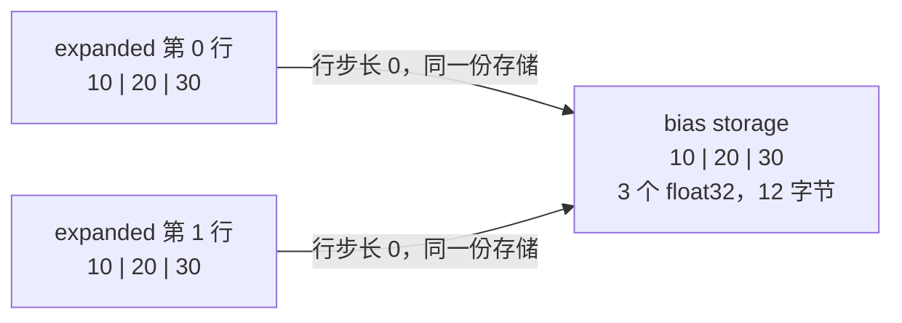
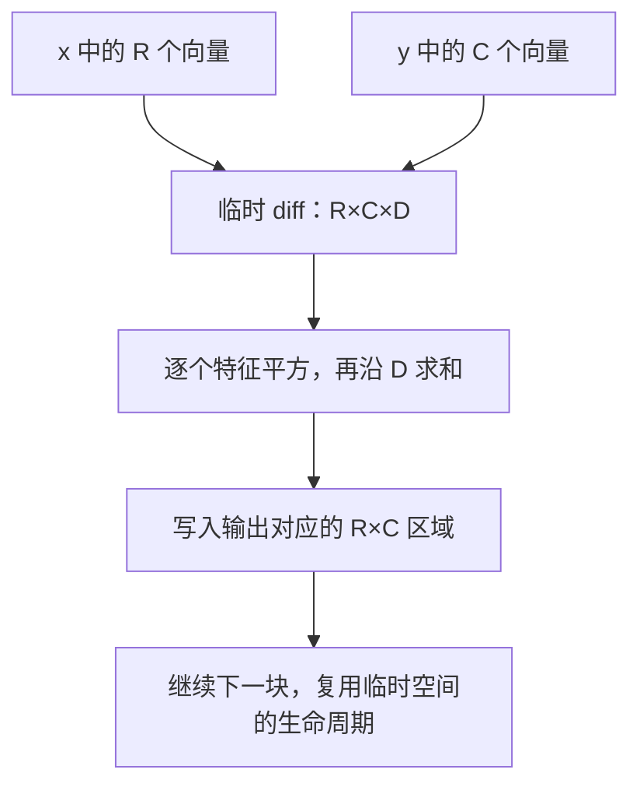

# 广播看似没有复制数据，为什么仍可能增加计算或访存？

有两条样本，每条样本有 3 个特征。现在给每条样本的三个特征分别加上 `10、20、30`：

```python
import torch

x = torch.tensor([[0., 1., 2.], [3., 4., 5.]])
bias = torch.tensor([10., 20., 30.])
y = x + bias
# tensor([[10., 21., 32.],
#         [13., 24., 35.]])
```

我们只写了一份 `bias`，它却被用到了两行。这种让尺寸较小的输入参与较大形状运算的规则，就叫**广播（broadcasting）**。

先记住一个区别：广播可以省掉“先复制出多份 bias”这一步，但 `y` 的 6 个数仍要计算，也仍要保存。本文沿着“尺寸怎样对齐 → 同一个数怎样反复读取 → 输出与临时结果有多大 → 怎样控制成本”逐步展开。

前置阅读：[第 01 篇：shape、stride 与连续性](../2026-10-22-tensor-shape-stride-contiguity/README.md)。不熟悉 stride 时，先理解它是“索引走一步，存储位置移动几格”即可。完整练习见 [code/README.md](code/README.md)。

## 1. 先不想内存：三个数应该加到哪里？

### 1.1 为什么 `(2,3)` 可以加 `(3,)`？

把 `x` 的 shape 写在上面，`bias` 写在下面，并从右侧对齐：

```text
x       (2, 3)
bias       (3)   ← 右边的 3 对齐
```

最右侧都代表三个特征。缺失的左侧维度先按长度 `1` 理解，于是可以把 bias 想成一行：

```text
x       (2, 3)
bias    (1, 3)
结果    (2, 3)
```

长度为 `1` 表示“这一维只有一份，其他位置都用它”。于是第一行用 `bias[0:3]`，第二行也用同一组值。这里只是在说明对应关系，还没有要求框架真的复制一行。

### 1.2 广播规则能否只记“补齐形状”四个字？

还要检查每一对尺寸。从最后一轴向前看，一对尺寸满足以下任一条件才兼容：相同，或其中一个为 `1`；缺失的前导轴视为 `1`。这是 [PyTorch 的广播规则](https://docs.pytorch.org/docs/2.14/notes/broadcasting.html)。

```text
(5, 1, 4)
(   3, 1)
---------
(5, 3, 4)
```

从右向左：`4` 与 `1` 得到 `4`，`1` 与 `3` 得到 `3`，`5` 与缺失的 `1` 得到 `5`。每一轴单独判断，才不会被总元素数误导。

**那 `(2,3)` 加 `(2,)`，是不是给每一行加一个数？** 框架会把右侧的 `3` 和 `2` 对齐，它们不同且都不为 `1`，所以报错。我们想表达行方向，就要明确留出列方向：

```python
row_bias = torch.tensor([100., 200.])
y = x + row_bias[:, None]  # (2,1)，每一行复用自己的那个数
```

`None` 在这里插入一条长度为 `1` 的轴。shape 决定广播对齐，变量叫 `row_bias` 并不能告诉框架你的意图。

### 1.3 先认识两个边界，再去看实现

标量 shape 是 `()`，相当于所有位置都用同一个数，`x + 1` 就是最熟悉的广播。长度为 `0` 的轴表示没有元素：`(0,3)` 与 `(1,3)` 的结果为 `(0,3)`。

这也是为什么“每轴取最大值”不是完整规则：`0` 和 `1` 应得到 `0`，而非 `1`。先判断是否为 `1`，再决定沿用另一方尺寸，才能同时处理空 Tensor。后面的第一道题会验收这个细节。

## 2. 只有 3 个数，怎样表现得像 6 个数？

### 2.1 从熟悉的 stride 开始

显式调用 `expand`，可以把广播所需的视图单独拿出来看：

```python
expanded = bias.expand(2, 3)
print(expanded.shape)   # torch.Size([2, 3])
print(expanded.stride())  # (0, 1)
```

列方向的步长是 `1`，这和一维 bias 相同。行方向的步长为什么变成 `0`？因为换一行时，仍然读取原来的同一组数。

```text
expanded[0,0] → bias 的存储位置 0
expanded[1,0] → bias 的存储位置 0
expanded[0,1] → bias 的存储位置 1
expanded[1,1] → bias 的存储位置 1
```

代入上一篇的地址公式，`行索引×0 + 列索引×1`，就得到这种重复读取。**零 stride 是“同一地址被多个逻辑位置引用”的一种表达方式。** 官方 [`expand` 文档](https://docs.pytorch.org/docs/2.14/generated/torch.Tensor.expand.html) 也明确说明了这条路径。



图中的两行表示两组逻辑坐标，箭头指向同一份数据。Mermaid 图源就在正文中，可以随 Markdown 一起修改。

### 2.2 `numel()` 变大，storage 也变大了吗？

对当前非空、普通 CPU float32 例子：

```python
expanded.numel()                  # 6：逻辑上有 6 个位置
expanded.untyped_storage().nbytes()  # 12：仍只保存 3 个数
```

于是我们要分开两个问题：**能用多少个逻辑坐标访问，以及底层实际存了多少个数。** 后者在这个 `expand` 里没增加。这里读取 storage 字节数只是观察本例，不是通用显存峰值测量。

### 2.3 这些位置可以随便写入吗？

如果给 `expanded` 的两行分别写入不同的值，它们可能都在写同一格。PyTorch 对很多这种重叠批量写入会拒绝执行，例如本篇实际验收的 `expanded.add_(1)` 会报错。

这不应被记成“所有写操作都必定报错”。准确的使用约定是：把扩展视图用于读取；需要独立可写的数据时先 `clone()`，并确认原地修改是否符合梯度计算的规则。[`expand` 的重叠写入说明](https://docs.pytorch.org/docs/2.14/generated/torch.Tensor.expand.html)

## 3. 已经没有复制，为什么运算仍有成本？

### 3.1 `expand` 便宜，不代表 `x + bias` 没有工作

想象一张账单：把价格表挂在墙上一次，可以让很多人共用；每张订单仍要逐项算钱。这里的 bias 是价格表，输出的每个位置才是实际要算的订单项。

在 2 行、3 列的例子中，`x + bias` 仍需要完成 6 次加法，并写出 6 个 float32 结果。只要输出要完整保留下来，就有 24 字节的输出载荷。

若扩大为 `[B,S,H]` 的特征加 `[H]` 的 bias，这个逐元素加法要产生 `B×S×H` 个结果。“广播没复制 bias”并不会把结果数量降为 `H`。B 表示样本数，S 表示每条样本的位置数，H 表示每个位置的特征数；这些符号只是尺寸的简写。

### 3.2 “读了同一个数多次”和“从显存搬了多次”是一回事吗？

不是同一个计数口径。我们可以数出逻辑上用了 6 次 bias 元素，但真实硬件有寄存器、缓存和访存事务，相邻工作也可能复用数据。不能据逻辑复用次数直接声称发生了同样次数的 HBM（GPU 高带宽显存）读取。

对小例子，假设每份不同输入只从目标内存层读入一次，最小载荷是 `x 的 24 + bias 的 12 + 输出的 24 = 60` 字节。如果每次加法都单独从该层读取两个操作数，则是 `6×(4+4+4)=72` 字节。它们是不同假设下的模型，**都不是本篇实测流量**。第 04 篇会继续说明怎样把这样的字节模型放进带宽分析。

### 3.3 `repeat` 又做了什么？

```python
copied = bias.repeat(2, 1)
```

这会真的保存两份数据，本例的新 storage 为 24 字节。它与 `expand(2,3)` 的坐标值相同，分配行为却不同；[`repeat` 文档](https://docs.pytorch.org/docs/2.14/generated/torch.Tensor.repeat.html) 明确区分了复制。

| 这一步 | 本例是否保存完整 2×3 数据？ | 它的任务 |
| --- | --- | --- |
| `bias.expand(2,3)` | 否，复用原有 3 个数 | 建立扩展视图 |
| `bias.repeat(2,1)` | 是，新副本 | 真正重复保存输入 |
| `x + bias` | 是，创建计算结果 | 计算并保存输出 |

日常加 bias 时直接 `x + bias` 即可。先 `repeat` 通常只会额外创建一个输入副本；是否有特定布局或后续复用收益，需要结合具体消费者验证。

## 4. 真正容易 OOM 的，是哪一个中间结果？

现在换一个真实任务：有 N 个向量和 M 个向量，每个向量有 D 个特征，想计算任意两者的平方欧氏距离。欧氏距离可以理解为各特征差的平方相加；这里先不取平方根。

```python
# x: [N,D]，y: [M,D]
diff = x[:, None, :] - y[None, :, :]  # [N,M,D]
distance = diff.square().sum(dim=-1)  # [N,M]
```

`x[:,None,:]` 只是 `[N,1,D]` 视图，`y[None,:,:]` 只是 `[1,M,D]` 视图。**减法却要为每一对向量的每个特征生成一个差值**，于是结果是 `[N,M,D]`。

令 `N=M=4096，D=128`，输入为 float32：

```text
一份输入：4096×128×4 = 2 MiB
两份输入合计：4 MiB
diff：4096×4096×128×4 = 8 GiB
最终 distance：4096×4096×4 = 64 MiB
```

数字是载荷推算，本篇没有分配这块 8 GiB 数据。朴素 eager 表达式还可能为 `diff.square()` 保存另一块同等大小的结果；不能把其中一块的大小当成总峰值。训练时 autograd 保存的中间量也会改变生命周期。

### 4.1 既然最后只要二维结果，能否分小块算？

把 N 和 M 两条轴都切成小块。每次只计算 `[R,C,D]` 的差值，把归约后的 `[R,C]` 写入最终矩阵，再处理下一块。归约（reduction）在这里就是沿特征轴把 D 个平方值加成一个数。



例如 `R=C=64，D=128`，单个差值块载荷是 `64×64×128×4=2 MiB`。参考实现只在新建的 diff 上原地平方，再归约，避免再建一个完整的平方块；写回后释放这块 diff 的 Python 引用，再创建下一块。归约还会生成至多 `R×C` 的小结果，`D=0` 时这部分仍存在。输出仍需要 64 MiB；分块没有让完整输出免费消失。

这是本篇的**推理用教学实现**，用 `torch.inference_mode()` 明确声明推理专用并关闭正向、反向自动微分记录。不能直接照搬“每算完一块就不会保留中间量”的结论到训练图里。循环次数、分配器行为、归约工作区也会影响实际峰值，因此我们只承诺中间 Tensor 的逻辑尺寸受块大小约束，不宣称实测 RSS／显存峰值等于 2 MiB。

### 4.2 还有不构造三维差值的公式吗？

有。展开平方可以得到：

$$
\|x_i-y_j\|^2 = \sum_d x_{i,d}^2 + \sum_d y_{j,d}^2 - 2\sum_d x_{i,d}y_{j,d}
$$

最后一项可以用矩阵乘法计算，避免 `[N,M,D]` 中间量，并复用优化过的 GEMM。但当两个向量很接近、模长却很大时，几个大数相减可能丢失有效数字，甚至得到小负数。`clamp_min(0)` 可以去掉负值，无法恢复已经丢掉的距离信息。

本篇第二题选择分块直接相减，保持推导直观；它不声称比 GEMM 路径更快。第 03 篇先补浮点误差，第 07 篇再讲矩阵乘法为什么能高效复用数据。

## 5. 广播后的梯度为什么要相加？

训练中的“梯度”先理解为：最终损失对某个输入数的微小变化有多敏感。假设损失就是输出所有数的和：

```python
bias = torch.tensor([10., 20., 30.], requires_grad=True)
loss = (x + bias).sum()
loss.backward()
print(bias.grad)  # tensor([2., 2., 2.])
```

为什么不是 `[1,1,1]`？以第一个 bias 为例，它在第 1 行贡献一次，在第 2 行又贡献一次。把它增加一点，会同时使两行的结果增大；总影响就要把两处贡献加起来。

更一般地，若 `y[i,j]=x[i,j]+bias[j]`，每个 `bias[j]` 对应多行，则：

$$
\frac{\partial L}{\partial bias_j}=\sum_i\frac{\partial L}{\partial y_{i,j}}
$$

这解释了“前向重复读取，反向沿复用的轴归约”的关系。归约不是把独立参数弄丢，而是在汇总同一个参数在多处使用时的影响。[本地 `_sum_to` 源码](evidence/upstream/aten/src/ATen/ExpandUtils.h) 可以看到与目标尺寸相应的归约轴选择。

## 6. PyTorch 的代码怎样落实这些直觉？

本篇实际获取官方 `main` 文件，固定 commit 为 [`e149fba40596a8181f44e1f318da5fa10d609118`](https://github.com/pytorch/pytorch/tree/e149fba40596a8181f44e1f318da5fa10d609118)。这比第 01 篇快照晚，是本次重新核验的结果。运行仍是本机 PyTorch 2.9.1 CPU；本节是新主分支的静态分析，不是执行该主分支。

### 6.1 谁判断两个 shape 是否能一起算？

[ExpandUtils.cpp 的 `infer_size_impl`](https://github.com/pytorch/pytorch/blob/e149fba40596a8181f44e1f318da5fa10d609118/aten/src/ATen/ExpandUtils.cpp#L17-L45) 从末尾向前对齐两边，缺失维度视为 `1`；检查相等／为 `1` 后，选择结果尺寸。源码注释专门说明 `1` 对应另一方尺寸，另一方可以是 `0`。它对应第 1 节手工对齐 shape 的过程。

### 6.2 `expand` 在哪里把行步长设成零？

[`inferExpandGeometryImpl`](https://github.com/pytorch/pytorch/blob/e149fba40596a8181f44e1f318da5fa10d609118/aten/src/ATen/ExpandUtils.cpp#L65-L116) 检查原轴是否为 `1`，扩展时设置：

```cpp
size = targetSize;
stride = 0;
```

[`TensorShape.cpp::expand`](https://github.com/pytorch/pytorch/blob/e149fba40596a8181f44e1f318da5fa10d609118/aten/src/ATen/native/TensorShape.cpp#L1265-L1301) 随后把推导的 size／stride 交给 `as_strided` 建立视图。这两行描述的是元信息，没有遍历输出位置并复制 bias。

### 6.3 `x + bias` 是先创建了一个 `expand` Tensor 吗？

不必把显式教学步骤当成每个算子的真实调用序列。常见逐元素实现会使用 TensorIterator（为不同输入统一形状和迭代方式的工具）。它的 [`compute_shape` 与 `compute_strides`](https://github.com/pytorch/pytorch/blob/e149fba40596a8181f44e1f318da5fa10d609118/aten/src/ATen/TensorIterator.cpp#L1194-L1265) 可以直接计算广播 shape，并为需要复用的输入轴设置零字节步长。

这里源码的 `stride_bytes` **以字节为单位**，不同于 Python `stride()` 的元素单位。随后输出分配、轴重排、合并和具体 kernel 都有自己的路径。普通 `x+bias` 不要求在 Python 中先写 `expand`，编译路径还可能把加法融合进其他计算；不能假定所有 backend 都逐句使用同一条 eager 路径。

### 6.4 反向怎么“沿复用轴加回来”？

[ExpandUtils.h 的 `_sum_to`](https://github.com/pytorch/pytorch/blob/e149fba40596a8181f44e1f318da5fa10d609118/aten/src/ATen/ExpandUtils.h#L462-L503) 会把多出来的前导维度，以及目标尺寸为 `1`、当前不为 `1` 的维度加入归约列表，再执行求和并恢复目标 shape。这与第 5 节的推导相符。

这里说明形状恢复工具的机制；没有逐条追踪完整 autograd 生成代码。梯度行为另有本机真实验收，不把一个辅助函数概括成全部反向引擎。

## 7. 动手练习：先猜形状，再控制临时张量

### 练习一：不用 PyTorch 推断广播 shape

实现 `broadcast_shape(left,right)`，输入是两个非负整数尺寸序列，返回结果元组，不兼容则抛 `ValueError`。标量用 `()` 表示，必须处理空维度。

先自己计算以下结果，再写函数：`(2,3)+(3,)`、`(5,1,4)+(3,1)`、`(0,3)+(1,3)`；证明为什么 `(2,3)+(2,)` 不兼容。不得调用 `torch.broadcast_shapes` 完成实现，它只用作测试中的对照。

<details>
<summary>详解一：补齐前导 1，再逐轴判断</summary>

1. 取两边较大的 rank，在短的一边前面补 `1`。
2. 每轴先检查相等；不等时若左边为 `1` 取右边，若右边为 `1` 取左边，否则报错。
3. 返回所有结果尺寸。不能统一 `max(a,b)`，因为 `0` 与 `1` 的结果应是 `0`。

三组结果依次为 `(2,3)`、`(5,3,4)`、`(0,3)`。标量与标量输出 `()`；负尺寸、布尔值与非整数不属于本题支持的具体 shape。

完整实现：[answers.py 的 `broadcast_shape`](code/answers.py)。验收：[test_answers.py 的 `ShapeTests`](code/test_answers.py)，包含与 PyTorch 的有界对照。

</details>

### 练习二：分块计算所有平方距离

实现推理函数 `pairwise_sqdist(x,y,block_rows,block_cols)`：输入为同设备、同 dtype 的普通二维 float32／float64 Tensor，shape 分别为 `[N,D]` 和 `[M,D]`。返回 `[N,M]`，但每次差值中间量最多为 `[block_rows,block_cols,D]`。

允许保存完整二维输出；不允许一次建立完整三维差值；暂不使用上节的 GEMM 公式。尾部块不足时也要正确，允许非连续输入、零样本与 `D=0`。本题明确不提供可训练的梯度实现。

<details>
<summary>详解二：改变计算顺序，保留每对向量的定义</summary>

```python
for row in range(0, N, block_rows):
    for col in range(0, M, block_cols):
        diff = x[row:row+block_rows, None, :] - y[None, col:col+block_cols, :]
        diff.square_()
        out[row:row+block_rows, col:col+block_cols] = diff.sum(dim=-1)
```

完整实现使用 `@torch.inference_mode()`，校验形状、dtype、device 和块大小。`square_()` 只修改新建的临时差值，输入不会被改写。Python 切片会自动截断最后一块，`D=0` 时空特征的求和是零；N 或 M 为零时输出为空。

用固定随机种子、`N=7,M=5,D=4` 和 `3×2` 的块与小规模完整广播结果比较；再验证相同向量距离为零，以及非法输入明确报错。题目测试只分配小张量，不尝试复现 8 GiB OOM。

完整答案：[answers.py 的 `pairwise_sqdist`](code/answers.py)；验收：[DistanceTests](code/test_answers.py)。分块次数越多，Python 和算子启动成本越多；是否更快需要设备实测。本篇只验证值和 Tensor 形状边界。

</details>

## 8. 面试官继续追问

| 追问 | 先怎样想？ | 回答要点 |
| --- | --- | --- |
| `(2,3)+(2,)` 为什么不能给每行加一个数？ | 广播从哪一边对齐？ | 从末尾对齐，3 与 2 不兼容；每行一个数要显式变成 `(2,1)`。 |
| `expand` 的 stride 为 `(0,1)` 是什么意思？ | 两行第一列落在哪个位置？ | 都落在原 storage 同一位置，行索引不贡献地址偏移。 |
| 没复制输入，为何仍然 OOM？ | 哪个表达式生成了新结果？ | 输出和中间量仍按广播结果尺寸物化，例如 `[N,M,D]` 差值。 |
| 能把逻辑读取数当作 HBM 读取数吗？ | 数的是哪一层？ | 有缓存、寄存器复用和事务粒度，须说明模型并用对应设备计数器验证。 |
| 为什么 bias 梯度会跨行求和？ | 同一个参数在哪些位置使用？ | 汇总它影响到的全部输出的梯度贡献。 |
| 分块是否解决全部容量问题？ | 最终需要保留什么？ | 控制临时量，完整 `[N,M]` 输出仍存在；训练中还要分析 autograd 生命周期。 |
| 工程排障先查什么？ | 逐步写出各表达式 shape。 | 检查 expand／repeat、广播后的减法与逐元素中间量，再看 profiler 和实际分配。 |

## 9. 运行、证据与下一步

在 [code/](code/) 目录运行：

```bash
python3 -m unittest discover -s . -p 'test_*.py' -v
python3 run_lab.py
```

本篇的源码、许可证、阅读笔记和测试记录随文保留。验证范围是 PyTorch 2.9.1 CPU；没有 CUDA 执行、设备流量计数或性能比较。源码和文档以本次获取版本为准，不用旧 runtime 推断当前主分支的完整行为。

广播的 shape 与零 stride 是基础语义，不涉及独立论文算法，因此以官方文档和实现作为主要依据。平方距离的公式是逐项展开的代数恒等式，CPU 分块只是按输出区域拆解它，并非声称复现某篇 GPU 算法。

下一篇先补一个优化无法绕过的问题：同样的计算，换成 FP32、BF16 或 FP16，为什么可能得到不同结果？

[资料与源码笔记](references.md) · [审查与验证](review.md) · [返回索引](../../../index.md)
