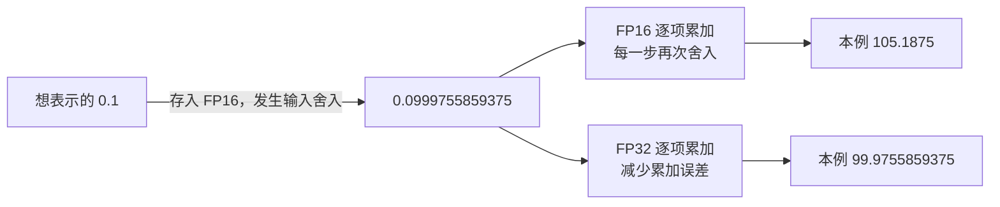

# 同一个计算，为什么 FP32、BF16、FP16 的结果不同？

先只存一个数，不做矩阵乘法，也不训练模型：

```python
import torch

x = torch.tensor([1.001], dtype=torch.float64)
print(x.to(torch.float16).to(torch.float64))
print(x.to(torch.bfloat16).to(torch.float64))
```

把存进去的值读回高精度后，本机得到：

```text
FP16：1.0009765625
BF16：1.0
```

明明写的是 `1.001`，为什么存进去就变了？这会带出三个不同的问题：**能存多大的数，刻度有多细，以及计算时在哪一步舍入。** 先把它们分清，再谈混合精度，才不会把“都占 16 位”误认为“误差一样”。

本篇从一把刻度有限的尺子讲起，逐步解释训练中为什么保留高精度累加、为什么要做数值验收。前置：[广播与中间量](../2026-10-22-broadcasting-cost/README.md)；运行入口：[code/README.md](code/README.md)。

## 1. 计算机为什么不能把每个数都原样存下？

### 1.1 先想一把只有有限刻度的尺子

假设一把尺子只标出 `1.00、1.01、1.02`。你想记下 `1.001`，却没有对应的刻度，只能选择一个邻近值。这一步就叫**舍入**。

计算机的存储格数同样有限。一个 float32 元素用 32 个二进制位记录；每一位只能是 `0` 或 `1`，所以它能记录的状态总数有限，无法精确包含无限多个实数。

十进制中的某个简单小数，换成二进制也可能无限展开。例如 `0.1` 就不能用有限二进制小数精确写出。更多位通常能让表示值更靠近原值，但仍不等于能够表达所有实数。

### 1.2 固定小数点与浮动小数点，有什么区别？

如果只按固定间隔刻画所有数，范围和精细程度很难兼顾。浮点数借用了科学记数法的思路：用“一段有效数字 × 一个尺度”表示数值。

十进制例子 `1.25×10³` 等于 `1250`。二进制浮点数用的是 `2` 的幂：有效数字决定这一档刻度有多细，指数决定数值位于多大的量级。

因此浮点数的刻度并非全程等距：数值量级增大时，相邻可表示数的间隔也会变大。**能表示很大的数，与能分辨这个大数旁边非常小的变化，是两种能力。**

## 2. 32 位和 16 位，究竟把位置分给了谁？

### 2.1 先认识符号、指数和小数三部分

对常见有限正规数，三部分可以这样理解：

```text
符号位：正还是负？
指数位：大致在什么量级？
小数位：在这个量级内，具体落在哪个刻度？
```

“正规数”是使用普通指数编码方式的一类数；零、非常小的次正规数、无穷大和 NaN 有额外约定，后面再解释，不必先背全部编码。

| 格式 | 总位数 | 符号位 | 指数位 | 存储的小数位 | 在 1 附近向上的一个刻度 |
| --- | --- | --- | --- | --- | --- |
| FP32 | 32 | 1 | 8 | 23 | `2^-23 ≈ 0.0000001192` |
| FP16 | 16 | 1 | 5 | 10 | `2^-10 = 0.0009765625` |
| BF16 | 16 | 1 | 8 | 7 | `2^-7 = 0.0078125` |

正规数还有一个不必显式保存的前导 `1`，所以有效二进制位数分别为 `24、11、8`。这也是源码 `numeric_limits::digits` 与表中“小数位”相差 1 的原因。[NVIDIA 浮点格式说明](https://docs.nvidia.com/cuda/floating-point/index.html#formats)、[PyTorch 的 Half／BFloat16 定义](references.md)

### 2.2 现在能解释开头的 `1.001` 了吗？

FP16 在 `1` 附近的下一格是 `1.0009765625`，很接近 `1.001`。BF16 的下一格却是 `1.0078125`，因此 `1.001` 更接近 `1.0`。

```text
FP16：1.0 -- 1.0009765625 -- 1.001953125 -- ...
                   ↑ 1.001 舍入到这里

BF16：1.0 ---------------- 1.0078125 -------- ...
       ↑ 1.001 更靠近这里
```

这不是 BF16 “计算出错了”，而是它把更多位分给了指数，留下的小数位更少。它在数值范围与局部精细程度之间作了另一种选择。

### 2.3 想把刻度推导出来，可以再看一层

对有限正规数，可用下面的式子理解编码：

$$
(-1)^s\times\left(1+\frac{f}{2^p}\right)\times2^{E-b}
$$

s 是符号位，f 是小数部分编码的整数，p 是小数位数，E 是指数编码，b 是指数偏置。先固定在 `1` 这一档，指数对应 `2⁰`。f 增加 1，数值就增加 `2^-p`，于是得到表中的三个刻度。

`torch.finfo(dtype).eps` 表示 `1` 与下一个更大可表示值的间隔，不能把它当作“任意量级上的固定误差”。单位量级变化，刻度也会变化。

## 3. 为什么 FP16 会变成 inf，BF16 却还能存？

### 3.1 范围问题：70000 放得下吗？

```python
values = torch.tensor([70000.], dtype=torch.float64)
values.to(torch.float16)   # inf
values.to(torch.bfloat16) # 读取实际值为 70144
```

FP16 最大有限值是 `65504`；这个输入超出范围，转换后成为正无穷大 `inf`。BF16 的最大有限值约为 `3.39×10³⁸`，所以仍可表示接近 `70000` 的一个有限值，但会舍入到 `70144`。

于是两个问题要分别问：**有没有越界，以及虽然没越界，数值是否足够精细。** BF16 避免这次溢出，并不意味着它更接近 `70000` 的每一位数字。

### 3.2 很小的数，又会怎样？

本机将 `1e-8` 转为 FP16 时得到 `0`，转为 BF16 时仍得到一个接近原值的非零数。一个非零小值被舍入或冲掉而失去信息，属于我们要关注的下溢问题。

```python
torch.finfo(torch.float16).tiny  # 约 6.10e-5
```

这里 `tiny` 是**最小正正规数**，不是最小正可表示数。FP16 还存在更小的次正规数，最小正次正规值为 `2^-24`。具体值怎样舍入，以及某条设备指令是否把次正规值冲为零，要分别核验。本文只报告已运行的 CPU 转换，不从中推出全部 GPU 行为。

| 格式 | 最大有限值（约） | 最小正正规数（约） |
| --- | --- | --- |
| FP32 | `3.4028e38` | `1.1755e-38` |
| FP16 | `65504` | `6.1035e-5` |
| BF16 | `3.3895e38` | `1.1755e-38` |

这些数可直接用 `torch.finfo` 获取并由本篇诊断记录复核。第一次阅读先记住：BF16 的指数范围接近 FP32，但小数刻度更粗。

### 3.3 NaN 和 inf 应该怎样看？

`inf` 是无穷大，`NaN` 是“不是一个可用数值”的特殊值，例如某些无定义运算会产生它。数值检查时先用 `torch.isfinite` 分清是否有限，再讨论误差大小。

两个结果都出现 NaN，并不能证明优化正确。本篇的练习验收采用严格有限值策略：只要某个位置的输入或参考结果不是有限值，就把该位置记为失败。后续遇到 Attention 的 `-inf` 掩码时，要明确区分“算法允许的中间哨兵值”和“期望有限的最终结果”。

## 4. 输入一样，为什么加法顺序仍然影响结果？

### 4.1 一个足够大的数，可以把加上的 1 吞掉

用 FP32 逐步算两条表达式：

```python
big = torch.tensor(1e8, dtype=torch.float32)
one = torch.tensor(1., dtype=torch.float32)

(big + one) - big  # 0
(big - big) + one  # 1
```

第一条先计算 `1e8+1`，但 FP32 在这个量级的刻度分不清这次增加，于是舍入回 `1e8`，再相减就剩 `0`。第二条先把两个大数抵消，再加 `1`，结果可以精确保存。

实数加法中换括号不影响结果；浮点计算中，每一步都可能先舍入，因此不能默认交换顺序后逐位相同。并行归约、不同 GEMM 算法、融合操作，都可能改变实际顺序。[PyTorch 数值准确性说明](https://docs.pytorch.org/docs/2.14/notes/numerical_accuracy.html)

### 4.2 低精度输入、高精度累加，解决了哪一部分？

先准备 1000 个存成 FP16 的 `0.1`，然后按不同方式累加：

```text
理想十进制总和：                     100
已经舍入的 FP16 输入，再用 FP64 求和： 99.9755859375
每加一次就舍入回 FP16：              105.1875
把这些 FP16 输入转为 FP32 再逐项累加： 99.9755859375
```

为什么高精度累加没有回到 `100`？因为每个输入在保存成 FP16 时，已经变成 `0.0999755859375`。累加器只能把这些已经保存的值加好，无法猜回原来的 `0.1`。



本篇用显式 Python 循环控制“每一步的累加 dtype”。**它不是在复现 `torch.sum` 的 kernel**，也不能从这个例子断言原生 FP16 `sum` 总会得到 `105.1875`。库可能使用更高精度的内部累加或不同归约树；输出 dtype 本身不足以说明全部内部算术。

## 5. 工程验收时，到底应该和谁比较？

### 5.1 先确定你想测哪一种误差

想测“输入转换损失了多少”，就要保留转换前的高精度输入作为参考。想测“kernel 是否正确处理了这些低精度输入”，参考实现也应该读取**同一批已经量化的输入**，再用更高精度计算。

上节中，`100` 与 `99.9755859375` 回答前一个问题；`99.9755859375` 与低精度逐项累加结果回答后一个问题。混用这两个参考，可能把输入量化误差误判成 kernel 缺陷。

FP64 通常能提供更好的参考精度，但它仍是有限精度。是否可信还取决于公式是否稳定、输入条件和参考实现本身；不能因为写了 `.double()` 就省略分析。

### 5.2 为什么既需要绝对误差，也需要相对误差？

如果参考值为 `1000`，相差 `1` 是千分之一；如果参考值为 `0`，相差 `0.001` 却没有有意义的“除以参考值”的比例。所以常用逐元素条件：

$$
|\text{actual}-\text{reference}|
\le \text{atol}+\text{rtol}\,|\text{reference}|
$$

`atol` 给接近零的数留出绝对误差尺度；`rtol` 控制相对参考值大小的误差。阈值需要来自模型或算子的正确性要求，不能为了让某次结果通过而临时放宽。

报告最大绝对误差可以定位最差位置；相对 L2（整体误差向量的长度除以参考向量的长度）可描述总体差异，但不能代替逐元素验收：很多好位置可能掩盖一个坏位置。本篇同时返回失败位置数。

## 6. 混合精度训练怎样利用这些知识？

现在回到训练：一个模型先产生输出和损失，再反向计算参数的梯度，最后用梯度更新参数。低精度可以减少数据载荷，并利用适合的硬件计算路径；数值敏感部分则保留更高精度。

原始 [Mixed Precision Training](https://arxiv.org/abs/1710.03740) 的第 3 节讨论了三个配合使用的办法：高精度权重更新副本、loss scaling，以及低精度输入配合 FP32 累加。它们分别针对更新丢失、小梯度下溢和累加误差；论文实验结果属于其模型与硬件条件，不能直接变成当前模型的收益承诺。

### 6.1 为什么更新参数时仍可能需要 FP32？

假设一个参数已经比较大，而本轮更新非常小。在低精度刻度上，加上更新后可能仍落回原刻度，相当于白做了这次更新。用 FP32 保存与更新参数，可以更细地积累这些变化，再提供低精度计算所需的表示。

现代 AMP（自动混合精度）也经常保留 FP32 参数，让选定算子以其他 dtype 运行；具体参数、优化器状态与中间量怎样保存取决于框架和训练配置。不要把论文中的 master copy 图机械理解为“每个 AMP 方案都自动额外复制一套所有参数”。[官方 AMP 文档](https://docs.pytorch.org/docs/2.14/amp.html)

### 6.2 loss scaling 为什么能帮助小梯度？

先把损失乘以一个尺度 S，再反向计算。按求导的链式法则，这些梯度也会乘 S；在更新前再除以 S，恢复应有的大小。把小值暂时抬高，可以让它经过低精度步骤时少一些变成零的风险。


S 太大会引起溢出，所以当前 GradScaler 还要检查非有限梯度，决定是否跳过更新，并调整尺度。已经在更早的前向计算中产生的错误或 inf，不能靠末尾乘一个 S 修好。缩放与梯度裁剪的顺序也有要求，须按框架 API 的约定使用。

BF16 的范围较大，许多训练配置不需要同样的 FP16 缩放方案；是否使用仍由实际数值与框架路径决定。不能只看两种格式都是 16 位就共用所有配置。

## 7. 在当前源码里，找到三种不同的工作

本次静态分析固定到 PyTorch `main` 的 [`e149fba40596a8181f44e1f318da5fa10d609118`](https://github.com/pytorch/pytorch/tree/e149fba40596a8181f44e1f318da5fa10d609118)。相关文件、获取命令与校验和随文保存；本机实际执行的是 2.9.1 CPU，没有构建这个主分支。

**第一种工作：描述格式。** 以前常见的 `c10/util/Half.h` 和 `BFloat16.h` 在本次源码里主要转向 `torch/headeronly/util/`。真正的 [Half 定义与范围](https://github.com/pytorch/pytorch/blob/e149fba40596a8181f44e1f318da5fa10d609118/torch/headeronly/util/Half.h#L730-L788) 和 [BFloat16 定义与范围](https://github.com/pytorch/pytorch/blob/e149fba40596a8181f44e1f318da5fa10d609118/torch/headeronly/util/BFloat16.h#L425-L475) 给出有效位数、最大值、最小正规数和 epsilon。不要只看文件名就以为已经找到实现。

**第二种工作：把一个值转到另一种格式。** [BFloat16 的 `round_to_nearest_even`](https://github.com/pytorch/pytorch/blob/e149fba40596a8181f44e1f318da5fa10d609118/torch/headeronly/util/BFloat16.h#L100-L139) 在通用路径加上与保留位有关的 rounding bias，再舍去低位。它说明转换涉及舍入，并非单纯无条件截掉低位。GPU／SYCL 等条件分支还可能使用平台转换指令，不能把通用 C++ 分支说成所有设备的实际执行路径。

**第三种工作：管理缩放过程。** [GradScaler 的 `scale`、`unscale_`、`step` 与 `update`](https://github.com/pytorch/pytorch/blob/e149fba40596a8181f44e1f318da5fa10d609118/torch/amp/grad_scaler.py) 分别处理放大输出、还原梯度、检查后更新参数以及调整尺度。它是训练策略的一部分，不会改写 FP16 的编码或让每个算子自动变成 FP32 累加。

最后，Tensor 标记为 FP32 也不足以保证 GPU 所有乘法都使用完整 FP32 输入精度，例如某些配置会选 TF32 等计算路径。这需要结合硬件、算子、库与设置核验，留到第 08 篇继续讨论；本篇不报告没有执行的 CUDA 路径。[数值准确性源码文档](evidence/upstream/docs/source/notes/numerical_accuracy.md)

## 8. 代码练习与详解

### 练习一：把“输入舍入”与“累加舍入”分开

实现 `roundtrip(values,dtype)`：先以 float64 接收一维数列，转换成目标浮点格式，再回到 float64 观察实际保存的值。再实现 `sequential_sum(values,accumulator_dtype)`，用显式循环使每步加法都使用指定累加格式。

验收 `1.001、70000、1e-8` 的转换；再用 1000 个 FP16 `0.1` 比较 FP16／FP32 逐项累加。参考总和必须来自**同一批 FP16 输入转成 float64 后**的求和。输入为空时总和为零，非法 dtype 或非一维累加输入明确报错。

<details>
<summary>详解一：先观察存进去的值，再改变累加器</summary>

`roundtrip` 的核心是 `torch.tensor(values,dtype=torch.float64).to(dtype).to(torch.float64)`。最后一次转回高精度只是便于读数，不能恢复已经丢掉的小数位。

累加器从目标 dtype 的标量零开始，每个输入先转换到累加 dtype，再与累加器相加。这样控制的是这份教学实现的每步舍入，不推断原生归约 kernel 的策略。上节列出的四个总和均由实际运行产生。

完整实现：[answers.py](code/answers.py)；验收：[FormatTests](code/test_answers.py)。不能用“与十进制 100 不相等”单独证明高精度累加器有问题，因为量化后的输入之和本来就不是 100。

</details>

### 练习二：写一个不会被平均数掩盖的验收报告

实现 `compare_finite(actual,reference,atol,rtol)`：输入为同 shape 的普通实数 CPU Tensor，按第 5 节逐元素不等式计失败数，同时返回非有限位置数、最大绝对误差和相对 L2。任何非有限输入位置都失败；空输入通过；参考全零而误差非零时相对 L2 定义为 inf，验收仍由 atol／rtol 决定。

至少验证：接近零时 atol 的作用、较大参考值时 rtol 的作用、一个坏位置不能被掩盖、匹配的 NaN／inf 也失败、非法阈值与形状明确报错。

<details>
<summary>详解二：把通过条件与描述性指标分开</summary>

主干只有三步：先检查有限性，再逐个比较 `abs(actual-reference)` 与阈值，最后汇总描述性指标。相对 L2 是 `sqrt(sum(error²)/sum(reference²))`，它不是逐元素通过条件。

为了让**小规模验收参考本身**避免浮点溢出与边界舍入误判，完整答案将存储值和阈值转成标准库 `Fraction`（整数之比），精确判定不等式；相对 L2 的平方和也先精确计算，再用明确的 80 位 Decimal 上下文开方。它是慢速 CPU 参考，不是给大 Tensor 做吞吐测试的工具。常见生产检查可以用高精度向量化实现，但也要明确容差边界和非有限值策略。

这些额外处理属于参考答案的进阶部分。第一次做题先理解逐元素条件即可；想研究验收器的数值稳健性，再看完整实现与修复前回归记录。

完整答案：[answers.py 的 `compare_finite`](code/answers.py)；验收：[ComparisonTests](code/test_answers.py)。验收报告的最大误差转为 float 后可能因范围不足显示 inf；输入有限性与精确的失败计数仍分别记录，不把显示指标当判定逻辑。

</details>

## 9. 面试官继续追问

| 问题 | 回答时先抓住什么？ |
| --- | --- |
| FP16 和 BF16 同为 16 位，为什么结果不同？ | 指数位与小数位分配不同，分别讨论范围和局部刻度。 |
| BF16 比 FP16 更准吗？ | 不能笼统比较；同量级的精细程度与大范围不溢出是不同目标。 |
| FP16 输入转成 FP32 累加，能恢复输入吗？ | 不能；输入舍入与累加舍入分别记账。 |
| 为什么并行化或融合后不逐位相同？ | 可能改变运算顺序、舍入位置或计算精度；先确认允许误差与实现路径。 |
| FP64 参考应该读原输入还是量化后的输入？ | 取决于要测输入转换误差，还是 kernel 对同一批存储值的计算误差。 |
| loss scaling 能解决前向所有溢出吗？ | 不能；它主要帮助梯度表示，还需检查非有限值与尺度范围。 |
| dtype 为 FP32，就证明没用 Tensor Core 低精度乘法了吗？ | 还需核验硬件指令、库算法与精度配置。 |
| 验收为什么不能只给平均误差？ | 需要逐元素条件、最差误差和非有限策略，避免少量坏位置被掩盖。 |

## 10. 运行与下一步

在 [code/](code/) 目录执行：

```bash
python3 -m unittest discover -s . -p 'test_*.py' -v
python3 run_lab.py
```

全部基础数值与答案均在 PyTorch 2.9.1 CPU 运行。没有 CUDA、Tensor Core、真实 AMP 训练或模型收敛实验；只从源码和原始论文解释它们解决的问题，不宣称本机复现了这些系统结果。

下一篇会把“做多少次运算”和“搬多少数据”放在同一张图里：一个算子究竟受算力还是内存带宽限制？

[资料、源码与论文笔记](references.md) · [审查与运行记录](review.md) · [返回索引](../../../index.md)
