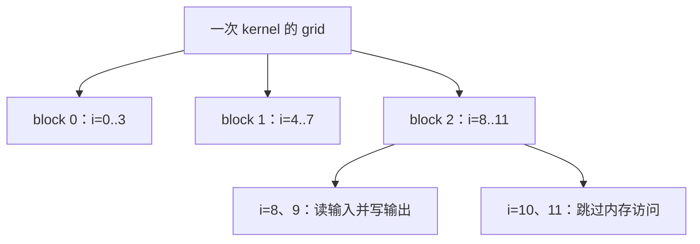

# GPU 如何把一次算子调用分配给线程、warp 和 block？

> 写 GPU 算子，先解决“谁处理哪个元素”，再解决“这些人如何一起访问数据和协作”。thread、warp、block 分别回答不同层次的问题。分清它们，才能理解尾部 mask、合并访存、同步和资源约束。

## 1. 10 个元素，怎样让很多人一起算？

继续做 `z=x+y`。长度是 10，输出位置编号为 `0…9`。

一个 CPU 教学循环通常写成：

```python
for i in range(10):
    z[i] = x[i] + y[i]
```

每次只讲一个位置，很容易理解。但这 10 次计算彼此独立，位置 7 不需要等位置 6 的结果。GPU 编程可以把许多独立位置分配给许多执行实例。

CUDA 把这样的执行实例称为 **thread，线程**。你可以先把线程理解为：运行同一段 kernel 代码、拥有自己编号和局部状态的一个实例。kernel 就是交给 GPU 执行的一段函数。

线程编号不会自动变成数组下标，需要我们写映射规则。今天先学最简单的一维映射：一个线程负责一个元素。

## 2. 为什么线程还要分组？

我们把线程按每组 4 个组织，叫作一个 **thread block，线程块**。4 只是为了让表能一眼数清，不是推荐的性能配置。

每个 block 有自己的编号 `b`，块内线程有编号 `t`，于是全局负责位置为：

\[
i=b\times \text{block_size}+t
\]

| block b | 块内 t | 全局位置 i | 是否真的有元素 |
| --- | --- | --- | --- |
| 0 | 0、1、2、3 | 0、1、2、3 | 全部有 |
| 1 | 0、1、2、3 | 4、5、6、7 | 全部有 |
| 2 | 0、1、2、3 | 8、9、10、11 | 最后两个没有 |

所有 block 合起来构成 **grid，线程块网格**。我们需要 `ceil(10/4)=3` 个 block，总共安排 12 个线程；最后两个线程不能访问数组。

为什么向上取整？向下取整只会得到 2 个 block，位置 8、9 就没人处理。多安排一点，再检查有效范围，是常见做法。



对应 CUDA 的常见写法如下，**这里只解释代码，本机未编译运行 CUDA**：

```cpp
int i = blockIdx.x * blockDim.x + threadIdx.x;
if (i < n) {
    z[i] = x[i] + y[i];
}
```

`blockIdx.x` 是块编号，`blockDim.x` 是块内线程数，`threadIdx.x` 是块内线程编号。检查必须发生在越界读取之前，不能先读再决定是否保存。

## 3. warp 又是哪一级分组？

thread 和 block 是程序组织任务的重要单位。GPU 执行线程时，还会以 **warp** 组织调度和指令执行。对本篇讨论的 NVIDIA CUDA，warp 含 32 个线程。

在一维 block 中，块内线程 `0…31` 属于第一个 warp，`32…63` 属于第二个 warp。每个线程在 warp 内的位置叫 **lane**，编号为 `0…31`。

所以：

```text
warp_in_block = threadIdx.x // 32
lane          = threadIdx.x % 32
```

warp 在各 block 内分别划分，不会把两个 block 的零散线程拼成同一个 warp。例如 block 大小为 33，线程 32 属于本块第二个 warp 的 lane 0；下一个 block 的线程 0 又属于它自己的第一个 warp。

二维或三维 block 要先把块内坐标线性化，x 变化最快，再划分 warp；不能只拿 y 或 z 除以 32。[CUDA SIMT kernel 指南](https://docs.nvidia.com/cuda/cuda-programming-guide/02-basics/writing-cuda-kernels.html)

这里容易产生一个误会：“32 个线程，是不是就有 32 个始终独占的物理小核心？”不是这样对应的。线程是编程实例，warp 是执行分组，物理运算单元还要按指令和硬件配置服务这些工作。不要把线程数直接当成算术单元数。

## 4. 分给谁之后，还要问：他们在读哪里？

回到第 01 篇的 stride。相邻的逻辑位置，不一定对应相邻的存储地址。GPU 也有同一个问题：同一个 warp 的线程，发出一次加载时，地址分布是否集中？

先假设 32 个有效 lane 每人读取一个 FP32，起始地址按 32 字节对齐：

```text
lane：          0   1   2   3  …… 31
连续字节地址：  0   4   8  12  ……124
               └── 0..31 ──┘ …… └96..127┘
               共覆盖 4 个 32 字节扇区
```

这里把对齐的 32 字节区间叫 **sector，扇区**。若 lane 依次读 `0,128,256,…`，同样只需要 128 字节有效数据，却分散在 32 个不同扇区中。

将一次 warp 访存中相邻或集中的请求合并服务，通常叫 **coalescing，合并访存**。CUDA 最佳实践对 compute capability 6.0 及以上、示例中的 4 字节访问，用 32 字节事务解释它：连续对齐访问可由 4 个这样的单位服务，整体错开 4 字节则覆盖 5 个。[官方合并访存说明](https://docs.nvidia.com/cuda/cuda-c-best-practices-guide/index.html#coalesced-access-to-global-memory)

这不是说“每个线程都发一次独立显存事务”，也不是说连续 Tensor 自动保证每条指令都访问连续地址。要把 **lane → 张量坐标 → stride → 字节地址** 连起来看。

例如，行主序矩阵中，相邻 lane 分给同一行的相邻列，通常更容易得到集中地址；相邻 lane 分给同一列的相邻行，地址间隔会乘行 stride。转置、GEMM 和 Attention kernel 的布局选择都与这件事有关。

本篇练习只数地址区间覆盖的扇区，不模拟缓存命中、指令拆分、重放、写事务或实际 HBM 流量。**扇区集合是理解地址分布的模型，不能当成硬件 profiler 的完整事务结果。**

## 5. block 的意义只有给线程编号吗？

还有协作。CUDA block 中的线程可以使用本块的 shared memory，也就是可共同访问的片上存储，并用块级屏障协调阶段。

想象线程分别把一组数据装进 shared memory，接下来每个线程都要读取别人装进来的数据。此时必须保证：读取阶段开始前，生产这些数据的写入已经完成并对协作者可见。

`__syncthreads()` 是常见块级同步手段。简单、安全的教学结构是：

```text
每个线程根据边界决定加载有效值或填补值
所有参与 block 的线程到达同一屏障
再读取协作产生的数据
```

不要因为线程“看起来同时运行”就省略正确同步；也不要让一部分线程进入必须全块一致参与的屏障分支、另一部分活跃线程绕开它。warp 内交换也要使用匹配的同步／shuffle 原语，不能依赖隐含锁步。[CUDA shared memory 与块同步说明](https://docs.nvidia.com/cuda/cuda-programming-guide/02-basics/writing-cuda-kernels.html)

普通 block 之间没有可随意使用的全 grid 屏障。需要跨 block 的生产与消费时，常用下一次 kernel、stream 顺序或专门支持的协作机制表达依赖；本篇不把它们简化成一个 `__syncthreads()`。

## 6. 实际源码：Triton 为什么一次写一段下标？

已经知道 CUDA 一线程一位置，再看另一个常见写法。我们实际获取的 Triton `main` 快照固定为 `c1641abbb17a80b8c9cad1fa05b4c70d6ac260ab`。

[vector-add 的 add_kernel，第 29—54 行](https://github.com/triton-lang/triton/blob/c1641abbb17a80b8c9cad1fa05b4c70d6ac260ab/python/tutorials/01-vector-add.py#L29-L54) 中：

```python
pid = tl.program_id(axis=0)
offsets = pid * BLOCK_SIZE + tl.arange(0, BLOCK_SIZE)
mask = offsets < n_elements
x = tl.load(x_ptr + offsets, mask=mask)
y = tl.load(y_ptr + offsets, mask=mask)
tl.store(output_ptr + offsets, x + y, mask=mask)
```

现在每句都有对应问题：`pid` 确定负责哪一段，`arange` 构造段内逻辑位置，`mask` 保护最后一段，load 与 store 都使用相同的有效范围。

但不要把 `BLOCK_SIZE` 直接翻译成 CUDA 的 thread 数。这里它表示一个 Triton program 处理的**逻辑元素数**，编译器会结合布局、warp 数等把元素映射到线程；一个线程可以处理多个元素。

[调用入口第 62—78 行](https://github.com/triton-lang/triton/blob/c1641abbb17a80b8c9cad1fa05b4c70d6ac260ab/python/tutorials/01-vector-add.py#L62-L78) 用 `cdiv(n_elements,BLOCK_SIZE)` 决定 program 数，教程采用 `BLOCK_SIZE=1024`。这不意味着“每个 program 必须创建 1024 个 CUDA 线程”。本篇 CPU 枚举题模拟的是前面的 CUDA 一线程一元素规则，不能把两种抽象的编号逐个等同。

## 7. block 越大，GPU 就越快吗？

先补一个硬件词：**SM** 是 NVIDIA GPU 上承载线程执行、寄存器和 shared memory 等资源的多处理器。一个 GPU 有多个 SM，一个普通 block 在一个 SM 上执行；一个 SM 可以同时驻留多个 block，数量受资源约束。[CUDA 编程模型](https://docs.nvidia.com/cuda/cuda-programming-guide/01-introduction/programming-model.html)

假如一个 block 要用很多寄存器或 shared memory，同一 SM 可能放不下更多 block。把 block 调大，有时减少尾部浪费，有时却减少可同时驻留的工作；调小也可能产生太多不完整 warp 或启动粒度问题。

**Occupancy，占用率**，常用来描述驻留活跃 warp 数相对硬件上限的比例。它不是“所有算术单元此刻都在计算的比例”，更不是性能目标本身。足够的驻留工作可以帮助隐藏某些等待，但额外增加 occupancy 也可能没有收益，甚至迫使每线程减少复用。

实际调参时先保证覆盖、边界和依赖正确，再看编译器报告的寄存器／shared memory、目标设备上限与 profiler。不能用 CPU 枚举出来的线程总数证明 GPU 上的 occupancy 或速度。

## 8. 动手练习

### 练习一：把谁负责哪里列出来

实现 `launch_map(n,block_size)`，返回每个数学线程的 block、块内编号、全局位置、有效标志、块内 warp 和 lane。限定一维、NVIDIA warp=32，不模拟调度顺序，不验证某个 GPU 的最大 block 大小。

验收：`n=10,block_size=4` 返回 12 行，恰好覆盖 `0…9` 一次，最后两个无效。再检查 `block_size=33` 时 warp 编号在每个 block 内重新开始。空输入返回空列表，真实 CUDA 调用方应跳过零 grid 启动。

<details>
<summary>详解与完整答案</summary>

先算 `(n+block_size-1)//block_size`，再枚举每个 block 内的线程，计算 `i=b*block_size+t`。有效条件是 `i<n`；warp 和 lane 都从块内 `t` 求，不能从全局 `i` 求。

完整 [answers.py](code/answers.py) 的 `ThreadWork` 保存每行结果。[test_answers.py](code/test_answers.py) 不只检查一个表，还遍历 31／32／33／65 等边界，断言没有重复和漏项。

常见错误：用 `n//block_size` 漏尾部；用 `<=n` 多访问一个位置；从全局下标算 warp，使 block 边界分组错误。枚举顺序是解释方便的输出顺序，不是 GPU 执行顺序。

</details>

### 练习二：同样读 128 字节，地址分散程度一样吗？

实现 `sector_ids(addresses,width=4,sector_bytes=32)`。每个地址是一次访问的首字节，访问区间为 `[a,a+width)`；返回覆盖的对齐扇区编号集合。只传入有效 lane，重复地址不重复计扇区。

比较 32 个 lane：`4*lane`、`4+4*lane`、`128*lane`。再处理首地址 31、宽度 4 的跨界访问。这个非对齐跨界用例只验证区间几何，不声称它会编译成一条合法的对齐 GPU 标量加载。

<details>
<summary>详解与完整答案</summary>

一个区间的首扇区是 `a//sector_bytes`，末扇区是 `(a+width-1)//sector_bytes`。把两者之间的编号加入集合即可。只对首地址做整除会漏掉跨界。

三个模式分别得到 4、5、32 个扇区。`a=31,width=4` 覆盖 0、1 两个扇区。完整实现和诊断为 [answers.py](code/answers.py)、[run_lab.py](code/run_lab.py)。

```bash
python3 -m unittest discover -s code -p 'test_*.py' -v
python3 code/run_lab.py
```

只需要 Python 3.10+ 标准库。实际 9 项测试通过，[输出记录](evidence/runs/lab.json) 可以逐项核对。不要跨多个 warp、多个不同指令把集合合并，再称为一次真实事务数。

</details>

## 9. 面试官继续追问

| 层次 | 问题 | 回答要点 |
| --- | --- | --- |
| 基础 | block、warp 是同一种分组吗？ | block 表达协作与资源范围，warp 是块内线程的指令执行分组。 |
| 索引 | 最后一块不足怎么办？ | 向上取整覆盖，再在读取和写入前做有效范围保护。 |
| 源码 | Triton BLOCK_SIZE=1024 就是 1024 线程吗？ | 是逻辑元素数，线程映射由编译配置和布局决定。 |
| 访存 | 相邻 lane 读相邻列为什么常有帮助？ | 要结合 stride 看字节地址，集中地址通常减少服务请求覆盖的扇区。 |
| 同步 | shared memory 写完立刻读，能依赖线程同时跑吗？ | 必须按生产消费关系使用正确同步；块级屏障也有参与条件。 |
| 调优 | occupancy 越高越好吗？ | 不是性能指标本身，要结合延迟隐藏、每线程复用与资源限制测量。 |

下一篇从另一种“并行错觉”开始：CPU 已经从调用返回，GPU 为什么可能还没有算完？

本篇不涉及需复现的论文算法，依据官方编程模型和固定教程实现。未运行 CUDA／Triton，未测实际事务、occupancy 或 GPU 性能。资料见 [references.md](references.md)，验证见 [review.md](review.md)，前置 [Roofline](../2026-10-22-roofline-basics/README.md)，返回 [Wiki 索引](../../../index.md)。
