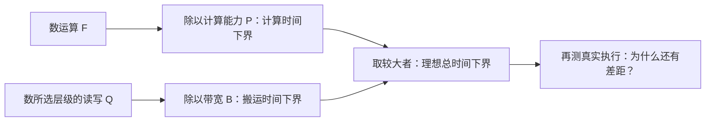
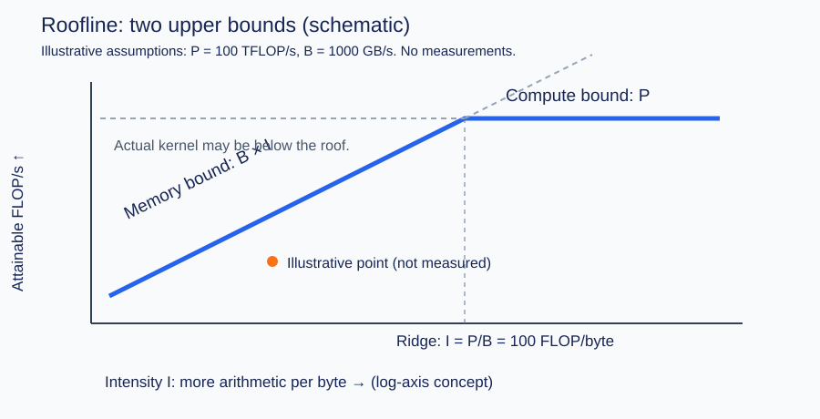

# 一个算子究竟受算力还是内存带宽限制？

> 先数要做多少次运算，再数要搬多少数据。把这两笔账分别除以机器的处理能力，可以得到一个理想时间下界。Roofline 把这件事画成图，帮助我们决定下一步该研究计算、数据复用，还是其他开销。

## 1. 明明只做加法，为什么也可能很慢？

从一个看得见的例子开始：

```python
x = [1, 2, 3, 4]
y = [10, 20, 30, 40]
# 希望得到 z = [11, 22, 33, 44]
```

计算第一个结果，需要拿到 `x[0]` 和 `y[0]`，做一次加法，再保存 `z[0]`。其他三个位置也一样。

所以，这个任务同时要求机器做两种工作：**处理数字，以及把数字送到能处理它的位置，再保存结果。** 即使加法部件很快，也要等输入到达。

先不用想 GPU 有多少线程。假设输入和输出都是彼此独立、连续的 FP32 数组，每个数占 4 字节，输入各读一次、输出写一次：

| 一笔工作 | 4 个位置一共多少 |
| --- | --- |
| 加法 | 4 次 |
| 读取 x | 4 × 4 = 16 字节 |
| 读取 y | 16 字节 |
| 写入 z | 16 字节 |
| 读写合计 | 48 字节 |

这个小例子已经包含今天的核心问题：机器会先被“4 次加法”，还是“48 字节读写”拖住？

这里的账本是教学假设，不是对真实缓存、内存事务的测量。先建立模型，后面再逐步拆开这个区别。

## 2. FLOPs 和 FLOP/s，差的那个斜杠是什么？

一次浮点加法算一次浮点操作，英文缩写为 FLOP。本篇用 `F` 表示整个任务的浮点操作总数，单位是 FLOPs。向量长度为 `N` 时，`z=x+y` 的 `F=N`。

机器每秒能做多少次浮点操作，是速率，单位是 FLOP/s。用 `P` 表示我们选定算术路径的计算能力。不要把“做了多少”与“每秒能做多少”混在一起。

例如，一个任务要做 100 次运算，机器每秒能做 10 次，单看计算至少要 10 秒。写成公式，就是 `F/P`。

数据搬运也一样。用 `Q` 表示所选内存层级的读写字节数，用 `B` 表示该层级每秒能搬运的字节数，单看搬运至少要 `Q/B` 秒。

本篇统一采用十进制速率：`1 TFLOP/s = 10^12 FLOP/s`，`1 GB/s = 10^9 byte/s`。容量若写 MiB，则 `1 MiB = 2^20 byte`。它们可以一起使用，前提是代入公式时都换回字节。

前一篇讲过，不同数据格式和累加方式会走不同计算路径。因此，**不能拿一个 FP32 任务去除以另一种低精度矩阵指令的峰值，然后称为它的计算时间下界。** `P` 必须匹配要讨论的算术路径。

## 3. “每搬一个字节，做多少计算”有什么用？

把向量从 4 个数扩大到 `N` 个数，刚才的账本变为：

\[
F=N,\qquad Q=3Ns,\qquad I=\frac{F}{Q}=\frac{1}{3s}
\]

`s` 是一个元素的字节数。`I` 叫强度，本篇也使用常见说法“算术强度”，单位是 FLOP/byte。FP32 的 `s=4`，所以强度为 `1/12`。

先用人话读它：**平均搬 12 字节，才做一次加法。** 增大 `N` 会同时放大计算和读写量，这个比例保持不变。

再看矩阵乘法 `C=A@B`。`A` 是 `(M,K)`，`B` 是 `(K,N)`，每个输出位置需要沿 `K` 方向累加乘积。

工程上通常按一次乘法加一次加法计 2 FLOPs，即使它们由一条 FMA 指令完成。因此采用约定 `F=2MNK`；它是常用计数，不是逐条数机器指令，也不是把首项初始化单独扣掉的精确标量加法次数。

如果 A、B 的每个元素从目标内存层只读一次，C 每个元素只写一次，没有读取旧 C：

\[
Q_{\text{ideal}}=s(MK+KN+MN)
\]

对于 FP32 方阵，`M=N=K=L`：

\[
I_{\text{ideal}}=\frac{2L^3}{12L^2}=\frac L6
\]

矩阵越大，这个理想比例越高。原因很具体：A 的一个数可以参与多个输出，B 也一样。**数据送进来以后，如果能反复使用，同样的搬运就能支撑更多计算。** 第 07 篇会把“如何复用”拆成可执行的分块循环。

注意公式中的 `ideal`：它没有证明任何真实 GEMM 已经把 A、B 各读一次。片上容量有限、分块重读、缓存命中与布局都会影响真实流量。

## 4. 两个时间要相加，还是取较大的那个？

先假设计算和数据传输能够理想重叠，并忽略启动、同步等其他成本。

如果计算至少要 3 秒，搬运至少要 8 秒，这个任务无论怎样安排，都不可能在 8 秒内完成。因此：

\[
T\ge\max\left(\frac FP,\frac QB\right)
\]

这不等于承诺“一定 8 秒结束”。真实过程若不能充分重叠，或者还有其他开销，只会更长。



如果把时间换成吞吐率 `F/T`，就得到 Roofline 的两条上限：

\[
\frac FT\le \min(P,BI)
\]

一条来自计算能力 `P`，另一条来自带宽能供给的计算量 `BI`。后一项的单位也能对上：`byte/s × FLOP/byte = FLOP/s`。



图源就是 [SVG 文件](assets/roofline.svg)。这是解释形状的示意图，横纵轴采用对数坐标的概念，没有实测坐标。斜线表示强度提高后，带宽可以支持更多运算；达到计算上限后，屋顶变平。橙点只表示“实际实现还可能低于屋顶”。

两条线交会的强度是 `P/B`，通常称为拐点或 ridge point。强度在其左侧时，简单模型中的带宽上限更低；右侧时，计算上限更低。

这个模型和拐点来自 [Roofline 原始技术报告第 3 节与 Figure 1](https://www2.eecs.berkeley.edu/Pubs/TechRpts/2008/EECS-2008-134.pdf)。第 4 节进一步讨论指令并行等额外上限，已经提醒我们：两条主线不能解释全部损失。

## 5. 带入数字，看一次完整判断

设想一台**虚构的教学机器**：所讨论算术路径的能力为 100 TFLOP/s，内存带宽为 1000 GB/s，也就是 `10^12 byte/s`。这些数字不对应任何具体 GPU 或实测结果。

先运行长度为 `2^20` 的 FP32 向量加法：

- `F=1,048,576` FLOPs。
- `Q=12,582,912 byte = 12 MiB`。
- 计算下界约 `0.01049 μs`；搬运下界约 `12.5829 μs`。

搬运项大得多。即使把加法能力翻倍，这个理想下界也几乎不动。要研究的是数据如何读写、能否减少中间结果，而不是继续增加加法吞吐。

再看 `1024×1024` 的 FP32 方阵乘法：`F=2,147,483,648`，理想 `Q` 仍为 12 MiB，强度约 `170.67 FLOP/byte`。拐点为 `100 FLOP/byte`，因此这次是计算项更大，理想时间下界约 `21.4748 μs`。

请停一下：后一个结论只说明**在这个乐观流量模型里**计算屋顶更低。它没有证明真实 1024 GEMM 达到 100 TFLOP/s，也没有证明所有机器上 1024 GEMM 都受算力限制。

把边长减为 128，理想强度降为 `128/6≈21.33`，模型里的主限制又变成带宽。小任务还可能被启动延迟或并行度不足主导；那时仅看这两笔账仍不够。

上述算术结果可运行 [run_lab.py](code/run_lab.py) 复算，输出保存在 [lab.json](evidence/runs/lab.json)。全部是估算，没有把 CPU 代码运行时间充当 GPU kernel 时间。

## 6. 现在看源码：减少搬运在代码里长什么样？

前面说“少搬中间结果”，具体减少哪一次读写？Triton 的 softmax 教程提供了一个能逐句核对的例子。

softmax 会把一行数转换成归一化的权重。现在先关注数据流，不要求你已经学会它的完整算法：求最大值、减最大值、取指数、求和、除以和。这五步可以分别产生中间张量，也可以在一个 kernel 内完成。

实际取得并归档的 Triton `main` 快照为 `c1641abbb17a80b8c9cad1fa05b4c70d6ac260ab`，不是本机已安装或编译运行的版本。

[naive_softmax，源码第 42—59 行](https://github.com/triton-lang/triton/blob/c1641abbb17a80b8c9cad1fa05b4c70d6ac260ab/python/tutorials/02-fused-softmax.py#L42-L59) 把每一步展开了。沿着 `x_max → z → numerator → denominator → ret` 数张量读写，教程账本合计 `8MN+4M` 个元素。

融合版本的 [softmax_kernel，第 84—109 行](https://github.com/triton-lang/triton/blob/c1641abbb17a80b8c9cad1fa05b4c70d6ac260ab/python/tutorials/02-fused-softmax.py#L84-L109) 则加载一行，在片上完成中间计算，再存出一行。若这行可以在片上资源中处理、没有额外溢出等流量，主输入输出账本是 `2MN` 个元素。

```text
分步：读 x → 写中间量 → 再读中间量 → …… → 写 y
融合：读 x → 片上完成一行的中间计算 → 写 y
```

**元素数还要乘元素字节数，才是字节数。** 上游相邻注释把 `MN` 写成 bytes，而其比值公式实际按元素计；本篇按读一次、写一次得到 `2MN × s byte`。也不能把框架算子级读写账本直接当作 HBM 计数器结果：缓存和编译器优化可能改变它。

因此，大列数时两份账本的比值接近 4，只能解释“减少主中间读写的潜力”，不能据此承诺任何 GPU 加速四倍。归约、指数指令、寄存器、溢出和启动成本仍需测量。第 09 篇会继续检查融合的代价。

## 7. 怎样把模型变成工程判断？

第一步，先写清任务：输入 shape、dtype、layout、输出要求，以及是否已经融合。改变这些，账本就可能改变。

第二步，写清 `Q` 的层级。原始 Roofline 特意统计**经过缓存过滤后、缓存与主存之间**的流量，并使用可持续带宽。我们手算的 `Q_ideal` 是一种乐观输入输出账本。它可能漏掉分块重读，也可能因热缓存而高于本次实际 DRAM 流量，不能直接贴上“实测 DRAM 强度”标签。[原报告第 3 节](https://www2.eecs.berkeley.edu/Pubs/TechRpts/2008/EECS-2008-134.pdf)

第三步，再测时间和流量。GPU 时间要考虑异步提交、warmup、事件与同步；第 06 篇专门讲。用 `Q_ideal/T` 算的是**有效带宽**，用硬件计数器的 DRAM 字节数除时间才对应那份实测流量口径。有效带宽看起来超过 DRAM 规格时，先查缓存与计数假设。

最后，根据证据选动作：数据读写占主导时，优先检查布局、复用、中间量与融合；计算上限占主导时，检查实际指令路径、tile 和可用并行度。若两种利用率都低，先看任务大小、启动间隙、依赖等待或资源约束。不要把每个慢算子都强塞进两个标签之一。

## 8. 代码练习

### 练习一：为两个算子记账

不用 GPU。实现 `vector_add_work(n,itemsize)` 和 `gemm_work(m,n,k,itemsize)`，返回整数 FLOP 数和假设字节数。向量允许空输入；GEMM 本题只接收正维度、`C=A@B`，不读取旧 C；布尔值和负数不是有效尺寸。

验收：4 个 FP32 向量元素应得到 `(4,48)`；`(2,4)@(4,3)` 应得到 `(48,104)`。再用非方阵检查你没有把所有维度误写成同一个数。

<details>
<summary>详解与完整答案</summary>

向量逐位置读两个数、写一个数，因此 `Q=3ns`。矩阵输出有 `mn` 个位置，常用 FLOP 计数为 `2mnk`；三个矩阵分别占 `mk`、`kn`、`mn` 个元素，合计乘 `s`。

完整 [answers.py](code/answers.py) 用冻结 dataclass `Work` 保存账本。它不分配大矩阵，尺寸增大不会造成对应 Tensor 分配。`gemm_work` 的乐观复用假设必须随结果一起解释，不能把公式当作实际访存追踪。

常见错误：只数输入不数输出；把一次 FMA 计为 1，却拿按 2 计的峰值比较；把元素数当字节数；忘记旧 C 的读取只在本题 `beta=0` 的语义下被省略。

</details>

### 练习二：下界与“测得的吞吐”怎样对应？

实现 `estimate(work,peak_tflops,bandwidth_gbs)` 与 `effective_rates(work,elapsed_s)`。输入速率是十进制单位；拒绝非正、非有限数值和布尔值。

输出强度、拐点、两个时间下界、总下界、吞吐上界，以及模型中较紧的限制。另假设 1024 GEMM 的耗时恰好是下界两倍，求有效 TFLOP/s。这个耗时是题目给定的合成值，不是真测量。

<details>
<summary>详解与完整答案</summary>

先把两种速率转换为每秒速率，再分别算 `F/P` 与 `Q/B`，取较大者。吞吐上界为 `min(P,B*I)`。合成耗时翻倍时，本例有效吞吐是 `50 TFLOP/s`。

完整实现仍在 [answers.py](code/answers.py)，[12 项测试](code/test_answers.py) 覆盖单位、非方阵、仅搬运、空任务和无效参数。空任务 `I=0.0` 是返回值约定，数学上的 `0/0` 没有定义；`balanced` 只表示两个浮点计算结果恰好相等，靠近拐点不应过度解读标签。

从文章目录运行：

```bash
python3 -m unittest discover -s code -p 'test_*.py' -v
python3 code/run_lab.py
```

基础答案只用 Python 标准库。核验实际使用 Python 3.10.13；12 项测试通过，详细环境和命令见 [summary.json](evidence/runs/summary.json)。如果系统有多个 Python，请选你自己的固定解释器，不要把另一个环境的依赖状态混用。

</details>

## 9. 面试官继续追问

| 层次 | 问题 | 参考回答要点 |
| --- | --- | --- |
| 基础 | FLOPs 多的算子一定更慢吗？ | 还要看数据量、实际算术路径、并行度与开销；只有同一计数和条件下才好比较。 |
| 推导 | 为什么两种时间取 max？ | 它是理想重叠下仍不可突破的下界；不是默认所有阶段必然重叠。 |
| 实现 | 融合为什么可能提高强度？ | 主中间量不再逐次写回再读取，针对同一内存层级的 Q 可以减少。 |
| 选择 | GEMM 理想强度高，是否不用再研究访存？ | 理想账本未必实现，需要核对分块复用、缓存、布局和实际流量。 |
| 排障 | 有效带宽超过设备标称带宽，是否硬件异常？ | 先检查模型字节数、缓存命中、时间口径和测量层级。 |
| 验证 | 点远低于两个屋顶，先做什么？ | 看 profiler 的执行与等待、问题大小和资源，而不是直接改公式给实现找理由。 |

## 10. 接下来先学会分工

今天建立的是成本模型，还没有解释线程怎样把任务分给自己。下一篇从“10 个元素交给若干个线程，谁负责哪一个”开始，逐步认识 thread、warp、block、mask 与访存事务。

本篇未运行 Triton kernel，未测 GPU 峰值、DRAM 流量或 GPU 延迟。缓存行为和性能分类都是待目标硬件验证的工程问题。

资料：[参考与阅读笔记](references.md)。验证：[审查记录](review.md)。前置：[浮点格式](../2026-10-22-floating-point-formats/README.md)。返回 [Wiki 索引](../../../index.md)。
