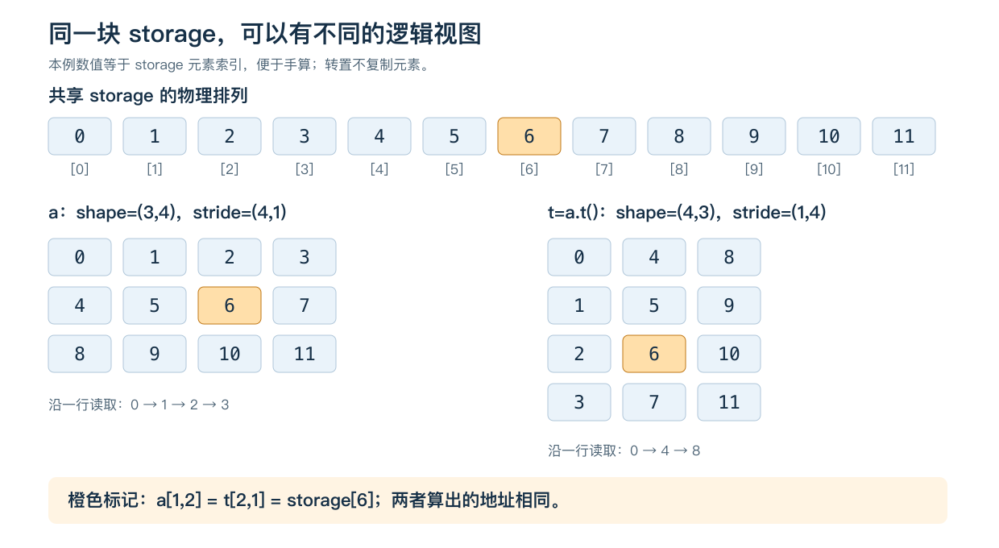
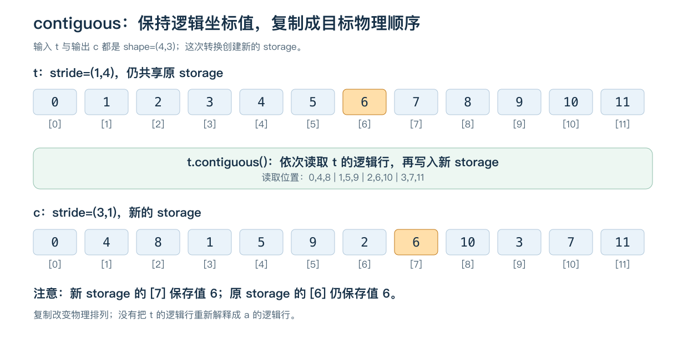
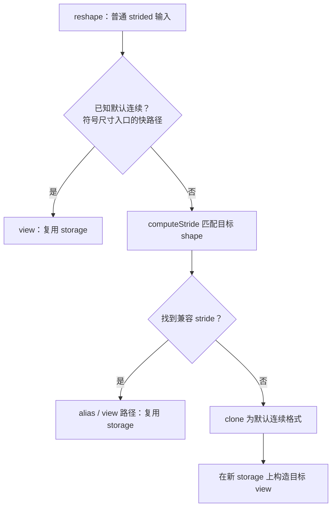

# Tensor 的 shape 一样，为什么 view、复制和访问方式仍然不同？

假设有 12 个数字，你希望每 4 个分成一组，摆成 3 行：

```text
 0   1   2   3
 4   5   6   7
 8   9  10  11
```

这就是我们这篇文章一直使用的矩阵。先不考虑 GPU，也不考虑大模型，只问：**这张有行有列的表，在计算机里到底怎样保存？**

这个问题会带出后面的几个疑问：换行时要跨过几个数？转置是不是一定要搬动数字？为什么有时能拉成一维，有时会报错？`contiguous()` 又在整理什么？我们从能亲手数清楚的 12 个数字开始。

读完后，你应该能判断一次操作只是换了访问方式，还是实际复制了数据。这能帮助理解切片后的 `view` 报错，也能为后面的 Attention 布局和显存开销分析打基础。

建议先顺着第 1—5 节建立直觉。第 6 节再去源码里核对这些直觉，第 7—8 节把它们用到工程问题中。第 9 节有三道练习与完整答案；基础题不需要 GPU。完整运行入口见 [code/README.md](code/README.md)。

**版本与验证。** 源码分析基于 2026-10-22 获取的 PyTorch 官方 `main` 快照 [`c9d49411dc9c251a6f9812799112e92532748eec`](https://github.com/pytorch/pytorch/tree/c9d49411dc9c251a6f9812799112e92532748eec)。实际实验是本机 **PyTorch 2.9.1、Python 3.10.13、CPU**；没有编译该主分支，没有 GPU 性能结果。先理解例子即可，源码版本的详细对应放在 [references.md](references.md)。

## 1. 一张有行有列的表，是怎样存起来的？

### 1.1 先认识 Tensor：一个数、一串数、一张表

可以先把 Tensor 理解成“带着形状的数字集合”：

```python
import torch

scalar = torch.tensor(7)          # 一个数，shape=()
vector = torch.tensor([7, 8, 9])  # 一串数，shape=(3,)
a = torch.arange(12).reshape(3, 4)
```

`arange(12)` 生成 `0` 到 `11`；`reshape(3,4)` 把这 12 个数分成 3 行、每行 4 个。打印 `a` 就是开头那张表。

这里有三个常用词：

- **轴（axis／dimension）**：索引用来变化的方向。二维矩阵有两个轴，我们把第一个叫行方向，第二个叫列方向。
- **shape**：每条轴有多长。`a.shape` 是 `(3,4)`，意思是行方向有 3 个位置，列方向有 4 个位置。
- **索引（index）**：指定要取哪个位置。Python 从 `0` 开始数，`a[1,2]` 是第 2 行、第 3 列，值为 `6`。

```text
            列索引
          0   1   2   3
行索引 0   0   1   2   3
       1   4   5  [6]  7
       2   8   9  10  11
```

一维 Tensor 只有一个轴，比如 `vector[1] == 8`，没有必要给它分行和列。shape `(3,)` 表示一串 3 个数；shape `(3,1)` 才表示有 3 行、每行 1 个数的二维矩阵。括号末尾的逗号是 Python 单元素元组的写法。

### 1.2 内存里也有“下一行”吗？

对本文讨论的普通 Tensor，可以先把底层存储想成一排有编号的格子。下面画的是 `a` 使用的 12 个元素位置：

```text
存储位置： 0  1  2  3 | 4  5  6  7 | 8  9 10 11
保存的值： 0  1  2  3 | 4  5  6  7 | 8  9 10 11
```

竖线是为了方便我们阅读而画的，内存并没有额外保存“换行符”。这排保存数据的底层空间叫 **storage**。Tensor 还保存一些说明信息，告诉程序怎样把格子解释成一张表。这些说明信息叫**元信息**，例如 shape 和接下来要讲的 stride。

本例的数值刚好等于存储位置编号，只是因为我们用了 `arange`。如果把 `6` 改成 `600`，它所在的位置仍是第 `6` 号格子。后面说“位置移动几个元素”，都在数格子，而不是在给数值做加法。

### 1.3 为什么 stride 是 `(4,1)`？亲手走两步

现在从 `a[0,0]` 出发，值是 `0`。

**第一个问题：行索引增加 1、列保持不变，会去哪？**

```text
a[0,0] → a[1,0]
位置 0 → 位置 4
```

从这一行的第一个数，走到下一行的第一个数，跨过了 4 个元素位置。因此行方向的步长是 `4`。

**第二个问题：行保持不变、列索引增加 1，会去哪？**

```text
a[0,0] → a[0,1]
位置 0 → 位置 1
```

只往后走了 1 个元素位置。因此列方向的步长是 `1`。

把两个方向的步长按轴顺序放在一起，就是：

```python
a.stride()  # (4, 1)
```

**stride 回答的是：某条轴的索引增加 1 时，底层存储位置移动几个元素。** 这里没有新增元素，Tensor 仍然有 12 个数。

你可能会想：“向右走一列，不都是走到下一个元素吗？”在逻辑表格里确实是下一列，但它在 storage 里是否相邻，要看这张表怎样解释底层数据。第 2 节的转置会给出一个列方向步长为 `4` 的例子。

### 1.4 知道 stride 后，怎样找到 `a[1,2]`？

先换一行，走 `1×4` 步；再换两列，走 `2×1` 步。合起来是：

```text
a[1,2] 的位置 = 1×4 + 2×1 = 6
```

如果 Tensor 只是原 storage 中间的一段，它的起点可能不在第 `0` 号格子。这个起点偏移叫 `storage_offset()`。比如 `a[1:]` 从原矩阵第 2 行开始，起点是第 `4` 号格子，offset 就是 `4`。

到这里再写通用公式，就只是把刚才的数数方法写紧凑一些：

$$
\text{元素位置}=\text{起点偏移}+\sum_d \text{第 d 轴索引}\times\text{第 d 轴 stride}
$$

求和符号 $\sum$ 的意思是把每条轴贡献的偏移加起来。二维时就是 `offset + 行索引×行步长 + 列索引×列步长`。索引仍须在 shape 允许的范围内；本篇只用非负索引与非负 stride。

**再进一步：元素和字节有什么区别？** stride 以元素为单位，实际内存地址以字节为单位。`dtype` 是数据类型，决定一个元素怎样解释、占几个字节；本例默认的 `int64` 每个元素占 8 字节，`float32` 每个占 4 字节。

因此同样是第 `6` 号元素，相对 storage 起点的字节偏移分别为 `6×8=48` 和 `6×4=24`：

$$
\text{字节地址}=\text{storage 起始地址}+\text{元素大小}\times\text{元素位置}
$$

PyTorch 确实把这些信息分开保存，取数据地址时再乘元素字节数，后面会读到 [TensorImpl.h 的对应路径](https://github.com/pytorch/pytorch/blob/c9d49411dc9c251a6f9812799112e92532748eec/c10/core/TensorImpl.h#L1819-L1831)。目前先把地址公式和这张 12 格的图对应起来即可。

### 1.5 读属性时，分别在问什么？

| 属性 | 现在可以怎样理解？ | `a` 的结果 |
| --- | --- | --- |
| `shape`／`size()` | 有几条轴，每条轴有几个位置？ | `(3,4)` |
| `stride()` | 每条轴走一步，storage 中移动几格？ | `(4,1)` |
| `storage_offset()` | 从 storage 的第几格开始读？ | `0` |
| `numel()` | 这个 Tensor 逻辑上有几个数？ | `3×4=12` |
| `dtype`／`element_size()` | 一个数怎样表示，占多少字节？ | `int64`，8 字节 |
| `device` | 数据放在哪里？ | 本例在 CPU |

shape 的长度也叫维数或 rank。`numel()` 数的是这个 Tensor 里的逻辑元素，不一定是整块 storage 的容量：一张表可能只使用其中一段，多张表也可能共享它。下一节就来做一次共享。


## 2. 转置为什么可以只改元信息？

**如果把原来的一行变成一列，数字一定要搬家吗？** 先看目标长什么样：原来 `0,1,2,3` 是第一行，转置后它们变成第一列。原来 `0,4,8` 是第一列，转置后它们变成第一行。矩阵的转置就是交换这两个索引方向，PyTorch 对二维矩阵可以用 `.t()` 表达。

令 `t = a.t()`，得到：

```text
a：shape=(3,4)，stride=(4,1)       t：shape=(4,3)，stride=(1,4)
 0   1   2   3                     0   4   8
 4   5   6   7                     1   5   9
 8   9  10  11                     2   6  10
                                   3   7  11
```



[可编辑图源](assets/layout.svg)。

图中的两张矩阵是**同一块 storage 的两种逻辑视图**。`t` 的行索引增加 1，跨过 1 个元素；列索引增加 1，跨过 4 个元素。

先只读 `t` 的第一行：`t[0,0]` 读位置 `0`，`t[0,1]` 读位置 `4`，`t[0,2]` 读位置 `8`。这就回答了上一节的问题：向右取下一列，底层可以跨过 4 个元素。程序只是换了一份“怎样找数”的说明，不需要先把数字排成打印出来的样子。

再次算地址：`t[2, 1]` 的元素位置为 `2×1 + 1×4 = 6`，和 `a[1, 2]` 相同。无需搬运 12 个数，交换两条轴的 size 和 stride 就能完成这次转置。[官方 Tensor Views 文档](https://docs.pytorch.org/docs/main/tensor_view.html) 将这种共享底层数据的结果称为 view。

```python
t = a.t()
t[2, 1] = 600
assert a[1, 2].item() == 600
```

注意：这种共享也意味着修改会传播到另一个视图。上面的写入只用于不含梯度的教学例子，不能据此忽略训练中的原地修改约束。

**“零复制”描述这一步没有复制元素，不代表后续读取成本相同。** 如果某个消费者按 `t` 的行逐个读取，它访问的是 storage 位置 `0,4,8,1,5,9,…`。另一个消费者可以按其他顺序访问，也可能内部重排数据，因此单看转置无法推出最终速度。

## 3. 连续究竟指什么？

### 3.1 默认连续：按逻辑顺序读，地址应紧挨着

这里的“连续”要同时考虑两件事：**我们准备按什么顺序读，以及读到的存储位置是否挨在一起。** 默认顺序是先从左到右读完第一行，再读下一行；更高维时也是最后一条轴先变化。

对 `a`，这样读到的位置是 `0,1,2,3,4,5,…`，每一步都紧挨着。对 `t`，这样读到的是 `0,4,8,1,5,9,…`，位置会跳动。所以 `a` 默认连续，`t` 默认不连续。两者都保存着正确的数据，“不连续”是在描述访问次序与物理排列的关系。

本文先讨论 `torch.contiguous_format`，即默认的行优先连续格式。对所有轴长度都大于 `1` 的非空 Tensor，最内层轴的 stride 应为 `1`，外层轴的 stride 依次是内层各维长度的乘积。

例如 shape 为 `(2, 3, 4)`，默认连续 stride 是 `(12, 4, 1)`：最后一轴走一步是 1 个元素，中间一轴走一步跨过 4 个元素，最外一轴跨过 `3×4=12` 个元素。

```text
expected = 1
从最内层轴向外检查：
    size == 1：跳过这个轴
    stride != expected：不是默认连续
    否则 expected *= size
```

这段教学逻辑对应 [`c10::_compute_contiguous`](https://github.com/pytorch/pytorch/blob/c9d49411dc9c251a6f9812799112e92532748eec/c10/core/Contiguity.h#L13-L33)，完整 Python 参考实现位于 [layout_answers.py](code/layout_answers.py)。

### 3.2 三个实际会遇到的例外

**长度为 1 的轴，其 stride 不影响连续性。** 例如 shape `(2,1,3)`、stride `(3,99,1)`，中间轴只能取索引 `0`，所以 `99` 从不会贡献地址偏移。合法视图如下：

```python
s = torch.as_strided(torch.arange(6), (2, 1, 3), (3, 99, 1))
assert s.is_contiguous()
```

这里 `as_strided` 仅用于验证一个已算清边界的例子；日常重排优先使用 `view`、`transpose` 和切片，不需要手写任意 stride。

**含有长度为 0 的轴时，没有元素可访问，默认连续性检查返回 True。** 标量 shape 为 `()`，则有一个元素，不要和空 Tensor 混淆。

**连续不要求 storage offset 为 0。** `a[1:]` 的 shape 为 `(2,4)`，stride 仍是 `(4,1)`，offset 为 `4`；从它自己的逻辑起点读，后面的 8 个元素完全连续。

```python
row_slice = a[1:]
assert row_slice.is_contiguous()
assert row_slice.storage_offset() == 4
```

### 3.3 非连续，不等于 storage 中有洞

转置后的 `t` 仍覆盖原来的 12 个不同存储位置，没有遗漏；只是**默认逻辑遍历顺序**与物理排列不同。与它相比，`a[:, ::2]` 只读取每行的第 `0`、`2` 列，确实跳过了其他元素。

所以要分开三个问题：逻辑顺序是否默认连续、是否存在重复地址、是否跳过存储位置。`is_contiguous()` 回答的是第一个问题，不能代替全部布局分析。

## 4. 为什么非连续 Tensor 也能 `view`？

### 4.1 `view` 检查目标形状能否用同一套地址关系表达

先看最常见的 `a.view(-1)`：这里 `-1` 是“让 PyTorch 自动推算这一维长度”。原来有 `3×4=12` 个数，只指定一条轴，长度自然就是 `12`。

```python
flat = a.view(-1)
print(flat.shape)   # torch.Size([12])
print(flat.stride())  # (1,)
# tensor([0, 1, 2, 3, 4, 5, 6, 7, 8, 9, 10, 11])
```

`flat` 是新的 Tensor 视图，`a` 的 shape 仍是 `(3,4)`。`stride=(1,)` 表示它只有一个轴，索引每增加 1，存储位置向后移动一个元素。它没有行列之分。

**为什么拉直 `a` 很容易，拉直 `t` 就可能失败？** 一维视图只有一个 stride，所以整串访问必须能用同一个步长走完。`a` 的位置一直加 `1`；`t` 的位置先是 `0→4→8`，接着却要到 `1`，一个固定步长无法描述这个次序。

`view` 需要元素数相同，还需要能够找到目标 shape 的 stride，并保持原来的逻辑元素次序。它不会把矩阵“转置回来”，也不会为了满足目标 shape 自行复制元素。

假设要把相邻轴 `d` 和 `d+1` 合成一轴，且相关轴长度都大于 `1`，兼容条件是：

$$
\text{stride}[d] = \text{stride}[d+1]\times\text{size}[d+1]
$$

为什么？读完内层轴的最后一个元素后，进入下一组时必须延续同样的步长。这个条件允许最内层步长是 `2`，并不要求它为 `1`。长度为 `1` 的轴、零元素、分割一个轴和多个可合并区段由完整实现另外处理；不能把上式不加条件地套到所有 reshape 上。[官方 `view` 定义](https://docs.pytorch.org/docs/2.14/generated/torch.Tensor.view.html)

### 4.2 两个非连续切片，结果为什么不同？

重新建立未修改的 `a = torch.arange(12).reshape(3,4)`：

| Tensor | shape | stride | offset | 按逻辑顺序对应的 storage 位置 | `view(-1)` |
| --- | --- | --- | --- | --- | --- |
| `a` | `(3,4)` | `(4,1)` | `0` | `0,1,2,…,11` | 成功，新 stride `(1,)` |
| `a.t()` | `(4,3)` | `(1,4)` | `0` | `0,4,8,1,5,9,…` | 失败 |
| `a[:, ::2]` | `(3,2)` | `(4,2)` | `0` | `0,2,4,6,8,10` | 成功，新 stride `(2,)` |
| `a[:, 1:3]` | `(3,2)` | `(4,1)` | `1` | `1,2,5,6,9,10` | 失败 |
| `a[1:]` | `(2,4)` | `(4,1)` | `4` | `4,5,6,…,11` | 成功，新 stride `(1,)` |

步进切片的地址一直以 `2` 递增，因为 `4 = 2×2`，展平成一维后仍然能用一个固定 stride 表达。

裁剪切片的相邻地址差是 `1,3,1,3,1`。一维 Tensor 只有一个 stride，无法同时表达这种变化，所以必须重排或保留原 shape。公式上也有 `4 != 1×2`。

同理，`t` 每行内部跳 `4`，换行却回到另一列，无法把**整个矩阵**展平成单一等步长视图。这不意味着转置后的任何 `view` 都失败，例如保持 shape 的 `t.view(4,3)` 仍然可以成立。

## 5. `view`、`reshape`、`contiguous`、`clone` 怎样选？

到了这里，可以先把这些函数放进三个问题中：

1. **要改变哪条轴代表什么吗？** 例如把行变成列，使用 `transpose`／`permute`。
2. **只想重新分组、换个 shape 吗？** 使用 `view` 或 `reshape`。
3. **需要怎样保存数据吗？** 需要连续布局时考虑 `contiguous`，需要独立副本时考虑 `clone`。

日常只关心目标形状，`reshape` 通常更方便：能共享存储就共享，必要时允许复制。`view` 多了一条硬约束——必须共享存储，做不到就报错。对于希望避免隐藏复制的代码，这条约束很有价值。它们的区别是所提出的要求不同。

| 操作 | 主要目的 | 元素复制行为 | 需要注意什么？ |
| --- | --- | --- | --- |
| `transpose`／`permute` | 交换逻辑轴 | 普通 strided 路径共享 storage | 轴语义发生变化；不承诺输出默认连续 |
| `view(shape)` | 用兼容的 shape 解释同一数据 | 成功时共享 storage；不兼容时报错 | 元素数相同仍不足以保证成功 |
| `reshape(shape)` | 按原逻辑次序改变 shape | 能使用 view 时复用，否则允许复制 | 不要依赖它一定共享或一定独立 |
| `contiguous(memory_format=...)` | 满足指定连续格式 | 已满足则直接返回，否则复制 | 默认目标是 `contiguous_format` |
| `clone()` | 创建数据副本 | 复制 | 默认保留适用的 memory format，未必默认连续 |

这张表针对本文的普通 strided Tensor。API 行为可对照 [`contiguous`](https://docs.pytorch.org/docs/2.14/generated/torch.Tensor.contiguous.html)、[`clone`](https://docs.pytorch.org/docs/2.14/generated/torch.clone.html) 与 [Tensor Views](https://docs.pytorch.org/docs/main/tensor_view.html)。

### 5.1 复制到底复制了什么顺序？

`c = a.t().contiguous()` 得到和 `a.t()` **同 shape、同坐标值**的新 Tensor，但 storage 按转置后矩阵的逻辑行顺序重新排列。

分开看这两步：`a.t()` 先让我们把第一行读成 `0,4,8`；`.contiguous()` 随后为这个次序准备一块新存储，把 `0,4,8` 真正挨着放好。第二行的 `1,5,9` 接在后面，依此类推。原来的 `a` 不变，`c` 仍是一张转置后的 `4×3` 表。



[可编辑图源](assets/materialization.svg)。

```python
a = torch.arange(12).reshape(3, 4)
t = a.t()
c = t.contiguous()

assert c.shape == t.shape
assert t.stride() == (1, 4)
assert c.stride() == (3, 1)
assert c.view(-1).tolist() == [0, 4, 8, 1, 5, 9, 2, 6, 10, 3, 7, 11]
```

原矩阵 `a` 的逻辑元素顺序没有被偷偷换回来。`reshape` 也不会把“改变 shape”和“交换语义轴”自动等同起来，Attention 练习会展示这种错误。

### 5.2 `clone()` 为什么不等于 `contiguous()`？

```python
copied = a.t().clone()
assert copied.stride() == (1, 4)
assert not copied.is_contiguous()
```

这个转置是无重叠且稠密的，默认 `clone` 可以保留其 stride，同时创建独立存储。如果你需要指定连续格式，要明确提出布局要求。

反过来，已连续的 `a[1:]` 调用 `.contiguous()` 会直接返回自身，并没有强制得到独立副本。因此：要求零复制时用能表达这一约束的 `view`；允许框架选择时用 `reshape`；明确需要独立数据副本时用 `clone`，再按需要指定 memory format。

### 5.3 现在再看开篇问题：shape 和值都一样，还会有什么不同？

```python
a = torch.arange(12).reshape(3, 4)
b = a.t().contiguous().t()
print(a.shape == b.shape, torch.equal(a, b))  # True True
print(a.stride(), b.stride())                # (4, 1) (1, 3)
a.view(-1)                                  # 成功
# b.view(-1)                                # RuntimeError
```

沿着刚学过的三步推一遍：第一次转置改变访问方式；连续化把转置后的次序复制到新存储；第二次转置把逻辑表格转回来。表格看起来恢复了，底层数字却仍按刚才复制的次序保存，因此 stride 不同。`a` 能按固定步长拉直，`b` 的完整逻辑顺序不能。

到这里，本文的主问题已经可以回答：**shape 告诉我们有几行几列，stride 告诉我们每一步去哪里找数。** 接下来读源码，就是检查 PyTorch 是否真的按这个方式工作。

## 6. 沿着当前 PyTorch 源码追一遍

这一节不要求你已经熟悉 C++。每小节只找一个与前文对应的动作：元信息放在哪里、转置交换了什么、`view` 在检查什么、复制在哪条分支发生。先理解动作，再读函数名；特殊分支可以留到需要排障时继续研究。

以下链接全部固定到本次获取的 `main` commit。对应源文件完整保存在 [evidence/upstream/](evidence/upstream/)，含上游许可证。省略的分支包括 sparse、MKLDNN、特殊设备与 Tensor subclass；本节不是完整 dispatcher 或 autograd 分析。

### 6.1 元信息与 storage 确实分开保存

[`TensorImpl.h`](https://github.com/pytorch/pytorch/blob/c9d49411dc9c251a6f9812799112e92532748eec/c10/core/TensorImpl.h#L2995-L3037) 中分别存在：

```cpp
Storage storage_;
c10::impl::SizesAndStrides sizes_and_strides_;
int64_t storage_offset_ = 0;
```

这里为了说明关系，把不相邻的成员放在一起，不能当作完整类定义。多个 TensorImpl 可以携带不同的 sizes／strides，并引用同一份 Storage。

### 6.2 `transpose`：交换 size 和 stride，再建立视图

[`TensorShape.cpp::transpose`](https://github.com/pytorch/pytorch/blob/c9d49411dc9c251a6f9812799112e92532748eec/aten/src/ATen/native/TensorShape.cpp#L3739-L3770) 的普通 strided 分支：

```cpp
std::swap(sizes[dim0], sizes[dim1]);
std::swap(strides[dim0], strides[dim1]);
return self.as_strided_symint(sizes, strides);
```

这直接解释了第 2 节的地址关系。源码还包含不同 layout 的分支，所以“所有 Tensor 的 transpose 都只改元信息”超出了本篇证据范围。

### 6.3 连续性：定义要看检查逻辑，调用要看缓存路径

[`Contiguity.h::_compute_contiguous`](https://github.com/pytorch/pytorch/blob/c9d49411dc9c251a6f9812799112e92532748eec/c10/core/Contiguity.h#L13-L33) 正是第 3 节的逆序检查：空 Tensor 返回 True，单例轴跳过，其余轴和 `expected_stride` 比较。

但这不意味着每次 Python 调用 `is_contiguous()` 都重新遍历所有维度。普通具体尺寸 Tensor 的 [`TensorImpl::is_contiguous_default_impl`](https://github.com/pytorch/pytorch/blob/c9d49411dc9c251a6f9812799112e92532748eec/c10/core/TensorImpl.h#L878-L921) 会读维护的连续性标志；符号尺寸与自定义 strides 有各自分支。要把定义逻辑和常见调用的实现成本分开。

### 6.4 `view`：先计算目标 stride，失败就报错

[`TensorShape.cpp::view_impl`](https://github.com/pytorch/pytorch/blob/c9d49411dc9c251a6f9812799112e92532748eec/aten/src/ATen/native/TensorShape.cpp#L4007-L4030) 的顺序是：

1. `infer_size_dv` 推断目标尺寸并核对元素数。
2. `at::detail::computeStride` 判断目标 shape 是否存在兼容 stride。
3. 无结果则 `TORCH_CHECK` 报错，有结果则 `alias_with_sizes_and_strides`。

[`alias_with_sizes_and_strides`](https://github.com/pytorch/pytorch/blob/c9d49411dc9c251a6f9812799112e92532748eec/aten/src/ATen/native/TensorShape.cpp#L1931-L1958) 引用原来的 Storage，设置新的 sizes／strides，并保留原 storage offset。注意这里没有“先复制再修好 view”的兜底。

### 6.5 `computeStride`：按可合并的区段匹配新 shape

[`TensorUtils.cpp::computeStride_impl`](https://github.com/pytorch/pytorch/blob/c9d49411dc9c251a6f9812799112e92532748eec/aten/src/ATen/TensorUtils.cpp#L327-L407) 从后向前处理旧 shape：把符合步长关系的相邻轴归入同一区段，随后用目标 shape 的轴消费该区段的元素数。某段无法匹配就返回 `std::nullopt`。

对 `shape=(3,2), stride=(4,2)`：

```text
最内层步长 chunk_base_stride = 2
最后一轴含 2 个元素；外层 stride 4 == 2×2，可以合并
整个区段含 3×2 = 6 个元素
目标 shape=(6,) 正好消费这一段，目标 stride=(2,)
```

对 `shape=(3,2), stride=(4,1)`，内层区段只有 2 个元素，外层 stride `4` 不能延续该区段；目标一维大小 `6` 不能只消费这一个 2 元素区段，因此失败。

这解释了为什么只在 `view` 前检查 `is_contiguous()` 会误拒绝一部分合法输入。反过来，只检查 `numel()` 又会漏掉不合法输入。

### 6.6 `reshape` 与 `contiguous`：复制发生在哪条分支？

当前 [`reshape_symint`](https://github.com/pytorch/pytorch/blob/c9d49411dc9c251a6f9812799112e92532748eec/aten/src/ATen/native/TensorShape.cpp#L1963-L2013) 对已知连续的普通输入先走 `view` 快路径；其余输入尝试 `computeStride`，兼容时使用 alias 路径，不兼容时 `clone(Contiguous)` 后构造目标 view。非符号整数版本 [`reshape`](https://github.com/pytorch/pytorch/blob/c9d49411dc9c251a6f9812799112e92532748eec/aten/src/ATen/native/TensorShape.cpp#L2034-L2070) 也保留相应逻辑。



[`TensorProperties.cpp::contiguous`](https://github.com/pytorch/pytorch/blob/c9d49411dc9c251a6f9812799112e92532748eec/aten/src/ATen/native/TensorProperties.cpp#L137-L147) 则先检查是否已经满足指定格式，满足时返回 `self`，否则调用 `clone(memory_format)`。

**本次主分支中还存在符号尺寸的保守判断。** `computeStride` 对无法证明的关系可能返回无可用 stride，让 `reshape` 走复制路径。本文的练习只有具体整数尺寸，不用于证明 `torch.compile` 的动态 shape、符号约束或生成 kernel 行为。旧运行版本与本次主分支的比较笔记见 [references.md](references.md)。

## 7. 把地址知识用到 Attention 的拆头与合头

这一节是进阶应用，先补充必要背景：模型会用一串数表示一个 token（文本被模型切分后的一个单位）。Attention 会把这串特征分成几组，每组叫一个 head，用不同组去计算关系。这里不讲 Attention 算法，只追问：**把一串特征分成几组时，哪些数应该分到同一组？** 后续第 10 篇再展开算法。

设 `B` 是 batch 数，`S` 是序列长度，`H` 是 head 数，`D` 是每个 head 的特征宽度。某个投影结果 `x` 是默认连续的 `[B,S,H*D]`。我们希望构造 `q`，满足：

$$
q[b,h,s,d] = x[b,s,hD+d]
$$

这条坐标等式比 shape 名字更重要：它规定了每个值应该去哪。

```python
q = x.view(B, S, H, D).transpose(1, 2)  # [B,H,S,D]
```

拆分最后一维后，stride 为 `(S*H*D, H*D, D, 1)`；交换 `S` 与 `H` 对应的元信息，得到 `(S*H*D, D, H*D, 1)`。这一步可以共享 storage。

如果直接写 `x.reshape(B,H,S,D)`，虽然最终 shape 一样，元素坐标却变了。以 `B=2,S=3,H=2,D=2` 为例，正确 `q[0,1,0,0]` 是 `2`，直接 reshape 的结果却是 `6`。**`reshape` 只调整逻辑元素的分组，不替你指定哪条轴是 head。**

### 相同的 `[B,H,S,D]`，合头时也可能有两种代价

```python
q_view = x.view(B, S, H, D).transpose(1, 2)
q_packed = q_view.contiguous()

y1 = q_view.transpose(1, 2).reshape(B, S, H * D)
y2 = q_packed.transpose(1, 2).reshape(B, S, H * D)
```

两个 `q` 的 shape 和坐标值相同，但 stride 不同。对这组正维度、`S>1,H>1` 的普通布局：

| 路径 | `[B,H,S,D]` 的 stride | 换回 `[B,S,H,D]` 后 | 合并 H、D |
| --- | --- | --- | --- |
| `q_view` | `(S*H*D,D,H*D,1)` | 恢复原默认连续布局 | 可以复用原 storage |
| `q_packed` | `(H*S*D,S*D,D,1)` | `(H*S*D,D,S*D,1)` | H、D 步长不兼容，需要重排 |

`y1` 和 `y2` 的值都正确，但第二条路径会产生一次布局复制。这是本篇练习构造的布局事实；**实际 Attention kernel 输出哪种 stride，要读取那个 kernel 或查看实际输出，不能从 `[B,H,S,D]` 这个 shape 推断。**

## 8. 工程上什么时候复制，什么时候保留 stride？

### 8.1 先看消费者是否支持当前布局

一次 `transpose` 很便宜，消费这个布局的算子未必同样便宜。自定义 kernel 如果写死 `ptr + row*width + col`，实际假定 stride 为 `(width,1)`。面对 `t`，它应该支持传入的 strides，或在入口明确要求／转换成相应布局。

不要仅因为 `is_contiguous()` 为 False 就给整条链路到处加 `.contiguous()`。矩阵库可能接受转置或 leading dimension，通用逐元素算子也可能按 stride 迭代；具体 backend 是否内部打包，仍需看实现与 profiler。把复制放在真正需要该布局的边界，比较整个消费者链路的成本。

### 8.2 一次布局物化意味着多少数据量？

假设一个 BF16 张量的逻辑 shape 是 `[1,4096,32,128]`，每个元素 2 字节：

```python
elements = 1 * 4096 * 32 * 128
payload_bytes = elements * 2
print(payload_bytes // (1024**2))        # 32 MiB
print(2 * payload_bytes // (1024**2))    # 64 MiB：一次读 + 一次写
```

在“完整读取旧数据、写出新数据”的理想复制模型下，这次物化涉及 `32 MiB` 的逻辑读和 `32 MiB` 的逻辑写。缓存、事务粒度、访存合并和实现路径会影响实际设备流量；这里不是 HBM 计数器实测，也不能据此给出毫秒数。

一个适合比较的成本模型是：

$$
T_{\text{直接消费当前布局}}
\quad\text{与}\quad
T_{\text{布局转换}}+T_{\text{消费目标布局}}
$$

若多个后续算子复用一次转换后的布局，就比较整段流水线。实际验证时保持数值一致，记录输入、dtype、硬件、软件版本、warmup、同步与统计口径，观察 `aten::clone`、`aten::copy_` 等事件，再比较端到端耗时。本篇不报告未测量的性能收益。

### 8.3 “连续格式”也有不同约定

视觉模型常用逻辑 shape `[N,C,H,W]`。默认布局 stride 为 `(C*H*W,H*W,W,1)`；`channels_last` 可以保持同样的逻辑 shape，把 C 对应的 stride 改成 `1`。

```python
image = torch.arange(120).reshape(2, 3, 4, 5)
cl = image.contiguous(memory_format=torch.channels_last)
assert cl.shape == image.shape
assert cl.stride() == (60, 1, 15, 3)
assert not cl.is_contiguous()
assert cl.is_contiguous(memory_format=torch.channels_last)
assert torch.equal(cl, image)
```

这里“不是默认连续”完全不能解释为“布局错误”。要问清楚所需的 memory format，以及下游算子是否能延续它。`channels_last` 的逻辑轴顺序和物理排列区别可对照 [官方教程](https://docs.pytorch.org/tutorials/intermediate/memory_format_tutorial.html)；本篇不外推该教程中特定模型、硬件上的加速比例。

### 8.4 小 view 为什么可能保留整块大 storage？

`row_slice = a[1:]` 的逻辑大小只有 8 个元素，但它共享的 storage 仍容纳原来的 12 个元素。即使不再持有 `a` 这个 Python 变量，仍有 view 引用该 storage，就不能因为 view 较小而只保留其中一段。

如果确实希望用独立的小副本替换这个引用，可以在适合的生命周期边界 `clone()`。调用 `contiguous()` 不足以保证释放共享关系，因为这个切片已经连续。是否适合复制要权衡生命周期与复制成本；原 storage 生命周期结束也不等于框架缓存的 reserved memory 立即归还系统。

## 9. 代码练习与详解

三道题分别练地址模型、显式物化和真实张量变换。先写自己的实现，再用随文测试验收。基础答案仅用标准库；第三题和 PyTorch 对照测试需要已有的 PyTorch 环境。

### 练习一：只用元信息计算地址与连续性

实现 `storage_index(shape, strides, index, offset=0)` 和 `is_c_contiguous(shape, strides)`。shape／stride 使用非负整数；索引也必须非负且在范围内。stride、offset 单位均为元素。**本题主动不支持 Python 的负索引语法。**

验收条件：

- `(4,3)`、`(1,4)` 的索引 `(2,1)` 对应 storage 元素位置 `6`。
- shape `(2,4)`、stride `(4,1)`、offset `4` 的索引 `(1,2)` 对应 `10`。
- `(2,1,3)`、`(3,99,1)` 判为连续；`(3,2)`、`(4,2)` 判为不连续。
- 标量是一个地址；含 `0` 的 shape 没有合法元素索引，但默认连续性为 True。
- 维数不匹配、负尺寸／stride、越界索引需要明确报错。

<details>
<summary>详解一：把地址与连续性作为两个独立判断</summary>

地址只做点积并加 offset：`offset + sum(i*s for i,s in zip(index,strides))`。先验证 rank 和索引范围，否则一个没有意义的逻辑坐标也可能算出看似正常的数字。

连续性不需要 offset。空 Tensor 直接返回 True；其余情况从最后一轴开始，`expected=1`，单例轴跳过，其他轴要求 `stride==expected`，然后 `expected*=size`。shape 为空时循环不执行，标量返回 True。

完整答案：[layout_answers.py](code/layout_answers.py)。验收：[test_layout.py](code/test_layout.py)。常见错误是漏掉单例轴、把空 Tensor 当标量、以为 offset 非零就不连续。

</details>

### 练习二：按逻辑次序把 view 装进新列表

实现 `pack_logical(storage, shape, strides, offset=0)`，返回一个**新列表**，内容等价于沿逻辑行优先次序读取 Tensor 后展平。不能直接切 `storage[offset:offset+numel]`，也不能调用 PyTorch 帮你完成。

验收条件：

- 原 storage 为 `list(range(12))`，shape `(4,3)`、stride `(1,4)` 时得到转置的展平值。
- shape `(3,2)`、stride `(4,1)`、offset `1` 时得到 `[1,2,5,6,9,10]`。
- shape `(2,3)`、stride `(0,1)`，从 `[7,8,9]` 读取时得到两组相同值。只读取，不对重叠地址写入。
- 标量读取一个元素；空 Tensor 不读取元素；有效逻辑坐标指向给定 storage 之外时明确报错。

<details>
<summary>详解二：逻辑遍历决定顺序，stride 决定取值地址</summary>

用 `itertools.product` 生成各轴索引的笛卡尔积，最后一轴变化最快。每个索引交给第一题算地址，再读取 storage 并追加到新列表。

例如转置 `(4,3)`、stride `(1,4)` 的第一行索引是 `(0,0),(0,1),(0,2)`，访问 `0,4,8`；第二行访问 `1,5,9`。结果为：

```text
[0,4,8,1,5,9,2,6,10,3,7,11]
```

这个结果对应 `a.t().contiguous().view(-1)` 的值。它模拟复制的**语义**，不模拟 PyTorch 的向量化、并行 copy kernel 或真实性能。

完整答案仍在 [layout_answers.py](code/layout_answers.py) 的 `pack_logical`，跨框架对照见 [test_torch.py](code/test_torch.py)。stride 为 `0` 的题目只是预览广播视图的重复地址，具体广播与写入限制留给下一篇。

</details>

### 练习三：正确拆头，并解释合头有没有复制

实现两个函数：

- `split_heads(x, heads)`：输入是维度均为正、默认连续的普通无名、非量化 `[B,S,M]`，且 `M=H*D`。输出 `[B,H,S,D]`，满足 `q[b,h,s,d]=x[b,s,h*D+d]`，要求共享 storage。输入违反约定时主动报错。
- `merge_heads(q)`：输入是正维度、普通无名、非量化的 strided `[B,H,S,D]`，输出 `[B,S,H*D]`，恢复对应坐标顺序，允许必要复制。

用 `x=torch.arange(24).reshape(2,3,4)`、`H=2` 验证：拆头 stride 为 `(12,2,4,1)`；直接拆头再合头可以复用 storage；把拆头结果 `.contiguous()` 后再合头则需要复制。两种合头结果的值都应等于原 `x`。同时证明直接 reshape 到 `[2,2,3,2]` 的值不对。

<details>
<summary>详解三：先满足坐标等式，再讨论布局成本</summary>

拆头要先把 `M` 拆成相邻的 `(H,D)`，再把 S、H 两轴交换。只改变 shape 无法表达交换两轴的坐标语义。

```python
def split_heads_core(x, heads):
    B, S, M = x.shape
    return x.view(B, S, heads, M // heads).transpose(1, 2)

def merge_heads_core(q):
    B, H, S, D = q.shape
    return q.transpose(1, 2).reshape(B, S, H * D)
```

上面是推导用的核心步骤，完整的输入约定检查在 [torch_answers.py](code/torch_answers.py)。参考实现选择严格拒绝非默认连续的拆头输入，是为了清楚表达这道题的零复制约定，不是在断言所有非连续输入都无法拆头。

第一种 round trip 中，两次 transpose 互相抵消，恢复原布局。第二种先把 BHSD 物化为默认连续，再转回 BSHD，H 与 D 不再构成一个可直接合并的区段，`reshape` 因而复制。S 或 H 为 1 等退化情况可能改变结论，不能把本题特定条件概括成“合头总复制”。

完整验收：[test_torch.py](code/test_torch.py) 的 `HeadLayoutTests`。它逐坐标核对拆头，验证错误 reshape，比较两个输入布局的合头值和共享关系，并检查非法输入。

</details>

### 怎样运行和确认？

在本文的 `code/` 目录执行：

```bash
# 不需要 PyTorch 的基础练习验收。
python3 -m unittest discover -s . -p 'test_layout.py' -v

# 有 PyTorch 时，运行全部验收与可读的诊断输出。
python3 -m unittest discover -s . -p 'test_*.py' -v
python3 run_lab.py
```

本文的实验使用**同时存活、非空、同 dtype 的普通 CPU Tensor** 比较 `untyped_storage().data_ptr()`，帮助诊断是否复用同一底层分配；它不是通用别名分析 API。不能把空 Tensor 常见的空指针相等当作共享证明，也不能用 Tensor 的 `data_ptr()` 是否相等判断所有 view，因为非零 offset 的视图首元素指针本来就不同。

这也不判断两个视图访问的元素集合是否重叠：共享同一 storage 的两个切片可以互不重叠。多个 Tensor 独立包装同一外部缓冲区时，即使 storage 起始指针不同，也可能访问重叠地址；这种来源不在本实验的判断范围内。

## 10. 面试官继续追问

| 层次 | 追问 | 回答要点 |
| --- | --- | --- |
| 基础 | shape 一样，地址布局就一样吗？ | 还要看 stride、offset、dtype；同 shape 同坐标值也能对应不同 storage 排列。 |
| 基础 | `a.t()[2,1]` 为什么指向 `a[1,2]`？ | 交换两轴 size／stride 后，地址点积相同；亲手算出元素位置 6。 |
| 理解 | 非连续 Tensor 能 `view(-1)` 吗？ | 可以。举 `(3,2)`、stride `(4,2)` 的例子，得到一维 stride 2；同时给出 crop 的反例。 |
| 实现 | `view` 为什么不直接要求 `is_contiguous()`？ | 该要求过强；实现用 `computeStride` 匹配目标形状和可合并区段。 |
| 实现 | `contiguous()` 必然分配吗？`clone()` 必然连续吗？ | 两者都不是；分别举连续非零 offset 切片和稠密转置 clone 的例子。 |
| 正确性 | `[B,S,H*D]` 直接 reshape 成 `[B,H,S,D]` 有什么问题？ | 元素分组不等于轴置换；先写坐标等式，再给出值 2 与 6 的反例。 |
| 方案选择 | kernel 不支持任意 stride，该在哪复制？ | 明确入口布局约定，检查消费者能力；比较一次转换加后续计算与直接消费布局的总成本。 |
| 排障 | profiler 出现大量 `clone`／`copy_`，先查什么？ | 追踪 reshape／连续化前后的 shape、stride、offset、格式与调用栈，区分显式转换和 backend 内部打包。 |
| 内存 | 一个很小的切片为什么仍可能持有大块内存？ | view 共享 storage；`contiguous()` 可能 no-op。必要时独立复制并检查所有引用生命周期。 |
| 证据 | CPU 语义实验能证明 GPU 更快吗？ | 能验证本文的值、布局与共享关系；不能证明 GPU kernel 路径、带宽或端到端收益。 |

## 11. 本篇边界与下一题

本文聚焦 eager 模式下的普通 strided Tensor、具体整数 shape 与非负 stride。没有展开 sparse、量化布局、复杂数的 dtype 重解释、autograd 视图规则、编译器布局优化或实际 Attention kernel。也没有引入独立的研究算法，因此以官方 API 与实现作为主要依据，不为凑引用引入无关论文。

下一题是：**广播看起来没有复制，为什么仍可能增加计算或访存？** 从本篇的 stride `0` 出发，继续讨论逻辑元素数、共享地址、物化和算子的实际工作量。

逐项资料定位与版本差异：[references.md](references.md)。实际验证与审查：[review.md](review.md)。返回 [Wiki 索引](../../../index.md)。
