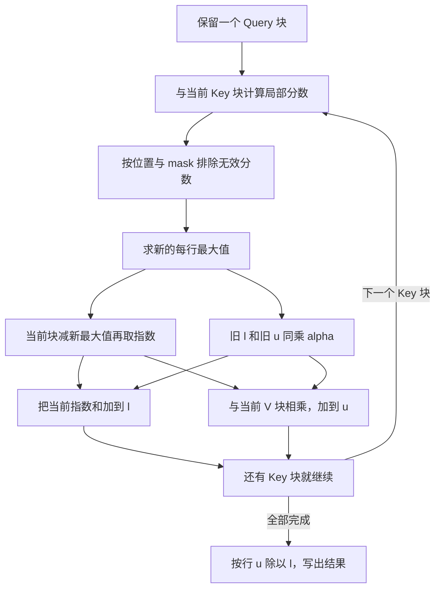

# Attention 的计算与中间张量从哪里来，为什么需要分块？

> Attention 最后需要的是一份加权结果，不一定需要把所有权重一直保存下来。分块计算时，保留每行的最大分数、归一化总和和加权分子；新块改变最大值时，把旧状态换算到新刻度，就能逐块累加。它避免大权重矩阵的持久物化，仍要承担标准稠密 Attention 的成对计算。

## 1. 先不谈模型：怎样按相关程度混合三份信息？

假设你要回答一个问题，有三份可参考的信息。先给它们打分，再把分数变成总和为 1 的权重，最后按权重混合信息。这就是今天需要的 Attention 直觉。

常见名称可以放进这个过程里理解：

- **Query，Q**：当前想查找什么。
- **Key，K**：用来和 Query 比较、产生分数的表示。
- **Value，V**：最后要按权重混合的信息。

在模型里它们都是向量或矩阵，通常来自上游投影。本篇先把 Q、K、V 当成已经给定的数，不要求你先学完整 Transformer。

把向量对应位置相乘再相加，叫**点积**。它会生成一个分数。分数怎样表达相关性来自模型训练；这里先研究给定这些数之后怎样计算。

## 2. 一个 Query 怎样变成一个输出？

先用每个向量只有一个数的例子：

```text
Q = [1]
K = [1], [2], [3]
V = [10], [20], [30]
```

Q 与三个 K 的点积是 `[1,2,3]`。我们希望大分数对应较大的非负权重，并把权重总和变成 1。

**Softmax** 就做这件事：对每个分数取指数，再除以所有指数的总和。

\[
p_j=\frac{e^{s_j}}{\sum_t e^{s_t}}
\]

这行的权重约为 `[0.09003,0.24473,0.66524]`，最后输出为：

```text
0.09003*10 + 0.24473*20 + 0.66524*30 ≈ 25.7521
```

输出不是“选中 30 后直接返回”，而是加权混合。后面分块时，要保持的是这同一个加权结果。

一般情况下，Q 为 `(Nq,d)`，K 为 `(Nk,d)`，V 为 `(Nk,dv)`：

\[
S=QK^T/\sqrt d,\quad P=\operatorname{softmax}_{row}(S),\quad O=PV
\]

`S`、`P` 都是 `(Nq,Nk)`，`O` 是 `(Nq,dv)`。每行独立做 softmax。除以 `sqrt(d)` 是常见缩放：在各项独立、零均值、单位方差的简化条件下，d 项点积的方差随 d 增长，缩放帮助控制分数尺度。前面 d=1，所以系数就是 1。[FlashAttention 原论文 Appendix B.3](https://arxiv.org/abs/2205.14135v2)

## 3. 分数很大时，直接 exp 会发生什么？

如果分数变成 `[1001,1002,1003]`，它们之间的差仍是刚才的差，但直接计算指数容易超出浮点范围。

可以先把所有分数减去同一个最大值 m。因为分子和分母都乘了同一个 `exp(-m)`，归一化后权重不变：

\[
p_j=\frac{e^{s_j-m}}{\sum_t e^{s_t-m}},\qquad m=\max_j s_j
\]

现在指数的输入是 `[-2,-1,0]`，最大指数值只有 1。记住这个“换刻度”的动作：后面新块带来更大最大值时，我们还要对旧状态做同样的换算。

这里先假定有效分数有限。输入中 NaN／Inf，以及矩阵乘法本身溢出，不会因为减最大值就自动变成一个定义良好的计算；练习会明确拒绝这类输入或溢出。

## 4. 中间矩阵为什么会比 Q、K、V 大很多？

自注意力中常有 `Nq=Nk=L`，分数 S 包含每个 Query 与每个 Key 的配对，共 `L²` 个位置；不是只有 L 个分数。

设 `L=8192`，一张每元素 2 字节的 S 表就有 `8192²*2 = 128 MiB`。如果朴素实现分别保留 S 与 P，两张共 256 MiB；batch=1、32 个 head，就达到 8 GiB。这只是指定存储格式的容量账本，不是某个框架默认实现的实测显存。

Q／K／V 则各约 L×d 或 L×dv 个元素，通常与序列长度成正比。序列长度翻倍时，大配对表会变为 4 倍，这就是它很容易成为容量和搬运负担的原因。

还有计算账本：两次稠密矩阵乘法分别约 `2Nq*Nk*d` 和 `2Nq*Nk*dv` FLOPs。若 d=dv，则自注意力为 `4L²d`，尚未数缩放、mask 与 softmax。**不保存大矩阵，不代表这份稠密成对计算自动变成线性。**

现代 SDPA 等接口可能已经选择融合后端，所以不能把上述朴素实现当作每个当前框架都在执行的默认路径。[PyTorch SDPA 接口与后端说明](https://docs.pytorch.org/docs/2.14/generated/torch.nn.functional.scaled_dot_product_attention.html)

## 5. 各块分别 softmax，再拼起来不就行了吗？

先试一个更容易看出错误的例子：分数 `[0,0,0]`，拆成 `[0,0]` 和 `[0]`。

第一块单独 softmax 得到 `[0.5,0.5]`，第二块得到 `[1]`。拼起来总和是 2，而正确结果应为 `[1/3,1/3,1/3]`。

原因是每块都用了自己的分母。它们还没有共享**整行的总量**。因此，不能只留下各块归一化后的权重，不记它们如何被归一化。

该保留什么？先考虑一个分数向量，不考虑 V。看过一部分分数后，保存：

- `m`：目前最大的分数。
- `l`：目前所有 `exp(score-m)` 的和。

这两个数足够把旧数据的“总量”换算到下一块的新刻度。[Online normalizer calculation，Algorithm 3 与 Theorem 1](https://arxiv.org/abs/1805.02867v2)

## 6. 新块最大值变大，旧分母怎样修正？

设旧最大值为 m，新块与旧状态合起来的最大值为 `m'`。旧的一个指数项可以这样改写：

\[
e^{s-m'}=e^{s-m}\,e^{m-m'}
\]

对旧的每个项都乘同一个因子 `alpha=exp(m-m')` 即可；不必把旧分数全部再取出来。

所以，读入一个分数块 `s_block` 后：

\[
m'=\max(m,\max s_{block})
\]

\[
l'=\alpha l+\sum_{j\in block} e^{s_j-m'}
\]

这叫 **online normalizer**：边读数据，边维护归一化需要的状态。这里的 online 是流式更新，不是线上服务。

如果最终要返回所有 softmax 权重，得到 m、l 后仍需再遍历输入来写出权重。**一次遍历的是最大值与分母的联合更新，不是凭两个数就凭空返回全部输出。** 本篇第一道题完整实现了这个两遍过程。

## 7. Attention 只要混合结果，能再少存一点吗？

前面最终需要的是 `sum(p_j*v_j)`。不用先把整张 P 写出来，可以同时维护一个加权分子向量：

\[
u=\sum_{seen} e^{s_j-m}v_j
\]

新块到来时，u 与 l 使用同一个旧刻度，因此必须一起缩放：

\[
u'=\alpha u+\sum_{j\in block} e^{s_j-m'}v_j
\]

全部 Key 块完成后，输出 `O=u/l`。l 是每个 Query 的一个数，u 是每个 Query 的 dv 个数。**如果只修正 l、忘了修正 u，结果就会错。**



这与 FlashAttention 原论文第 3.1 节、Algorithm 1 的分块缩放思路一致。本文保存未归一化 u、最后除 l，并采用 Query 块外层循环；原论文 Algorithm 1 使用 K／V 块外层、逐阶段写回归一化 O。二者可从同一缩放关系推导，**这里验证代数，不宣称逐行复刻论文调度或 IO 最优实现。**

## 8. 用刚才三个分数，亲手合并一次

仍是分数 `[1,2,3]`、Value `[10,20,30]`，每次读两个 Key。

第一块 `[1,2]`：

```text
m = 2
l = exp(-1)+1 ≈ 1.367879
u = 10*exp(-1)+20 ≈ 23.678794
```

第二块 `[3]`，新最大值为 3。旧状态乘 `alpha=exp(2-3)≈0.367879`：

```text
l' = 1.367879*alpha + 1 ≈ 1.503215
u' = 23.678794*alpha + 30 ≈ 38.710942
O  = u'/l' ≈ 25.7521
```

它与先算完整 softmax 再乘 V 一致。[实际 FP64 输出](evidence/runs/lab.json) 保留了状态和断言，以上只是便于阅读的四舍五入显示。

## 9. mask 和整行无效，为什么要单独处理？

**Mask** 用来表达某个 Query 可以看哪些 Key。因果 Attention 的简单位置规则是：位置 i 只能看 `j<=i`，不能看未来。

本篇布尔 `keep_mask` 的 True 表示允许参与，False 表示排除；分数在 softmax 前被设为 `-inf`，对应指数贡献为零。它与 PyTorch SDPA 的布尔含义一致，不能把不同 API 的 mask 含义混用。

若一个块甚至整行都无效，最大值可能是 `-inf`。照搬减最大值会出现 `-inf-(-inf)`，产生 NaN。参考实现把“没有有效分数的刻度”安全替换为 0 来计算指数，而状态最大值仍表示未见有效元素；所有贡献为零。

最终 l=0 时，本篇约定输出零。这是明确的工程返回约定，**不是空集合 softmax 在数学上天然有定义**；也不保证每个接口、每个后端都有相同返回策略。它已与本机 PyTorch 2.9.1 的 CPU SDPA 对照验证。

还有一种隐蔽错误：先对被屏蔽的大分数取 exp，之后再填零。最终也许看起来正常，内部却已产生 Inf。练习现在先屏蔽再取指数；修复前失败与最终测试均保存。

位置也要说清：练习 causal 使用本地坐标 `j<=i`，是 top-left 对齐。它不自动包含 KV Cache 的历史位置偏移；短 Query、长 Key 的增量生成不能不加分析地沿用这个开关。

## 10. 当前源码：这三个状态还在吗？

实际刷新官方 FlashAttention 仓库 `main` 后固定 `767386d814051d1d853c45ac952d8259b5bc7235`，按文件拉取并归档。没有构建或运行该仓库。

### 10.1 先读一条易对应的 C++／CUDA 行块路径

[flash_fwd_kernel.h 的 compute_attn，第 1082—1098 行](https://github.com/Dao-AILab/flash-attention/blob/767386d814051d1d853c45ac952d8259b5bc7235/csrc/flash_attn/src/flash_fwd_kernel.h#L1082-L1098) 从 blockIdx 取得 Query 行块、batch、head，进入 `compute_attn_1rowblock`。

其 [第 326—374 行](https://github.com/Dao-AILab/flash-attention/blob/767386d814051d1d853c45ac952d8259b5bc7235/csrc/flash_attn/src/flash_fwd_kernel.h#L326-L374) 顺着完成局部 QK、mask、`softmax_rescale_o` 和局部 PV；[第 438—443 行](https://github.com/Dao-AILab/flash-attention/blob/767386d814051d1d853c45ac952d8259b5bc7235/csrc/flash_attn/src/flash_fwd_kernel.h#L438-L443) 最后归一化并转换输出类型。

需要特别看 [softmax.h 第 136—165 行](https://github.com/Dao-AILab/flash-attention/blob/767386d814051d1d853c45ac952d8259b5bc7235/csrc/flash_attn/src/softmax.h#L136-L165)：它先保留旧 `row_max`，再更新最大值，用 `scores_scale` 同时缩放 `row_sum` 与 `acc_o`。m、l、u 的换刻度就在这些动作里。

实现使用 `exp2` 配合 `log2(e)` 的缩放，而不是原样写 `exp`。源码 row_max 与 acc_s 使用同一输入刻度，缩放在指数计算时应用；教学公式已经把缩放放进 S，阅读时需要统一这两个口径。局部 P 还转为低精度格式供后续矩阵乘法使用。CPU FP64 参考不模拟这些舍入细节，也不复现寄存器布局和同步。

[scale_apply_exp2，第 65—89 行](https://github.com/Dao-AILab/flash-attention/blob/767386d814051d1d853c45ac952d8259b5bc7235/csrc/flash_attn/src/softmax.h#L65-L89) 有全 `-inf` 处理；部分其他保护受 `Check_inf` 与 causal／local 等模板条件影响。不能把这条路径说成接受练习中的任意稠密布尔 mask。

### 10.2 再看当前 CuTeDSL 路径

当前仓库的 [README，80—99 行](https://github.com/Dao-AILab/flash-attention/blob/767386d814051d1d853c45ac952d8259b5bc7235/README.md#L80-L99) 已列 FlashAttention-4 的 CuTeDSL 入口，面向 Hopper／Blackwell。因而，不能把刚才那条 C++ 路径当作当前仓库所有架构的唯一或统一默认实现。

实际取得的 [cute/softmax.py 第 187—250 行](https://github.com/Dao-AILab/flash-attention/blob/767386d814051d1d853c45ac952d8259b5bc7235/flash_attn/cute/softmax.py#L187-L250) 仍然维护 `row_max`、`row_sum`，返回 `row_scale`；旧 sum 乘这个比例后再加入新块。它还按 `check_inf` 处理无效刻度。

[finalize 与 rescale_O，第 252—301 行](https://github.com/Dao-AILab/flash-attention/blob/767386d814051d1d853c45ac952d8259b5bc7235/flash_attn/cute/softmax.py#L252-L301) 分别完成最终归一化／统计量处理，以及对输出累加状态的逐行缩放。新实现的语言和流水组织在变，但今天推导的状态与缩放关系仍能帮助读懂它。

这段只分析实际取得的 Softmax 类基础方法。文件还有变体，仓库还有其他架构和调度路径；本文没有追踪全部新路径的 dispatch、调用点或性能，不把看到方法定义说成特定 GPU 已执行。

## 11. 分块以后，到底省了哪一类容量？

对足够大的问题，固定 Query tile 为 Bq 行、Key tile 为 Bk 行，单张局部分数表至多 `min(Bq,Nq)*min(Bk,Nk)` 个元素，每行还保留 m、l 和 dv 维 u。

例如 `Bq=64,Bk=128`，分数 tile 只有 8192 个元素，相比 `8192²` 的大配对表小得多。这里数一张表的元素数，实际还会同时存在其他常数份局部临时量、输入和完整输出，不能把它称为程序的峰值字节数。

如果故意把两块尺寸都设得足以覆盖全部问题，这一块本身就具有完整得分矩阵的形状。因此准确说法是**按选定 tile 计算，不额外持久保存全量 S／P**；内存收益依赖块配置，不能写“任何输入与块大小下绝不产生完整形状的表”。

可选的稠密 `keep_mask` 本身也是 `Nq×Nk`，传入它就已经承担二次容量。causal 可由局部坐标生成，不必专门分配整张 mask。CPU 参考还可能把输入提升为 FP64，额外容量随输入线性增长。

Q 块外层的简单实现会为不同 Q 块重读 K／V；真实 HBM 流量还受缓存、片上容量与调度影响。节省中间表和实现 IO 最优是不同结论。本文没有测 allocator 峰值、HBM 流量或速度。

论文也讨论为反向传播保存少量统计量、重算局部 S／P，以避免保留大表；本篇代码只有推理前向，不提供训练反向或 dropout。论文中的 exact 指标准稠密 Attention 的代数形式，而不是与所有浮点执行路径逐 bit 相等。

## 12. 动手练习

### 练习一：在线维护分母，但真正返回完整 softmax

实现 `online_softmax(x,block_size,keep_mask=None)`。CPU 一维 FP32／64 输入，内部用 FP64；先用一遍分块维护 m、l，再第二遍返回权重。可选 True=keep；空向量返回空向量，全屏蔽返回零。不提供梯度。

测试 `[1000,1001,999,1002]`，不同块大小应与稳定 `torch.softmax` 一致；再测试前面整块屏蔽、后面出现有效元素，以及被屏蔽的 10000 不应在内部取 exp 时溢出。

<details>
<summary>详解与完整答案</summary>

每块取有效元素，若为空就跳过。把旧 l 乘 `exp(m-m')`，加新块指数和。第二遍先按最终 m 平移，屏蔽无效位置，再 exp 除 l。

完整 [answers.py](code/answers.py)。不能对每块单独 softmax 后拼接；不能在返回最终概率前忘记第二遍；不能只在指数之后屏蔽大值。[修复前失败](evidence/runs/masked-exp-before-fix.txt) 和 [最终测试](evidence/runs/tests.txt) 可对照阅读。

</details>

### 练习二：只保留块状态，计算 Attention 输出

实现 `tiled_attention(q,k,v,block_q,block_k,keep_mask=None,causal=False)`。CPU、单 head、二维 FP32／64，类型相同；内部统一 FP64、返回 FP64。`d>0`，允许零 Query／Key 长度；causal 仅本地 `j<=i`；显式 mask 与 causal 取交集。

按公式维护 m、l、u，最后除 l；整行无效返回零。拒绝 NaN／Inf 输入和分数／未归一化分子溢出。它是有界小规模参考，不是涵盖极端动态范围的通用稳定数值库。

验收手算输出约 25.7521；随机非方阵、多个 tile、非连续输入、奇数尾部与全屏蔽行，与独立的 PyTorch CPU SDPA 对照，固定 FP64 案例使用 `rtol=atol=1e-12`。

<details>
<summary>详解与完整答案</summary>

外层取一块 Q，初始化 `m=-inf,l=0,u=0`；内层取 K／V、计算小分数块、应用 mask。为尚无有效元素的行使用安全刻度，避免 `-inf-(-inf)`。求 alpha 后一起缩放旧 l 和 u，再加入当前块，最后用非零分母归一化。

完整 [答案](code/answers.py) 也提供二次容量的 `dense_attention` 便于对照；测试另外使用框架 SDPA，并非只比较两份共享公式的自写程序。

```bash
python3 -m unittest discover -s code -p 'test_*.py' -v
python3 code/run_lab.py
```

已有 Python 3.10+、PyTorch 即可。实际 [15 项测试](evidence/runs/tests.txt) 通过，[lab.json](evidence/runs/lab.json) 保存逐块状态与容量整数账本，大例子没有实际分配 8 GiB。没有执行 FlashAttention、CUDA、低精度矩阵路径、反向或 dropout。

中间 u 可能因极端 Value 过大而溢出，即使最终数学加权平均仍有限，参考实现也会报错；不要把小规模 FP64 验收器误当覆盖所有输入的生产实现。GPU 数值容差、mask 位置、性能和容量须按目标环境另验。

</details>

## 13. 面试官继续追问

| 层次 | 问题 | 回答要点 |
| --- | --- | --- |
| 基础 | S／P 为什么是 L²？ | 每个 Query 和每个 Key 都有一个分数，softmax 按行归一化。 |
| 推导 | 块内 softmax 拼起来为什么错？ | 块分母不同，需要共享整行归一化刻度与总量。 |
| 算法 | 新最大值变大时应缩放什么？ | l 和未归一化加权分子 u 同乘 exp(m_old-m_new)。 |
| 边界 | 全屏蔽行为何容易 NaN？ | -inf 减 -inf 与零分母，需要明确实现约定和分支。 |
| 源码 | exp2 与 exp 是否表示算法改了？ | 配合 log2(e) 可表达同一指数变换，但硬件舍入与近似不能视为 bitwise 相同。 |
| 选择 | FlashAttention 消除了二次计算吗？ | 标准稠密成对计算仍在，主要改变物化与内存层级之间的搬运。 |
| 验证 | 参考通过能证明 FA4 在目标 GPU 上正确且快吗？ | 只能证明本篇 CPU 代数与契约；实际 dispatch、低精度、指令与性能仍需验证。 |

至此前 10 篇把布局、广播、数值、成本模型、GPU 分工、计时、分块和融合连接起来。下一步进入生成过程：新 token 到来时，历史 K／V 为什么能复用，以及 Cache 的大小与生命周期怎样管理。

资料与原论文笔记：[references.md](references.md)。审查：[review.md](review.md)。前置：[算子融合](../2026-10-23-kernel-fusion/README.md)。返回 [索引](../../../index.md)。
