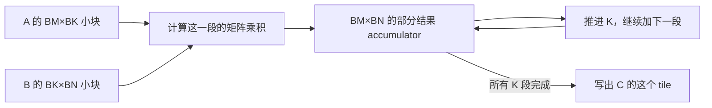

# 为什么矩阵乘法需要分块与数据复用？

> 分块先是一种保持数学结果不变的拆分方法。它的性能价值来自：把一小片输入拿进来以后，尽量多次使用；把部分输出留住，累加完再写回。块大小还会改变资源占用、边界浪费和可用并行度，所以并非越大越好。

## 1. 先算一个输出，看看数据被重复用了几次

矩阵乘法写作 `C=A@B`。若 A 的形状是 `(M,K)`，B 是 `(K,N)`，那么 C 是 `(M,N)`。

为什么中间的 K 要相等？因为 C 的一个位置，要把 A 的一行和 B 的一列逐位置相乘，再求和：

\[
C_{ij}=\sum_{k=0}^{K-1} A_{ik}B_{kj}
\]

先不要被下标吓住。`i` 选输出的哪一行，`j` 选哪一列，`k` 是求和时沿着输入走的位置。

例如：

```text
A = [1 2 3 4]       B = [1 0]
    [5 6 7 8]           [0 1]
                        [1 0]
                        [0 1]
```

左上角 `C[0,0] = 1*1 + 2*0 + 3*1 + 4*0 = 4`。右上角 `C[0,1]=6`。第一行 A 同时服务了两个输出；第一列 B 也会服务 C 的两行。

**数据本来就有复用机会。关键是：算下一个输出时，还能否用到刚才读进来的那份数据？** 如果每次都从远处重新拿，就浪费了这个机会。

## 2. 把一条长求和，拆成两段会怎样？

先沿 K 在第 2 个位置后切开，得到：

```text
前半段： [1 2] @ [1 0] = [1 2]
         [5 6]   [0 1]   [5 6]

后半段： [3 4] @ [1 0] = [3 4]
         [7 8]   [0 1]   [7 8]

相加：                  [4  6]
                        [12 14]
```

与一口气沿 K 求和一样，因为只是把同一组乘积拆开再加起来。浮点运算的舍入顺序可能不同，第 03 篇已经解释为什么测试应使用适合的误差标准，而不是默认 bitwise 相同。

把这样一块矩阵叫 **tile，分块**。一次输出 tile 的形状记为 `(BM,BN)`，每次沿求和方向处理 `BK` 个位置。



**Accumulator** 就是保存“加到当前为止的部分结果”的地方。K 循环还没结束时，不能把它当最终结果。

## 3. 分块到底少读了什么？亲手数一次

先用没有缓存复用的朴素模型：每个输出位置独立读取 K 个 A 和 K 个 B。总共读 `2MNK` 个输入元素，最后写 `MN` 个输出。

在刚才 `2×4 @ 4×2` 的例子里，4 个输出各读 8 个数，共读 32 次输入元素。注意说的是读取次数，不是独立输入一共只有多少个数。

若一次合作算整个 `2×2` 输出块，每次沿 K 处理 2 个位置：

- 第一阶段读 `2×2` 个 A、`2×2` 个 B，共 8 个输入元素。
- 第二阶段同样读 8 个。
- 总共 16 次输入读取，最后写 4 个输出。

同一块 A 中的每个数服务 2 列输出，同一块 B 中的每个数服务 2 行输出。计算总量没减少，减少的是这份模型里重复从目标层级加载的次数。

在一般的完整 tile 中，一阶段：

\[
F_{stage}=2BM\cdot BN\cdot BK
\]

\[
Q_{input}=s(BM\cdot BK+BK\cdot BN)
\]

`s` 是输入元素字节数。前一个式子数所有乘加，后一个式子数两个输入 tile。暂时只看输入，二者之比为：

\[
I_{input}=\frac{2BM\cdot BN}{s(BM+BN)}
\]

你可能发现 `BK` 消掉了。**在这个“有效元素各读一次”的账本里，增加 BK 会同时增加一阶段计算与加载，没有自动提高这个比例。** 它仍可能改变循环次数、流水线和资源，但需要另外分析。

## 4. 整个矩阵的账本，为什么仍不等于“各读一次”？

每个输出 tile 重复上述过程。不考虑不同输出 tile 之间的缓存复用，且只数实际有效元素：

\[
R_A=MK\left\lceil\frac N{BN}\right\rceil,\qquad
R_B=KN\left\lceil\frac M{BM}\right\rceil
\]

同一片 A 可能要为不同输出列块再读一次，因此出现 `ceil(N/BN)`。同理，B 为不同输出行块重读。

输出写入 `MN` 个元素，`C=A@B` 不需要读取旧 C。所以本篇逻辑流量模型是 `Q=s(R_A+R_B+MN)`。

这补上第 04 篇的一层细节：`s(MK+KN+MN)` 是非常乐观的整矩阵复用账本；块级模型明确写出了跨输出块重读。如果 L2 接住其中的重读，真实 DRAM 流量又可能更低。

别把本模型直接等同 CPU 参考程序的实际内存流量。参考程序的每个 tile `@` 还会调用 CPU 库，内部可能 packing、分配临时量和使用缓存。这里只核对块代数和有声明前提的加载次数。

## 5. 从内存层级理解：东西要留在哪里？

GPU 的全局显存容量大；寄存器和 shared memory 更靠近执行单元，容量较小。高效 GEMM 会在多个层次组织复用，而不是只做一次 Python 切片。

大体可以沿着这个问题链理解：哪些数据从全局内存读进来？哪些线程共同使用它？每线程或矩阵指令保留哪些输入和累加状态？下一段 K 到来时，旧状态什么时候可以释放？

具体存储位置、搬运指令与同步方案依实现和架构而变。不能看见 Triton `tl.load` 就断言某个变量一定住 shared memory；需要继续看编译布局与生成代码。

CPU 高性能 GEMM 也有同类问题。[Goto 与 van de Geijn 的原论文](https://doi.org/10.1145/1356052.1356053) 第 3 节、Figure 5 从分层块乘构造计算；第 4.2.1—4.2.3 节讨论缓存层、地址转换范围与 packing。**Packing** 是把原来不便连续访问的数据重新排进适合内核消费的工作区。

这篇论文分析的是 CPU 缓存／寄存器等条件，不能把它的某个 cache 参数直接翻译成 GPU shared memory 容量。我们借用的是“复用必须匹配所在层级的容量和带宽”这一思路，现代 GPU 路径还要对照实际代码。

## 6. 看当前 Triton 源码：前面的每一步在哪里？

实际刷新并取得的官方 Triton `main` 固定为 `1ec1eee840b8a35b15101e5ab9a4388e905291f3`。本篇分析 matrix-multiplication 教程，未运行或编译它。

### 6.1 谁负责哪个 C 块？

[第 252—264 行](https://github.com/triton-lang/triton/blob/1ec1eee840b8a35b15101e5ab9a4388e905291f3/python/tutorials/03-matrix-multiplication.py#L252-L264) 把 `pid` 映射为 `pid_m,pid_n`。它还把输出块按组重排，希望邻近工作更有机会复用 L2 中的输入。

这改善的是跨块局部性，不是保证硬件严格按 program id 顺序执行。也不能只看重排公式就宣称本机获得教程提到的性能收益。

### 6.2 怎样从逻辑坐标找到数据？

[第 279—290 行](https://github.com/triton-lang/triton/blob/1ec1eee840b8a35b15101e5ab9a4388e905291f3/python/tutorials/03-matrix-multiplication.py#L279-L290) 构造 A、B 两块的指针：行坐标乘行 stride，列坐标乘列 stride，再相加。这与第 01 篇地址公式直接衔接。

M、N 边缘使用取模，令输入地址仍落在有效行列上；这会为越界逻辑槽位重复加载有效行列，不是完全没有边缘开销。本篇“只数有效元素”的模型没有把这些冗余槽位算进去。

### 6.3 部分结果怎样跨 K 段保存？

[第 292—312 行](https://github.com/triton-lang/triton/blob/1ec1eee840b8a35b15101e5ab9a4388e905291f3/python/tutorials/03-matrix-multiplication.py#L292-L312) 创建 FP32 accumulator，在 K 循环里加载 A／B，`tl.dot(a,b,accumulator)` 累加，然后推进两个输入指针。

K 的最后一段不足 BK 时，mask 让无效位置读成零。这样它们不贡献有效乘积。循环后才把累加结果转为 FP16；不要把 FP32 累加误写成最终输出仍为 FP32。

[第 314—320 行](https://github.com/triton-lang/triton/blob/1ec1eee840b8a35b15101e5ab9a4388e905291f3/python/tutorials/03-matrix-multiplication.py#L314-L320) 对输出行列做 mask，避免越界写入。输入取模与输出保护各有职责。

这个教学入口 [第 334—351 行](https://github.com/triton-lang/triton/blob/1ec1eee840b8a35b15101e5ab9a4388e905291f3/python/tutorials/03-matrix-multiplication.py#L334-L351) 还检查 A 连续，并按 FP16 分配 C；源码也包含 stride 正值假设。CPU 参考答案接受部分非连续 FP32／64 输入，不代表这些输入可以原样交给该 GPU 入口。

## 7. 能复用，为什么不把 tile 做到最大？

先数状态。输入 tile 的有效元素量近似 `BM*BK+BK*BN`，累加器有 `BM*BN` 个元素。若累加器是 FP32，其数值状态就有 `4*BM*BN` 字节，还没算分发、流水线、其他变量与分配粒度。

把 BM、BN 都翻倍，累加器元素变为 4 倍。它可能挤压寄存器，使驻留工作减少甚至产生溢出。更多流水线 stage 可能帮助隐藏搬运，也会增加资源需求。实际寄存器数和 shared memory 应看编译结果，不从这一个公式直接给出。

另一个代价是输出块数减少。小矩阵切成很大 tile，可能没有足够独立工作让所有 SM 都忙起来；边缘多时还会做更多无效槽位计算。适合大方阵的块不必然适合细长矩阵。

工程上通常围绕目标 shape、dtype 和硬件搜索配置；在正确性通过之后，用第 06 篇的方法计时，结合编译资源与 profiler 解释原因。不能只用“读次数下降”证明速度必然上升。

## 8. 动手练习

### 练习一：把块代数写出来

实现 `blocked_matmul(a,b,bm,bn,bk)`。限定 CPU、二维 strided Tensor、相同 FP32 或 FP64、`C=A@B`；支持最后不足一块、非连续输入和空维度。它是推理参考，不提供梯度，不改变输入。

先用第 2 节例子求 `[[4,6],[12,14]]`，再与 `a@b` 比较随机非方阵。不要先把所有输入 reshape 成方阵。

<details>
<summary>详解与完整答案</summary>

外层枚举输出的行块与列块，创建与有效输出块等大的零 accumulator。内层沿 K 切片，把小乘积加进去。K 结束后才写输出切片；空 K 的乘积为零矩阵。

完整 [answers.py](code/answers.py) 每个局部乘法调用 PyTorch CPU `@`。它验证拆分与累加，不实现 GPU 指令或 shared memory 搬运。切片自动裁剪边界，与教程的取模／mask 方法不同。

随机 FP64 使用 `rtol=atol=1e-12`，FP32 使用 `1e-5`；固定小整数例子恰好精确相同。测试不以这一组容差承诺任意尺度或输入的误差界，应用应按自己的数值范围定义标准。

常见错误：每段 K 都把 accumulator 清零；误把 BK 当输出列数；尾部拿完整 tile 大小写回；为了图省事只测试各维都整除的方阵。

</details>

### 练习二：比较 tile，哪项成本真的变了？

实现 `tile_traffic(m,n,k,bm,bn,bk,itemsize)`，返回有效输入读取、输出写入、模型字节数、输出块数和单阶段有效输入／累加器元素上界。不要把它叫显存 profiler。

比较 `64×64 @ 64×64` 的 `(BM,BN)=(1,1)` 与 `(8,8)`，BK 都为 8；再只把 BK 改为 16。解释哪些量变化，哪些不变。

<details>
<summary>详解与完整答案</summary>

沿输出列共有 `ceil(N/BN)` 个块，因此每份 A 参与那么多次读取；B 同理由输出行块数决定。扩大输出 tile 在本例把输入读次数减为八分之一，输出写次数保持不变；包括输出写入后的总流量比例则不是恰好 8。

只扩大 BK 时，本模型总有效读取不变，K 阶段数减少，单阶段输入状态增加。最大片段的有效元素上界使用裁剪后的 `min` 尺寸；零输出块时没有输入阶段。

完整 [答案](code/answers.py)、[11 项测试](code/test_answers.py) 与 [诊断输出](evidence/runs/lab.json) 已归档。运行：

```bash
python3 -m unittest discover -s code -p 'test_*.py' -v
python3 code/run_lab.py
```

需要已有 Python 3.10+、PyTorch。实际测试通过；没有用 Python 循环时间判断 GPU tile 优劣，也没有把有效元素上界称为实际 allocator 峰值。

</details>

## 9. 面试官继续追问

| 层次 | 问题 | 回答要点 |
| --- | --- | --- |
| 基础 | 分块是否减少标准 GEMM 的有效乘加数？ | 不减少，主要改变数据复用与执行组织，可能额外计算边缘。 |
| 推导 | BK 翻倍一定提高强度吗？ | 本阶段有效输入账本里分子分母同时增长；需分析其他开销和资源。 |
| 实现 | K 尾部与 M／N 尾部保护一样吗？ | 归约无效位置填零；输出越界禁止写，教程输入行列还用了取模。 |
| 选择 | 128×128 tile 能否替代所有 32×64 tile？ | 看资源、输出块数、shape 比例和边缘，不存在仅按尺寸大小判断的万能配置。 |
| 验证 | CPU 分块结果正确能证明 GPU kernel 正确吗？ | 只能验证块代数参考；GPU 地址、同步、生成指令和数值仍需实机验证。 |

下一篇继续问：我们已经学会分块，Tensor Core 这种专门做矩阵计算的硬件究竟还要求什么？

资料与论文笔记：[references.md](references.md)。审查：[review.md](review.md)。前置：[异步计时](../2026-10-23-gpu-asynchronous-timing/README.md)。返回 [索引](../../../index.md)。
