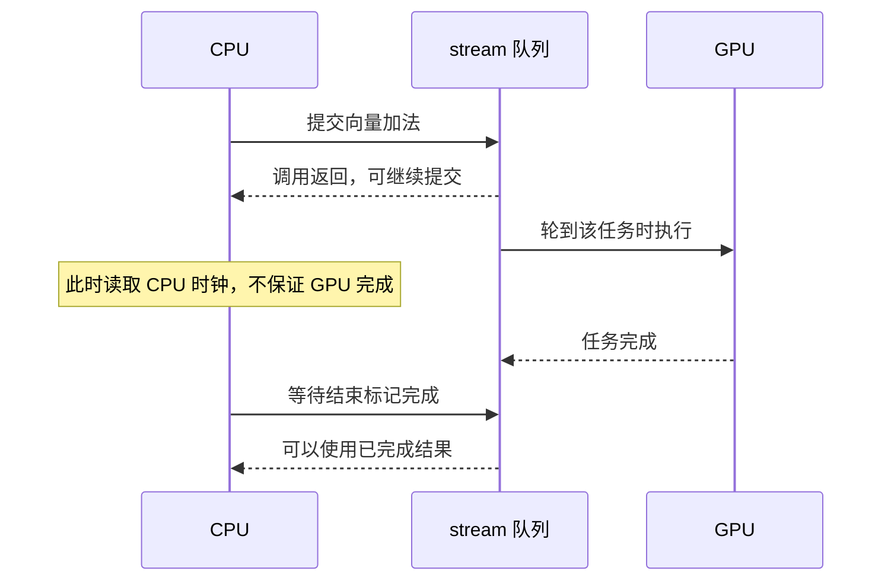

# GPU 计时为什么需要理解异步执行和同步？

> CPU 把工作提交给 GPU，和 GPU 把工作做完，是两个时刻。计时前先决定自己要测哪一段：提交、某条 stream 上的设备事件区间，还是等待结果可用的端到端过程。同步方式必须与这段范围匹配。

## 1. 函数已经返回，为什么结果还可能没算完？

假设一次向量加法提交花 `0.1 ms`，GPU 真正处理需要 `3 ms`。这两个时间是为了讲解设定的，不是实测。

CPU 可以先发出任务，然后继续做其他事情。GPU 稍后拿到任务，再计算、保存结果。程序调用返回，只说明提交这一步走到了返回位置，不保证设备已经完成。

这就是 **asynchronous，异步**：调用方不必在每个操作之后都等结果。GPU 工作通常会先被排入队列。[CUDA 异步执行指南](https://docs.nvidia.com/cuda/cuda-programming-guide/02-basics/asynchronous-execution.html)

因此，下面的两次 CPU 读表，可能只夹住提交过程：

```python
t0 = time.perf_counter()
y = gpu_operation(x)
t1 = time.perf_counter()
```

这段并非永远“毫无意义”：如果目标就是研究主机调用与提交开销，它可能是相关数据。但不能直接把 `t1-t0` 称为 GPU 已完成该算子的时间；调用也可能因为分配、编译或隐式同步包含更多事情。

## 2. 先画出两个独立的时钟视角



图只表达先后关系，不表达实际时间比例。

有三个时刻要分别记住：**提交返回、设备开始、设备完成**。如果 GPU 前面还有工作，设备开始还会更晚。

前一篇讲 thread 和 block，那是在 GPU 内部怎样分工。今天的 CPU 与 GPU 异步，是另一个层次；增加线程并不会自动修复错误的计时范围。

## 3. stream 是什么：先想成一条有顺序的工作队列

一条 **CUDA stream** 是某个设备上的有序操作序列。同一条 stream 上，后续操作按其规定的顺序依赖前面操作。例如先产生 x，再用 x 做加法，通常不需要 CPU 在两者之间停下来等。

```text
stream A：生成 x → 加法 y=x+1 → 求和
CPU：     提交       提交        提交 → 之后再等结果
```

不同 stream 可能重叠，也可能因为资源、依赖或默认流语义没有重叠。**创建两条 stream 不等于保证两份工作同时执行。** PyTorch 也明确区分同流顺序与跨流显式同步。[PyTorch CUDA semantics，Asynchronous execution 与 CUDA streams](https://docs.pytorch.org/docs/2.14/notes/cuda.html#asynchronous-execution)

若 A 产生数据，B 要消费它，就需要表达 `A 的生产完成 → B 的消费开始`。这里的“等待”可以由 GPU 队列执行，不必让 CPU 立刻阻塞。

## 4. 同样叫等待，谁被停住了？

先认识 **event，事件**：可以把它理解为插入某条 stream 的一个进度标记。它完成时，说明这个标记覆盖的前序工作已经走到相应位置。

两种常用动作很不一样：

| 动作 | 等待发生在哪里 | CPU 是否必须等完才继续 |
| --- | --- | --- |
| `consumer.wait_event(done)` | consumer 后续设备工作等 done | 调用通常直接返回 |
| `done.synchronize()` | CPU 等 done 完成 | 是 |
| `stream.synchronize()` | CPU 等该 stream 前序工作完成 | 是 |
| `torch.cuda.synchronize()` | CPU 等当前选定设备的前序工作完成 | 是，范围含该设备各 stream |

事件也不是永久连接两条 stream 的魔法线。记录事件时覆盖的是那个位置之前的工作；生产者之后再提交的新工作，不会自动加入先前的标记。

PyTorch 当前源码正好能核对这些细节。本篇刷新官方 `main`，固定 `d52f3687e72fac81e20fd7741ab1fd10e0b3899d`，实际文件已归档，没有把它当成本机运行的 PyTorch 版本。

[Stream.wait_stream，第 74—86 行](https://github.com/pytorch/pytorch/blob/d52f3687e72fac81e20fd7741ab1fd10e0b3899d/torch/cuda/streams.py#L74-L86) 最终调用 `self.wait_event(stream.record_event())`。读到这里，就能把“记录生产者进度，再让消费者依赖它”对应起来；其说明明确是影响未来工作，调用本身不等待生产者全部执行完。

[Event.record，第 208—218 行](https://github.com/pytorch/pytorch/blob/d52f3687e72fac81e20fd7741ab1fd10e0b3899d/torch/cuda/streams.py#L208-L218) 未指定 stream 时使用当前 stream。[elapsed_time 与 synchronize，第 243—263 行](https://github.com/pytorch/pytorch/blob/d52f3687e72fac81e20fd7741ab1fd10e0b3899d/torch/cuda/streams.py#L243-L263) 分别返回毫秒间隔、等待事件完成。这里是 Python 包装入口，底层实现交给 CUDA 事件；不能据此宣称我们分析或实测了硬件时间戳内部。

## 5. 用 CPU 手推一条时间线

现在用本篇小模型复算，不需要 GPU。约定每次提交 `0.1 ms`，事件和设备依赖的主机成本忽略，各 stream 在资源上可以理想并行。

1. CPU 提交生产者 A，主机时间到 `0.1`；A 在 `[0.1,3.1]` 执行。
2. 记录 A 的完成标记 `3.1`，让 B 等它；CPU 时间仍是 `0.1`。
3. 提交耗时 `2 ms` 的 B，CPU 到 `0.2`；B 必须等 A，因此执行区间是 `[3.1,5.1]`。
4. CPU 做设备同步后，主机时间推进到 `5.1`。

只在两次提交后读 CPU 时间，会看到 `0.2`；等任务完成再读，看到 `5.1`。这两个数并不矛盾，它们回答了不同问题。

若 B 没有依赖、使用独立数据，小模型允许 B 从 `0.2` 开始，与 A 重叠。真实设备还要检查资源、依赖与流配置，所以本篇模型不承担硬件调度预测。

## 6. 正确计时先确定“完成”的边界

### 6.1 我关心 CPU 提交到结果完成

常见教学范围是：清掉此前工作、读 CPU 时钟、提交任务、等待本次完成、再读时钟。

```python
torch.cuda.synchronize()
t0 = time.perf_counter()
operation()
torch.cuda.synchronize()
seconds = time.perf_counter() - t0
```

这里是当前设备上带同步的主机观察区间，会包含提交与等待等成本。前一次同步用于把旧工作排除在起点之外，最后一次同步用于把完成放进终点以内。若同时还有其他人向设备提交工作，这个设备级等待也可能收进干扰；必须记录隔离与并发条件。

若你真正关心完整请求，还要把数据准备、传输、排队、后处理放进相应范围。只测一个算子不能推导请求延迟或 token 延迟。

### 6.2 我关心一条 stream 上的一段设备事件区间

在同一条当前 stream 上记录 start，执行固定批次，再记录 end；等 end 完成后，读取 `start.elapsed_time(end)`，结果单位是 **ms**。[Event 官方接口](https://docs.pytorch.org/docs/2.14/generated/torch.cuda.Event.html)

完整 [benchmark_cuda](code/answers.py) 就按这个顺序写。它假设 `fn` 始终只往当前设备、同一当前 stream 提交工作。若函数内部创建 side stream，而 end 没有依赖其完成，外层事件可能漏掉那份工作。

还要注意：事件区间可以包含主机提交太慢造成的设备空档，以及资源竞争等影响。**它不是自动剥离所有开销后的单个 kernel 纯指令执行时间。**

### 6.3 为什么批量执行，还要预热？

第一次可能初始化上下文、分配缓存、编译、选择算法。预热是把明确不属于目标稳态的准备工作移出计时；5 次只是本篇示例参数，不能保证所有工作负载都已稳定。

一次事件间夹 20 次调用，算 `区间/20`，得到该批次的平均每次时间。再做 5 个批次，保留原始样本和中位数。它不能冒充逐请求延迟分布或 P99。

本篇 GPU 示例使用固定输入、预分配输出，是重复访问同一批数据的热输入场景。冷缓存、轮换输入、分配输出或其他 batch 策略应另行测量；不要只换个标签沿用结果。

## 7. 跨 stream 还藏着一件事：内存活到什么时候？

假设 Tensor 在 A 上创建，在 B 上使用。除了保证 B 读取前生产完成，还要保证内存不会在 B 使用完前被 allocator 回收复用。

PyTorch 的 `wait_stream`／事件依赖解决执行顺序；`Tensor.record_stream` 让分配器跟踪跨流使用生命周期，两者职责不同。不能只 `record_stream` 就假设数据已经生产好了。[官方跨流示例及解释](https://docs.pytorch.org/docs/2.14/notes/cuda.html#cuda-streams)

这部分先记住两个问题：“什么时候能读”与“什么时候能回收”。后续写流水线和内存管理时再展开。

排查时也避免把 `.item()`、打印 GPU 结果或 CPU 拷贝随意放进计时循环，它们可能引入主机等待。`CUDA_LAUNCH_BLOCKING=1` 可帮助定位异步错误，但改变了执行方式，不应不加说明地作为正常异步性能配置。[CUDA semantics](https://docs.pytorch.org/docs/2.14/notes/cuda.html#asynchronous-execution)

## 8. 动手练习

### 练习一：构造能看懂的异步队列

实现 `QueueModel`：每次 submit 推进主机提交时间；同 stream 串行，不同 stream 可理想并行；event 捕获前序完成时刻；wait_event 只限制后续设备任务，不推进主机；synchronize 才把主机推进到所有任务完成。

验收前面 A 3 ms、B 2 ms 的例子；再测试先记录 A 的事件、之后又提交更长 A 任务，B 应只等已经记录的那一段。

<details>
<summary>详解与答案</summary>

每条流保存一个尾部完成时间。新任务开始时间是 `max(主机提交结束,本流尾部)`，结束再加时长。wait_event 更新消费者流的尾部下界，但不改主机时钟。

完整 [answers.py](code/answers.py) 使用逻辑毫秒，不睡眠，也不发 GPU 请求。[run_lab.py](code/run_lab.py) 输出 A `[0.1,3.1]`、B `[3.1,5.1]`，与正文一致。模型忽略默认流特殊语义、事件开销、内存生命周期和资源竞争，所以不能用来证明真实并行率。

</details>

### 练习二：实现范围明确的事件计时器

实现 `benchmark_cuda(fn,warmup,iterations,repeats)`。检查循环次数；warmup 后同步；每批创建启用计时的 start/end，记录顺序正确；先等待 end，再读取 elapsed 毫秒，转为秒并除调用次数。无 CUDA 时明确报错，不产生假时间。

用 mock 事件检查 API 顺序，并用 `20 ms / 4 = 0.005 s` 验证单位。mock 验证代码协议，不能取代真实 GPU 测试。

<details>
<summary>详解与答案</summary>

完整 [benchmark_cuda](code/answers.py) 和 [gpu_demo.py](code/gpu_demo.py) 已归档。demo 在 CUDA 可用时创建 FP32 连续向量，预分配输出，测 `torch.add(...,out=out)`，最后另做结果正确性检查，并输出环境、输入和样本。

```bash
python3 -m unittest discover -s code -p 'test_*.py' -v
python3 code/run_lab.py
python3 code/gpu_demo.py
```

需要已有 Python 3.10+ 和 PyTorch。实际前两项通过；demo 在本机输出 `SKIP`，原因是 CUDA 不可用，日志见 [gpu-demo.json](evidence/runs/gpu-demo.json)。因此没有 GPU 时间结果，不能把 mock 的 0.005 秒写成测量值。

9 项 CPU 测试包含 6 项时间线／边界检查及 3 项计时调用协议检查。常见错误包括只在计时前同步、没等 end 就读、把毫秒当秒、把不同 stream 的工作漏到区间外。实际 GPU 正确性和性能仍需在目标设备运行 demo 验证。

</details>

## 9. 面试官继续追问

| 层次 | 问题 | 回答要点 |
| --- | --- | --- |
| 基础 | GPU 函数返回代表什么？ | 通常代表调用／提交返回，不保证设备完成。 |
| 顺序 | 同流生产消费需要每步 CPU 同步吗？ | 依赖可由流顺序表达；不必每步阻塞主机。 |
| 源码 | wait_stream 为什么记录事件？ | 捕获对方当前前序工作，给本流未来工作建立依赖。 |
| 范围 | 外层事件能测内部所有 side stream 吗？ | 只有正确汇合依赖后才能覆盖，不能默认包含。 |
| 生命周期 | record_stream 能代替 wait_stream 吗？ | 一个帮助分配器管理寿命，一个表达执行依赖。 |
| 测量 | 批次均值的中位数是不是 P99？ | 不是；需要定义逐请求样本和统计口径。 |

下一篇进入 GEMM：已有足够线程，为什么还要把矩阵切成小块，反复使用读进来的数据？

本篇讨论官方执行语义，不涉及需要原论文复现的特定算法。资料：[references.md](references.md)；审查：[review.md](review.md)；前置：[GPU 映射](../2026-10-22-gpu-parallel-mapping/README.md)；返回 [索引](../../../index.md)。
