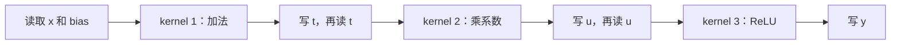
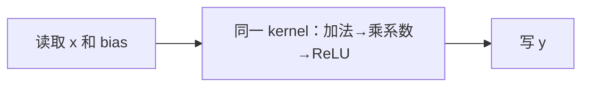

# 算子融合什么时候划算，什么时候会适得其反？

> 融合把原来分开执行的步骤放进同一个 kernel，让一些中间值留在片上，减少写回、重读和启动。代价是这些步骤必须共享一套执行组织和资源。要依次问：结果能否保持、哪些成本消失、又增加了什么，最后才看实际是否更快。

## 1. 三步小计算，先把中间结果写出来

很多神经网络层不只做一次加法。例如给每列加 bias，乘一个系数，再把负数变成零：

```python
t = x + bias
u = t * 2
y = torch.relu(u)
```

**ReLU** 在这里就是 `max(value,0)`。先用一行小数看看：

```text
x      = [-2, 0,  2]
bias   = [ 1, 2, -1]
t      = [-1, 2,  1]
u      = [-2, 4,  2]
y      = [ 0, 4,  2]
```

若 t、u 只是为了得到最后的 y，外部没有人需要它们，是否一定要先完整保存 t，下一步再把它读回来？

可以换一种组织：读一个位置的 x 与 bias，在局部依次加、乘、截断，直接写最终 y。步骤都还在，只是不再要求两个完整中间张量分别落到全局内存里。

这就是理解 **kernel fusion，内核融合** 的起点。

## 2. 为什么 Python 写成一行，不等于已经融合？

```python
y = torch.relu((x + bias) * 2)
```

数学表达一样，但 Python 表达式长度不决定 GPU 有几个 kernel。框架可能逐个调算子，也可能由编译器或库合并步骤；某个复杂算子自身还可能由多个 kernel 完成。

所以要区分：**表达式合在一行、计算图中有融合节点、最终运行了融合 kernel**。确认最后一种，要看生成代码和实际 trace，不能只数 Python 行数。

本篇用“手工规定三步各一个 kernel，与一个融合 kernel”来建账，随后读真实编译器怎样作决定。没有宣称任意版本的 eager 或 compile 对这个表达式一定生成相同数量。





第二幅图少了两个完整中间值的写入和读取，没有少掉数学步骤。

## 3. 省了多少数据？先约定账本口径

令 x 和 y 为 `(M,N)`，bias 为 `(N,)`，每个元素占 `s` 字节。先采用乐观的 bias 复用账本：整次调用只把 N 个独立 bias 元素算一次，忽略标量系数流量。

三步分开时，按主张量读写：

| 步骤 | 读取 | 写入 |
| --- | --- | --- |
| 加法 | x：MN；bias：N | t：MN |
| 乘法 | t：MN | u：MN |
| ReLU | u：MN | y：MN |

因此 `Q_staged=s(6MN+N)`。若融合后没有额外 spill 或重读，主输入输出账本是 `Q_fused=s(2MN+N)`，节省 `4MN*s` 字节。

`4MN` 从哪来？t 一次写、一次读，u 一次写、一次读，总共四份。**偏置广播没有完整复制 bias，但中间结果 t、u 仍可能物化。** 这与第 02 篇衔接起来了。

这里数的不是 profiler 实测 HBM 流量。真实 bias 缓存、编译器已做的消除、中间量缓存命中、融合后的 spill 都会改变对应内存层的字节数。要比较，先确保两边 `Q` 用的是同一层级与口径。

## 4. 小任务为什么常常更在意启动？

一次 kernel 执行之前，主机和运行时需要提交它。对于非常小的工作，这些固定成本可能占相当比例。融合若把三次启动变一次，即使数据不多也可能受益。

为建立直觉，我们写一个**合成成本模型**：

\[
T_{toy}=K_{launch}L+\frac QB
\]

`K_launch` 是假定 kernel 数，`L` 是每次启动成本，`B` 是假定有效带宽。这里把两项相加，是刻意选择的简化成本模型；它不是第 04 篇 Roofline 的严格下界，也没有描述主机／设备流水重叠。

假设虚构条件为 `L=5 μs`、`B=1000 GB/s`，FP32、`M=N=1024`：分步模型约 `40.17 μs`，融合模型约 `13.39 μs`。这些是代入公式的结果，不是某块 GPU 的跑分。

如果融合使这一段的有效数据处理时间恶化为原先的 5 倍，我们仅给融合的 `Q/B` 项乘 5，结果约 `46.96 μs`，反而高于分步。**字节账本没变，结论却反转。** 这个假定因子不拟合硬件，它只是提醒：不能只看节省的字节。

[run_lab.py](code/run_lab.py) 可复算两种假设，所有参数和输出均归档。

## 5. 融合为什么会增加代价？

第一种情况，更多中间状态同时活着。一个 kernel 既要保留前面步骤的数据，又要进行后面的计算，寄存器需求可能增加。超出可用资源后产生 **spill**，即把本想放寄存器的状态转移到其他存储，这又带来额外读写。

第二种情况，步骤需要不同的分工。逐元素操作容易按输出独立并行，归约却要合并一组元素。强行共享同一套布局和线程安排，可能增加同步、重复计算，或减少可并行工作。

第三种情况，中间值有其他消费者。若 t 还要返回给调用者，或被另一个分支使用，就不能默认它整份消失。有时要保留输出，有时选择重算；选择改变了计算与容量成本。

第四种情况，语义要求更严格。原地写入、别名、随机数、外部操作和训练保存值都会影响合法性。浮点融合还可能改变中间存储舍入或采用 FMA，不能只用实数等式保证逐 bit 相同。

前面的 CPU 练习会保持加、乘、ReLU 顺序；真实编译器能做什么，还需检查其数值与副作用契约。先过正确性，再比较速度。

## 6. 当前源码怎样体现“能融合”和“值得融合”？

本篇实际取得 PyTorch `main` 的 `d52f3687e72fac81e20fd7741ab1fd10e0b3899d` 和 Triton `main` 的 `1ec1eee840b8a35b15101e5ab9a4388e905291f3`，未在本机编译或运行其 GPU 融合路径。

### 6.1 先检查依赖与执行约束

[Inductor scheduler.can_fuse，第 10414—10463 行](https://github.com/pytorch/pytorch/blob/d52f3687e72fac81e20fd7741ab1fd10e0b3899d/torch/_inductor/scheduler.py#L10414-L10463) 先调用内部可融合检查，还在相关状态存在时检查环与峰值内存约束，并管理失败时的推测性修改回滚。

[后续 placement 与 reduction 检查，第 10489—10534 行](https://github.com/pytorch/pytorch/blob/d52f3687e72fac81e20fd7741ab1fd10e0b3899d/torch/_inductor/scheduler.py#L10489-L10534) 会考虑不同 stream／mempool，以及后端归约契约、严格归约顺序等。这说明相邻两个节点不等于可以无条件拼接。

### 6.2 省内存访问只是一个评分依据

[score_fusion_memory，第 11341—11365 行](https://github.com/pytorch/pytorch/blob/d52f3687e72fac81e20fd7741ab1fd10e0b3899d/torch/_inductor/scheduler.py#L11341-L11365) 估计共同依赖与 buffer 访问能省多少，帮助排序候选。

这里注释中的 “shared memory access patterns” 指节点共享的访问依赖／buffer，不能直接翻译成“这两个 kernel 使用 CUDA shared memory”。要结合后面依赖集合与 buffer 名字看含义。

### 6.3 是否实测比较，还受配置与后端影响

[speedup_by_fusion，第 7401—7472 行](https://github.com/pytorch/pytorch/blob/d52f3687e72fac81e20fd7741ab1fd10e0b3899d/torch/_inductor/scheduler.py#L7401-L7472) 明确存在 `benchmark_fusion` 配置以及模板、后端等分支。不能声称 Inductor 每一次融合都一定现场跑一轮完整 A/B 性能测试。

在其适用的 [benchmark 分支，第 7915—7978 行](https://github.com/pytorch/pytorch/blob/d52f3687e72fac81e20fd7741ab1fd10e0b3899d/torch/_inductor/scheduler.py#L7915-L7978)，会取得两个分开 kernel 与融合版本的结果，处理 spill 相关失败，并比较 `ms_fused < ms1+ms2`。这里可直接看到：少一个 kernel 不是接受融合的充分条件。

### 6.4 回到一个具体融合实现

Triton 的 [softmax_kernel，第 84—109 行](https://github.com/triton-lang/triton/blob/1ec1eee840b8a35b15101e5ab9a4388e905291f3/python/tutorials/02-fused-softmax.py#L84-L109) 在加载一行后完成 max、减法、指数、求和与除法，再存结果。

调用端 [第 142—170 行](https://github.com/triton-lang/triton/blob/1ec1eee840b8a35b15101e5ab9a4388e905291f3/python/tutorials/02-fused-softmax.py#L142-L170) 预编译获得 `n_regs` 和 shared memory 元数据，用设备资源估计驻留 program 数。它让“融合要付出资源成本”变成可定位的代码，而不是一句抽象提醒。

这仍是特定教程路径和估计策略，不是所有 softmax、所有硬件都应复制同一配置；示例的寄存器／shared memory 计算也不能替代你自己的编译与测量。

## 7. 工程上怎样选融合边界？

先画实际数据流，标记哪些中间值只供一个消费者，哪些必须留下。再固定 dtype、数值标准、训练／推理模式和动态 shape 条件，确认语义。

然后查看生成代码与 trace：中间量是否真的消失？kernel 数是否真的下降？是否插入格式转换或其他 kernel？冷编译时间与稳态执行分开记录。

最后在目标 GPU 测相同输入和输出需求，使用第 06 篇的方法控制计时范围；结合寄存器、shared memory、spill、occupancy 和流量解释变化。还要测用户关心的整段执行，不能只挑单个融合 kernel 的局部数字。

常见合理边界包括 GEMM 后的 bias／激活 epilogue，以及行内可在片上完成的归约链。跨较大归约、跨流或有多消费者的复杂图，则更需要实际依赖与资源分析，而不是把图上所有节点涂成一个框。

## 8. 动手练习

### 练习一：写一份不会偷偷变成跑分的成本模型

实现 `pipeline_model(m,n,itemsize,bandwidth_gbs,launch_us,fused_slowdown)`。范围就是三步链与一个融合版本的假定比较，bias 只数独立 N 个元素，标量流量忽略，空任务约定不启动。

验收 `M=2,N=3,s=4`：分步 156 字节、融合 60 字节、节省 96 字节。对 1024 方形输入，比较 slowdown=1 与 5，保持字节数不变，解释为何成本判断改变。

<details>
<summary>详解与完整答案</summary>

分别使用 `s(6MN+N)` 与 `s(2MN+N)`，启动数 3／1。十进制 GB/s 换为 byte/s，微秒换为秒；仅给融合的数据时间乘假设因子。

[完整答案](code/answers.py) 会拒绝负维度、无效速率、布尔参数与非有限成本。模型不包含计算瓶颈、资源调度或流水重叠，输出是合成数值，不能拿去标注具体 GPU 上的预期加速比。

</details>

### 练习二：在 CPU 上先保持计算与存储语义

实现 `chunked_affine_relu(x,bias,scale,chunk_rows)`。CPU FP32／64，x 为二维、bias 为一维同列数；支持非连续输入和不足整块的尾部，不修改输入，不提供梯度。

要求只给每一行块创建一个显式算术 buffer，乘法和 ReLU 在这份新 buffer 上原地完成，然后写入完整输出。不要对借来的输入切片原地加 bias。

<details>
<summary>详解与完整答案</summary>

先 `buffer=x_slice+bias` 创建新存储，再 `mul_` 与 `clamp_min_`。写出后释放当前 buffer，下一轮重新创建；完整输出仍占 `MN` 个元素，不能声称总内存只需一个小块。

完整实现见 [answers.py](code/answers.py)。这是 CPU 分块与临时量复用，仍调用多个 CPU 算子，**不是真实 GPU kernel fusion**。这里只用它核对最后结果、别名与中间状态的职责；没有测峰值分配或速度。

```bash
python3 -m unittest discover -s code -p 'test_*.py' -v
python3 code/run_lab.py
```

已有 Python 3.10+、PyTorch 即可，实际 [9 项测试](evidence/runs/tests.txt) 通过，涵盖手算、非连续、不同 chunk、空值、推理契约和参数边界。固定小输入与相同逐元素顺序精确一致，不据此要求任意融合实现 bitwise 一致。[诊断输出](evidence/runs/lab.json)

</details>

## 9. 面试官继续追问

| 层次 | 问题 | 回答要点 |
| --- | --- | --- |
| 基础 | 一行 Python 是否表示一个 kernel？ | 表达式与调度／生成实现不同，必须看实际代码和 trace。 |
| 推导 | 两份中间量为什么省四份元素流量？ | 每份一次写入、一次重读，且只在可消除、同口径假设成立时。 |
| 实现 | can_fuse 和 speedup_by_fusion 为什么分开？ | 语义与后端可行性先行，收益判断另受配置、模型或适用实测影响。 |
| 选择 | 中间量有两个消费者怎么办？ | 不能默认消除，需保留／共享／重算，并重新计算成本。 |
| 排障 | 融合后 kernel 少了却更慢？ | 查资源、spill、同步、布局、并行度及额外转换，再测完整区间。 |

下一篇把“归约链能否分块且保持结果”作为主问题：Attention 为什么不必把整个注意力矩阵一直保存在显存里？

本篇是数据流与编译器基础，没有声称实现某个新论文算法。资料：[references.md](references.md)；审查：[review.md](review.md)；前置：[Tensor Core](../2026-10-23-tensor-core-conditions/README.md)；返回 [索引](../../../index.md)。
