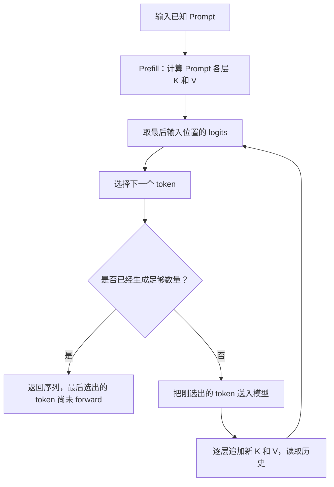

# 生成一个 token 时，哪些数据可以复用？

模型已经读过一段输入，接下来要继续写答案。每多写一个 token，是否需要把之前所有内容从头算一遍？

对于本文讨论的普通因果 Transformer，历史位置看不到后来追加的内容，因此它们已经算好的 K、V 可以保留。下一次只为新位置算 Q、K、V，再用新 Q 读取历史 K、V。这就是 KV Cache 的核心用途：省去历史位置的重复计算，代价是把历史状态留在内存里。

我们先用三个输入 token 走完一次生成，再解释为什么能缓存、缓存放在哪一层、当前引擎怎样使用它。第 10 篇的 [Attention 加权求和](../2026-10-23-attention-online-softmax/README.md) 是唯一必要的算法前置；基础练习都能在 CPU 上运行。

## 1. “生成下一个 token”，到底在做什么？

先把输入想成三个编号：

```text
输入 token ID：[2, 5, 1]
```

**Token** 是模型处理文字等内容的基本单位。Tokenizer 把原始内容编码成 ID；一个 token 可以是一部分词、一个字或其他片段，不能假设“一字一个 token”。本篇直接使用 ID，暂时不引入具体分词器。

模型把每个 ID 查表转换成一串数，叫**嵌入向量（embedding）**。这些向量经过多层计算，最后得到词表中每个候选 token 的分数，叫 **logits**。把分数转为概率后，可以按策略选择下一个 token。

为了把计算过程看清楚，练习使用最简单的**贪心选择**：总是取分数最大的候选。它不需要真的先算出概率，因为 softmax 不改变分数的大小顺序。

本篇随机固定权重的小模型实际给出：

```text
读入 [2, 5, 1] → 预测 7
读入 [2, 5, 1, 7] → 预测 12
读入 [2, 5, 1, 7, 12] → 预测 9
```

这些编号没有自然语言含义，只用于验证两条计算路径。我们还没有优化任何东西：上面的朴素写法每次都把整段 ID 重新送入模型。[实际运行记录](evidence/runs/lab.json)

一个自然的问题是：第二次输入中的 `[2,5,1]` 没变，它们在模型内部的计算也没变吗？

## 2. 先回忆一层 Attention 怎样读信息

假设某一层已经拿到每个位置的向量 `h_i`。这一层用三组固定参数，把它分别变成 Q、K、V：

\[
q_i=h_iW_Q,\qquad k_i=h_iW_K,\qquad v_i=h_iW_V
\]

这里用行向量写法。W 是这一层的模型参数，h、q、k、v 是这次输入产生的数据。

- Q 表示这个位置要查找什么。
- K 用来和 Q 比较，得到相关性分数。
- V 是最后按权重混合的内容。

例如位置 2 的 Q，可以和位置 0、1、2 的 K 打分，再对这三个位置的 V 加权求和。得到结果后，还会经过输出投影、残差相加和逐位置的前馈网络。

**前馈网络（FFN）**可以先理解为对每个位置的向量分别做几次固定变换。它不会因为句子后面多了一个位置，就自动把前面每个位置的数据拿来重算。

模型一般有很多层。同一个 token 到第二层时，拿到的已经是第一层加工后的向量，所以第二层的 K、V 与第一层不同。后面说“缓存 K、V”，指的是**各层分别保存自己的状态**。[原始 Transformer，第 3.2—3.4 节](https://arxiv.org/abs/1706.03762v7)

## 3. 为什么追加内容，不会改变历史位置？

先画出三个位置之间允许的信息流。`✓` 表示这一行可以读取这一列：

```text
             Key 位置
             0   1   2
Query 位置 0  ✓   ×   ×
           1  ✓   ✓   ×
           2  ✓   ✓   ✓
```

这叫**因果 Attention**：位置 i 只能看自己和之前的位置，不能看未来。

追加位置 3 后：

```text
             Key 位置
             0   1   2   3
Query 位置 0  ✓   ×   ×   ×
           1  ✓   ✓   ×   ×
           2  ✓   ✓   ✓   ×
           3  ✓   ✓   ✓   ✓
```

注意前三行。它们没有新增任何可见内容，仍然只读原来的前缀。变的是最后新增的一行。

这给出一个可以逐层推下去的理由：

1. 旧 token、旧位置和模型参数不变，所以旧位置的初始嵌入不变。
2. 第一层的旧位置仍看同样的前缀，Attention 的数学结果不变；逐位置的归一化、FFN 和残差也不引入未来信息。
3. 因而第二层收到的旧向量不变。重复这个推理，后面各层也成立。

这正是缓存的依据。它依赖固定模型、固定前缀、相同的位置语义，以及关闭 dropout 等随机行为。浮点计算换了形状或执行顺序，仍可能出现很小的舍入差异；数学上可复用，不等于任何后端都逐 bit 相同。[因果约束：原论文第 3.1、3.2.3 节](https://arxiv.org/abs/1706.03762v7)

如果是可以双向读取全文的编码器，前三行可能新增可见的 Key；这时不能直接照搬这个推理。位置编码本身若随总长度改变，也需要重新检查“旧位置的计算是否不变”。

## 4. 为什么叫 KV Cache，而不是把 Q、K、V 都留下？

现在只计算新位置 3。它需要的是：

```text
新的 q_3
已有的 k_0、k_1、k_2，加上新的 k_3
已有的 v_0、v_1、v_2，加上新的 v_3
```

新位置不会拿自己的 Q 去和旧 Q 比较；打分用的是旧 K。因此旧 Q 完成当时的任务后，普通下一 token Attention 不再需要把它作为持久历史保存。

旧位置的完整输出向量也不必为了这个生成过程跨步全部保留。它们已经用于形成后续层的缓存；下一步沿着各层自己的历史 K、V 继续计算即可。

这并不意味着缓存后“什么都不用算了”。新 token 在每一层仍需计算自己的 Q、K、V、Attention、FFN 和输出。省掉的是**历史位置**的重复工作。

也别把几类东西混在一起：

| 数据 | 作用 | 本篇生成过程中的保存方式 |
| --- | --- | --- |
| 模型参数 W | 决定怎样变换输入 | 所有步骤使用同一份模型参数 |
| 各层历史 K、V | 让未来 Query 读取历史 | 跨生成步骤保留并追加 |
| 当前 Query 的分数与权重 | 完成本次加权求和 | 不必作为整个历史长期保存 |
| token ID 序列 | 记录已经输入和生成的内容 | 另行保存，不能替代各层 K、V |

KV Cache 是输入相关的模型状态，不是“一个 ID 对应一份永远不变的 K、V”。同样的 ID 放在不同前缀或位置，状态通常不同。[PagedAttention 论文，第 2.1—2.2 节](https://arxiv.org/abs/2309.06180v1)

## 5. Prefill 与 Decode：亲手走四次调用

第一次处理输入 `[2,5,1]` 时，可以一起计算这三个已知位置，为每一层建立长度为 3 的 K、V，并用最后一个输入位置的 logits 选择第一个新 token。这个建立提示词状态的过程通常叫 **Prefill**。

后面每次把刚选出的 token 送入模型，追加它的 K、V，再选择下一个 token。这段增量生成过程通常叫 **Decode**。

把练习实际生成四个 token 的过程列出来：

| 本次调用 | 本次送入的 ID | 本次选择的下一 ID | 调用完成后的缓存位置 |
| --- | --- | --- | --- |
| Prefill | `[2,5,1]` | `7` | 0—2，共 3 个 |
| Decode 1 | `[7]` | `12` | 0—3，共 4 个 |
| Decode 2 | `[12]` | `9` | 0—4，共 5 个 |
| Decode 3 | `[9]` | `9` | 0—5，共 6 个 |

最终返回 `[2,5,1,7,12,9,9]`，一共 7 个 ID，但缓存只有 6 个位置。原因是最后选出的那个 9 位于位置 6，**尚未再次送入模型**；它还没有自己的 K、V。两个 9 的 ID 相同，不代表它们是同一个位置。

因此，“已采样多少 token”和“已有多少位置完成 forward”是两件事。在这个不含投机生成、固定步数的循环中，输入长度 P、生成数量 G>0 时，最终缓存长度是 `P+G-1`。



这里说的是最简单的生成循环。Prefill 可以拆成多个块，Decode 也可能因投机方法一次处理多个候选；“每次只有一个新位置”不是所有引擎调用的普遍约束。[原始阶段说明：PagedAttention 第 2.2 节](https://arxiv.org/abs/2309.06180v1)

## 6. 新 Query 的 mask，为什么不能从 0 重新数？

如果缓存已有 p 个位置，这次追加 n 个位置，那么：

```text
Q_new：(n,d)
K_all：(p+n,d)
V_all：(p+n,dv)
```

第 i 行新 Query 的实际位置是 `p+i`，所以可见条件是：

\[
\operatorname{keep}(i,j)=[j\le p+i]
\]

然后才计算：

\[
O_{new}=\operatorname{softmax}\left(Q_{new}K_{all}^T/\sqrt d+\mathrm{mask}\right)V_{all}
\]

无效位置在 softmax 之前设为 `-inf`。它们不会参与归一化。

用一个能手算的例子：旧 V 为 `[10,20]`，新 V 为 `[30,40]`，所有 Q 都是零，因此所有有效分数相同、权重均匀。

```text
                Key 0  Key 1  Key 2  Key 3
新 Query 位置 2    ✓      ✓      ✓      ×  → (10+20+30)/3 = 20
新 Query 位置 3    ✓      ✓      ✓      ✓  → (10+20+30+40)/4 = 25
```

不能让两个新 Query 都看全部 Key，否则第一行会偷看新块内部的未来位置；也不能忘掉旧缓存偏移，否则新 Query 会漏掉应该能读取的历史。

一个常见 API 陷阱是直接对非方阵调用 `is_causal=True`。当前 PyTorch 文档把它定义为 upper-left 对齐：当 Q 只有一行、K 有三行时，这行只会看第一个 Key。增量生成中最后一个 Query 往往应看全部三个 Key，语义不同。本篇用显式绝对位置 mask，已在本机 PyTorch 2.9.1 CPU 上验证这个差别。[PyTorch 2.14 文档的精确定义](https://docs.pytorch.org/docs/2.14/generated/torch.nn.functional.scaled_dot_product_attention.html)

练习直接把位置偏移写出来，便于核对：

```python
keep = torch.arange(past + n)[None, :] <= (past + torch.arange(n))[:, None]
```

实际模型还必须给新 token 正确的位置编码。即使 mask 对了，位置嵌入或 RoPE 的位置从 0 重新开始，仍会得到错误结果。练习的位置嵌入从 `past` 开始取，当前 vLLM 的 Llama 路径则把实际 `positions` 传给旋转位置变换。

## 7. 少算了多少，为什么不能直接说快了三倍？

仍然是 3 个输入 token、4 个新输出 token。每层处理的输入位置数是：

```text
每次重算：3 + 4 + 5 + 6 = 18
使用缓存：3 + 1 + 1 + 1 = 6
```

对逐位置的 QKV 投影、FFN 等工作，缓存路径避免了重复处理旧位置。但 Attention 还要读取历史，不能只数“这次输入了一行”。

我们另数**有效的因果 Query–Key 配对**。长度为 T 的完整因果 Attention 有 `T*(T+1)/2` 对：第一行 1 对，第二行 2 对，一直加到 T。

```text
每次重算：6 + 10 + 15 + 21 = 52 对
使用缓存：6 +  4 +  5 +  6 = 21 对
```

这两份账本回答不同问题，按每层、每 head 计数。它们不是实际 GPU 指令数或 FLOPs：稠密矩阵乘法可能仍计算随后被 mask 的位置，融合实现也可能跳过部分工作。

所以 18→6 不能直接当作三倍加速。真实时间还包含参数和 KV 的读取、采样、调度、通信，以及 kernel 的实现成本。普通全量历史 Attention 中，一条新 Query 对 T 个 Key 打分、读取 V，工作仍随 T 线性增长。KV Cache 没有把 Decode 变成常数成本。

Prefill 一次有很多已知 Query，容易形成较大的矩阵运算；单请求的逐 token Decode 一次通常只有一个新 Query，更容易受数据搬运影响。这个判断要结合 batch、长度、硬件和后端验证，不能把“Prefill 一定算力受限、Decode 一定带宽受限”当作定律。[对照第 04 篇的成本模型](../2026-10-22-roofline-basics/README.md)

缓存本身也要占空间。只数本篇单 head、L 层、T 个位置、K/V 宽度均为 d 的有效元素载荷：

\[
\mathrm{bytes}=2LTd\times\mathrm{element\_size}
\]

练习是 2 层、6 个缓存位置、d=8、FP64 每元素 8 字节，所以有效 K/V 数据共 1536 字节。这不含对象开销、分配器、复制时同时存在的旧新缓存或模型参数，也不是峰值内存。多 head、GQA、不同缓存类型与分页容量留到下一篇逐项算。

## 8. 当前 vLLM 源码怎样落实这些动作？

本次实际 shallow clone 官方仓库并使用 sparse checkout，固定 `main` 的 `7128f568ac036f7b7f21860d1928747ac6f78213`，提交时间为 2026-10-26 10:40:54（UTC+08:00）。相关文件与许可证完整归档，字节已和 `git show` 对照。没有构建或运行 vLLM，也没有拿主分支快照冒充某个稳定 release。[获取记录](evidence/upstream-acquisition.json)

### 8.1 新位置的 Q、K、V 在哪里产生？

在 [LlamaAttention.forward，第 224—234 行](https://github.com/vllm-project/vllm/blob/7128f568ac036f7b7f21860d1928747ac6f78213/vllm/model_executor/models/llama.py#L224-L234)，代码按顺序完成：

```text
hidden_states → qkv_proj → 拆成 q、k、v
positions 与 q、k → rotary_emb
q、k、v → Attention → o_proj
```

这与前面的推导对应：这次参与计算的 hidden states 产生新 QKV，位置处理是其中的一部分。Q head 与 KV head 的数量还可能不同，本篇单 head 模型没有模拟这一点。

### 8.2 新 K、V 怎样进入持久缓存？

当前导入的 `Attention` 在 `model_executor/layers/attention/attention.py`，不能沿用旧版本目录印象来找源码。

其 [forward，第 544—583 行](https://github.com/vllm-project/vllm/blob/7128f568ac036f7b7f21860d1928747ac6f78213/vllm/model_executor/layers/attention/attention.py#L544-L583) 在“后端不把缓存更新包含在 forward 内、没有共享目标层、K/V 存在”等条件满足时，先调用 `unified_kv_cache_update`，再调用 Attention。direct-call 与 custom-op 两条分支都保留这个顺序。

[第 719—748 行](https://github.com/vllm-project/vllm/blob/7128f568ac036f7b7f21860d1928747ac6f78213/vllm/model_executor/layers/attention/attention.py#L719-L748) 按层名取得该层缓存和 `slot_mapping`，再调用后端的 `do_kv_cache_update`。`slot_mapping` 可以先理解为“这批新位置应写到哪些缓存槽位”；它把逻辑 token 和物理存储连接起来。

以本次实际读取的 FlashAttentionBackend 为例，[第 369 行](https://github.com/vllm-project/vllm/blob/7128f568ac036f7b7f21860d1928747ac6f78213/vllm/v1/attention/backends/flash_attn.py#L369) 声明更新不包含在 forward 内；[第 1432—1466 行](https://github.com/vllm-project/vllm/blob/7128f568ac036f7b7f21860d1928747ac6f78213/vllm/v1/attention/backends/flash_attn.py#L1432-L1466) 通过 `reshape_and_cache_flash`，把本批 K/V 按槽位散写进缓存。

这里已经能看到生产方案与练习的区别：练习 `torch.cat` 每次会复制历史；这条生产路径把新数据写进已有缓存槽位。本文停在这个调用边界，没有声称独立验证了底层写入 kernel。

### 8.3 Attention 从哪里读取历史？

[unified_attention_with_output，第 772—799 行](https://github.com/vllm-project/vllm/blob/7128f568ac036f7b7f21860d1928747ac6f78213/vllm/model_executor/layers/attention/attention.py#L772-L799) 取得缓存后传给后端。用于表达缓存写入副作用的 dummy dependency，让编译器保留“先更新、再读取”的数据依赖；它本身不是新的 K/V 内容。

在所读后端的普通 decoder 路径中，[第 1244—1286 行](https://github.com/vllm-project/vllm/blob/7128f568ac036f7b7f21860d1928747ac6f78213/vllm/v1/attention/backends/flash_attn.py#L1244-L1286) 取得 `key_cache`、`value_cache`、Query 长度、序列长度和块表。非 DCP 分支的 [第 1404—1428 行](https://github.com/vllm-project/vllm/blob/7128f568ac036f7b7f21860d1928747ac6f78213/vllm/v1/attention/backends/flash_attn.py#L1404-L1428) 把新 Query、缓存 K/V 及这些元信息传给 Attention kernel 入口。

这就是“本次 Query 数量”和“可读取历史长度”可以不同的实现落点。编码器分支、跨层共享、量化、DCP、滑动窗口与具体 FA 版本有各自条件；本文没有把这一条静态调用路径泛化为所有硬件的默认实际执行。

### 8.4 调度器有没有两个独立的阶段开关？

[Scheduler.schedule，第 677—689 行](https://github.com/vllm-project/vllm/blob/7128f568ac036f7b7f21860d1928747ac6f78213/vllm/v1/core/sched/scheduler.py#L677-L689) 的注释明确使用统一的 token 进度模型：请求记录已计算 token 数和包含待处理候选的 token 数，每轮让前者追上后者。这能容纳 chunked prefill、前缀复用和投机生成等情形。

所以 Prefill／Decode 是很有用的工作负载概念，不要求调度器代码一定写成两个互斥循环。读日志时也要区分待处理、已调度、已完成和已采样，不能只看输出文本长度来猜缓存进度。

### 8.5 请求完成，缓存何时回收？

[Scheduler 第 2910—2944 行](https://github.com/vllm-project/vllm/blob/7128f568ac036f7b7f21860d1928747ac6f78213/vllm/v1/core/sched/scheduler.py#L2910-L2944) 处理已完成请求，但连接器可要求延后释放；[第 2955—2971 行](https://github.com/vllm-project/vllm/blob/7128f568ac036f7b7f21860d1928747ac6f78213/vllm/v1/core/sched/scheduler.py#L2955-L2971) 还考虑在途 GPU 步骤可能继续写缓存的情况。可安全释放时才调用缓存管理器。

[KVCacheManager.free，第 627—636 行](https://github.com/vllm-project/vllm/blob/7128f568ac036f7b7f21860d1928747ac6f78213/vllm/v1/core/kv_cache_manager.py#L627-L636) 再把请求交给 coordinator 的释放逻辑。这里读到的是请求释放的调用边界，不等于显存当场清零；块池、引用计数与前缀保留策略需要继续往下分析，后面的分页与前缀缓存专题再展开。

## 9. 工程中，怎样判断这份缓存还能不能用？

先问三个具体问题。

**前缀真的相同吗？** 修改了早先一个 token，后面的状态就可能全部受影响。只看最后一个 token ID 相同不够；模型参数、适配器、位置与缓存格式也必须兼容。

**有没有把不同层或不同请求的缓存混在一起？** 每层 K/V 来自不同的中间向量。缓存管理除了有多少字节，还需要正确的层、请求、位置和生命周期。练习检查层数、长度、宽度与类型，但无法仅凭 shape 证明缓存来自正确模型和前缀；这是调用者的语义责任。

**节省的是哪项成本？** KV Cache 减少跨步骤的历史重复计算；第 10 篇的 FlashAttention 主要改变一次 Attention 内部的中间物化与搬运。二者可以同时使用。缓存容量、历史读取和新 token 的计算仍然存在。

出现增量输出不一致时，可以按顺序检查：同一模型完整重算的 logits → 缓存路径的新位置 logits → 每层完整 K/V → 绝对位置与 mask → dtype／后端与容差。只比较最终贪心 token，可能漏掉已经发生的数值偏差：两份不同 logits 仍然可能有相同最大值。

## 10. 代码练习与详解

### 练习一：把一个新块追加进 K/V，并算对因果 Attention

实现 `cached_attention(q,k_new,v_new,cache=None)`，返回新位置输出和更新后的 `KVCache(k,v)`。要求：

- CPU、二维 FP32 或 FP64；Q/K/V 类型一致，新位置数量一致，Q/K 宽度大于 0。
- 已有 K、V 长度一致，特征宽度与新块匹配；新块是紧接历史的连续位置，没有 padding 或位置空洞。
- 使用 `j<=past+i`，支持 n=1 和 n>1。空新块返回空输出，保留等价历史状态。
- 不修改输入或旧缓存；拒绝非法形状、NaN／Inf 和分数／输出溢出。只做推理。

先用第 6 节例子手算出 `[[20],[25]]`，再尝试随机输入分成 `[2,1,3,1]` 四块，与一次完整 CPU SDPA 对照。

<details>
<summary>详解一：拼接的是 K/V，偏移的是新 Query 的位置</summary>

先得到历史长度 p，构造 `K_all=cat(K_old,K_new)` 和 V 的对应拼接。新 Q 的第 i 行位于 p+i，所以 mask 按绝对位置生成。应用 mask 后做稳定 softmax 和 V 的加权求和。

完整 [answers.py](code/answers.py) 保留了检查和空块分支。`torch.cat` 保证本题的新缓存不与调用者输入或旧缓存共享数据存储，但会复制历史数据；这是小规模正确性参考，不能用它验证生产缓存的速度和峰值内存。

检查输出之外，还要逐步比较更新缓存的**全部 K、V**，并确认旧缓存没有变化。完整测试在 [test_answers.py](code/test_answers.py)，包含一个非方阵 `is_causal=True` 得到错误可见范围的反例。

</details>

### 练习二：让两层小模型用缓存连续生成，并对照每次完整重算

实现单序列、单 head 的 `TinyDecoder`，使用固定随机 FP64 权重：

```text
token 嵌入 + 位置嵌入
    → LayerNorm → 因果 Attention → 输出投影 → 残差相加
    → LayerNorm → FFN → 残差相加
    → 再过第二层
    → 最终 LayerNorm → 词表 logits
```

LayerNorm 在这里分别归一化每个 token 的特征，不跨 token 混合。残差是把变换结果加回当前向量。FFN 用两个线性变换，中间 ReLU 把负值截成 0。这些部件是为了让你看到“每一层都有自己的历史状态”，不是要求先掌握一个完整的生产模型。

提供 `full(tokens)` 和 `cached(new_tokens,caches=None)`。前者使用独立的 CPU SDPA 完整重算；后者为每层保留 K/V，只推进新位置，并把位置嵌入从历史长度处开始取。

最后实现固定步数的贪心生成。使用 `TinyDecoder(vocab=13,width=8,layers=2,max_length=16,seed=11)`，输入 `[2,5,1]`、生成 4 个 token，本次两条路径都得到 `[2,5,1,7,12,9,9]`。配置和随机权重改变时，ID 可以改变；真正验收的是同一模型的两条计算路径一致。不能只看 ID：每一新位置的 logits、每一层的完整 K/V 也应在 FP64 `rtol=atol=1e-11` 下与重算路径一致。

<details>
<summary>详解二：一次 forward 推进输入，下一 token 来自它的最后一行</summary>

首次 `cached(prompt,None)` 处理所有 Prompt 位置；每层保存自己的 K/V。用最后一行 logits 选 token，若还需继续生成，下一轮只送入刚选出的 token，连同所有层的缓存。

缓存的旧长度既决定新位置嵌入，也决定 Attention 的可见边界。第一层处理完新位置后，把新隐藏向量交给第二层；第二层使用自己的缓存，不能借用第一层的 K/V。

每次完整重算的输入长度是 `(3,4,5,6)`，缓存路径是 `(3,1,1,1)`，最终两层缓存长度均为 6。最后的 sampled token 还没有 forward。参考实现中的 `max_length` 限制已 forward 的位置数，因此返回序列可比它多出最后一个未 forward 的 token；这个教学约定不能直接套成所有生成 API 的长度参数含义。

完整 [答案](code/answers.py) 与 [运行方法](code/README.md)。模型不是预训练模型，不模拟 Llama 的 RoPE、RMSNorm、GQA、SwiGLU、量化、分页或分布式执行；也不提供训练、EOS 和投机生成。

</details>

在本篇目录运行：

```bash
python3 -m unittest discover -s code -p 'test_*.py' -v
python3 code/run_lab.py
```

实际使用 Python 3.10.13、PyTorch 2.9.1、macOS arm64、CPU；15 项测试通过。[测试](evidence/runs/tests.txt)、[实验 JSON](evidence/runs/lab.json)、[命令与环境](evidence/runs/summary.json) 随篇归档。没有执行 vLLM、CUDA 或 GPU 性能测试。

## 11. 面试官继续追问

| 层次 | 问题 | 回答要点 |
| --- | --- | --- |
| 基础 | Prefill 完成后，还要再跑一次模型才能得到首 token 吗？ | 普通循环可以直接用最后 Prompt 位置的 logits 选择首 token；把它送入模型是为了再预测下一个。 |
| 原理 | 追加 token 为什么不改变历史 K/V？ | 固定前缀、位置和参数下，因果约束让旧位置看不到新增未来；逐层推导成立。 |
| 实现 | 为什么通常不持久缓存历史 Q？ | 未来 Query 与历史 K 打分、对历史 V 加权，不需要旧 Q。 |
| 实现 | 为什么不把每一层都指向同一份 K/V？ | 每层输入隐藏向量和投影参数不同，普通模型各层状态不同；特殊共享结构需另证。 |
| 排障 | 单 token 对了，追加两个 token 为什么错？ | 检查块内未来屏蔽，以及新 Query 的绝对位置 past+i。 |
| 计数 | 输出共 7 个 token，缓存只有 6 个位置，哪里漏算了？ | 最后 sampled token 尚未 forward；要区分采样进度与计算进度。 |
| 性能 | 有 KV Cache，长上下文 Decode 为什么仍可能变慢？ | 新 Query 仍读取增长的历史，参数与 KV 搬运、batch 和后端都会影响时间。 |
| 工程 | 有 FlashAttention 后还要 KV Cache 吗？ | 一次 Attention 内的分块与跨生成步骤的历史复用解决不同成本，可以共同使用。 |
| 验证 | token 相同，能证明缓存实现正确吗？ | 还应比较 logits、各层完整状态、旧状态不变性及位置和类型契约。 |

下一篇把这份持久状态真正算成容量：KV Cache 的字节数怎样随层数、序列长度、并发和 KV head 数增长，MHA、GQA、MQA 各改变哪一项。

资料与源码：[references.md](references.md)。审查与修正：[review.md](review.md)。返回 [索引](../../../index.md)。
