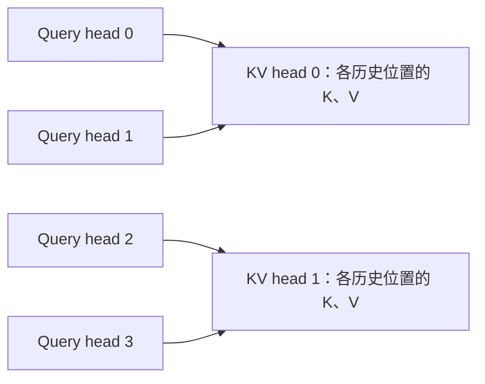

# KV Cache 怎么算大小，MHA、GQA、MQA 各改变了什么？

模型权重已经放进显存，为什么多接几个长请求，仍可能显存不足？其中一个原因是：**权重通常由请求共用，每个请求的历史 K／V 却会随着已处理的 token 增长。**

先给一个可以复算的例子。假设有 32 层 Attention，每个 head 的向量长 128，KV 用 BF16 保存，单个请求已经处理 8192 个 token。如果有 32 个 KV head，仅 KV 内容就需要 **4 GiB**；如果模型采用 8 个 KV head，则是 **1 GiB**。这不是某款 GPU 的实测，而是存储元素的字节账本。

这两个数怎样算出来？为什么减少 KV head 后，Query 仍可以保留 32 个 head？我们从“一个 token 留下了什么”开始。

前置：[Prefill、Decode 与 KV Cache](../2026-10-26-prefill-decode-kv-cache/README.md)、[Attention 与在线归一化](../2026-10-23-attention-online-softmax/README.md)。练习入口：[code/README.md](code/README.md)。

## 1. 一个 token 到底留下多少东西？

### 1.1 K 和 V 是向量，不是两个标量

上一章说，每层保留历史 token 的 Key 和 Value。这里的“一个 Key”通常是一串数字。例如一条 Key 向量可以是 `[0.2, -0.1, 0.7, 0.4]`，长度为 `4`。

一个 **head（头）**可以先理解成一套独立的 Attention 检索通道。模型为同一个 token 产生多组 Query、Key、Value，让不同通道学习不同的检索方式；各通道的结果再组合回模型的输出。多头并不是把同一个输出复制几遍。

先设一个很小的层：有 `2` 个 KV head，每个 head 的 K 和 V 都各有 `4` 个数字。一个 token 在这一层留下：

```text
Key：  head 0 的 4 个数 + head 1 的 4 个数 = 8 个数
Value：head 0 的 4 个数 + head 1 的 4 个数 = 8 个数
合计：16 个数

每个数用 BF16：16 bit = 2 byte
一个 token、一层：16 × 2 = 32 byte
```

这里乘 `2` 有两个不同来源：一处是 **K 与 V 两份内容**，另一处是 **BF16 每元素 2 字节**。把它们分开，换 dtype 时就不容易算错。

### 1.2 为什么还要乘层数和历史长度？

不同层使用不同的变换，通常有各自的 K／V；同一层中，不同 token 的 K／V 也各不相同。仍用上面的层布局：

```text
缓存 3 个 token，一层：3 × 32 = 96 byte
这样的 Attention 层共 2 层：2 × 96 = 192 byte
```

这里没有把历史 Query 一起缓存。新位置的 Query 用来检索历史 K／V，历史 Query 的输出已经在当时算过；原因见上一章。本文讨论普通自回归全量 Attention，各层之间没有额外 KV 共享。

## 2. 怎样把这个数数过程写成容量公式？

令 `L` 为缓存 K／V 的 Attention 层数，`Hkv` 为 KV head 数，`D` 为每个 head 的向量长度，`b` 为每元素字节数。请求 `r` 已有 `T_r` 个 token 的 K／V：

$$
M_{\mathrm{KV}}=2\times L\times\left(\sum_r T_r\right)\times H_{kv}\times D\times b
$$

每个因子都对应上一节数过的一个维度：K／V 两份、层、历史位置、head、向量元素、元素字节。若 `B` 个请求长度都为 `T`，中间的总 token 数就是 `B×T`。

| 问题 | 容量账本中的对应项 |
| --- | --- |
| 多接一个请求会怎样？ | 多出该请求已经缓存的 `T_r` 个位置。 |
| 请求继续生成会怎样？ | 新 token 再送入模型、写入 K／V 后，历史长度增加。采样出但尚未送入的 token 不算已缓存位置。 |
| BF16 改成 FP32 呢？ | 其他条件相同时，`b` 从 `2` 变为 `4`，内容字节数翻倍。 |
| 历史 token 翻倍呢？ | 普通全量 Attention 的 KV 内容线性翻倍；不是平方增长。 |

不要把 KV 内容与 Attention 的分数矩阵混在一起。分数矩阵涉及 Query 与 Key 两个位置轴；KV Cache 保存的是历史 K／V 向量。FlashAttention 避免物化大分数矩阵，与减少 KV head 是两件可以结合的事。

现在回到开头：`L=32、Hkv=32、D=128、b=2、T=8192`。

```text
每个 token，跨 32 层：2 × 32 × 32 × 128 × 2 = 524288 byte = 512 KiB
8192 个 token：8192 × 512 KiB = 4 GiB
8 个等长请求：8 × 4 GiB = 32 GiB
```

这里 `1 KiB=2^10 byte`、`1 GiB=2^30 byte`。`4 GiB` 与十进制的 `4 GB` 不相同。不等长请求按实际长度求和，例如长度 `2、5、0` 的三条请求，计入 `7` 个位置，而不是强行按 `3×5` 计入；若实现真的分配了 padding，其额外占用要另记。

## 3. MHA、GQA、MQA 改的是哪一项？

### 3.1 Query head 数与 KV head 数，可以不同

用 `Hq` 表示 Query head 数。先固定 `Hq=4`，比较三种结构：

| 结构 | Query head 数 Hq | KV head 数 Hkv | 谁读取谁的 K／V？ |
| --- | --- | --- | --- |
| MHA，多头 Attention | `4` | `4` | 每个 Query head 有自己的 KV head。 |
| GQA，分组 Query Attention | `4` | `2` | 两个 Query head 一组，共用一个 KV head。 |
| MQA，多 Query Attention | `4` | `1` | 四个 Query head 都读取同一个 KV head。 |

这幅图画的是中间的 GQA。箭头表示“读取这组历史 K／V”，不是复制一份缓存：



共享发生在 **Query head 之间**。不同历史位置仍有各自的 K／V，不同层也仍有各自的 K／V。[GQA 原始论文，第 2.2 节与 Figure 2](https://aclanthology.org/2023.emnlp-main.298.pdf)

### 3.2 共用 K／V，输出会不会也相同？

不会必然相同。把 K 想成供检索的目录，把 V 想成对应的内容；两个人可以查同一份目录，却提出不同问题。Query 不同，与同一份 Key 计算出的分数就可能不同，最后对 Value 的加权也会不同。

用最小数字验证：历史 K 为 `[0,1]`，历史 V 为 `[0,10]`，两个 Query 分别是 `0` 和 `2`，每个向量都只有一个数，两个历史位置都可见。

```text
Query 0：与 K 的分数是 [0,0]，softmax 后各占 1/2，输出为 5。
Query 2：与 K 的分数是 [0,2]，更偏向第二个 V，输出约为 8.808。
```

所以 GQA 保存了多组 Query 和输出，同时减少 K／V 的组数。一般情形可写为：

$$
g(h)=\left\lfloor\frac{h}{H_q/H_{kv}}\right\rfloor,\qquad
O_h=\operatorname{softmax}\!\left(\frac{Q_h K_{g(h)}^\top}{\sqrt D}+\text{mask}\right)V_{g(h)}
$$

`h` 是从 `0` 开始的 Query head 编号，`g(h)` 是它使用的 KV head 编号。本文假设 `Hq` 能被 `Hkv` 整除，并把相邻 Query head 分为一组；这是练习与所核对实现采用的映射方式。

### 3.3 现在能比较容量了吗？

保持 `L=32、Hq=32、D=128、BF16、每请求 8192 个已缓存 token`，只改变模型的 KV head 数：

| 教学模型结构 | Hkv | 单请求 KV 内容 | 8 个请求 KV 内容 | 相对 MHA |
| --- | --- | --- | --- | --- |
| MHA | `32` | `4 GiB` | `32 GiB` | `1` |
| GQA | `8` | `1 GiB` | `8 GiB` | `1/4` |
| MQA | `1` | `128 MiB` | `1 GiB` | `1/32` |

这些是同一组假设下的结构对比，不对应某个实际 checkpoint 的三种无损运行模式。公式里用的是 `Hkv`，不是 `Hq`。容量计算已由练习一精确复算。

## 4. 为什么不能把一个 MHA 模型的配置直接改成 GQA？

想象原模型的四套 K 投影分别学会了不同变换。删除其中三套，或者把它们平均成一套，都改变了模型实际计算的函数；缓存变小，不代表原来的预测结果保持不变。

GQA 原论文的转换路径是：对同组 K／V **投影矩阵**做平均，再继续训练，让模型适应新结构。论文在指定 T5 模型与任务上评估了质量和速度；本文没有执行该训练，也不承诺任意模型转换都能保住质量。不要把它误读为“推理时把已经缓存的几个向量平均一下，就能免费切换结构”。[第 2.1—2.2 节，原文与笔记](evidence/paper-reading.md)

减少 KV 内容也不等于 Attention 总计算量按同样比例减少。`Hq` 保留时，每个 Query head 仍要计算自己的分数与输出。以 K／V 向量同长、直接计算完整矩阵为例，QK 与 PV 两次乘法的主要工作量约为 `4×B×Hq×Tq×T×D` FLOPs；减少的是 KV head 对应的存储、投影规模，以及实现能够复用时的 KV 读取需求。实际延迟还取决于权重读取、kernel、并行与调度，不能把表中的容量比例当成加速比。

MQA 原论文正是从增量解码反复读取 K／V 的问题出发，让 Query 保留 head 维，而 K／V 不再保留多份 head。[MQA 原论文，第 2.4—3 节](https://arxiv.org/abs/1911.02150v1)。后续 GQA 在多份 KV 与单份 KV 之间提供选择。

## 5. 当前引擎怎样把 head 数变成缓存规格？

本次实际更新了官方 vLLM 源码缓存，固定为 `1e10a92d1da2da4e2b70fd66d7d31b1672ba6da7`。当日查询到的最新发布版是 `v0.32.0`；下面分析的是默认分支快照，没有声称发布版逐行相同，也没有在本机执行 vLLM。[版本与获取范围](evidence/versions.json)

### 5.1 先看模型入口，Query 与 KV 分别有多宽？

`LlamaAttention` 分别计算本 rank 的 Query head 数和 KV head 数，再设置：

```python
# 教学摘写：对应 LlamaAttention 的尺寸计算。
q_size = num_heads * head_dim
kv_size = num_kv_heads * head_dim
```

这回答了“是不是所有 head 数都一起变小”：Query 和 KV 使用不同宽度。构造 `QKVParallelLinear` 后，模型把本地 `num_heads` 与 `num_kv_heads` 分别传入 Attention。[llama.py，尺寸与投影](https://github.com/vllm-project/vllm/blob/1e10a92d1da2da4e2b70fd66d7d31b1672ba6da7/vllm/model_executor/models/llama.py#L143-L170)、[Attention 构造](https://github.com/vllm-project/vllm/blob/1e10a92d1da2da4e2b70fd66d7d31b1672ba6da7/vllm/model_executor/models/llama.py#L212-L219)

### 5.2 缓存规格里保存的是哪一种 head？

Attention 检查 Query head 数可被 KV head 数整除，并把 KV 的 head 数、向量长度和**缓存 dtype**传给 `FullAttentionSpec`。缓存 dtype 应单独确认，不能只看模型权重 dtype。[整除与字段](https://github.com/vllm-project/vllm/blob/1e10a92d1da2da4e2b70fd66d7d31b1672ba6da7/vllm/model_executor/layers/attention/attention.py#L321-L339)、[构造缓存规格](https://github.com/vllm-project/vllm/blob/1e10a92d1da2da4e2b70fd66d7d31b1672ba6da7/vllm/model_executor/layers/attention/attention.py#L674-L683)

当前 `AttentionSpec` 用更一般的“head 槽位数 × 存储状态数 × 每状态字节”表达页内容：

```python
# 教学摘写，省略属性装饰器与可选 override。
state_bytes = (head_size + head_size_v) * dtype_bytes
unpadded_page_bytes = num_heads * num_states * state_bytes
```

普通、未量化、K／V 同向量长度、每 token 一份状态、无布局 override 的分支中，一页保存 `P` 个 token，就得到 `P×Hkv×(D+D)×b`，正好是前面公式的一层、一页版本。[页尺寸的实际定义](https://github.com/vllm-project/vllm/blob/1e10a92d1da2da4e2b70fd66d7d31b1672ba6da7/vllm/v1/kv_cache_interface.py#L556-L601)

源码还允许 K 与 V 长度不同、打包布局、页 padding 和其他状态表达。不能把这里的简化公式硬套到所有模型。`FullAttentionSpec.max_memory_usage_bytes` 也会按块取整；逻辑内容字节与实际分配字节因此可能不同。[按块取整](https://github.com/vllm-project/vllm/blob/1e10a92d1da2da4e2b70fd66d7d31b1672ba6da7/vllm/v1/kv_cache_interface.py#L642-L648)

### 5.3 后端是否仍知道 Query 与 KV 的比例？

FlashAttention 后端保存 `num_queries_per_kv = num_heads // num_kv_heads`。K／V 输入的 head 轴使用 `num_kv_heads`，没有在缓存规格层强制改成 Query head 数。[比例字段](https://github.com/vllm-project/vllm/blob/1e10a92d1da2da4e2b70fd66d7d31b1672ba6da7/vllm/v1/attention/backends/flash_attn.py#L1078-L1095)、[输入形状说明](https://github.com/vllm-project/vllm/blob/1e10a92d1da2da4e2b70fd66d7d31b1672ba6da7/vllm/v1/attention/backends/flash_attn.py#L1195-L1203)

这能核实 head 语义与紧凑缓存接口，不能单凭字段推断某个 GPU kernel 的实际 HBM 流量。练习二验证同一个语义，但不是这段后端的性能复现。

## 6. 多张 GPU 时，为什么“除以卡数”还可能算错？

**张量并行（TP）**会把同一层的一部分计算交给不同 GPU；参与这一组并行的进程通常叫 rank。先只考虑 TP，各 rank 都负责本文这 `L` 层的一部分 head，不加入流水线并行或上下文并行。

如果有 `8` 个 KV head、`4` 个 rank，每个 rank 保存 `2` 个，容易均分。但是只有 `1` 个 KV head、却有 `4` 个 rank 时，每个 rank 仍可能需要这份 K／V。当前 vLLM Llama 分支采用复制，不能指望每个 rank 只保存四分之一个 head。

```python
# 对已通过整除约束检查的布局，当前分支采用此局部 head 数。
local_kv_heads = max(1, total_kv_heads // tp_size)
```

当 KV head 不少于 rank 数时，要求前者可被后者整除；反过来要求 rank 数可被 KV head 数整除，Query head 也要能均分。不是所有整数搭配都支持。[模型入口的完整条件](https://github.com/vllm-project/vllm/blob/1e10a92d1da2da4e2b70fd66d7d31b1672ba6da7/vllm/model_executor/models/llama.py#L143-L156)、[投影层的复制份数](https://github.com/vllm-project/vllm/blob/1e10a92d1da2da4e2b70fd66d7d31b1672ba6da7/vllm/model_executor/layers/linear.py#L1064-L1071)

仍用单请求、32 层、8192 个已缓存 token、BF16 的例子，TP 为 `4`：

| 结构 | 总 Hkv | 每 rank 的 Hkv | 每 rank KV 内容 | 四个 rank 合计 |
| --- | --- | --- | --- | --- |
| MHA | `32` | `8` | `1 GiB` | `4 GiB` |
| GQA | `8` | `2` | `256 MiB` | `1 GiB` |
| MQA | `1` | `1` | `128 MiB` | `512 MiB` |

MQA 的逻辑内容是 `128 MiB`，这个 TP 布局的四个 rank 合计却是 `512 MiB`，因为保存了副本。源码的权重加载路径也用复制份数选择 K／V 的 shard；这不是把同一张表算重了就能消掉的实际存储需求。[加载分片](https://github.com/vllm-project/vllm/blob/1e10a92d1da2da4e2b70fd66d7d31b1672ba6da7/vllm/model_executor/layers/linear.py#L1312-L1320)

这是该模型路径、该并行配置的结论。启用其他并行方式或专门的 KV 分片方案后，应重新检查各 rank 的实际规格。

## 7. 用这张账本做工程判断，还缺哪些条件？

| 判断或优化 | 改变什么 | 需要核实的代价与边界 |
| --- | --- | --- |
| 选择已经训练好的 GQA／MQA 模型 | 减少 `Hkv` | 模型质量、checkpoint 与后端支持；不是任意修改配置即可无损转换。 |
| 降低缓存精度 | 减少内容的每元素字节 | 量化误差、scale／元数据、打包与 kernel 支持；不能只按位宽忽略额外成本。 |
| 限制同时驻留的总历史长度 | 减少 `sum(T_r)` | 排队、可接受上下文与服务目标；更大 batch 也需要更大缓存容量。 |
| 使用分页管理 | 改善分配与碎片 | 页尾空位、块表和分配策略；不改变同一普通 KV 元素本身的字节数。 |
| 根据 TP 布局估算单卡 | 使用本地 KV head 数 | 少量 KV head 时的复制，以及其他并行方式的影响。 |

实际进程显存还包括权重、临时激活、工作区、分配器预留及其他缓存。引擎也可能先预留一整个 KV 池：此时请求的逻辑使用量增长，不一定立刻体现为进程显存继续增长。反过来，公式算得下也不保证峰值分配成功。

本文第一张容量表的边界是：各层布局相同，K／V head_dim 相同，普通全量 Attention，无跨请求或跨层共享，无分页余量，无量化元数据，不含权重。混合层、滑动窗口、MLA 等应按真实缓存状态重新列账，不能把“层数”机械地乘上一个统一值。

## 8. 动手验证：既会算容量，也能读懂共享

### 练习一：写一个不会把 Query head 算进去的容量计算器

实现 `kv_cache_bytes(lengths, *, layers, kv_heads, head_dim, element_bytes)`。`lengths` 表示每个请求**已经缓存**的 token 数；允许空请求集合与零长度，其他尺寸为正 Python 整数，拒绝负数、浮点数和布尔值。

验收：先算 `lengths=[2,5,0]、L=3、Hkv=2、D=4、b=2`，再复算正文的 MHA／GQA／MQA 表。进阶：写 `kv_heads_per_rank`，复现第 6 节的整除与复制约束，再算每 rank 与集群总量。Query head 的 TP 整除由调用者另外核验。

<details>
<summary>详解：沿着一条缓存轴数数，再乘其他轴</summary>

三个请求一共有 `7` 个已缓存位置。每位置、跨所有层需要 `2×3×2×4×2=96 byte`，所以总量是 `7×96=672 byte`。

```python
total_tokens = sum(lengths)
total_bytes = 2 * layers * total_tokens * kv_heads * head_dim * element_bytes
```

完整参考答案包含参数校验：[answers.py](code/answers.py)。空 batch 返回 `0`，因为它没有缓存位置；尺寸非法不能以一个负容量或截断后的浮点容量蒙混过关。

TP 例子先求本地 KV head，再调用同一容量函数；不能直接把未分片模型容量除以 TP。参考函数只覆盖本篇的 Llama 分支，不能当作全部模型通用的部署验收器。

运行与真实结果：[执行命令](code/README.md)、[lab.json](evidence/runs/lab.json)。大尺寸容量只做整数运算，不创建几十 GiB 的 Tensor。

</details>

### 练习二：不复制 K／V，也能得到相同的 GQA 输出吗？

输入 `Q:[1,4,2,3]`、`K/V:[1,2,5,3]`，两行 Query 对应绝对位置 `3、4`。实现因果 Attention，输出仍为 `[1,4,2,3]`，不把 K／V 预先重复到四个 head。

验收：用 `repeat_interleave` 将紧凑 K／V 展开后，交给独立的 CPU SDPA 作对照；两边使用同一绝对位置 mask，FP64 下 `atol=rtol=1e-12`。补测 MHA、MQA、完整 Prefill、单 token Decode，以及共享 KV 但 Query 不同的例子。

这两行 Query 的可见位置分别是 `[0,1,2,3]` 和 `[0,1,2,3,4]`。不能把矩形输入下的 `is_causal=True` 自动当成带历史偏移的 mask；本例显式传入 True=允许读取的布尔 mask，并关闭 dropout。对照时 K／V 已展开，未启用 SDPA 的 `enable_gqa`，因此没有把 GPU GQA 支持条件套到 CPU 上。[PyTorch 2.9 SDPA 语义](https://docs.pytorch.org/docs/2.9/generated/torch.nn.functional.scaled_dot_product_attention.html)

<details>
<summary>详解：把 Query 轴拆成 KV 组与组内 Query</summary>

`Hq/Hkv=2`，把 Q 改看为 `[B,Hkv,2,Tq,D]`。K／V 仍保持 `[B,Hkv,T,D]`，同组内每个 Query 各自算分数，再读取同一组 Value。

```python
grouped_q = q.reshape(batch, kv_heads, group_size, query_length, dim)
scores = torch.einsum("bhgqd,bhkd->bhgqk", grouped_q, k) / math.sqrt(dim)
# i 的绝对 Query 位置是 query_start+i，只允许 j <= query_start+i。
probabilities = torch.softmax(scores.masked_fill(~keep, -torch.inf), dim=-1)
output = torch.einsum("bhgqk,bhkd->bhgqd", probabilities, v)
```

`b、h、g、q、k、d` 分别表示 batch、KV 组、组内 Query、Query 位置、Key 位置、向量元素。对 `d` 求和得到分数，对 `k` 求和得到输出。最后把 `h、g` 合回 Query head 轴。

这份代码支持有限的 CPU FP32／FP64 输入与非连续 Tensor，不修改调用者的 Q／K／V；只接收正长度、同批次同 dtype、K／V 同向量长度的规则 batch。分数或加权输出溢出时明确报错。它会物化分数和概率，Q 的 reshape 也可能复制；只用来验证语义，不是 FlashAttention 或显存优化 kernel。

本机 FP64 例子中，紧凑 K／V 的内容为 `2×1×2×5×3×8=480 byte`，展开后为 `960 byte`。这里 FP64 每元素为 `8` 字节，和正文 BF16 的容量表是不同实验；这些是 Tensor 元素账本，不是进程内存峰值。

完整答案：[answers.py](code/answers.py)；独立对照和边界：[test_answers.py](code/test_answers.py)；诊断：[run_lab.py](code/run_lab.py)。本例验证“存两组 KV 能服务四组 Query”，没有验证把一个 MHA checkpoint 改成 GQA 后还能输出相同结果。

</details>

## 9. 面试官会怎样继续追问？

| 层次 | 问题 | 回答要点 |
| --- | --- | --- |
| 基础 | 为什么公式开头有一个 `2`？ | K 与 V 两份，不是 batch，也不是每元素字节。K／V 长度不同要分别算。 |
| 基础 | MQA 是不是只有一个 Query？ | 保留多个 Query head，只有一组 KV head。不同 Query 可以得到不同输出。 |
| 实现 | 缓存大小看 `num_attention_heads` 还是 `num_key_value_heads`？ | 看实际缓存的 KV head、head_dim 与缓存 dtype；再检查本地 TP 规格与布局 override。 |
| 实现 | 用 `repeat_interleave` 之后为什么内存又变大？ | 物化了供对照的重复 K／V；数学共享与物理复制是不同实现选择。 |
| 方案 | KV 少四倍，Decode 就快四倍吗？ | 不能这样推断；Query 工作、权重读取、kernel、并行与调度仍影响延迟。 |
| 方案 | 把配置中的 KV head 改小就完成转换了吗？ | 投影与 checkpoint 结构变了，需要相应权重及训练／质量验证；运行配置不能替代。 |
| 排障 | MQA 做 TP=4，为什么单卡没降到四分之一？ | 检查是否每 rank 复制一个 KV head；明确统计的是逻辑内容、单 rank 还是集群总量。 |
| 排障 | 字节公式算得下，为什么服务仍 OOM？ | 查权重和临时峰值、页 padding、缓存池、分配器、实际 dtype、异构层及历史长度口径。 |

## 10. 本篇验证到哪里，下一步问什么？

容量表是可精确复算的教学模型；CPU 练习验证字节公式与分组 Attention 语义。官方源码已经实际更新、固定并归档，但没有编译或执行 vLLM，没有真实 GPU 的流量、显存峰值或吞吐测量，也没有模型转换训练与质量评测。

下一篇继续问：**KV Cache 为什么需要分页，逻辑 token 怎样找到物理块？** 这一篇已经把“该保存多少内容”算清，下一篇再解释“怎样分配这些内容”。

资料、源码与论文笔记：[references.md](references.md)。技术、教学与代码审查：[review.md](review.md)。返回 [Wiki 索引](../../../index.md)。
