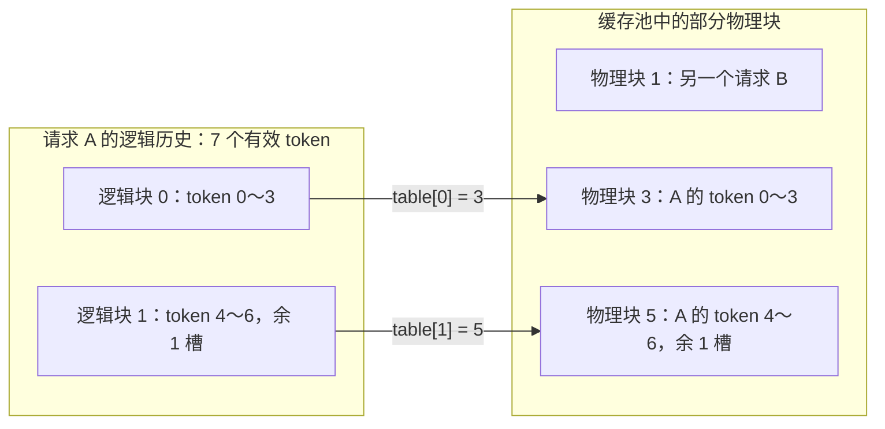

# KV Cache 为什么需要分页，逻辑 token 怎样找到物理块？

假设缓存池还有两片空位，每片能存 4 个 token。现在来了一个需要保存 7 个 token 的请求：**总空位明明够，为什么要求连续存放的方案仍可能放不下？**

分页的办法是把这 7 个位置分成两块，再用一张表记住它们实际放在哪里。请求仍按 `0、1、2……` 的顺序理解自己的历史，存储却可以使用池里不相邻的块。这样可以按需增长、回收复用，但仍有页尾余量、映射开销与后端约束。

这一篇先数清一个小例子，再追踪当日 vLLM 的分配、写入、读取路径。前置：[KV Cache 的生命周期](../2026-10-26-prefill-decode-kv-cache/README.md)、[容量与 MHA／GQA／MQA](../2026-10-27-kv-cache-capacity-gqa/README.md)。[练习入口](code/README.md)。

## 1. 上一篇已经算出字节数，为什么还会放不下？

### 1.1 空间的总量与形状，是两个问题

把缓存池画成 16 个位置，每个位置能保存一个 token 的 K／V。中间的请求还活着，空闲位置被分成两片：

```text
[空闲 空闲 空闲 空闲][使用 使用 使用 使用][空闲 空闲 空闲 空闲][使用 使用 使用 使用]
       4 个位置                                  4 个位置
```

总共空闲 `8` 个位置，却没有一片连续的 `7` 个位置。若一个请求必须占据一整段连续区域，它就不能直接使用这两片空位。这类“空位在外面，但拼不成所需形状”的问题叫**外部碎片**。

另一个问题来自未来。一个请求现在缓存了 `5` 个 token，最终也许长到 `16` 个。如果从一开始就为它保留 `16` 个位置，尚未写入的部分会长期占着容量；如果它提前结束，部分预留永远用不上。

这两个小例子是在解释分配策略，不是在声称所有连续缓存实现都按最大长度预分配。也有增长、搬迁或虚拟地址映射等做法，各有代价。今天聚焦的是引擎在缓存池内使用块表管理 KV 的路径。

### 1.2 能不能让请求每次只多拿一小块？

可以。规定每块容纳 `P=4` 个 token 的 K／V：

```text
请求已经缓存 1～4 个 token：需要 1 块。
请求已经缓存 5～8 个 token：需要 2 块。
请求已经缓存 9～12 个 token：需要 3 块。
```

这个分配单位叫 **KV block（KV 块）**，本文也称“页”。`P` 是一页容纳的 token 数，不是字节数。一个 token 的 K／V 仍然可能包含许多 head 和向量元素，字节数按上一篇的方法另算。

这里的 KV 块属于缓存管理层；CUDA thread block 是 GPU 的线程组织单位；操作系统页则属于另一层地址管理。本文的“物理块编号”是**缓存池中的编号**，不是裸 HBM 地址，也不表示直接调用了操作系统的缺页机制。

## 2. 拆开以后，第 6 个位置到底去哪里找？

### 2.1 先区分“请求自己的顺序”与“池里的位置”

所有编号从 `0` 开始。请求 A 已经缓存 `7` 个 token，每页 `4` 个：

```text
逻辑块 0：token 0、1、2、3
逻辑块 1：token 4、5、6、空位
```

**逻辑块**按请求的历史顺序编号。**物理块**是池里实际分配的块，可以不相邻。例如管理器给 A 的表是：

```python
block_table_A = [3, 5]
# 表中第 0 项：逻辑块 0 放在物理块 3。
# 表中第 1 项：逻辑块 1 放在物理块 5。
```

这张映射叫 **block table（块表）**。下面只画出池中的几个块；箭头表示地址映射，不是数据复制：



请求 A 的顺序没有变，变化的是它怎样找到存储位置。物理块中夹着 B，不妨碍 A 保有自己的完整历史。

### 2.2 亲手把位置 `i=6` 翻译一次

`i=6` 指的是第七个 token。每页装 `4` 个，先做除法：

```text
6 // 4 = 1：属于逻辑块 1。
6 % 4  = 2：在这个块内的偏移是 2。
table[1] = 5：实际使用物理块 5。
```

若把整个池的 token 槽按块顺序展平，槽号就是 `5×4+2=22`。概括为：

$$
\ell=\lfloor i/P\rfloor,\qquad o=i\bmod P,\qquad
p=\mathrm{table}[\ell],\qquad \mathrm{slot}=pP+o
$$

`ℓ` 是逻辑块，`o` 是块内偏移，`p` 是物理块。**`i//P` 得到的是逻辑块，必须查表后才能得到物理块。**

`slot=22` 仍是“一个 token 的槽号”，不是某个标量元素下标或字节地址。要定位某个 head 的某个元素，还需结合缓存 Tensor 的布局和 stride；当前源码也会使用块、页内位置和 head 的实际 stride。

## 3. 同一张映射，怎样支持追加、读取和回收？

### 3.1 尾页还有空位，就不必多拿一页

继续沿 A 的例子：有效长度从 `7` 增到 `8` 时，新位置 `7` 仍在逻辑块 `1`，写入物理块 `5` 的偏移 `3`，块表不变。

再增到 `9` 时，位置 `8` 属于新的逻辑块 `2`，才需要新物理块。若分配到块 `2`，表变成 `[3,5,2]`，旧的两块保持原位。无需为了让 A 物理连续而搬动全部历史 KV。

注意增长的时刻：是新 token 已经送入模型、算出并写入它的 K／V。仅仅采样出下一个 token，并不意味着它的 KV 已经存在。

### 3.2 写新数据与读历史，需要的信息不同

新一轮可能只处理几个新 token。引擎可以预先为它们各算一个 `slot`，形成 **`slot_mapping`**：一项对应本轮一个 token 的写入目标。写入 kernel 据此把新的 K／V 放到相应槽位。

读取历史则需要请求的块表，以及**有效长度**。A 长度为 `7` 时，第二页的第 `3` 个偏移仍未写入，不能因为那页已经分配，就把它当作第八个有效 token。

| 元数据 | 回答什么问题？ |
| --- | --- |
| `block_table` | 请求的各个逻辑块分别在哪个物理块？ |
| `slot_mapping` | 本轮这些新 token 的 K／V 分别写到哪里？ |
| 有效长度及因果信息 | 哪些历史位置确实存在，且能被这行 Query 看见？ |

### 3.3 分页改变地址，会改变 Attention 的数学含义吗？

只要 K／V 与逻辑位置对应正确、可见位置不变，分页本身不需要改变模型权重或 Attention 定义。归一化仍然覆盖**全部可见的 Key**，不能在每页单独 softmax 后随意把结果平均。

例如两页各考虑一个有效位置，分数是 `0` 与 `ln(3)`，Value 是 `0` 与 `10`。分数指数化后为 `1、3`，总和为 `4`，所以正确权重为 `[1/4,3/4]`，输出 `7.5`。若每页各自 softmax，它们的唯一位置都会得到权重 `1`，再平均会得到错误的 `5`。

把当前 Query 可见的有效位置集合按页划分为 `S_j`，数学上只是对同一个分子、分母分组求和：

$$
O=\frac{\sum_j\sum_{t\in S_j}\exp(s_t)V_t}
{\sum_j\sum_{t\in S_j}\exp(s_t)},\qquad s_t=QK_t^\top/\sqrt D
$$

这是数学表达，不是建议直接对大数执行 `exp`。稳定的分块归一化见 [Attention 与在线 softmax](../2026-10-23-attention-online-softmax/README.md)。分页 kernel 可以按块直接计算；本文练习为了便于检查，先按索引收集（gather）有效 KV 成为连续 Tensor，再交给 PyTorch 的缩放点积 Attention 接口（SDPA），**不把这个教学 gather 当作引擎必须执行的步骤**。

### 3.4 请求结束后，块怎样给别人用？

在独占页的简单模型里，结束请求可以归还它的块，其他请求再分配使用。若启用前缀复用，同一块可能有多个引用，必须等相关引用释放，并服从缓存淘汰策略；“一个请求结束”不必然等于“这块立即无条件覆盖”。

原始 PagedAttention 论文第 4.1—4.3 节用分块、块表和按需增长建立这套机制，另在第 4.4 节讨论共享。本篇只实现独占页的基础情形。[原始论文 v1](https://arxiv.org/abs/2309.06180v1)、[阅读与当前代码对应](evidence/paper-reading.md)。

## 4. 分页以后，究竟省了什么，又多了什么？

### 4.1 KV 元素没有变小，少的是过度预留和分配限制

设每个 token 的 KV 内容占 `c` 字节。沿用上一篇的普通、同规格布局，`c=2×L×Hkv×D×b`；此处已包含 K 与 V 两份，不再额外乘 `2`。这是同一位置账本跨这些层的合计；若只统计一层，就取 `L=1`，不能把层数再重复计算。

对请求长度 `T_r`，独占、按需分配所需页数为 `ceil(T_r/P)`。于是：

$$
N=\sum_r\left\lceil T_r/P\right\rceil,\qquad
M_{\text{内容}}=c\sum_rT_r,\qquad M_{\text{已分配页}}=cPN
$$

长度为 `0` 的请求在这份账本中占 `0` 页。长度 `[5,3]`、`P=4`、`c=32 byte` 时：

```text
请求 A：5 个有效位置，需要 2 页，容量 8 个位置，余 3 个槽。
请求 B：3 个有效位置，需要 1 页，容量 4 个位置，余 1 个槽。
总内容：8 × 32 = 256 byte。
已分配页：3 × 4 × 32 = 384 byte。
页尾余量：4 × 32 = 128 byte。
```

若另一种教学策略从头给每条请求预留 `16` 个位置，则占 `2×16×32=1024 byte`。这是两种分配策略在指定输入下的账本对比，不是 GPU 实测，也不说明分页把同样的 KV 内容压缩了。

### 4.2 为什么最后一页仍会浪费？

每个请求最后一页最多有 `P-1` 个未用槽；这种“已经分给请求、但页里没填满”的余量叫**内部碎片**。对 `B` 条请求，简单模型下：

$$
0\le M_{\text{页尾余量}}=M_{\text{已分配页}}-M_{\text{内容}}
\le B(P-1)c
$$

它的前提是同规格、独占页、无额外预留，不能覆盖投机解码中为候选 token 提前预留位置的 lookahead、共享、异构缓存组、滑动窗口等情况。实际引擎还可能有页 padding（为布局／对齐增加的填充）、特殊块、量化元数据或其他状态。

同样长度 `[5,3]`，每 token `32 byte`，只改变教学页长：

| P | 总页数 | 未用槽 | 已分配页内容容量 |
| --- | --- | --- | --- |
| `2` | `5` | `2` | `320 byte` |
| `4` | `3` | `4` | `384 byte` |
| `8` | `2` | `8` | `512 byte` |

更小的页减少这个例子的尾部余量，却需要更多表项和块管理。`P=4` 只是方便数数，不是部署参数建议；真实页长要符合后端、模型与布局约束，不能把论文年代的默认值当成所有当前环境的默认值。

表本身也要占空间。若每个块号用 32 位整数 `int32`，`N` 个有效表项就需要 `4N` 字节；实际引擎还会按 batch、最大行宽和对齐预留缓冲，不能把这个有效项账本当作全部元数据实测。本文的页容量表没有计入这些元数据。

### 4.3 缓存池空闲，与 GPU 进程显存下降，不是一回事

引擎可以初始化一整批 KV 存储，再在池内分配和归还块。此时释放请求会增加池内可用块，却未必把整片 Tensor 归还 GPU 分配器，也未必让显存监控立即下降。

本次源码的 `allocate_kv_cache` 先按配置计算缓冲需求并创建底层存储；请求运行时的取块、还块发生在管理器中。[初始化分配路径](https://github.com/vllm-project/vllm/blob/84e455367336b62547d1f1273e9b50bc7f8edb47/vllm/v1/worker/utils.py#L564-L624)

因此排查容量时至少分别看：有效 KV 内容、已分给请求的页、池的总预留，以及进程中的权重、激活与工作区。分页缓解的是同规格池内的分配问题，不保证消除整个 GPU 分配器的所有碎片，更不保证永远不会显存不足（OOM）。

## 5. 今天的 vLLM，实际怎样实现这些动作？

本次更新官方源码，固定 `main` 为 `84e455367336b62547d1f1273e9b50bc7f8edb47`。当日 latest release 元数据为 `v0.32.0`；本节分析默认分支，未将它与发布版混同。没有编译或运行 vLLM。[版本记录](evidence/versions.json)

以下选取普通 Decoder Attention、没有上下文并行（CP，即在多设备间拆分序列位置）、使用 token 槽映射与 FlashAttention 后端的路径，手算默认管理页长与 kernel 页长一致。不宣称所有硬件都选择该后端，也不把所有缓存组化简为同一种 KV 页。官方旧分页说明已标注为历史文档，本篇以当前代码追踪替代对旧实现的猜测。[历史文档声明](https://github.com/vllm-project/vllm/blob/84e455367336b62547d1f1273e9b50bc7f8edb47/docs/design/paged_attention.md#L1-L5)

### 5.1 谁决定“再给这个请求几页”？

Scheduler 调用 `KVCacheManager.allocate_slots`，把本轮需求交给缓存管理器。管理器检查空闲块、保留量等条件，不足时可以返回 `None`；分页仍需要容量准入。[调度入口](https://github.com/vllm-project/vllm/blob/84e455367336b62547d1f1273e9b50bc7f8edb47/vllm/v1/core/sched/scheduler.py#L1424-L1443)、[容量检查](https://github.com/vllm-project/vllm/blob/84e455367336b62547d1f1273e9b50bc7f8edb47/vllm/v1/core/kv_cache_manager.py#L578-L607)

再经 coordinator 分派到对应的缓存类型管理器。当前代码还处理共享尾页的写时复制（CoW，即写入前换成私有副本）；只看 `SingleTypeKVCacheManager.allocate_new_blocks` 的普通增长部分，可以直接看到前面的向上取整：

```python
# 教学摘写：省略共享尾页的 CoW 分支和其他管理逻辑。
num_required_blocks = ceil_div(num_tokens, block_size)
num_new_blocks = num_required_blocks - len(req_blocks)
if num_new_blocks > 0:
    req_blocks.extend(block_pool.get_new_blocks(num_new_blocks))
```

这里 `num_tokens` 是本次需要容纳的总位置数，不是“一律只分配一个新 token”。有 lookahead 或其他预留时，它也不等于已有效缓存的历史长度。[当前增长代码](https://github.com/vllm-project/vllm/blob/84e455367336b62547d1f1273e9b50bc7f8edb47/vllm/v1/core/single_type_kv_cache_manager.py#L388-L410)

`BlockPool.get_new_blocks` 从空闲队列取块并增加引用；释放路径则递减引用，在适当条件下把块放回可复用队列。当前还区分有缓存哈希与无缓存哈希块的复用顺序，不能把下面练习的 FIFO 顺序冒称为真实引擎策略。[取块](https://github.com/vllm-project/vllm/blob/84e455367336b62547d1f1273e9b50bc7f8edb47/vllm/v1/core/block_pool.py#L706-L740)、[归还](https://github.com/vllm-project/vllm/blob/84e455367336b62547d1f1273e9b50bc7f8edb47/vllm/v1/core/block_pool.py#L816-L849)

### 5.2 块号怎样变成本轮的写入槽？

`GPUModelRunner` 先根据已计算长度与本轮 Query 偏移构造位置，再调用 `compute_slot_mapping`。[位置与调用](https://github.com/vllm-project/vllm/blob/84e455367336b62547d1f1273e9b50bc7f8edb47/vllm/v1/worker/gpu_model_runner.py#L2137-L2152)

`worker/block_table.py` 中，`TOTAL_CP_WORLD_SIZE=1` 时，位置到块号、块内偏移的计算就能化简为第 2 节公式；V2 worker 的 `CP_SIZE==1` 分支也明确取 `local_positions=positions`，再查块表计算槽号。[映射实现](https://github.com/vllm-project/vllm/blob/84e455367336b62547d1f1273e9b50bc7f8edb47/vllm/v1/worker/block_table.py#L351-L376)、[V2 对应分支](https://github.com/vllm-project/vllm/blob/84e455367336b62547d1f1273e9b50bc7f8edb47/vllm/v1/worker/gpu/block_table.py#L382-L414)

代码还处理跨 rank 分布和 padding，这些分支不能直接用本文单池公式代替。块表和槽映射是索引元数据，不是把所有 KV 值复制到这两张表里。

另一个当前实现边界是：在部分支持的布局中，管理器的一块可以再拆成较小的 kernel 块，对后端提供转换后的块表。遇到这种配置，应按实际层级核对 `P` 与块号，不能把管理器的页长直接代入另一个布局的 kernel 寻址式。[块表转换](https://github.com/vllm-project/vllm/blob/84e455367336b62547d1f1273e9b50bc7f8edb47/vllm/v1/worker/utils.py#L368-L395)

### 5.3 写入 kernel 是否真的按这个槽号存放？

FlashAttention 后端的 `do_kv_cache_update` 把 K／V 与 `slot_mapping` 交给 `reshape_and_cache_flash`。CUDA 平台经 `fa_utils` 选择当前 custom op 包装，最终 CUDA 写入代码拆回块号与偏移：

```cpp
// 对照当前 CUDA 写入 kernel 的关键寻址关系。
slot_idx = slot_mapping[token_idx];
if (slot_idx < 0) return;
block_idx = slot_idx / block_size;
block_offset = slot_idx % block_size;
// 实际元素地址还要结合 block_stride、page_stride 等布局信息。
```

`slot_idx<0` 的跳过逻辑用于无效／padding 槽等情形。它不意味着在 Python 教学数组中可以用 `-1` 访问最后一项；练习会明确拒绝非法块号。[后端写入](https://github.com/vllm-project/vllm/blob/84e455367336b62547d1f1273e9b50bc7f8edb47/vllm/v1/attention/backends/flash_attn.py#L1432-L1466)、[CUDA 分派](https://github.com/vllm-project/vllm/blob/84e455367336b62547d1f1273e9b50bc7f8edb47/vllm/v1/attention/backends/fa_utils.py#L22-L28)、[kernel 寻址](https://github.com/vllm-project/vllm/blob/84e455367336b62547d1f1273e9b50bc7f8edb47/csrc/cache_kernels.cu#L335-L366)

### 5.4 读取方拿到什么？

在所核对的普通 dense FlashAttention 分支，后端向 Attention 调用传入 `key_cache`、`value_cache`、`block_table`，同时传递有效 Key 长度 `seqused_k`、Query 长度和因果信息。这里能够确认缓存及索引接口，没有要求先把整个请求 KV 拼回一大段。[当前读取调用](https://github.com/vllm-project/vllm/blob/84e455367336b62547d1f1273e9b50bc7f8edb47/vllm/v1/attention/backends/flash_attn.py#L1404-L1424)

到此，分配的块号、写入槽与历史读取的信息接上了。本文没有继续核验每种 FlashAttention 设备内核的指令与流量，也不从这个调用推断实际加速比。完整路径及原文件见 [源码阅读笔记](evidence/source-reading.md)。

## 6. 工程上怎样选页长、判断收益？

先问工作负载：并发请求是否多、长度是否差异大、请求是否频繁加入退出、是否被 KV 容量限制。它们决定按需分配与复用是否能换来更多可同时驻留的请求。

再同时核对两边成本：

| 选择或现象 | 收益来源 | 代价、条件或验证办法 |
| --- | --- | --- |
| 同规格池内按页分配 | 可使用不相邻空闲块，避免每请求从头占住大段未来空间。 | 仍有页尾余量；按实际页数与总池预算验收。 |
| 更小的页 | 简单模型中尾部余量上界变小。 | 表项、分配动作、地址计算及后端访问形态会变化；必须满足 kernel 支持条件。 |
| 更大的页 | 同长度下表项变少，可能更适配某些 kernel 的处理粒度。 | 短请求尾页可能空得更多，复用粒度变粗；不能只看单个 kernel 计时。 |
| 释放请求后池内空闲增加 | 块可再分配给其他请求。 | 进程显存可能不下降；观察池内使用，而非只看显存总数。 |
| 页足够但输出错误 | 容量不是首要嫌疑。 | 对照块表、请求行号、位置、长度、KV 布局及失效槽，检查跨请求误读或尾页污染。 |

若要比较性能，应固定模型与 KV dtype、硬件与软件、输入／输出长度分布、到达率和并发，先验数值正确，再同时观察池利用率、抢占／重算、吞吐及延迟。论文第 7.1—7.2 节也讨论映射开销与页长取舍；其历史实验不能替代当下设备测量。[原文与边界笔记](evidence/paper-reading.md)

## 7. 动手练习：自己做一次映射和池内复用

### 练习一：算出槽号，并把页尾余量记到账上

实现两个函数，接口见 [练习说明](code/README.md)：

1. `slot_for_token`：给定块表、有效长度、页长和池大小，把一个有效逻辑位置转成展平槽号。只检查当前访问的表项；无效位置、缺少表项、负块号或越过池的块号必须拒绝。
2. `page_usage`：给定请求长度列表，返回有效 token 数、页数、未用槽、内容字节与已分配页字节。不包含表本身或池的总预留。

验收：`table=[3,5]、length=7、P=4、num_blocks=8`，槽号应为 `[12,13,14,15,20,21,22]`；位置 `7` 虽然落在已分配尾页，仍不可读取。`lengths=[5,3]、P=4、c=32` 应得到 `3` 页、`4` 个未用槽、`256` 与 `384 byte`。

<details>
<summary>详解：先找逻辑块，再查物理块，最后加页内偏移</summary>

对位置 `6`：`divmod(6,4)=(1,2)`，查到 `table[1]=5`，所以槽号是 `22`。直接把位置 `6` 当成物理槽 `6`，或者把逻辑块 `1` 当作物理块 `1`，都会读错数据。

页数要**分别向上取整，再相加**。`ceil(5/4)+ceil(3/4)=3`，不能改成 `ceil((5+3)/4)=2`；后者隐含两个独立请求能互相填进同一页，违背本题独占页条件。

参考答案拒绝布尔值、浮点数及非法尺寸；零长度请求占零页，空请求集合也返回零。块表尾部未选中项不会被读取；这既不是允许访问它，也不是给整个块表作有效性担保。

完整实现：[answers.py](code/answers.py)；验收：[test_answers.py](code/test_answers.py)。

</details>

### 练习二：实现一个会追加、耗尽、回收和复用的页池

实现单层、单头的 `PagedKVCache`：CPU FP64 输入 `K/V:[T,D]`，固定池大小与页长。支持 `append`、`read`、`release`，并能查看请求长度和不可变的块表副本。

从 `4` 页、每页 `4` 个 token、`D=2` 开始：A 先追加 `3` 行，B 追加 `5` 行，A 再追加 `4` 行。采用题设的 FIFO 编号分配，A 的表应为 `[0,3]`，B 为 `[1,2]`，空闲页为 `0`。

此时请验证：A 一次追加 `2` 行会失败且有效前缀不变；只追加 `1` 行仍可成功；释放 B 后，A 再追加 `1` 行可以取得归还的块。每步读回值要与原始连续 K／V 对照，最后用同一 Query 分别调用独立 SDPA 对照结果。

<details>
<summary>详解：先预检整次追加，再写入新槽，最后提交请求元数据</summary>

关键状态只有空闲块队列、每请求的块表、每请求的有效长度，以及存 K／V 的固定池。按 `ceil(新长度/P)-已有页数` 求新增页数，在修改所有权之前检查能否满足整次请求。

上例 A 长度为 `7`，尾页只有一个空槽，所以一次追加两行需要新页。池中没有空页，整次追加应拒绝；不能先写入一行、又以失败结束，却把请求长度或历史弄乱。只追加一行会把长度增到 `8`，不需要新页。

释放 B 后，FIFO 教学队列提供块 `1`，A 的表变为 `[0,3,1]`；新位置 `8` 写到槽 `1×4+0=4`。旧的 A 数据不需要搬动，B 的旧内容也不能通过 A 的有效长度被读出。

`read` 用块表把有效行 gather 回连续 Tensor，仅供教学对照。最后一行 Query 位于历史末端，提供的全部 KV 都是它可见的历史，所以普通 SDPA 对照不启用从左上角对齐的 `is_causal=True`，并显式关闭 dropout。本题没有多行 Query 的因果 mask。[PyTorch 2.9 的接口约定](https://docs.pytorch.org/docs/2.9/generated/torch.nn.functional.scaled_dot_product_attention.html)

参考实现显式使用 CPU，不受调用者默认设备影响；写入不保留 autograd 历史，读取返回副本。支持非连续输入，拒绝非法 dtype、shape、非有限值和空追加；重复释放会报错，避免同一页被重复归还。它是单线程教学模型，没有共享、抢占或设备同步。

本题把 `0` 作为可用物理块；当前 vLLM `BlockPool` 会预留编号 `0` 的 null block（占位块），因此题设的具体分配顺序不对应引擎实测。回收时本题不擦除池中旧数据，只靠有效映射控制正常读取；它不实现多租户安全隔离，不能拿去充当生产缓存管理器。

运行 [run_lab.py](code/run_lab.py)，真实状态与输出见 [lab.json](evidence/runs/lab.json)。最终连续 KV 对照相同；本机 FP64 SDPA 最大绝对差异为 `0.0`。验证针对 CPU 语义，不包含 GPU 分页 kernel 或延迟／显存测量。

</details>

## 8. 面试官会怎样继续追问？

| 层次 | 问题 | 回答要点 |
| --- | --- | --- |
| 基础 | 总空闲容量够，为什么连续分配仍可能失败？ | 空间被活跃对象分隔，缺少足够大的连续段；同规格分页可组合不相邻空闲块。 |
| 基础 | `position//P` 是物理块号吗？ | 是逻辑块号，还需查当前请求的块表；偏移是 `position%P`。 |
| 实现 | `block_table` 和 `slot_mapping` 能互换吗？ | 前者按请求逻辑块描述历史映射，后者为本轮 token 定位写入槽；还要保持长度与有效性信息。 |
| 实现 | 为什么最后一页不能全读？ | 分配容量大于有效长度，尾槽可能未初始化或保留旧内容。 |
| 方案 | 页越小越好吗？ | 尾部余量下降，但表项、管理与后端访问成本变化；需按支持条件及实际工作负载验证。 |
| 方案 | PagedAttention 与 FlashAttention 冲突吗？ | 分页描述 KV 的分配／寻址；分块 Attention 描述计算与数据复用，兼容的后端可组合两者。 |
| 排障 | 释放请求后显存没下降，是泄漏吗？ | 先区分池内空闲与整池预留，再查引用、缓存保留和分配器，而非只凭总显存判断。 |
| 排障 | 正好跨页时开始输出错误，查什么？ | 逻辑块索引、表行、页内偏移、长度更新、stride、padding 槽，以及释放／复用后的旧映射。 |

## 9. 本篇验证到哪里，下一篇问什么？

已经验证的是地址公式、页尾账本、独占页的追加／耗尽／回收／复用，以及读回连续 KV 的 CPU 对照；当前 vLLM 源码只做静态路径分析。未运行 GPU、多卡、生产调度、缓存共享与模型端到端生成，不给出分页加速比。

本文的简单页数公式不覆盖所有缓存架构；页长也不是 GPU thread block 大小。完整版本、公开源码、论文阅读和实际运行记录都在本篇目录中，原始上游缓存留在 `.cache/upstream/`。

下一篇候选：**请求为何需要逐步调度，batch 大小由什么决定？** 有了“哪些块可用”的基础，再看调度器如何决定谁在这一轮使用它们。

资料：[references.md](references.md)。审查：[review.md](review.md)。返回 [Wiki 索引](../../../index.md)。
