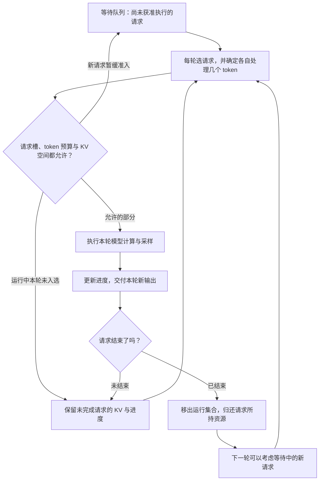

# 请求为何需要逐步调度，batch 大小由什么决定？

> 一批请求里，有人先答完，就应让等待的人有机会在下一轮加入。这需要引擎把调度边界放在每轮模型执行之间。真正能一起执行多少请求，还要同时看请求槽、这一轮处理的 token 数和 KV Cache 空间。
>
> 本篇从 4 条请求排队讲起，再读当前 vLLM 的调度代码。读完后，你应能解释 continuous batching，区分两种 batch 大小，并判断一次参数调整影响的是等待时间、输出间隔还是容量。

建议先读 [第 11 篇：Prefill、Decode 与 KV Cache](../2026-10-26-prefill-decode-kv-cache/README.md)、[第 12 篇：KV 容量](../2026-10-27-kv-cache-capacity-gqa/README.md) 和 [第 13 篇：分页与块表](../2026-10-28-paged-kv-block-table/README.md)。先记住一件事就够了：请求生成文字时，会保留自己的历史 KV，供下一轮使用。

## 1. A 已经答完了，为什么 C 还不能进来？

假设一个服务最多同时处理 2 条请求。A、B、C、D 在时刻 0 一起到达，按这个顺序排队，分别生成 1、4、2、1 个输出 token。token 可以先理解为模型读写的文字单位；这里关心它们的数量，不讨论分词细节。

为了先看清排队规则，作一个很小的简化：每个 Prompt 只有 1 个 token，每轮为入选请求处理 1 个输入 token，并各产生 1 个输出 token；每轮耗时恰好 1 个“逻辑时间单位”。第一轮处理 Prompt，后面的轮次处理上轮采样出的 token。实际 GPU 每轮耗时会变化，这里先不模拟它。

第一轮选 A、B。轮末 A 已经结束，B 还要继续。如果这一批成员必须等到整批结束才能换入，接下来会怎样？

| 轮次 | 固定批次成员：本轮实际工作的请求 | 轮末发生什么 |
| --- | --- | --- |
| 1 | A、B | A 完成，B 还差 3 个输出 |
| 2 | B | A 的位置空着，C 仍在等 |
| 3 | B | C 继续等 |
| 4 | B | B 完成，第一批终于结束 |
| 5 | C、D | D 完成 |
| 6 | C | C 完成 |

这个基线允许 A 在第 1 轮末就把答案交给用户，但不允许新请求填进尚未结束的批次。因此，空位仍然浪费了。另一些实现还会为已完成请求保留无效计算；本例没有额外假设这种开销。

再换一个规则：**每轮结束后都检查谁完成了，下一轮重新决定成员。**

| 轮次 | 重新调度后的请求 | 为什么能这样排 |
| --- | --- | --- |
| 1 | A、B | 与刚才相同，A 完成 |
| 2 | B、C | A 退出，C 加入并产生第一个输出 |
| 3 | B、C | 两者继续，C 完成 |
| 4 | B、D | D 填上空位；B、D 都完成 |

同样 8 个输出，从 6 轮变成了 4 轮。C 的第一个输出，也从第 5 轮末提前到第 2 轮末。**B 并没有重新处理 Prompt**；它仍带着自己的历史 KV 继续生成。

这就是逐轮调度，也常称 **iteration-level scheduling**；不断移出完成请求、接纳新请求的批处理方式，通常称 **continuous batching（连续批处理）**。它不要求每次凑满，也不表示任意时刻可以打断一个正在执行的 GPU kernel。这里的换入边界是轮次之间。

Orca 原论文第 3 节、Figure 3／4 提出了这种按迭代与引擎交互的机制；第 4.2 节、Algorithm 1 给出带容量约束的调度。本文的 A—D 数字和两种规则是自选教学例子，未复用论文性能结果。[Orca，OSDI 2022](https://www.usenix.org/conference/osdi22/presentation/yu)

注意上面的结论是“在给定时间模型下少了 2 轮”。它还不是“真实服务快了 1.5 倍”的证据。真实每轮会受 batch、上下文、kernel、通信等影响。

## 2. 每轮换了成员，怎样保证 B 仍在继续自己的回答？

想象给每条请求保留一张进度卡：它的 Prompt、已经生成的 token、已有多少位置算出了 KV，以及这些 KV 在哪里。

轮次变了，进度卡还在。引擎可以把 B 的新 token 和 C 的新 token 放到同一次模型调用里，但它们的 Attention 仍分别访问各自的历史。batch 是一起组织计算，不会把两人的上下文串成一段。历史 KV 的地址如何隔开，已经在上一章的块表中解释过。



这是普通、同步、无跨实例 KV 传输的教学流程；归还后是块池可复用，不等于立即向 GPU 分配器释放物理显存。实际引擎还可能延迟归还。图源见 [scheduling-loop.mmd](assets/scheduling-loop.mmd)。

到这里再区分两个常被混用的词：

- **请求准入**：等待中的请求是否可以进入运行集合、持有执行所需资源。
- **本轮调度**：已经运行或刚获准进入的请求，这一轮各处理几个位置。

进入运行集合，不保证每一轮都入选；例如本轮 token 预算已经耗尽，或者还在等待依赖。因此“运行中请求数”“这一轮入选请求数”“等待请求数”是三个不同的计数。当前 vLLM 也专门说明，运行集合里可能有本轮未调度的请求。[调度结果的约束与注释](https://github.com/vllm-project/vllm/blob/0c81a0371f586cc50a0daad6d216fbac21cf1a2d/vllm/v1/core/sched/scheduler.py#L1618-L1637)

## 3. batch size 是 3，究竟是 3 个什么？

### 3.1 先数本轮需要计算的新位置

现在把 Prompt 恢复成长短不一的真实情况。

- A 已有 100 个位置的 KV，刚采样出下一个 token。继续生成时，本轮通常只给模型输入这 1 个新 token。
- B 已有 1,000 个位置的 KV，也通常只输入 1 个新 token。
- C 刚到达，Prompt 有 4 个 token，没有任何 KV。本轮若完整 Prefill，就要处理这 4 个位置。

一起调度 A、B、C 时：**请求数是 3，本轮处理的 token 数是 `1 + 1 + 4 = 6`**。这里的“处理”指新算这些输入位置的模型表示及 KV。

它不是 `101 + 1001 + 4`。已有历史 KV 不会重新全部输入一遍。但历史仍要被 Attention 读取，所以不能因为 A、B 都只新增 1 个 token，就认为它们的计算成本相同。

它也不是“这一轮输出 6 个 token”。在普通自回归生成中，C 的 4 个 Prompt token 一起处理，是为了产生 C 的第一个输出；A、B 各继续产生一个输出。这个例子最多给三个请求各产生一个输出。如果 C 的 Prompt 只算了一部分，它本轮甚至还没有可交付的新输出。投机解码可改变每轮输出数量，本篇先不启用它。[当前调度器的 token 进度定义](https://github.com/vllm-project/vllm/blob/0c81a0371f586cc50a0daad6d216fbac21cf1a2d/vllm/v1/core/sched/scheduler.py#L699-L722)、[未完成 Prefill 的输出约定](https://github.com/vllm-project/vllm/blob/0c81a0371f586cc50a0daad6d216fbac21cf1a2d/vllm/v1/core/sched/scheduler.py#L2745-L2758)

### 3.2 为什么同时需要“最多几条请求”和“最多几个 token”？

设本轮入选请求组成集合 S，`qᵢ` 是请求 i 本轮新处理的 token 数，单位是 token。`R` 是请求槽上限，`Q` 是本轮 token 预算。最基本的两个条件是：

\[
|S|\le R,\qquad \sum_{i\in S}q_i\le Q.
\]

取 `R = 4，Q = 8`。A、B 各用 1，C 用 4，总共 3 条请求、6 个 token，都允许。再来 D，完整 Prefill 要 3 个 token：请求数变 4 仍可容纳，但 token 总数变成 9，超过 8。因此本轮不能按这个完整方案全部处理。

请求槽防止运行器的每请求状态超过容量；token 预算限制这一轮发给模型的工作规模。这是两个维度。对于全部为单 token Decode 的简单情况，两个计数碰巧相等，容易误以为它们始终是一回事。

token 预算也不是耗时预算。同样处理 6 个新位置，历史上下文长度、Prefill／Decode 组成不同，执行时间仍可能不同；一个 token 上限不能直接保证延迟上限。

在当前 vLLM 中，对应的常见配置名是 `max_num_seqs` 和 `max_num_batched_tokens`。这些值是上限，不是引擎必须填满的目标，也不是等待队列长度。[配置定义](https://github.com/vllm-project/vllm/blob/0c81a0371f586cc50a0daad6d216fbac21cf1a2d/vllm/config/scheduler.py#L48-L76)

### 3.3 明明两项都没超，为什么还进不来？

因为 C 还需要存放 KV。沿用上一章的页模型：每块放 P 个 token 的 KV；新请求有 L 个 Prompt token，无共享、无缓存命中，完整处理时需要的块数是：

\[
b(L)=\left\lceil\frac{L}{P}\right\rceil.
\]

令 `P = 4`，C 有 5 个 Prompt token。即使请求槽和 token 预算都够，若现在只剩 1 个空闲块，C 仍不能完整进入，因为 `ceil(5/4) = 2`。

这是一轮新请求准入的最小模型。运行中的请求也会增长，需要提前为它们本轮的新位置准备空间。“现在还有 3 个空闲块”，必须说明是在这项准备之前还是之后。练习二明确使用**已保障运行中 Decode 后**剩下的空闲块，避免把同一块重复承诺给两个请求。

更一般地，KV 检查会计算各请求此次真正需要新增的块，并计入缓存命中、已持有的页及必要预留。它并不等同于把所有请求的总 token 数除以页长。当前管理器会在需求超过可用块时返回 `None`。[allocate_slots 的容量检查](https://github.com/vllm-project/vllm/blob/0c81a0371f586cc50a0daad6d216fbac21cf1a2d/vllm/v1/core/kv_cache_manager.py#L569-L587)

## 4. 为什么 batch 大了，吞吐升了，用户却觉得更慢？

先看一个用户能感受到的时间线。请求在 `0 ms` 到达，三个输出 token 分别在 `120、160、220 ms` 到达用户观察点：

```text
到达           第一个输出     第二个输出         第三个输出
0 ms ---------- 120 ms ------- 160 ms ----------- 220 ms
   等到开口：120 ms    间隔：40 ms      间隔：60 ms
```

**TTFT（Time To First Token）**是等到第一个 token 的时间，这里是 `120 ms`。它可能包括输入处理、排队、等待调度、Prefill 和交付；不能把它全部当成一次 GPU Prefill kernel 的执行时间。

**ITL（Inter-Token Latency）**是相邻输出 token 的间隔，这里有两个样本：`40 ms、60 ms`。**TPOT（Time Per Output Token）**常用来表示每请求首 token 之后的平均输出耗时，这里是：

\[
TTFT=t_1-a,\qquad ITL_j=t_j-t_{j-1},\qquad
TPOT=\frac{t_N-t_1}{N-1}\quad(N>1).
\]

其中 a 是到达时刻，`tⱼ` 是第 j 个输出的时刻，N 是输出 token 数。这个例子的 TPOT 是 `(220-120)/(3-1)=50 ms`。端到端时间是 `220 ms`；直接算 `220/3`，会把首 token 的等待也摊进去，得到另一种指标。

只有一个输出时，没有相邻输出间隔，数学上也没有首 token 之后的平均值。具体工具可能记录为 0，或不纳入 TPOT 统计。当前 vLLM 的 Prometheus 记录和 `bench serve` 在这一点上有差异，比较报告前必须对齐规则。[官方指标说明](https://github.com/vllm-project/vllm/blob/0c81a0371f586cc50a0daad6d216fbac21cf1a2d/docs/design/metrics.md#L69-L81)

再看吞吐。指定统计窗口 `[T₀,T₁]`，完成请求吞吐是“窗口内完成请求数／窗口秒数”；输出 token 吞吐是“窗口内产生的输出 token 数／窗口秒数”。两者单位分别是 `requests/s` 和 `output tokens/s`，分子不同。Prompt token 不应混进“输出 token 吞吐”。

如果增大 batch 后，模型一次为更多请求共享参数读取和计算，每轮可以推进更多 token，整体吞吐可能上升；但每轮耗时也可能变长，某个用户两次收到输出之间反而等得更久。它是实际需要测的权衡，并非单调定律。第一节的模型强行固定每轮耗时，正好没有模拟这项代价。

还有一个测量细节：一次流式事件可能带多个 token。此时“相邻事件间隔”不能直接解释成“每个 token 的生成间隔”。本文公式的例子约定每次交付恰好 1 个 token。当前 vLLM 的 `inter_token_latency_seconds` 根据连续引擎输出事件记间隔；浏览器、网络和客户端又有各自的缓冲，观察点必须写清。[指标定义](https://github.com/vllm-project/vllm/blob/0c81a0371f586cc50a0daad6d216fbac21cf1a2d/docs/design/metrics.md#L51-L81)、[实际时间戳计算](https://github.com/vllm-project/vllm/blob/0c81a0371f586cc50a0daad6d216fbac21cf1a2d/vllm/v1/metrics/stats.py#L551-L558)

## 5. 当前 vLLM 怎样把这些问题写进代码？

本次在 **2026-10-29** 实际更新官方仓库，固定 `main` 为 **`0c81a0371f586cc50a0daad6d216fbac21cf1a2d`**。同日 GitHub latest release 为 **v0.32.0**，tag commit 是 `5df63a7203cdb9328d824a27b682e77c7b9928be`。下面分析默认分支的这一份代码；稳定版本只核对了发布元数据，没有逐行比较，不能据此断言稳定版行为相同。[版本与获取记录](evidence/versions.json)

### 5.1 先找“选一轮、执行一轮、处理输出”的循环

前面的流程图，在普通 `EngineCore.step()` 中可以直接找到：

```python
# 教学摘写：省略语法约束、取消请求和错误处理。
plan = scheduler.schedule(...)
future = model_executor.execute_model(plan, non_block=True)
result = future.result()
if result is None:
    result = model_executor.sample_tokens(...)
outputs = scheduler.update_from_output(plan, result)
```

关键是 `schedule()` 产出的计划只描述**这一轮**，不是“把这一批人全部生成完再回来”。普通路径的输出回来后会更新状态，再决定下一轮。异步调度及 batch queue 可以重叠多项工作，不能把这段简化调用顺序视为所有模式的同步边界。[EngineCore.step](https://github.com/vllm-project/vllm/blob/0c81a0371f586cc50a0daad6d216fbac21cf1a2d/vllm/v1/engine/core.py#L674-L704)、[batch queue 入口](https://github.com/vllm-project/vllm/blob/0c81a0371f586cc50a0daad6d216fbac21cf1a2d/vllm/v1/engine/core.py#L715-L750)

### 5.2 每个请求的“进度卡”，怎样算出本轮工作量？

调度器开头的注释说明，它用“已有多少 token 需要计算”和“已经推进多少”统一表示进度，而不是给 Prefill 和 Decode 各写一套互不相干的调度主循环。物理执行仍有 Prefill／Decode 的工作负载差异。

先忽略投机 token、在途输出占位、缓存命中和重算，则可以手算：

```text
known_tokens = Prompt token 数 + 已生成的输出 token 数
gap = known_tokens - num_computed_tokens
```

新到的 C：Prompt 长 4，输出 0，已计算 0，差额是 4。

已有 A：假设 Prompt 长 3，已输出 2。前一轮刚采样出的最后一个输出，还没作为输入经过下一轮模型计算；于是已计算位置为 `3+1=4`，已知 token 为 `3+2=5`，差额是 1。这也解释了为什么“已经产生 2 个输出”不等于“2 个输出的 KV 都已经写好”。

实际 running 分支还加上 `num_output_placeholders`，并考虑投机等路径，再受预算与长度上限裁剪。异步模式还会预先推进记账并维护在途计数，所以不要把任意时刻的 `num_computed_tokens` 都读成“GPU 已完成的数量”。[统一进度注释](https://github.com/vllm-project/vllm/blob/0c81a0371f586cc50a0daad6d216fbac21cf1a2d/vllm/v1/core/sched/scheduler.py#L699-L722)、[差额与裁剪](https://github.com/vllm-project/vllm/blob/0c81a0371f586cc50a0daad6d216fbac21cf1a2d/vllm/v1/core/sched/scheduler.py#L839-L857)、[推进与在途计数](https://github.com/vllm-project/vllm/blob/0c81a0371f586cc50a0daad6d216fbac21cf1a2d/vllm/v1/core/sched/scheduler.py#L1845-L1865)

### 5.3 请求槽和 token 预算，代码如何分别记账？

可以沿两条线读：

**先看运行集合。** `schedule()` 先遍历 running 请求，计算本轮要推进多少 token，尝试获得 KV 块；成功后记录 `num_scheduled_tokens[request_id]`，从本轮预算扣除。[running 循环](https://github.com/vllm-project/vllm/blob/0c81a0371f586cc50a0daad6d216fbac21cf1a2d/vllm/v1/core/sched/scheduler.py#L793-L848)、[分配 KV](https://github.com/vllm-project/vllm/blob/0c81a0371f586cc50a0daad6d216fbac21cf1a2d/vllm/v1/core/sched/scheduler.py#L911-L922)、[扣 token 预算](https://github.com/vllm-project/vllm/blob/0c81a0371f586cc50a0daad6d216fbac21cf1a2d/vllm/v1/core/sched/scheduler.py#L996-L1003)

**再看等待集合。** 尚有预算时，检查新请求能否准入；入选后记账并切成 `RUNNING`。本快照还有持 KV 的单独等待队列与依赖检查，因此“新来的一律严格按到达时间运行”并不准确。running 中也可能有尚未算完的 Prefill，不能把“先 running”直接等同于“全局严格 Decode 优先”。[waiting 入口](https://github.com/vllm-project/vllm/blob/0c81a0371f586cc50a0daad6d216fbac21cf1a2d/vllm/v1/core/sched/scheduler.py#L1062-L1082)、[准入记账](https://github.com/vllm-project/vllm/blob/0c81a0371f586cc50a0daad6d216fbac21cf1a2d/vllm/v1/core/sched/scheduler.py#L1566-L1574)

当前快照比基础公式多了两项可选细分，读配置时很有用：

| 你想约束什么 | 本快照的对应配置与关系 |
| --- | --- |
| 运行器最多支持几条请求 | `max_num_seqs`；实际准入可用更小的 `max_num_active_seqs`，未设置时沿用前者 |
| 一轮输入规模与调度发放量 | `max_num_batched_tokens`；可用 `max_num_scheduled_tokens` 单独限制调度发放量，未设置时沿用前者 |

构造调度器时会分别保存这两组限制；每轮同时维护 `token_budget` 和 `input_budget`，例如还要为投机 draft 留位置。本文普通无投机例子把两种 token 预算取成相同值。[限制初始化](https://github.com/vllm-project/vllm/blob/0c81a0371f586cc50a0daad6d216fbac21cf1a2d/vllm/v1/core/sched/scheduler.py#L130-L143)、[配置语义](https://github.com/vllm-project/vllm/blob/0c81a0371f586cc50a0daad6d216fbac21cf1a2d/vllm/config/scheduler.py#L48-L76)

这些关系是本次 `main` 的事实；不要把示例中的 `R=4，Q=8` 或配置类的常量写成所有部署的默认值。配置注释说明真实使用时还有 `EngineArgs.create_engine_config` 决策。这个配置类还校验 `max_num_batched_tokens >= max_num_seqs`；它保证上限组合合理，但仍不能让任意长度的 Prefill 都装得下。[参数校验](https://github.com/vllm-project/vllm/blob/0c81a0371f586cc50a0daad6d216fbac21cf1a2d/vllm/config/scheduler.py#L331-L344)

调度结果会把“每请求多少 token”和“总共多少 token”分别交给运行器，因此一个整数 batch size 不能完整描述工作量。[SchedulerOutput](https://github.com/vllm-project/vllm/blob/0c81a0371f586cc50a0daad6d216fbac21cf1a2d/vllm/v1/core/sched/output.py#L234-L247)

### 5.4 KV 放不下时，会发生什么？

新请求调用 `KVCacheManager.allocate_slots()`。本快照可要求检查**整个当前输入序列是否容得下**，而不只检查首个 Prefill 片段；随后还会检查本轮实际分配，以及相关预留和 watermark（留出的空闲块余量）。“整个当前输入”不等于为所有未来输出一次性预留到 `max_tokens`。[waiting 调用](https://github.com/vllm-project/vllm/blob/0c81a0371f586cc50a0daad6d216fbac21cf1a2d/vllm/v1/core/sched/scheduler.py#L1432-L1454)、[整段容量检查](https://github.com/vllm-project/vllm/blob/0c81a0371f586cc50a0daad6d216fbac21cf1a2d/vllm/v1/core/kv_cache_manager.py#L517-L547)

如果运行中请求连本轮新增位置都放不下，调度器还可能抢占已有请求：归还其块，清零计算进度，放回等待队列，之后重算。它不仅是“晚进来一轮”；已经计算过的一段可能需要重新计算，延迟代价更大。具体牺牲谁取决于策略和资源是否能立即归还。[分配失败与抢占选择](https://github.com/vllm-project/vllm/blob/0c81a0371f586cc50a0daad6d216fbac21cf1a2d/vllm/v1/core/sched/scheduler.py#L930-L980)、[抢占状态更新](https://github.com/vllm-project/vllm/blob/0c81a0371f586cc50a0daad6d216fbac21cf1a2d/vllm/v1/core/sched/scheduler.py#L1812-L1842)

正常结束则由输出处理识别停止条件，移除请求并归还所持资源；有 connector 或在途工作时，释放可能推迟。[输出与停止检查](https://github.com/vllm-project/vllm/blob/0c81a0371f586cc50a0daad6d216fbac21cf1a2d/vllm/v1/core/sched/scheduler.py#L2745-L2765)、[完成处理](https://github.com/vllm-project/vllm/blob/0c81a0371f586cc50a0daad6d216fbac21cf1a2d/vllm/v1/core/sched/scheduler.py#L2470-L2477)、[最终资源回收](https://github.com/vllm-project/vllm/blob/0c81a0371f586cc50a0daad6d216fbac21cf1a2d/vllm/v1/core/sched/scheduler.py#L3029-L3065)

### 5.5 论文教给我们的机制，和当前实现有什么不同？

Orca 第 3 节的关键是每轮选择成员，并让执行器处理不同进度的请求；其 selective batching 还区分了 token 级可合并运算与 Attention。第 4.2 节 Algorithm 1 按到达顺序选择，并按论文中的 `max_tokens` 预留 K/V 容量。那里 `max_tokens` 是请求最终总长度上限。

当前 vLLM 用统一进度、多项预算、分页块管理和额外功能组合出调度。它有 FCFS／priority 等策略，也有不能严格遵守到达顺序的跳过分支。**不能把 Orca 的预留规则、Attention 执行方式或公平性保证直接贴到当前 vLLM 上。** 本篇练习更小，只验证我们显式写下的规则。[Orca 原论文第 3、4.2 节](https://www.usenix.org/system/files/osdi22-yu.pdf)、[当前策略配置](https://github.com/vllm-project/vllm/blob/0c81a0371f586cc50a0daad6d216fbac21cf1a2d/vllm/config/scheduler.py#L159-L167)、[非严格 FCFS 分支说明](https://github.com/vllm-project/vllm/blob/0c81a0371f586cc50a0daad6d216fbac21cf1a2d/vllm/v1/core/sched/scheduler.py#L894-L909)

## 6. 真正调服务时，先看哪条证据？

假如用户抱怨“很久才开始回答”，先量 TTFT，并拆出输入处理、排队和 Prefill。若等待队列持续增长，继续看准入是否被请求槽、token 预算或 KV 卡住；单看 GPU 利用率很难回答这件事。

假如用户抱怨“开始很快，但一顿一顿”，看 ITL 的分布及观察点。检查慢轮次里是否混入大量 Prefill、长上下文 Decode、重算或通信；同时排除输出缓冲导致的假象。只看平均 TPOT，可能掩盖少数很长的停顿。[当前指标的计算位置](https://github.com/vllm-project/vllm/blob/0c81a0371f586cc50a0daad6d216fbac21cf1a2d/vllm/v1/metrics/stats.py#L525-L558)、[请求级时间统计](https://github.com/vllm-project/vllm/blob/0c81a0371f586cc50a0daad6d216fbac21cf1a2d/vllm/v1/metrics/stats.py#L594-L615)

在这些证据之上，再选择调整方向：

| 观察到的约束 | 可以验证的调整 | 收益条件与代价 |
| --- | --- | --- |
| 请求槽已满，token 和 KV 尚有余量 | 适度提高有效准入上限 | 可能提高并行度和参数复用；每轮更大，ITL 及 KV 压力可能上升 |
| Prefill 经常填满 token 预算，后续请求等待 | 对照不同 token 预算，或拆分 Prefill | 预算大可一次推进更多输入，但可能拖长 Decode 轮次；细分策略留到下一章 |
| KV 紧张、出现反复抢占重算 | 降低并发或输入规模；重新做 KV 容量规划 | 可能减少重算，代价是更长队列或更低接纳率；单独增大 token 预算无法创造 KV 空间 |
| 低负载，本来就没有足够请求填空位 | 保持及时执行，测实际排队 | 等待凑批会主动增加延迟；连续批处理本身不强制凑满 |

这些是根据预算机制得到的诊断方向，不是已经在本机测出的调参结论。真实 A/B 需固定模型、dtype、后端、硬件、并行配置、缓存状态、输入／输出长度分布、到达率和输出方式；先验收结果正确，再同时报告完成请求数、输出 token 吞吐、TTFT／ITL 的分位数、排队和抢占次数。只比较某一组平均吞吐，不能证明另一组服务体验更好。

官方优化指南讨论了预算、延迟和抢占的关系，但其中经验值有环境前提，不宜照抄成统一最优参数。[本次固定版本的优化指南](https://github.com/vllm-project/vllm/blob/0c81a0371f586cc50a0daad6d216fbac21cf1a2d/docs/configuration/optimization.md#L29-L80)

## 7. 两道代码练习：把“看起来能排”变成可检查的规则

完整题目和接口在 [code/README.md](code/README.md)，起始文件是 [exercises.py](code/exercises.py)。使用 Python 3.10+ 标准库即可；不用安装 vLLM 或下载模型。可以在自己的 `playground/` 下另建练习文件。

### 练习一：让短请求结束后，新请求及时加入

实现 `simulate(requests, capacity, policy)`。请求包含到达时刻和输出 token 数；输入顺序用于同到达时刻的排序。每条请求的 Prompt 都只有 1 个 token，每轮产生 1 个输出，KV 和 token 预算充足。

`static` 只在当前批次全部结束后换入；`continuous` 每轮补空位。到达时刻为 t 的请求，可以参加从 t 开始、在 `t+1` 交付输出的这一轮。引擎空闲时可以跳过无事发生的时间，但时间戳不能归零。

验收：A—D 的两种完整轨迹必须分别是 6 轮与 4 轮；同时处理晚到请求、空输入和无效参数。不能用“已知输出短”作为排序依据。

<details>
<summary>详解：轮次边界，而不是一次性固定整组成员</summary>

先把请求按到达时刻稳定排序。每轮把已到达请求放入 ready 队列；连续模式每轮补位，固定模式只在 active 清空时补位。所有 active 请求本轮各前进一步，输出时间记为 `tick+1`，最后移除完成者。

关键判断只有一处：

```python
if policy == "continuous" or not active:
    while ready and len(active) < capacity:
        active.append(ready.popleft())
```

完整实现见 [answers.py](code/answers.py)。对于 A—D，连续模式依次是 `AB → BC → BC → BD`；固定模式是 `AB → B → B → B → CD → C`。

观察窗口从 0 到最后一个输出：连续模式为 `8/4=2` 个输出／逻辑时间单位；固定模式为 `8/6≈1.333`。这验证了该模型里的排程差异。槽位填充率 `8/(2×4)=100%` 也只是教学槽位占比，不是 GPU SM 利用率。

如果 A 在 0 到达、需要 3 个输出，B 在 1 到达、只需 1 个输出，容量为 2：连续模式让 B 在时刻 2 输出；固定模式让 B 在时刻 4 输出。这个边界能检查你是否不小心让未来请求提前入选。

常见错误是：A 刚结束就让 C 在同一轮也生成；把未来到达的请求提前放进 active；跳过空闲后丢掉真实时间；为了得到漂亮结果按输出长度排序。

</details>

### 练习二：空位还在，为什么这个 Prefill 仍不能进入？

实现 `admit_prefills()`。已有 2 条 Decode，每条本轮需要 1 个输入 token，它们的 KV 分配已经完成。等待 C、D、E 的 Prompt 长度依次是 `4、3、1`。请求上限 4，token 预算 8，剩余 KV 块 3，每块放 4 个 token。

本题选择一个明确、较保守的规则：新请求必须完整 Prefill；严格按等待顺序接纳，第一条放不下就停止。检查通过后才扣 token 和块。不模拟 chunked prefill，也不承诺未来生成期间一定不会缺 KV。

验收：默认只能接纳 C；只把 token 预算改为 16，可以接纳 C、D，随后被请求槽限制；另测 C 长 5、只剩 1 块的情况，应被 KV 限制。失败请求不能消耗预算，也不能直接绕过它去接纳后面的 E。

<details>
<summary>详解：三个条件都通过后，再提交这次分配</summary>

先扣掉两条 Decode 的 2 个 token 预算，余 6；它们的请求槽也已占用。C 需要 4 个 token 和 `ceil(4/4)=1` 块，接纳后：运行请求数 3，总处理 token 数 6，剩余 token 预算 2、剩余块 2。

D 需要 3 个 token，超过剩余 2，所以停止。虽然 E 只需 1 个并能放下，这道题的 FCFS 规则不允许跳过 D。因此答案应是：

```text
admitted = ("C",)
num_scheduled_requests = 3
num_scheduled_tokens = 6
remaining_tokens = 2
remaining_blocks = 2
stopped_request = "D"
stop_reason = "token_budget"
```

把预算改为 16 后，C、D 都能进入，总请求数到 4，总 token 数为 `2+4+3=9`，此时挡住 E 的是请求槽，不是 token。若 C 长 5、空闲块只有 1，则 C 所需两块不够：即使 token 预算刚好够，也必须保持原来的剩余 token 和块数。

完整实现见 [answers.py](code/answers.py)。在生产系统里，D 可以有不同处理办法，例如只做一段 Prefill；本题刻意固定完整 Prefill 规则来辨认瓶颈，不能把它当成当前 vLLM 的逐项复刻。[当前允许裁剪 Prefill 的位置](https://github.com/vllm-project/vllm/blob/0c81a0371f586cc50a0daad6d216fbac21cf1a2d/vllm/v1/core/sched/scheduler.py#L1332-L1347)

常见错误是：先扣 token 后才发现块不够，却没有回滚；忘记已运行请求占据槽位；给所有请求总长度统一向上取整；把 `free_blocks` 当成尚未为运行中请求扣账的数。

</details>

在本篇目录运行：

```bash
python3 -m unittest discover -s code -p 'test_*.py' -v
python3 code/run_lab.py
```

测试默认验证完整答案；验证自己的起始文件，用 `EXERCISE_IMPL=exercises` 执行同一测试命令。当前实际 CPU 输出见 [lab.json](evidence/runs/lab.json)，测试和环境见 [运行记录](evidence/runs/summary.json)。所有时间都是逻辑 tick 或显式合成时间戳，没有启动真实推理服务。

## 8. 面试官继续追问

| 层次 | 追问 | 回答要点 |
| --- | --- | --- |
| 基础 | 连续批处理改变了哪条规则？ | 每轮有机会变更请求集合；完成者退出、新请求可加入，原请求保留 KV 进度继续执行。 |
| 基础 | 一个 4-token Prompt 加两条 Decode，一轮算几个 token、输出几个？ | 无缓存命中且完整 Prefill 时算 6 个输入位置；普通生成各请求最多产出一个新 token，不能按 6 个输出计吞吐。 |
| 机制 | 请求数没超、token 也没超，为何还在等待？ | 继续查 KV、依赖与其他准入条件；空闲块还须扣除运行中增长及预留，不能重复承诺。 |
| 源码 | 当前调度器怎样统一表示 Prefill 与 Decode？ | 已知 token 与计算进度的差额，叠加在途及投机状态，再受预算等约束；工作负载的物理差异仍存在。 |
| 选择 | 提高 `max_num_seqs` 一定加速吗？ | 只有有效准入受它限制时才可能推进更多请求；还会增加每轮工作、KV 压力或重算，必须同时测延迟和吞吐。 |
| 公平性 | continuous batching 保证严格 FCFS 吗？ | 它定义调度粒度，不自动定义公平策略；当前代码有 priority、跳过、依赖与抢占分支。 |
| 排障 | TTFT 高与 ITL 高，下一步一样吗？ | 前者拆输入、排队、Prefill；后者追相邻输出之间的慢轮次、重算、上下文与交付缓冲，并统一观察点。 |
| 验证 | CPU 模拟 6 轮变 4 轮，证明什么？ | 证明给定规则与固定每轮成本下的轨迹；GPU 收益还需要真实每轮耗时、资源、负载与正确性证据。 |

## 9. 到这里，你可以继续追问什么？

这篇解决了“什么时候能换人”和“能换进多少工作”。还有一个更具体的问题：如果新来的 Prompt 很长，即使允许它加入，它会不会拖慢正在输出的人？下一篇将从这个冲突出发，解释 **chunked prefill** 怎样拆分输入、怎样分配每轮预算，以及为什么拆分也有代价。

本篇未验证 GPU kernel、vLLM 运行时、异步／多卡时序、真实 TTFT／ITL 或吞吐；未展开投机解码、前缀共享、多模态、跨实例 KV、优先级与公平性策略。练习一假定每轮成本相同且容量足够，练习二只做一轮完整 Prefill 准入。它们的价值是建立可复算的模型，不能替代线上 trace。

资料与本地归档：[参考资料](references.md)、[源码阅读笔记](evidence/source-reading.md)、[论文阅读笔记](evidence/paper-reading.md)、[审查记录](review.md)。返回 [Wiki 索引](../../../index.md)。
