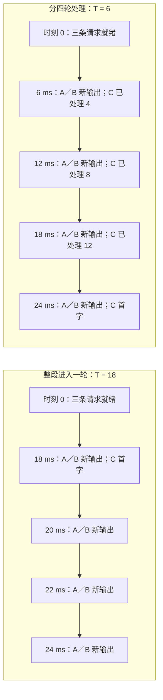
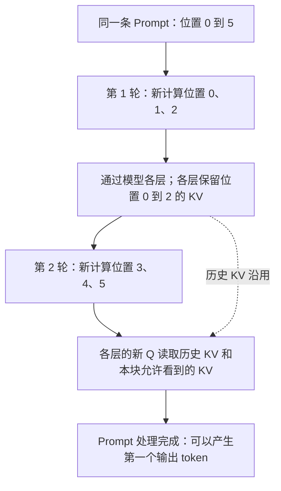

# 长 Prompt 为什么会干扰其他请求，如何拆分 Prefill？

> 长输入会占用较长的一轮模型执行，让已经在生成的请求也等得更久。Chunked Prefill 把长输入分几轮处理，在轮与轮之间给其他请求推进的机会；同一请求的各块仍共享已有 KV，并使用原来的逻辑位置。
>
> 拆得更小，通常更容易控制其他请求的输出间隔，但长输入自己的首字可能更晚，执行开销也可能增加。读完本篇，你应能手算一条调度时间线，写出保持因果关系的分块 Attention，并沿源码区分“每轮 token 预算”和“某条请求本轮实际处理的长度”。

先读过 [第 11 篇的 Prefill／Decode 与 KV Cache](../2026-10-26-prefill-decode-kv-cache/README.md) 和 [第 14 篇的逐轮调度](../2026-10-29-continuous-batching-scheduling/README.md) 会更顺畅。Attention 公式可回看 [第 10 篇](../2026-10-23-attention-online-softmax/README.md)，分页地址映射可回看 [第 13 篇](../2026-10-28-paged-kv-block-table/README.md)。本篇仍会先把必要概念重新说清楚。

## 1. 两个人正在等下一字，为什么新来的长输入会影响他们？

想象一个聊天服务正在处理三条请求：

- A、B 已经读完输入，正在逐字生成回答。
- C 刚到达，带来一大段文档，需要先读完，才能生成回答的第一个 token。

这里的“读”不是从磁盘读取文本，而是模型对输入 token 做前向计算。

模型读入已知输入、建立各层 KV Cache 的阶段叫 **Prefill**。随后每轮继续生成新 token 的阶段叫 **Decode**。在本篇普通自回归生成的设定中，一条 Decode 请求每轮处理一个新位置，才能继续产生下一个输出；投机解码不在这个设定里。

现在提出一个问题：**假如把 C 的整段输入塞进下一轮执行，A、B 会怎样？**

即使 A、B 也被选入同一个混合 batch，它们的这一轮输出也要等到相应执行和输出处理完成才能交付。C 的长 Prefill 可能把这一轮拉得很长。另一种历史调度方式会先单独执行 Prefill，让 Decode 暂时等候；这同样会拉长 A、B 的输出间隔。

上一篇讲的连续批处理，解决的是“每轮重新选择请求”。它本身没有保证“每轮执行一定足够短”。如果一个长输入一次就占用大量计算，重新调度的机会仍然来得很晚。

Chunked Prefill 的基本动作因此很直观：**C 这一轮先处理一部分，记住做到哪里；下一轮再继续。** 这里的 chunk 就是“一块”。它创造的是模型迭代之间的调度机会，不是让调度器在一个正在执行的 GPU kernel 中间任意打断它。原始工作的机制可对照 [SARATHI §4.2—4.3](https://arxiv.org/html/2308.16369v1) 和 [Sarathi-Serve §4.1—4.2](https://www.usenix.org/system/files/osdi24-agrawal.pdf)。

## 2. 先拿 16 个输入 token，亲手排一遍

### 2.1 先约定清楚，我们在数什么

为了用纸笔复算，先把真实 GPU 暂时换成一个**人为规定耗时的教学模型**。以下毫秒数全部来自这条假设公式，不能用于预测 vLLM 性能：

\[
\text{本轮耗时}=1+0.5d+p\quad\text{毫秒}
\]

- 每开始一轮，固定开销为 1 毫秒。
- 本轮有 \(d\) 条旧 Decode 请求各处理一个位置，每个位置另算 0.5 毫秒。
- 本轮处理 C 的 \(p\) 个输入位置，每个位置另算 1 毫秒。

三条请求都在时刻 0 就绪。A、B 刚在时刻 0 各交付一个 token，接下来各还要生成 **4 个**。C 有 **16 个**输入 token。忽略排队、网络、采样额外耗时，假设 KV 空间和请求槽位都充足。每轮先为 A、B 各安排一个 Decode 位置，再给 C 剩余份额。

用 \(T\) 表示**整轮 token 预算**：本轮所有请求需要新计算的位置数之和不能超过它。它不是请求数，也不是从过去保留下来的 KV token 总数。例如，A、B 各推进一个位置，C 处理 4 个位置，总计为 \(1+1+4=6\)。

为了比较相同工作，本例始终只跟踪 A、B 后续各 4 个输出，以及 C 的第一个输出；**C 首字之后的 Decode 不加入模拟**。否则不同方案中 C 加入 Decode 的时刻不同，后面的比较就换了工作集合。

### 2.2 如果一轮把 C 全部处理完

设 \(T=18\)。A、B 各占 1 个位置，C 的 16 个位置也都能放下。

第一轮耗时为 \(1+0.5\times2+16=18\) 毫秒。到时刻 18，A、B 才拿到各自的下一个输出，C 也得到首字。之后不再跟踪 C，每轮只有 A、B，耗时为 2 毫秒。

| 轮次 | A／B 本轮各推进 | C 本轮处理 | 结束时刻 | 这一刻交付 |
| --- | --- | --- | --- | --- |
| 1 | 1 个位置 | 16 个输入位置 | 18 ms | A／B 的第 1 个新输出，C 首字 |
| 2 | 1 个位置 | 0 | 20 ms | A／B 的第 2 个新输出 |
| 3 | 1 个位置 | 0 | 22 ms | A／B 的第 3 个新输出 |
| 4 | 1 个位置 | 0 | 24 ms | A／B 的第 4 个新输出 |

A、B 后面虽然每 2 毫秒就能拿到一字，但**开头有一个 18 毫秒的停顿**。仅看后面的平稳速度，会漏掉这次干扰。

### 2.3 如果每轮只给 C 一部分

改成 \(T=6\)。A、B 合计先占 2 个位置，C 每轮可以推进 4 个。

每轮耗时变成 \(1+0.5\times2+4=6\) 毫秒。C 需要 4 轮才读完，A、B 则每轮都能继续生成。



图中时间为假设公式的结果；[可编辑图源](assets/scheduling.mmd) 与 [实际运行的模拟输出](evidence/runs/lab.json) 已归档。

现在可以把收益和代价同时说出来：

- A、B 最大的相邻输出间隔，从 18 毫秒变成 6 毫秒。这里包括“时刻 0 的上一字”到第一个新输出的间隔。
- C 的首字从时刻 18 推迟到时刻 24。这个例子中，C 从到达到首字的时间，也就是 **TTFT（Time To First Token）**，变长了。
- 两种方案最后一个被跟踪的输出都在时刻 24 出现。本例没有推出总吞吐提高。

**ITL（Inter-Token Latency）**关注同一请求相邻输出 token 的间隔。C 的 TTFT 与 A、B 的 ITL 是不同问题，不能用一个“平均延迟”代替它们。真实测量还要约定是在引擎输出端还是客户端计时；这里统一用模拟器的轮末交付时刻。

## 3. 把输入切开，后半段会不会忘记前半段？

### 3.1 切的是本轮处理的位置，模型仍然是一条连续的请求

先把 C 缩小成只有 6 个输入位置的例子，便于逐个画出依赖，再分成两块：`[0,1,2]` 和 `[3,4,5]`。

第一轮处理位置 0、1、2，经过模型各层，留下这些位置在**每一层**的 K、V。第二轮处理位置 3、4、5 时，这些历史 KV 仍属于同一条请求，可以继续读取。

第二轮的新位置也必须继续编号为 3、4、5。位置编码（例如 RoPE）不能因为“进入第二块”就重新从 0 开始。



[图源](assets/prefix-kv.mmd)。图中的“通过各层”很重要：引擎把一个 chunk 送过整个模型，再处理下一个 chunk；它不是把同一层的 GPU tile 直接当作服务调度单位。GPU kernel 内的分块与引擎层的 Chunked Prefill 可以同时存在，作用的层次不同。

那么，要保证计算正确，到底还缺什么？**每个位置只能看到它原本应当看到的内容。**

### 3.2 位置 3 的 Query，到底可以看谁？

先回顾一个注意力位置的工作：它拿自己的 Query（Q，查询向量），与若干 Key（K，键向量）计算相关性，再按权重组合 Value（V，值向量）。在因果模型中，位置 \(i\) 只能看位置 \(0\) 到 \(i\)，不能看未来。

下面的 ✓ 表示可以看到。第二块虽然只有 3 行 Query，但它的 Key 范围包含第一块。

| Query 的全局位置 | K0 | K1 | K2 | K3 | K4 | K5 |
| --- | --- | --- | --- | --- | --- | --- |
| 0，第一块 | ✓ | — | — | — | — | — |
| 1，第一块 | ✓ | ✓ | — | — | — | — |
| 2，第一块 | ✓ | ✓ | ✓ | — | — | — |
| 3，第二块 | ✓ | ✓ | ✓ | ✓ | — | — |
| 4，第二块 | ✓ | ✓ | ✓ | ✓ | ✓ | — |
| 5，第二块 | ✓ | ✓ | ✓ | ✓ | ✓ | ✓ |

现在把数值也变得能手算。设 Q、K 都为 0，Value 依次为 `0,1,2,3,4,5`。所有允许看到的位置得分都相同，softmax 后就是平均分配权重。

因此，位置 3 的正确输出为：

\[
(0+1+2+3)/4=1.5
\]

两个很容易出现的错误，可以立刻用这个数字识别：

| 错误做法 | 位置 3 实际看到的 Value | 输出 |
| --- | --- | --- |
| 丢掉第一块 KV，把第二块当作新序列 | 只有本块的第一个值 3 | 3 |
| 保留全部 KV，却把本块第一行当成全局第 0 行做左上角三角 mask | 只有全局第一个值 0 | 0 |
| 使用全局位置构造正确 mask | 0、1、2、3 | 1.5 |

第二种错误尤其隐蔽。PyTorch 的 `scaled_dot_product_attention`（SDPA，缩放点积注意力）接口可以直接完成上述计算，但 2.9 版文档明确说明：非方阵的 `is_causal=True` 使用左上角对齐的因果关系。**Query 是后半块、KV 是完整前缀时，不能无条件把这个参数当作“自动理解历史长度”。** 本篇练习显式构造绝对位置 mask，而用完整方阵 SDPA 作为独立对照。[官方 API 语义](https://docs.pytorch.org/docs/2.9/generated/torch.nn.functional.scaled_dot_product_attention.html)；[本地语义笔记](evidence/source-reading.md)。

### 3.3 从这张表，写出分块的公式

设整条输入长度为 \(L\)，本块处理位置 \(b\) 到 \(e-1\)。冒号使用 Python 的左闭右开约定：`Q[b:e]` 有 \(e-b\) 行。每行 Q、K 的向量长度为 \(d_k\)。

\[
O[b:e]=\operatorname{softmax}\left(
\frac{Q[b:e]K[:e]^T}{\sqrt{d_k}}+M[b:e,:e]
\right)V[:e]
\]

其中 \(M_{i,j}=0\) 当 \(j\le i\)，否则为 \(-\infty\)。softmax 按每行进行，因此被遮住的位置权重为 0。

先看形状，就能判断是否漏了历史：Q 有 \(e-b\) 行，K 和 V 有 \(e\) 行；它们不必是同样长的序列。如果 \(b=3,e=6\)，本轮是 3 行 Query，访问 6 个 Key／Value。

因果约束还解释了为什么前一块可以先算完：前面位置的正确输出本来就不依赖未来位置。对于这里讨论的普通因果 Decoder，各块按原来位置、沿用各层 KV，便保留了这条因果依赖关系。真实模型还要保持位置编码、其他算子语义及数值设置一致；我们的练习只验证**固定 Q、K、V 的一层单头 Attention**，不是完整模型的输出等价测试。原论文的分块因果图见 [SARATHI §4.2、Figure 6](https://arxiv.org/html/2308.16369v1)。

如果只数有意义的因果 Query–Key 配对，整条长度为 \(L\) 的输入仍然有：

\[
1+2+\cdots+L=\frac{L(L+1)}2
\]

切块没有删除这些历史依赖，也没有把完整密集 Prefill Attention 变成线性复杂度。实际 kernel 是否计算部分被遮住的 tile，取决于实现；上式是依赖数量，不是精确指令计数。不同执行路径的浮点结果也未必逐 bit 相同，需要按精度标准比较。

## 4. 每轮预算，为什么不等于每条 Prompt 固定切几块？

回到 A、B、C。当前轮有 \(D\) 条旧 Decode 请求，各占一个新计算位置，总预算为 \(T\)，C 还剩 \(R\) 个输入位置。在“先安排全部旧 Decode、只有一条 Prefill、KV 和槽位足够、没有其他限制”的教学策略下：

\[
p=\min(R,T-D),\quad T\ge D
\]

当 \(D\) 保持不变且 \(T>D\) 时，长度为 \(L\) 的 Prefill 所需轮数才可以写成：

\[
K=\left\lceil\frac{L}{T-D}\right\rceil
\]

这不是所有真实引擎都适用的轮数公式。如果 A、B 结束，\(D\) 就变了；如果有另一条 Prompt，也要分享剩余预算；如果 KV 无法分配，本轮甚至不能按这个计划执行。

把预算继续减小，原例的结果如下。四行使用完全相同的输入、工作集合和耗时公式。

| 整轮预算 \(T\) | C 每轮处理的输入位置数 | C 首字时刻 | A／B 的新输出时刻 | A／B 最大输出间隔 | 最后一个被跟踪的事件 |
| --- | --- | --- | --- | --- | --- |
| 18 | 16、0、0、0 | 18 ms | 18、20、22、24 ms | 18 ms | 24 ms |
| 6 | 4、4、4、4 | 24 ms | 6、12、18、24 ms | 6 ms | 24 ms |
| 4 | 2、2、2、2、4、4 | 26 ms | 4、8、12、16 ms | 4 ms | 26 ms |
| 2 | 先 4 轮为 0，再 8 轮各处理 2 | 32 ms | 2、4、6、8 ms | 2 ms | 32 ms |

关注第三行：前 4 轮，A、B 各占一个位置，C 只能得到 2 个；A、B 结束后，C 每轮可以得到 4 个。**预算始终为 4，C 的实际 chunk 长度却从 2 变为 4。**

最后一行说明另一个问题：预算全部被 Decode 用完时，Prefill 不会凭空前进。这里 A、B 只剩有限 4 步，所以 C 后来仍能完成。如果持续有 Decode 占满所有预算，而策略又始终只保护 Decode，Prefill 可能长期得不到机会；需要进一步检查准入、优先级或公平性策略。

更小的预算也让固定轮次开销更明显。比如 \(T=4\) 需要 6 轮，最后时刻为：

\[
6\times1+8\times0.5+16\times1=26\ \text{ms}
\]

这里的 8 是 A、B 各自生成 4 个 token 的总工作。这个算式能解释教学模型的时间守恒，**没有刻画 GPU 上权重共享、矩阵形状利用率、历史 KV 长度和算子融合的非线性影响**。论文提出的 Decode piggybacking，是利用混合执行时的实际资源复用；不能拿我们的线性加法公式证明其性能收益。[Sarathi-Serve §4.2—4.3](https://www.usenix.org/system/files/osdi24-agrawal.pdf)。

## 5. 论文里的想法，在今天的代码中长什么样？

本节只回答前面已经提出的三个问题：**这轮选多少位置、下一轮如何接着算、未读完时会不会错误输出。**

2026-10-30 实际更新了两个官方仓库：vLLM 默认分支固定为 `e49ea84e929e3d48a2bc500454dfcd4377f9a722`，Sarathi-Serve 固定为 `96f9911790ecc00af12ee9fae47cb8fa9ba0d199`。当天观测到 vLLM 最新稳定发行元数据为 `v0.32.0`，但本节代码结论来自前述 main 快照，**没有单独分析稳定版实现**。仓库没有安装或执行这两个引擎。[版本与实际更新记录](evidence/versions.json)。

### 5.1 先看作者实现：Decode 占掉的份额要先扣除

2023 年 SARATHI 描述分块 Prefill 和 Decode 混合执行的思路；2024 年 Sarathi-Serve 的 §4.2、Algorithm 3 进一步给出了按 token 预算组织迭代的调度算法。先选已有 Decode，再选尚未完成的 Prefill，最后考虑新请求，仍受内存等条件约束。论文使用的 “stall-free” 不能解释为 Decode 没有额外延迟；混合迭代本身仍需要时间。论文实验中的 vLLM 基线也是当时版本，不能代表今天的 main。[原论文与版本笔记](evidence/paper-reading.md)。

在这次拉取的 Sarathi-Serve 作者仓库中，`SarathiScheduler._schedule` 先处理已完成 Prefill、且当前可调度的序列，为每个 Decode 累加一个 token；随后处理已有的部分 Prefill，再考虑等待中的请求。代码还会检查执行状态、KV 槽位并处理抢占，不能省略这些条件后声称“所有 Decode 永远都能优先运行”。[第一、第二遍选择](https://github.com/microsoft/sarathi-serve/blob/96f9911790ecc00af12ee9fae47cb8fa9ba0d199/sarathi/core/scheduler/sarathi_scheduler.py#L124-L187)。

关键的剩余份额在 `_get_seq_next_num_prefill_tokens` 里：

```python
# 作者代码的静态 chunk 配置路径；变量名沿用上游。
next_num_tokens = min(
    seq.get_prompt_len() - seq.get_num_prompt_tokens_stage_processed(),
    chunk_size - num_batched_tokens,
)
```

这里 `num_batched_tokens` 包括已经放入本轮的 Decode 和其他 Prefill 位置。虽然变量叫 `chunk_size`，这一步仍然要减去已占份额；它并不意味着每条请求每轮都处理这么长。配置中的 `get_max_num_batched_tokens` 也返回相应预算。另有动态分块分支，本篇不把静态路径推广到全部模式。[函数原文](https://github.com/microsoft/sarathi-serve/blob/96f9911790ecc00af12ee9fae47cb8fa9ba0d199/sarathi/core/scheduler/sarathi_scheduler.py#L74-L96)；[配置实现](https://github.com/microsoft/sarathi-serve/blob/96f9911790ecc00af12ee9fae47cb8fa9ba0d199/sarathi/config/config.py#L245-L271)。

这份仓库快照的提交日期为 2026-01-08，晚于论文发表。它有助于核对作者公开实现的机制，不能当作复现 2024 年论文测量的完整环境。

### 5.2 再看 vLLM：统一的“还差多少位置”模型

vLLM V1 调度器不简单地把所有工作写成一个 Prefill 队列加一个 Decode 队列。`schedule` 对请求维护已有计算进度与还需处理的位置，运行中的请求也可能是尚未完成的 Prefill。

普通、同步、无投机的场景里，可以先把核心动作理解为：

```python
# 教学化表达，省略投机、异步占位、多模态及对齐约束。
remaining = request.num_tokens - request.num_computed_tokens
this_round = min(remaining, remaining_token_budget)
```

真实 running 路径还会考虑 `num_tokens_with_spec`、`num_output_placeholders`、`input_budget` 等，先应用可选的长 Prefill 限制，再按预算裁剪。对于等待中的普通请求，若允许 Chunked Prefill，可以按本轮剩余预算只接纳一部分；关闭该能力且本轮装不下时，则有相应停止调度条件。[running 路径](https://github.com/vllm-project/vllm/blob/e49ea84e929e3d48a2bc500454dfcd4377f9a722/vllm/v1/core/sched/scheduler.py#L793-L855)；[waiting 路径](https://github.com/vllm-project/vllm/blob/e49ea84e929e3d48a2bc500454dfcd4377f9a722/vllm/v1/core/sched/scheduler.py#L1331-L1346)。

因此需要分清三个概念：

| 概念 | 限制什么 | 容易产生的误解 |
| --- | --- | --- |
| `max_num_batched_tokens` 等整轮预算 | 所有请求本轮新计算的位置总量 | 当成每条 Prompt 的固定 chunk 长度 |
| `long_prefill_token_threshold` | 特定条件下单条长 Prefill 的额外上限 | 设为 0 就等于关闭 Chunked Prefill |
| `enable_chunked_prefill` | 是否允许相应请求拆到多轮 | 只凭一个阈值判断功能开关 |

当前快照里，长 Prefill 阈值只在多条候选请求时启用；只有一条时不施加这个额外上限。可选 adaptive 模式还会调整上限。阈值为 0 表示这道额外裁剪不生效，整轮预算仍然存在。[条件原文](https://github.com/vllm-project/vllm/blob/e49ea84e929e3d48a2bc500454dfcd4377f9a722/vllm/v1/core/sched/scheduler.py#L753-L768)；[配置声明](https://github.com/vllm-project/vllm/blob/e49ea84e929e3d48a2bc500454dfcd4377f9a722/vllm/config/scheduler.py#L79-L90)。

本篇练习显式采用“所有旧 Decode 先安排”的简化策略；不能据此声称当前 vLLM 的所有运行模式都严格全局 Decode 优先。实际请求顺序、部分 Prefill、预算、内存、节流和模型约束要一起看。调参时应确认有效配置和真实路径，不能只套用论文的简化调度顺序。

### 5.3 下一块怎样知道从哪里开始？

前面数字例子中，第一块做完位置 0、1、2，第二块就应从 3 开始。对应到源码，需要读“进度”和“位置”两个动作。

调度器在 `_update_after_schedule` 中推进 `num_computed_tokens`，并记录 `num_in_flight_tokens`，让后续调度可以接着安排下一块。注意：它在调度后就推进了进度，并非每次读到这个计数都能断言 GPU 已经完成全部计算；异步与投机路径还有后续修正。[进度更新](https://github.com/vllm-project/vllm/blob/e49ea84e929e3d48a2bc500454dfcd4377f9a722/vllm/v1/core/sched/scheduler.py#L1844-L1867)。

接着沿 `GPUWorker._make_model_runner` 的分支看：**以下分析限定 `use_v2_model_runner=False` 时的 `GPUModelRunner`，不声称这是所有配置的默认路径。** 该分支入口可以在 [worker 中核对](https://github.com/vllm-project/vllm/blob/e49ea84e929e3d48a2bc500454dfcd4377f9a722/vllm/v1/worker/gpu_worker.py#L577-L593)。

`_prepare_inputs` 为本轮各位置生成的逻辑位置，等于“该请求此前的进度 + 块内偏移”。于是此前进度为 3、这轮计算 3 个位置时，得到的仍是 `3,4,5`。注意力用的序列长度也包含此前进度和本轮新增量，而非只等于 chunk 长度。[位置构造](https://github.com/vllm-project/vllm/blob/e49ea84e929e3d48a2bc500454dfcd4377f9a722/vllm/v1/worker/gpu_model_runner.py#L1946-L1960)；[长度与未完成请求标记](https://github.com/vllm-project/vllm/blob/e49ea84e929e3d48a2bc500454dfcd4377f9a722/vllm/v1/worker/gpu_model_runner.py#L2039-L2065)。

再看普通密集因果 FlashAttention 后端的接口：Q 来自本轮，K／V 来自缓存，调用同时传入 Query 的分段边界、KV 序列长度、因果标志和块表。这些信息共同表达“短 Query 块访问更长的历史 KV”；真实后端不应被误认为练习里错误的左上角三角 mask。[缓存与元数据](https://github.com/vllm-project/vllm/blob/e49ea84e929e3d48a2bc500454dfcd4377f9a722/vllm/v1/attention/backends/flash_attn.py#L1274-L1286)；[密集调用接口](https://github.com/vllm-project/vllm/blob/e49ea84e929e3d48a2bc500454dfcd4377f9a722/vllm/v1/attention/backends/flash_attn.py#L1404-L1428)。这里是源码接口核对，没有运行 GPU kernel，也没有覆盖稀疏、滑动窗口、多模态或另一套 runner。

### 5.4 读到一半，为什么不应该交付一个新 token？

用户希望得到的是“整段 Prompt 后的回答”。只读到位置 2 时，后面的已知输入 3、4、5 还没处理完，这时不能把中间预测当作回答交出去。

前述 runner 用 `discard_request_mask` 标记本轮结束后仍未覆盖完整输入的请求；调度器处理输出时，也明确预期部分 Prefill 的 `new_token_ids` 为空。[runner 标记](https://github.com/vllm-project/vllm/blob/e49ea84e929e3d48a2bc500454dfcd4377f9a722/vllm/v1/worker/gpu_model_runner.py#L2060-L2065)；[调度器输出处理](https://github.com/vllm-project/vllm/blob/e49ea84e929e3d48a2bc500454dfcd4377f9a722/vllm/v1/core/sched/scheduler.py#L2739-L2756)。

准确的说法是：**未读完 Prompt 的 chunk 不向这条请求交付有效的新回答 token。** 这不等于承诺每个执行路径都绝不运行采样相关计算；有的实现会计算后丢弃不应交付的结果。

## 6. 生产环境里，怎样判断该不该拆、拆多大？

### 6.1 先确认干扰来自长迭代，还是别的地方

如果交互请求偶尔出现长停顿，可以把请求时间线与引擎迭代对齐：停顿附近是否恰有长输入进入？那一轮新计算的位置数和执行时长是否明显增加？KV 是否接近容量上限、触发抢占或重算？入口排队、网络发送是否也在等待？

只有确认延迟主要发生在混合执行或 Prefill 占据调度机会时，Chunked Prefill 才直接对症。若问题主要在网络、模型加载或 KV 容量不足，只减小预算不一定解决。

### 6.2 收益与代价要一起看

| 调整方向 | 希望改善什么 | 需要付出的代价或检查的条件 |
| --- | --- | --- |
| 限制长 Prefill 在一轮中的工作量 | 减少对正在 Decode 请求的长时间干扰 | 长输入需要更多轮，自己的首字可能推迟 |
| 让适量 Prefill 与 Decode 混合 | 利用不同阶段的资源特征和批内复用 | 实际收益取决于模型、形状、后端和硬件，要实测 |
| 把 chunk 继续缩小 | 提供更细的调度机会 | 更多轮次与启动开销，矩阵可能更难充分利用 GPU |
| 延续历史 KV，避免重算前缀 | 保持每块计算正确，并复用前面结果 | 后续块仍要访问历史 KV；切得更碎可能增加重复访问与管理开销 |
| 给 Prefill 保留推进机会 | 防止只照顾 Decode 而饿死新请求 | 可能需要在新请求 TTFT 与已有请求 ITL 间重新分配份额 |

这些取舍在 [Sarathi-Serve §4.3、§5.4.1](https://www.usenix.org/system/files/osdi24-agrawal.pdf) 中有明确讨论。本篇不复用其历史加速比作为今天系统的测量，也不从 CPU 练习推算 HBM 流量。

还要牢记：**处理顺序变了，最终要保留的 KV 并没有自动变少。** 同样一条密集模型请求，处理完 \(L\) 个输入位置后仍需相应各层 KV。按需分配会改变内存增长的时间线，但不等于完整输入或后续输出必然放得下。

当前 vLLM 还有完整当前输入的准入预留选项；`allocate_slots` 的 `full_sequence_must_fit` 检查也说明，“本轮只算一块”与“能否接纳整条当前输入”是两个不同约束。这又不等于已经为所有未来生成位置保留了最大长度的容量。[容量检查](https://github.com/vllm-project/vllm/blob/e49ea84e929e3d48a2bc500454dfcd4377f9a722/vllm/v1/core/kv_cache_manager.py#L517-L547)。

### 6.3 一个能用于调参的验证方法

先固定模型和 tokenizer、权重及缓存精度、GPU 与并行方式、引擎完整版本、注意力后端，以及 prefix caching、投机解码等开关。再固定请求输入／输出长度分布、到达速率和并发方式，比较不同预算与阈值下的表现。

至少分别查看长输入和短输入的 TTFT、正在生成请求的 ITL 分布、完成吞吐、排队、抢占与 KV 使用。长上下文中的一个 Decode 位置，与短上下文中的一个位置并不一定等价；因此 **token 预算不是毫秒预算**。想满足尾延迟 SLO（服务目标），需要在目标负载下测量相应分位数，保留样本量和计时边界，不能靠“预算取某个整数”直接保证。

测试前还要确认分块后正确性满足既定容差；使用相同的生成／采样设定。在改变预算后，如果只看总 tokens/s 而不看长输入 TTFT 与 Decode 尾部停顿，容易把延迟转移误认为问题已经解决。本篇没有 GPU，也没有进行这项服务压测；以上是验证方案。

## 7. 两道代码练习：先保证看对历史，再安排好时间

依赖仅使用已有的 Python 与 PyTorch CPU 环境，不会自动安装引擎。题目接口在 [exercises.py](code/exercises.py)，完整说明在 [代码运行与题目](code/README.md)，答案在独立文件中。你可以在自己的文件里完成，也可以直接填写起始接口。

### 练习一：后半块怎样正确读取前半块？

实现 `chunked_attention(q, k, v, chunk_size)`。

输入契约：Q、K 为 `[L,D]`，V 为 `[L,Dv]`，维度均为正；CPU `float32` 或 `float64`，三者 dtype 相同且输入值有限。`chunk_size` 为正整数，`bool` 不作为整数接受。返回 `[L,Dv]`，不修改输入。

请按顺序处理 Query 块，用保留的前缀 KV 做因果 Attention。要求支持最后一块不足 `chunk_size`、`chunk_size>L`、非连续输入，以及 V 宽度与 Q 不同。输入校验不满足时抛出 `ValueError`。

先用 Q、K 为 0，V 为 `0..5` 手算第二块第一个位置应为 `1.5`。再与完整方阵、`dropout_p=0`、`is_causal=True` 的 SDPA 对照：float64 用 `rtol=atol=1e-12`，float32 用 `rtol=1e-5, atol=1e-6`。还要说明把矩形 `is_causal=True` 直接用于后半块，会得到什么错误结果。

运行自己的版本（先把函数写进 `exercises.py`）：

```bash
# 在本篇目录中执行，python 指向已有 PyTorch 环境。
EXERCISE_IMPL=exercises python -m unittest discover -s code -p test_answers.py -v
```

这条命令也会检查练习二；尚未完成的接口报错是预期现象。

<details>
<summary>详解与参考答案：把块内行号换成全局位置</summary>

完整实现见 [answers.py](code/answers.py) 的 `chunked_attention`。核心可以分四步理解：

1. 本块从 `start` 计算到 `end-1`，将这段 K、V 加入已有前缀。
2. 计算 `q[start:end] @ cached_k.T / sqrt(D)`，形状为 `[end-start,end]`。
3. 本块 Query 的位置为 `start..end-1`，Key 的位置为 `0..end-1`；比较 `key_position <= query_position`，给未来位置填 `-inf`。
4. 对每行做 softmax，与缓存 V 相乘，最后拼回完整输出。

```python
query_positions = torch.arange(start, end, device=q.device)[:, None]
key_positions = torch.arange(end, device=q.device)[None, :]
allowed = key_positions <= query_positions
```

这段比较就是第 3 节表格的代码版本。位置 3 的允许范围为 0 到 3，所以答案是 `1.5`。若丢掉前缀，得到 `3.0`；若使用错误的左上角三角关系，得到 `0.0`。[测试中的可执行反例](code/test_answers.py)。

本地 CPU 随机输入为 `[8,4]`、float64、种子 123，chunk 为 `1,3,8,11`。与完整 SDPA 比较，四组最大绝对误差均为 `2.220446049250313e-16`，通过设定容差；这不是逐 bit 相等的承诺。[真实输出](evidence/runs/lab.json)。

这里用 `torch.cat` 表达“缓存里有哪些内容”，会产生复制，并非推荐的引擎缓存分配方式。工程实现应沿用缓存地址管理；不要把这段 CPU 教学代码拿来证明缓存性能。浮点点积也有范围限制：有限但极大的输入仍可能在乘加中溢出，有限性校验不等于任意有限输入都能得到有限输出。我们验证的是记录中的常规尺度数据，不覆盖所有极端数值或完整 Transformer。

</details>

### 练习二：每轮保护 Decode，C 需要等多久？

实现 `schedule_prefill(prompt_tokens, decode_requests, decode_steps, token_budget)`，使用第 2 节完全相同的规则。`prompt_tokens`、`decode_steps`、`token_budget` 为正整数，`decode_requests` 为非负整数，均拒绝 `bool`，并要求预算不小于初始 Decode 请求数。

返回 [models.py](code/models.py) 中的 `Schedule`：逐轮起止时刻、Decode 数、本轮 Prefill 长度、累计已处理输入长度，C 首字时刻，以及每条旧请求的输出时刻。所有旧 Decode 请求都还需 `decode_steps` 个输出；C 首字后不再加入模拟，但旧 Decode 要继续到完成。

请比较 `L=16,D=2,N=4`，预算为 `18,6,4,2` 的四种情况，复现第 4 节表格。额外要求：

- 核对每轮使用的位置数不超过预算。
- 核对 C 总共恰好处理 16 个位置，旧请求共输出 8 个 token。
- 解释预算为 4 时为什么 chunk 后来变长，预算为 2 时为什么 C 暂停。
- 检查没有旧 Decode、只有 1 个输入位置等边界情况。

<details>
<summary>详解与参考答案：先扣预算，轮末再交付</summary>

完整实现见 [answers.py](code/answers.py) 的 `schedule_prefill`，逐轮维护三个状态：剩余 Prompt 长度、旧请求还剩几轮、当前时刻。

只要旧请求还有输出要生成，本轮就安排 `D` 个 Decode 位置；否则为 0。剩余预算给 C：`p=min(remaining_prompt, token_budget-decodes)`。按假设公式推进时刻，在轮末记录旧请求的新输出。只有累计处理完 C 的全部输入，才第一次记录 C 的首字。

`T=4` 时，前 4 轮每轮为 `2 Decode + 2 Prefill`，结束于 `4,8,12,16 ms`。这时旧请求完成，C 还剩 8 个输入；再用两轮、每轮 4 个位置，于 `21,26 ms` 完成。首字在时刻 26，且 C 的 chunk 从 2 变成 4。

`T=2` 时，前 4 轮预算全给旧请求，各轮 2 毫秒，时刻 8 结束。之后 C 用 8 轮，每轮 `1+2=3 ms`，所以首字为 `8+8×3=32 ms`。本题是有限旧请求，并未模拟持续到来的无限 Decode 流量。

任意一组有效输入都可用下式检查工作是否被漏算：

\[
\text{总模拟时长}=\text{轮数}\times1+0.5DN+L
\]

这是本题线性模型的守恒关系。把 C 的首字后 Decode 也偷偷加入，或者 C 一读完就停止模拟、漏掉尚未结束的 A／B，都会改变题目的工作集合。

参考答案的完整测试为：

```bash
python -m unittest discover -s code -p test_answers.py -v
python code/run_lab.py
```

本次实际环境为 macOS arm64、Python 3.10.13、PyTorch 2.9.1、CPU，CUDA 不可用。**20 个测试通过**，包含独立 SDPA 对照、手算反例、默认设备回归、输入边界及多组调度守恒检查。Ruff check 与 format 检查通过。[命令和退出码](evidence/runs/summary.json)；[原始测试输出](evidence/runs/tests.txt)。模拟器中的时间来自假设公式，Attention 输出则来自真实 CPU 运算。

</details>

## 8. 面试官继续追问

| 层次 | 追问 | 参考回答要点 |
| --- | --- | --- |
| 基础 | 已经连续批处理，为什么长输入仍会导致卡顿？ | 连续批处理提供轮间重新选择机会；整段 Prefill 仍可能把一轮执行拉长。 |
| 基础 | chunk 之间需要保留什么？ | 同一请求逐层 KV、计算进度、原来的逻辑位置及必要状态；不能把各块当成独立文本。 |
| 数值 | 第二块只有 3 行 Q，为什么可以有 6 行 K／V？ | Q 是本轮新增位置，K／V 包含历史；因果 mask 要按全局位置判断。 |
| 实现 | `is_causal=True` 为什么也可能用错？ | 必须看具体 API 的矩形对齐语义；本篇 PyTorch 反例为左上角对齐，不能自动补出前缀偏移。 |
| 实现 | 把阈值设为 0，是否就关闭 Chunked Prefill？ | 当前 vLLM 快照里表示不做该额外阈值裁剪；能力开关与整轮预算仍要分别检查。 |
| 实现 | `num_computed_tokens` 增加了，能证明 GPU 计算完成吗？ | 不能；当前调度器在安排后就推进计数，并另记 in-flight 状态，须结合实际完成反馈。 |
| 取舍 | chunk 越小是不是所有人都更快？ | Decode 间隔可能改善，长输入 TTFT、轮次开销与 GPU 利用率可能变差，且可能缺乏 Prefill 推进份额。 |
| 容量 | 切块后 KV 可以只保留最近一块吗？ | 普通密集因果 Attention 仍需前面的 KV；删除前缀会改变计算，滑动窗口模型另有语义。 |
| 验证 | 要证明线上优化有效，需要哪些证据？ | 固定环境与工作负载，验证正确性，分别测各类请求 TTFT、ITL 分布、吞吐、排队与抢占，检查目标 SLO。 |

## 9. 带着边界进入下一篇

本篇集中讨论普通因果 Decoder 的单请求分块，以及它和已有 Decode 请求共享调度预算的关系。论文、作者公开代码、当前 vLLM 特定路径、CPU 参考与假设时间线已分别标注；GPU 引擎执行、完整模型一致性和服务尾延迟尚未实测。

我们已经知道：**同一条请求的下一块，需要复用自己前一块的 KV。** 接下来自然会问：两条请求拥有相同前缀时，能不能连第一块也不用重复计算？这将进入 prefix caching，以及复用条件、隔离和失效问题。

资料：[参考资料与证据](references.md)；[源码阅读笔记](evidence/source-reading.md)；[论文阅读笔记](evidence/paper-reading.md)。验证：[审查记录](review.md)；[Python 独立审查](evidence/python-review.md)。返回 [Wiki 索引](../../../index.md)。
