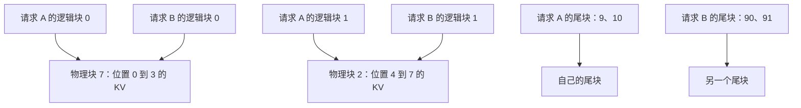
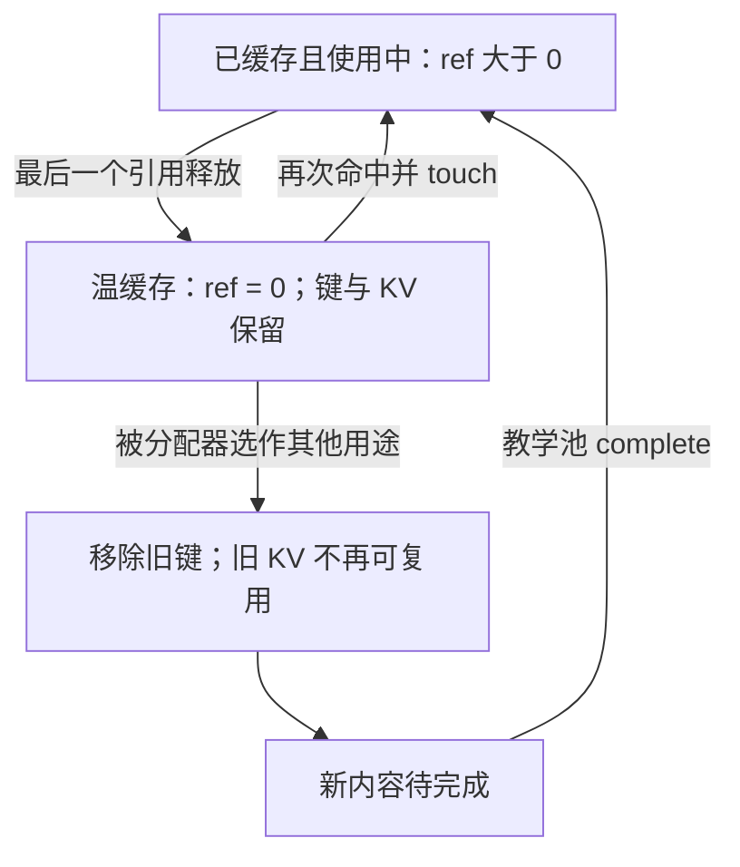

# 多个请求什么时候能安全复用同一段前缀？

> 多条请求可以复用同一段前缀已经算好的 KV，省去重复处理这段输入的工作。前提是模型与计算语义兼容、从开头到复用边界的有效输入相同、缓存仍然有效，并且请求属于允许共享的范围。
>
> 本篇先用每块 4 个 token 的例子，讲清“有相同文本”为什么还不够，再沿当前 vLLM 代码查看哈希链、命中边界、引用计数与驱逐。两道 CPU 练习分别实现前缀查找和共享块的生命周期。

前置阅读：[第 11 篇：Prefill／Decode 与逐层 KV](../../10/2026-10-26-prefill-decode-kv-cache/README.md)、[第 13 篇：分页与块表](../../10/2026-10-28-paged-kv-block-table/README.md)、[第 14 篇：逐轮调度](../../10/2026-10-29-continuous-batching-scheduling/README.md)、[第 15 篇：分块 Prefill](../../10/2026-10-30-chunked-prefill-interference/README.md)。以下从必要基础重新讲起。

## 1. 同一本手册问十次，为什么要读十遍？

你部署了一个问答助手。每条请求都包含相同的使用说明和一份长手册，最后才接用户的问题：

```text
请求 A：[使用说明][同一份手册][问题：怎样创建账户？]
请求 B：[使用说明][同一份手册][问题：怎样重置密码？]
```

如果每条请求都重新计算说明与手册，重复工作会很多。上一篇把长输入拆成多轮，改善调度机会，但拆块本身仍然要把这段输入算一遍。

现在换一个问题：**A 已经算过的部分，B 能不能直接沿用？**

模型在 Prefill 阶段处理输入 token，留下各层注意力需要的 Key／Value，也就是 KV Cache。B 如果能复用前缀 KV，就可以从自己的新问题接着计算。这种跨请求复用前缀状态的能力，通常叫 **Prefix Caching（前缀缓存）**；vLLM 的自动查找与复用称为 **APC（Automatic Prefix Caching）**。[官方功能说明](https://github.com/vllm-project/vllm/blob/e8ec12c5edc3e14598bb122237d2798a3d4f3fa0/docs/features/automatic_prefix_caching.md#L1-L13)。

不过，KV 不是“这本手册的摘要”，也不是已生成的回答。它是某个模型、在某段具体输入与位置关系下算出的中间状态。换了前文、模型或有效输入，能否沿用这些状态就需要重新判断。

## 2. 先看一个能逐个数清楚的例子

### 2.1 相同的是哪些位置？

分词器（tokenizer）负责把文本变成 token ID。这里先不运行真实分词器，把每个数字直接当成一个 ID。设缓存按每块 \(B=4\) 个位置组织，A 已经计算过以下输入：

```text
A： [1, 2, 3, 4] [5, 6, 7, 8] [9, 10]
        第 0 块       第 1 块     未满的尾块
```

我们先讨论一个明确的基础模型：**只有完整块参与跨请求复用，哈希粒度、命中对齐和物理块大小都为 4；所有缓存都已准备好且仍驻留。** 当前引擎还存在更细的部分块路径，第 6 节会说明，先不把它混进基础例子。

B 的输入为：

```text
B： [1, 2, 3, 4] [5, 6, 7, 8] [90, 91]
```

从开头往后比较，前 8 个位置完全相同。B 可以复用前两个完整块，再处理自己最后 2 个位置。这里说“省去 8 个输入位置的重复处理”，不等于“耗时恰好减少 80%”；剩余位置仍需访问历史 KV，各种算子成本也不相同。



两条请求各有自己的块表，前两项可以指向同样的物理块；不同后缀使用自己的存储。[图源](assets/shared-prefix.mmd)。图中的物理 ID 只是教学编号，未表示真实运行地址。

再把 B 的第 8 个输入 token 改掉（位置从 0 开始时是位置 7）：

```text
C： [1, 2, 3, 4] [5, 6, 7, 99] [90, 91]
```

这次共同前缀只有 7 个位置。按完整块模型，第二块还差一个位置才能完全匹配，因此只复用前 4 个，后面 6 个位置重新计算。

### 2.2 为什么不是“后面碰巧相同的一块也能拿来用”？

看另一条请求：

```text
D： [90, 2, 3, 4] [5, 6, 7, 8] [9, 10]
```

第 1 块局部 token 仍是 `[5,6,7,8]`，但它前面的第一个 token 已经变了。对于因果模型，后面位置的状态可能受前面输入影响，不能只比较当前这 4 个数字，就复用 A 的第 1 块 KV。

“前缀”强调的是**从请求开头到某个边界连续相同**。它不是在任意位置寻找语义相近或文字重复的片段。

## 3. 同一个前缀，为什么会得到可复用的状态？

### 3.1 先把因果关系说清楚

普通因果 Decoder 中，位置 \(i\) 的计算只能依赖它自己和更早的位置。后面的新问题还没出现时，前面说明与手册的状态不会因为那个未来问题改变。

可以把第 \(\ell\) 层位置 \(i\) 的隐藏向量记为 \(h_i^{(\ell)}\)。“隐藏向量”就是模型在该层表示这个位置的一组数。一个简化的依赖表达为：

\[
h_i^{(0)}=\operatorname{Embed}(x_i,\operatorname{position}_i),\qquad
h_i^{(\ell)}=F_\ell\left(h_0^{(\ell-1)},\ldots,h_i^{(\ell-1)}\right)
\]

这里的 embedding 是输入的向量表示。这个式子只表达依赖，不把所有位置编码实现都写成相加。各层 K／V 由相应层的输入状态经过模型变换得到。

如果两条请求前 \(P\) 个位置的有效输入相同，位置、权重和计算规则也一致，那么从第 0 层开始，这段前缀就有相同的数学输入；逐层往上看，也得到相同的数学状态。因此可以保存这段状态，供后续请求使用。分页共享的早期设计见 [PagedAttention 论文 §4.2、§4.4](https://arxiv.org/html/2309.06180v1)。

这里有两个需要保留的边界：

- 不要把“某个后缀 token 相同”当成整个依赖相同。第一层某些 K／V 可能只取决于当前 embedding 和位置，但更深层的状态一般已经包含前文信息，不能据此推广到逐层 KV。
- 数学依赖一致不保证不同 batch、不同 kernel 路径的浮点结果逐 bit 相同。真实部署仍应按模型与精度要求验证缓存开关前后的结果；本篇没有运行整模型一致性实验。

### 3.2 文本看着一样，为什么还可能不能复用？

引擎面对的是处理后的输入，而不是屏幕上显示的几行文字。聊天模板可能插入角色标记、分隔符和生成提示；tokenizer 也会把文本变成具体 ID。即使可见正文相同，模型实际收到的 token 序列也可能不同。

还有更直接的反例：两张不同图片都可能被表示为相同形状的占位 token，真正送给模型的图像 embedding 却不同。所以“token ID 相同”在多模态或直接输入 embedding 时也不一定足够。当前 vLLM 把这些额外身份纳入块键，见 [额外键生成](https://github.com/vllm-project/vllm/blob/e8ec12c5edc3e14598bb122237d2798a3d4f3fa0/vllm/v1/core/kv_cache_utils.py#L612-L675)。

逐个检查下面的问题，比只问“字符串是否一样”更可靠：

| 需要确认的条件 | 为什么会影响复用 |
| --- | --- |
| 权重版本和模型计算规则一致 | 同样输入经过不同函数，状态可能不同；热更新必须正确处理旧缓存 |
| 适配器身份一致 | LoRA 等附加适配器会改变计算，基础模型名字相同还不够 |
| 有效输入、位置与注意力可见关系一致 | 角色模板、前文、图像／embedding、截断和位置变化都可能改变状态 |
| 缓存表示与所在资源可兼容 | 存储类型（dtype）、内存布局、缓存组、并行分片或设备位置不能任意混用；跨实例传输另需协议 |
| 缓存已可安全读取且未被覆盖 | 只有键或物理编号，没有有效数据与执行依赖，不能复用 |
| 请求属于允许共享的范围 | 计算上相同也不自动代表跨租户允许共享 |

这里的适配器可以先理解为基础模型之外附加的一组参数；LoRA 就是常见方式之一。表格列的是条件，不是说这些值都逐项写在当前 vLLM 每个块的哈希里。模型级缓存通常属于具体引擎和缓存池；它的隔离、初始化和失效管理同样属于正确性的一部分。

温度是否相同则是另一个层次：温度影响从输出分数采样 token，通常不改变同一个给定前缀的目标模型 KV。可以复用前缀，不代表两次请求必然生成相同答案；输出 token 一旦不同，后续依赖也开始分叉。

## 4. 怎样给一段 KV 起一个不会漏掉前文的名字？

### 4.1 只给当前块做 hash，会漏掉什么？

hash 可以先理解为“把一组输入变成便于查询的固定长度指纹”。如果只对 `[5,6,7,8]` 求指纹，A 和 D 的第 1 块就会得到同一个名字，遗漏前面的差别。

一个自然的修正是，把“前面已经有什么”也带进来。设 \(b_j\) 是第 \(j\) 块的 token，\(e_j\) 是本块需要附带的输入身份：

\[
H_j=\operatorname{Hash}\left(H_{j-1},b_j,e_j\right)
\]

第一块的前驱使用约定的根值。第 0 块变化后，\(H_0\) 改变；即使第 1 块 token 没变，\(H_1\) 也会变化。这就把“同一条完整前缀”逐块串成了**哈希链**。

当前 vLLM 的核心动作正是把 parent hash、本块 token tuple、extra keys 一起交给 hash 函数；请求追加 token 后再增量产生新的完整 hash 单元。[`hash_block_tokens`](https://github.com/vllm-project/vllm/blob/e8ec12c5edc3e14598bb122237d2798a3d4f3fa0/vllm/v1/core/kv_cache_utils.py#L707-L741)；[`get_request_block_hasher`](https://github.com/vllm-project/vllm/blob/e8ec12c5edc3e14598bb122237d2798a3d4f3fa0/vllm/v1/core/kv_cache_utils.py#L953-L1035)。

### 4.2 同一个 hash，还需要核对哪些身份？

当前实现的 extra keys 包括 LoRA 名称与路径、涉及的多模态信息、直接传入的 embedding 指纹，以及可选 `cache_salt`。salt 可以理解为人为加入指纹计算的一个隔离值：前缀相同但 salt 不同，就不应进入同一个复用范围。

源码在第一块加入 salt，后续块通过 parent hash 继承它；因此不必在每块重复加入，也能让整个前缀链发生变化。[LoRA 键](https://github.com/vllm-project/vllm/blob/e8ec12c5edc3e14598bb122237d2798a3d4f3fa0/vllm/v1/core/kv_cache_utils.py#L592-L609)；[salt 与其他键](https://github.com/vllm-project/vllm/blob/e8ec12c5edc3e14598bb122237d2798a3d4f3fa0/vllm/v1/core/kv_cache_utils.py#L637-L675)。

**salt 是缓存键的一部分，不是完整的访问控制。** 多租户服务应由可信服务端把共享范围绑定到授权关系；不能认为客户端随便填相同 salt，就已经获得对方数据的访问资格。它也不负责加密 KV、处理网络权限或清除所有侧信道。[官方隔离机制说明](https://github.com/vllm-project/vllm/blob/e8ec12c5edc3e14598bb122237d2798a3d4f3fa0/docs/design/prefix_caching.md)；[本地边界笔记](evidence/source-reading.md)。

还要区分“同样的算法”和“同样的字节”。SHA-256 前必须把数据序列化。当前配置默认 `sha256` 使用 Pickle，而 `sha256_cbor` 使用 canonical CBOR；不要因为都写 SHA-256，就认定跨语言、跨版本会产生相同键。本篇练习使用自己的规范 JSON 协议，**不与 vLLM 的键字节兼容**。[配置](https://github.com/vllm-project/vllm/blob/e8ec12c5edc3e14598bb122237d2798a3d4f3fa0/vllm/config/cache.py#L257-L274)；[序列化实现](https://github.com/vllm-project/vllm/blob/e8ec12c5edc3e14598bb122237d2798a3d4f3fa0/vllm/utils/hashing.py#L26-L60)。

选用 SHA-256 可以把碰撞风险降得很低，但不应称为数学上绝对无碰撞。输入身份缺失造成的错误复用，也不会因为换了更强的 hash 就自动消失。

## 5. 为什么输入完全命中，可能还要重新算最后一块？

### 5.1 KV 足够读历史，不等于已经有下一字的分数

模型生成下一个 token，需要当前最后一个输入位置的隐藏状态和输出分数（logits）。前缀 KV 缓存主要保存注意力历史，并不等于同时保存了这次输出需要的最后隐藏状态或完整分数。

当前 vLLM 的本地前缀查找把可命中长度限制为已知输入长度减 1，保留最后一个位置供重新计算分数；请求参数还可能把上限收得更紧。在整块对齐的基础路径里，这可能使**整个最后一块**重新计算。[请求上限](https://github.com/vllm-project/vllm/blob/e8ec12c5edc3e14598bb122237d2798a3d4f3fa0/vllm/v1/request.py#L319-L344)；[缓存管理器说明](https://github.com/vllm-project/vllm/blob/e8ec12c5edc3e14598bb122237d2798a3d4f3fa0/vllm/v1/core/kv_cache_manager.py#L266-L307)。

回到已经缓存 A 前 8 个位置的例子。如果新请求只有 `[1,2,3,4,5,6,7,8]`，虽然这 8 个位置都有 KV，允许复用的上限也是 7。以 4 对齐，命中长度变成 4，后面 4 个位置重算。

如果新请求有 9 个位置、前 8 个相同，最后一个不同，那么前 8 个可以复用，第 9 个继续计算。

### 5.2 把可复算的边界写成公式

在允许共享的同一计算域内，对本篇**单组密集因果模型、完整块对齐、普通生成、不要求额外 prompt 分数**的设定，令新请求长度为 \(L\)，与缓存内容相同的连续前缀长度为 \(P\)，块大小为 \(B\)。所有相应块都可读取时：

\[
H=B\left\lfloor\frac{\min(P,L-1)}B\right\rfloor
\]

\(H\) 为本轮查找可跳过的前缀位置数。若中间某块已被驱逐或不可用，实际命中还会更短；额外请求上限也要计入。

| 新请求情况，\(B=4\) | \(L\) | \(P\) | 复用位置数 \(H\) | 新计算位置数 \(L-H\) |
| --- | --- | --- | --- | --- |
| 前 8 个相同，最后 2 个不同 | 10 | 8 | 8 | 2 |
| 前 7 个相同，后面不同 | 10 | 7 | 4 | 6 |
| 第一个就不同，后面碰巧有重复 | 10 | 0 | 0 | 10 |
| 相同输入，属于另一个隔离范围 | 10 | 10 | 0 | 10 |
| 新请求恰为相同的前 8 个位置 | 8 | 8 | 4 | 4 |

不同隔离范围这一行不满足公式的共享前提：内容相同，但键域不同，实际命中为 0。最后一列是输入位置数量，不是时间测量；它也没有计入后续 Decode 的计算。

完整块查找从头逐块进行，第一次未命中就停止。**这不等于证明后面的键一定不存在。** 例如前面块被驱逐、后面块仍驻留时，缓存表里可以有后面的键；只是所选基础路径不把有洞的命中当作连续可跳过前缀。[密集查找循环](https://github.com/vllm-project/vllm/blob/e8ec12c5edc3e14598bb122237d2798a3d4f3fa0/vllm/v1/core/single_type_kv_cache_manager.py#L789-L800)。

## 6. 沿当前代码走一遍：查找、占用、释放、失效

### 6.1 这份实现来自哪个版本？

2026-11-02 实际 fetch 官方 vLLM main，固定 commit `e8ec12c5edc3e14598bb122237d2798a3d4f3fa0`。当天观测的最新稳定发行元数据仍为 `v0.32.0`；没有单独分析该稳定版源码，也没有安装运行 vLLM。[获取与版本记录](evidence/versions.json)。以下结论限定这个 main 快照的对应路径。

2023 年 PagedAttention 论文 §4.4 已讨论共享物理 KV 块、引用计数及需修改共享内容时的写时复制（copy-on-write）。但论文中的预定义共享前缀与今天自动哈希查找、细粒度缓存不是同一份实现；不能直接拿论文图替代当前代码分析。[论文阅读笔记](evidence/paper-reading.md)。

### 6.2 一个新请求怎样找到可复用的块？

普通入口 `EngineCore.step` 调用调度器。新请求尚无计算进度时，调度器通过 `_get_local_prefix_cache_hit` 调用 `KVCacheManager.get_computed_blocks`；再由协调器（coordinator）选择对应缓存组管理器，查找可用的前缀块与长度。缓存组可以先理解为采用兼容存储与管理规则的一组层的缓存。[入口](https://github.com/vllm-project/vllm/blob/e8ec12c5edc3e14598bb122237d2798a3d4f3fa0/vllm/v1/engine/core.py#L685-L710)；[调度调用](https://github.com/vllm-project/vllm/blob/e8ec12c5edc3e14598bb122237d2798a3d4f3fa0/vllm/v1/core/sched/scheduler.py#L1106-L1127)；[本地查找分支](https://github.com/vllm-project/vllm/blob/e8ec12c5edc3e14598bb122237d2798a3d4f3fa0/vllm/v1/core/sched/scheduler.py#L663-L675)。本篇限定本地缓存，不展开外部 KV connector。

单个 KV 组的 `UnitaryKVCacheCoordinator` 明确要求 hash 单元和块大小相同，按块大小对齐查找，这对应前面的基础模型。块池还把缓存组 ID 与块 hash 组合查询，避免把不同缓存组的数据混为一谈。[coordinator](https://github.com/vllm-project/vllm/blob/e8ec12c5edc3e14598bb122237d2798a3d4f3fa0/vllm/v1/core/kv_cache_coordinator.py#L567-L599)；[按组查询](https://github.com/vllm-project/vllm/blob/e8ec12c5edc3e14598bb122237d2798a3d4f3fa0/vllm/v1/core/block_pool.py#L202-L228)。

“请求键已经生成”只说明可以查找，不说明对应 KV 已完成。当前引擎可能在调度阶段就登记计划产生的块，正确读取还依赖执行顺序和其他状态。本篇教学池采用更保守的明确 `complete()` 步骤，只把已声明完成的块提供给下一请求，**没有模拟真实异步时序**。[调度阶段的缓存登记](https://github.com/vllm-project/vllm/blob/e8ec12c5edc3e14598bb122237d2798a3d4f3fa0/vllm/v1/core/kv_cache_manager.py#L610-L624)。

### 6.3 为什么“释放了”还能命中？

假设块 7 被两条请求共享，引用计数 `ref_cnt=2`。它表示当前有多少请求引用这块。

A 结束后，计数降为 1，B 仍然要读它，不能拿去覆盖。B 也结束后，计数降为 0，它可以成为以后分配的候选，但旧数据与缓存索引可以暂时保留。新请求恰好需要同一前缀时，仍可能把它从空闲候选中取回，增加引用计数，继续复用。



[图源](assets/cache-lifecycle.mmd)。这里的“空闲”指可以重新分配的块，不是已经把那段 GPU 内存还给操作系统。

当前 `BlockPool.touch` 会把零引用命中块移出 free queue 并增加计数；`free_blocks` 对已缓存块释放到 0 后放入空闲队尾，而不是立即删除 hash。真正把块分给新用途时，`get_new_blocks` 才执行旧缓存索引的驱逐。[touch 与释放](https://github.com/vllm-project/vllm/blob/e8ec12c5edc3e14598bb122237d2798a3d4f3fa0/vllm/v1/core/block_pool.py#L792-L847)；[重新分配](https://github.com/vllm-project/vllm/blob/e8ec12c5edc3e14598bb122237d2798a3d4f3fa0/vllm/v1/core/block_pool.py#L706-L740)。

命中块必须先保护，再分配未命中的新块，否则可能刚找到一个温缓存，又把它当成空闲候选覆盖掉。管理器中的“先接入已有计算块、再分配新块”正服务于这层约束。[分配顺序](https://github.com/vllm-project/vllm/blob/e8ec12c5edc3e14598bb122237d2798a3d4f3fa0/vllm/v1/core/kv_cache_manager.py#L569-L608)。

另外，引用计数为 1 也不等于可以任意修改缓存内容。当前 `is_block_writable` 除了检查唯一所有者，还要求块没有已登记的 hash。共享缓存的内容与键要保持一致；需要修改尾部时，必须按相应路径处理私有存储、复制或失效。[可写条件](https://github.com/vllm-project/vllm/blob/e8ec12c5edc3e14598bb122237d2798a3d4f3fa0/vllm/v1/core/block_pool.py#L812-L814)。练习只模拟完整块，不实现尾块追加或写时复制。

### 6.4 当前进阶路径：匹配粒度与物理块可以不同

有些模型混用不同类型的层，保存状态的粒度也不同。当前配置的 `prefix_match_unit` 可以比物理块更细，但**能生成细粒度键，不等于一定存在可复用的状态边界**；还要满足缓存管理器和模型条件。[匹配粒度配置](https://github.com/vllm-project/vllm/blob/e8ec12c5edc3e14598bb122237d2798a3d4f3fa0/vllm/config/cache.py#L203-L214)。

例如当前混合路径的细粒度启用判断，需要相应的 Mamba 对齐状态及其他缓存组支持；coordinator 随之选择更细的命中对齐。`FullAttentionManager` 也有在整块前缀后探测块内边界的第二阶段。[启用条件](https://github.com/vllm-project/vllm/blob/e8ec12c5edc3e14598bb122237d2798a3d4f3fa0/vllm/v1/core/kv_cache_utils.py#L764-L803)；[对齐选择](https://github.com/vllm-project/vllm/blob/e8ec12c5edc3e14598bb122237d2798a3d4f3fa0/vllm/v1/core/kv_cache_coordinator.py#L690-L716)；[第二阶段查找](https://github.com/vllm-project/vllm/blob/e8ec12c5edc3e14598bb122237d2798a3d4f3fa0/vllm/v1/core/single_type_kv_cache_manager.py#L802-L823)。

所以，第 5 节的公式不能当作全部当前模式的规则，官方概述中的“只缓存满块”也不能替代这些条件分支。本篇没有实现或运行部分块路径，只通过固定源码确认其存在与生效边界。投机 drafter 还可能需要 lookahead token 参与键，本篇普通目标模型的严格因果推导不覆盖这种状态依赖。

## 7. 工程上到底省了什么，又付出了什么？

### 7.1 少算共同前缀，但新问题仍要读它

前缀命中主要省掉共同输入的重复 Prefill，以及在共享物理块时相应的重复存储。新问题仍然要计算 Q、访问历史 KV、经过后续层，之后也仍需逐 token Decode。

因此，长文档多次提问、稳定说明配不同问题、多轮会话中不变的聊天历史，通常更有复用机会。若每条输入很快就不同，或大部分耗时在生成很长的回答，收益可能有限。APC 不直接删除后续 Decode 的必要计算；系统负载变化对 ITL 的间接影响则要实测，不能保证一概不变。[官方工作负载与边界](https://github.com/vllm-project/vllm/blob/e8ec12c5edc3e14598bb122237d2798a3d4f3fa0/docs/features/automatic_prefix_caching.md)。

### 7.2 共享存储，能省多少字节？

给一个独立可复算的容量估算：32 层、每层 8 个 KV head、每个 head 维度 128、K 和 V 都用 BF16，每个数 2 字节，不做并行复制。每个 token 的逐层 KV 大小为：

\[
m=2\times32\times8\times128\times2=131072\ \text{bytes}=128\ \text{KiB}
\]

如果 10 条同时活跃的请求共享 1024 个完整前缀位置、各自还有 128 个后缀位置，理想情况下共同前缀只存一份：

\[
\text{节省量}=(10-1)\times1024\times128\ \text{KiB}=1152\ \text{MiB}
\]

未共享时为 1440 MiB，共享后为 288 MiB。假设块大小能整除这些长度，忽略元数据、额外对齐和副本；这只是容量模型，不是测得的显存下降。当前实现可能存在重复物理块、多组缓存及其他状态，也不能把这笔理想节省直接当作“还能多接多少请求”。容量基础见 [第 12 篇](../../10/2026-10-27-kv-cache-capacity-gqa/README.md)。

顺序到来的请求也可能从温缓存受益；不过缓存仍驻留在固定池里，不代表进程总显存会随命中而自动缩小。

### 7.3 让稳定内容放在前面，但别破坏应用语义

可以先检查稳定说明、固定文档是否处于真正共同的前缀，避免把每次变化的请求时间、随机 ID 放在最前面。聊天模板、tokenizer 或系统说明更新后，也要观察命中变化。调整 Prompt 顺序有可能改变模型行为，应同时验收回答质量，不能只追命中率。

缓存本身还有代价：计算键和查表需要 CPU 工作，保留温缓存会占用可供别的前缀复用的驻留机会，混合负载下可能频繁驱逐。模型／适配器更新、缓存重置、路由到另一个本地实例，也会让之前的命中预期失效。

对比缓存策略时，固定模型版本、精度、缓存布局、模板、请求长度分布、到达过程和实例路由，分别测冷／热状态下的首字时间（TTFT）、相邻输出间隔（ITL）、吞吐、排队、抢占及命中位置数。还要按相同标准验证输出。命中率最好写清 token 分母；“10 条请求中有 9 条命中一个短块”，不等于省掉了 90% 输入工作。

本篇没有 GPU 与服务压测，不给加速比；CPU hash 和元数据操作的成功也不代表已验证实际 KV 内容、跨设备协议或多租户访问控制。

## 8. 两道代码练习：先识别正确对象，再管理它的寿命

两题都只使用 Python 标准库，Python 3.10+ 即可运行；不需要 PyTorch、GPU 或安装引擎。接口在 [exercises.py](code/exercises.py)，完整契约在 [代码说明](code/README.md)，答案独立保存。

### 练习一：写出带上下文与隔离范围的前缀查找

实现 `block_hashes(tokens, block_size, context)` 与 `reusable_tokens(..., available)`。

`tokens` 为非空 list／tuple，元素是非负整数，拒绝 `bool`；`block_size` 为正整数。`context` 是 [PrefixContext](code/models.py)，包含非空的模型计算域 `namespace`、适配器 `adapter`、隔离值 `salt`。本题用 namespace 表达模型版本等条件，不假装当前引擎每块都 hash 模型权重。

约定如下：

- 根指纹为规范 JSON 数组 `["context-v1", B, namespace, adapter, salt]` 的 SHA-256。
- 每个完整块的指纹为 `["block-v1", parent_hash, block_tokens]` 的 SHA-256，后块使用前块的十六进制字符串；尾部不足 B 不产生独立指纹。
- JSON 用 `ensure_ascii=True, separators=(",", ":")`，编码为 UTF-8；输出由 64 个十六进制字符组成的字符串 tuple。每个字符表示 4 bit，合计为 SHA-256 的 256 bit。
- `available` 为有效完整键的 set／frozenset。按顺序查找，第一次未命中即停止，且普通生成最多跳过 `floor((L-1)/B)*B` 个位置。
- 不修改输入；契约不满足时抛出 `ValueError`。

复现第 5 节的五组例子，并证明：局部块相同但前驱不同，不会命中；模型域、适配器或 salt 改变会传递到整个链；不同 Python hash seed 下结果仍一致。

<details>
<summary>详解与参考答案：把“此前所有输入”带进键</summary>

完整答案见 [answers.py](code/answers.py) 的两个函数。

先对 context 建立根，再从左到右遍历所有完整块。每次把旧 parent、当前块和协议标记一起序列化、求 SHA-256，将结果作为下一个 parent。这里不能把 token ID 直接连成字符串：`[1,23]` 与 `[12,3]` 可能都变成 `"123"`；结构化编码可以区分它们。

查找最多检查 `(len(tokens)-1)//B` 个块。这个减 1 来自普通生成要重新得到最后位置的输出分数，不是 SHA-256 的要求；向下取整则来自本题的整块对齐。缓存表中只有后面的键，也不能绕过前面缺失的块。

本次真实 CPU 输出的五组命中位置数依次是 **8、4、0、0、4**。更改前驱后的局部重复、改变 context、跨 Python hash seed、序列化歧义、短输入、整段命中以及缺块等情况都有断言。[运行 JSON](evidence/runs/lab.json)；[测试](code/test_answers.py)。

本题是教学协议，不实现多模态 extra keys、哈希碰撞后的二次确认、部分物理块或跨进程共享 KV。salt 仅改变键，不提供用户认证；把 namespace 填错也不能由 hash 自己发现。

</details>

### 练习二：请求结束后，让前缀继续保持“温热”

实现 `PrefixPool(capacity)`：固定数量的完整块元数据池，不分配真实 KV。每个块包含物理 ID、key、引用数和 ready 状态；公开方法的精确输入输出在 [代码说明](code/README.md)。池接收本题已经选定管理的完整块，不接收 token 长度或 logits 要求，第 5 节的 `L-1` 上限由上层查找策略处理。

核心行为要求：

1. `acquire(request_id, keys)` 先复用连续 ready 前缀，再为剩余块分配空间。命中块要先全部 touch；容量不足时不能改任何状态。同 key 有多个副本时优先共享活跃副本，保留空闲副本作分配候选；同状态按小 ID 选择。
2. 新块在 `complete(request_id)` 前不提供给其他请求复用。完成可以重复调用；ready 块的 key 在存活期间不改写。
3. `release(request_id)` 只减少引用，降到 0 的 ready 块保留缓存索引，进入空闲队尾。未完成块释放后优先放队首；释放时按请求块逆序处理。
4. 只有覆盖空闲块时，才移除它旧 key 的对应物理副本。活跃块不可驱逐；同 key 的其他副本不能被一起误删。
5. `snapshot()` 返回 [PoolView](code/models.py) 的不可变状态，便于检查计数、空闲顺序和索引。

用 3 个物理块手推：r1 请求 `("a","b")`，完成并释放；r2 请求 `("a","b","c")`，完成并释放；r3 请求 `("d",)`。说明每步引用数、命中块、空闲队列和被驱逐的键。

<details>
<summary>详解与参考答案：释放引用和删除缓存是两件事</summary>

完整实现见 [answers.py](code/answers.py) 的 `PrefixPool`。这里 `a`、`b`、`c` 是不同有序前缀块的键标签，不是原始文本。真实业务应该使用练习一等机制生成键；池不重新判断标签对应的模型输入。

初始物理 ID 为 `0,1,2`，队列从左端取空闲块：

| 步骤 | 块 0 | 块 1 | 块 2 | 空闲队列 |
| --- | --- | --- | --- | --- |
| 初始 | 空闲 | 空闲 | 空闲 | `[0,1,2]` |
| r1 acquire | a，ref=1，未完成 | b，ref=1，未完成 | 空闲 | `[2]` |
| r1 complete 后 release | a，ref=0，ready | b，ref=0，ready | 空闲 | `[2,1,0]` |
| r2 acquire | a，ref=1，ready | b，ref=1，ready | c，ref=1，未完成 | `[]` |
| r2 complete 后 release | a，ref=0，ready | b，ref=0，ready | c，ref=0，ready | `[2,1,0]` |
| r3 acquire | a，ref=0，ready | b，ref=0，ready | d，ref=1，未完成 | `[1,0]` |

r2 要先保护 a、b，再给 c 分配块 2；r3 覆盖块 2 时，旧键 c 才失效。r2 使用中，如果再要求另一个新块，必须失败且保持原状态。[完整状态轨迹](evidence/runs/lab.json)。

容量预检要扣掉将被 touch 的零引用命中块。否则它们虽然还在空闲队列里，却不能同时拿去存新数据。代码审查还发现了更细的边界：同 key 有“空闲副本＋活跃副本”时，先选活跃副本能保留空闲副本给 miss 使用；固定选最小 ID 可能误报无空间。已新增失败回归并修复。[真实审查与修复](evidence/python-review.md)。

本池刻意不模拟未满尾块、原地追加、GPU 写入、异步依赖或完整引擎准入。它的 `complete`、副本选择、线性队列移除和容量规则都是明确的教学契约，不声称和当前 vLLM 逐行相同。

</details>

### 运行与验收

在本篇目录运行参考答案：

```bash
python -m unittest discover -s code -p test_answers.py -v
python code/run_lab.py
```

在 `exercises.py` 中完成自己的版本后运行：

```bash
EXERCISE_IMPL=exercises python -m unittest discover -s code -p test_answers.py -v
```

未实现接口会报错。实际使用 Python 3.10.13、macOS arm64，**29 个测试通过**；Ruff check 与 format 检查通过。测试除了手算结果，还从全部活跃请求独立重数引用，检查 free queue 恰好包含零引用块、ready 索引与块状态一致，并检查失败操作不改变状态。[实际环境、命令和退出码](evidence/runs/summary.json)；[原始输出](evidence/runs/tests.txt)。这些是元数据行为的 CPU 验证，没有计算真实 Transformer KV 或测量延迟。

## 9. 面试官继续追问

| 层次 | 追问 | 回答要点 |
| --- | --- | --- |
| 基础 | 前缀缓存保存的是回答吗？ | 保存逐层 KV 等可复用状态；后缀及生成仍需计算，采样设定也可改变答案。 |
| 依赖 | 后半块 token 相同，为什么不能直接复用？ | 逐层状态可能依赖更早前文；应匹配完整前缀及有效计算身份。 |
| 实现 | parent hash 有什么作用？ | 将此前输入的指纹带入当前块，前驱变化传递到后面所有键。 |
| 边界 | 相同的 8-token 输入、块长 4，为什么可能只跳过 4 个？ | 普通本地生成需重算最后位置取得 logits；基础路径按整块向下对齐。 |
| 生命周期 | ref=0 为什么还能命中？ | 表示无活跃引用，但 warm 内容和键可暂留；实际分配覆盖时才驱逐。 |
| 正确性 | ref=1 能任意修改已缓存块吗？ | 还要保持内容与键一致；当前可写判断另要求没有登记 hash，尾部修改需相应处理。 |
| 隔离 | 把 token 都做 SHA-256，是否就安全了？ | 还要包含正确身份并控制共享范围；hash 不替代授权，也不能补回遗漏输入。 |
| 选择 | 命中率高为什么未必明显更快？ | 分母、命中长度、剩余 Attention、长输出 Decode、哈希开销、排队和路由都影响实际收益。 |
| 当前源码 | “只支持整块命中”是全部当前模式的事实吗？ | 不是；本篇基础路径如此，当前有受模型与管理器条件限制的更细粒度路径。 |

## 10. 下一步：把“共享状态”与训练联系起来

本篇说明的是推理中在正确身份和生命周期下复用已有状态。接下来进入训练：多张卡各自算出的梯度，为什么需要通信，通信又能否与计算重叠？这会连接数据并行、梯度桶与 AllReduce。

资料：[参考资料](references.md)、[源码阅读笔记](evidence/source-reading.md)、[原论文笔记](evidence/paper-reading.md)。审查：[两轮自审](review.md)、[Python 独立审查](evidence/python-review.md)。返回 [Wiki 索引](../../../index.md)。
