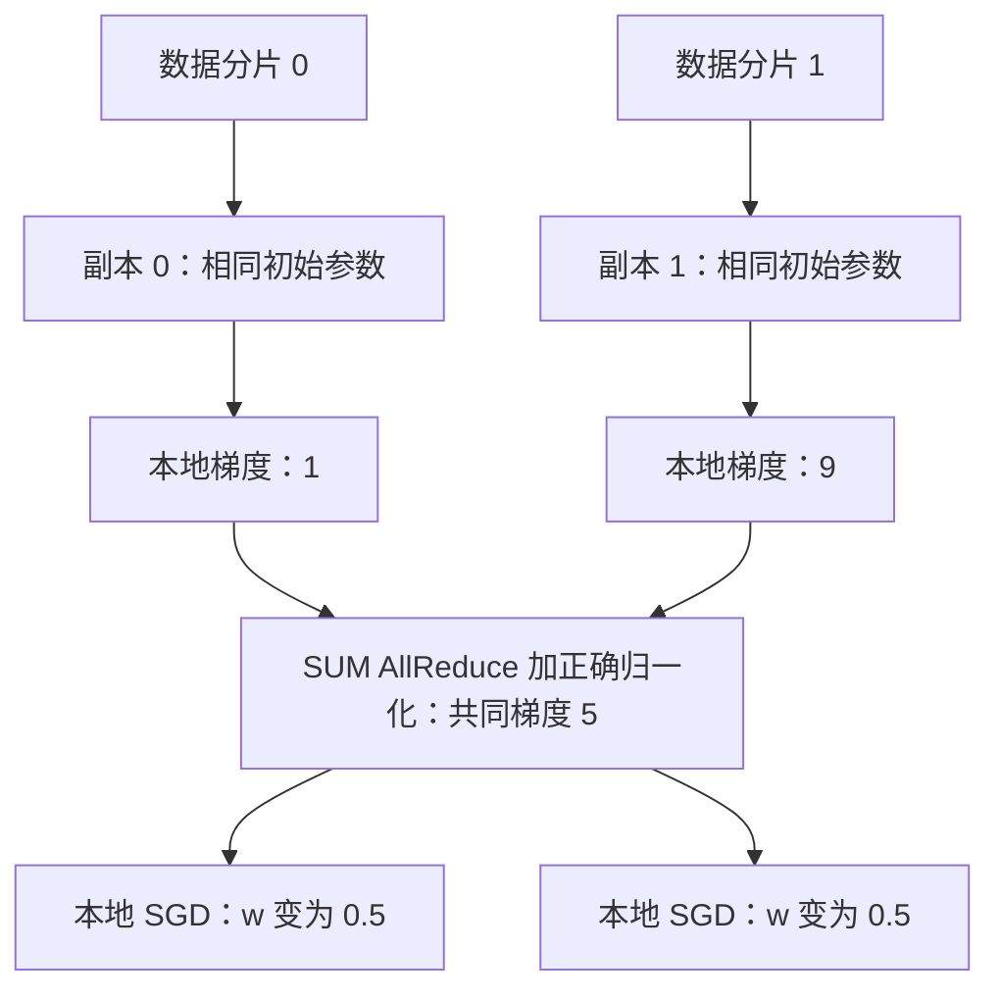
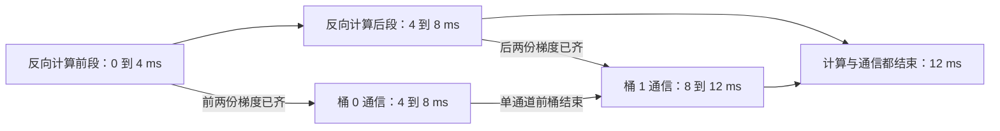

# 训练的梯度为什么需要通信，通信能否与计算重叠？

> 数据并行让多张卡各自处理一部分数据，但模型副本要按同一个全局训练目标更新。普通 DDP 通过同步梯度保持这些更新一致；有效样本数不同时，还需要正确处理 loss 的分母。
>
> 通信可以在反向计算尚未全部结束时开始：一组梯度先算好，就先归约这一组。不过，桶太小会增加调用成本，桶太大又会推迟启动。下面从一个只有一个参数的例子讲起，再沿当前 PyTorch 源码寻找这些行为。

前置阅读：[第 03 篇：浮点数与精度](../../10/2026-10-22-floating-point-formats/README.md)、[第 06 篇：异步执行与计时](../../10/2026-10-23-gpu-asynchronous-timing/README.md)、[第 09 篇：融合的收益与代价](../../10/2026-10-23-kernel-fusion/README.md)。本篇是训练并行的起点，不要求先掌握分布式系统。

## 1. 两张卡各自学，为什么不能直接各自更新？

先想象一个极小的模型：输入数字 x，输出 `w*x`，w 是需要训练的一个参数。目标值暂时都设为 0，用下面的损失衡量预测偏离目标的程度：

\[
\ell(w;x)=\frac12(wx)^2
\]

一次训练通常做三件事：前向计算得到预测与 loss；反向计算得到参数的梯度；优化器用梯度更新参数。梯度可以先理解为“参数变化一点，损失会朝哪个方向、变化多快”。对这个小模型求导，有：

\[
g(w;x)=\frac{\partial\ell}{\partial w}=wx^2,\qquad
w_{\text{new}}=w-\eta g
\]

\(\eta\) 是学习率，即这次沿梯度方向移动多远。第二个式子是最基础的 SGD 更新；实际模型的参数和梯度都是很多数构成的张量。

上面的梯度并不神秘：把损失展开为 `w²*x²/2`，在 x 固定时对 w 求导，`w²` 变成 `2*w`，前面的二分之一抵消，便剩下 `w*x²`。正梯度表示 w 增大时损失增大，所以这里减去一小段梯度。

现在两张卡都从 `w=1` 出发，学习率为 `0.1`：

| 模型副本 | 看见的 x | 自己算出的梯度 | 如果独自更新后的 w |
| --- | --- | --- | --- |
| 卡 0 | 1 | 1 | 0.9 |
| 卡 1 | 3 | 9 | 0.1 |

问题出现了：我们原本希望两张卡一起训练**同一个模型**，一次更新后却有了两个不同的 w。下一轮它们甚至不再从相同函数出发。

如果把两份数据放到同一张卡，以两个样本的平均损失为目标，梯度应该是 `(1+9)/2=5`，更新后的 `w=0.5`。因此两张卡也需要先得到这个共同梯度，再分别更新到 `0.5`。

这种做法叫**数据并行（Data Parallel）**：每个副本拥有完整模型，数据分开处理，梯度再汇合。本篇采用常见的一进程一副本方式；进程在通信组内的编号叫 **rank**，参与进程数量叫 **world size**。rank 不等同于物理机器编号，一台机器可以有多个 rank。

## 2. 梯度怎样汇合？先把 AllReduce 当成一个接口

### 2.1 每个人提供一份，每个人拿到同一份结果

设两个 rank 的同一个参数梯度分别为 `[1,4]`、`[9,6]`。对它们做 SUM AllReduce，两个 rank 都得到 `[10,10]`；再按两个 rank 归一化，就都得到 `[5,5]`。

其中 Reduce 表示逐项做归约，例如求和；All 表示归约结果提供给所有参与者。这里没有规定必须把所有数据送到 rank 0 再发回来，底层通信库可以采用不同算法。不要把接口语义和某一种网络路径混为一谈。[原论文 §2.3](https://arxiv.org/html/2006.15704v1)。



图中先用等量样本，所以归一化是除以 2；下一节会检查这个条件。[图源](assets/data-parallel.mmd)。

每个 rank 可以保留自己的优化器。只要初始参数、优化器状态、更新规则及本次共同梯度一致，就能做出一致的更新。普通 DDP 的主线是同步梯度，并非每一步先各自更新、再广播一份新参数。初始状态同步和 BatchNorm 等 buffer 同步是另外的机制，不能据此说 DDP 完全不通信参数或 buffer。[初始化路径](https://github.com/pytorch/pytorch/blob/6ddf1c556aafe0295f682a2822d1510eda4beab2/torch/nn/parallel/distributed.py#L1074-L1096)。

### 2.2 DDP 会自动把输入分给不同卡吗？

不会。`DistributedDataParallel` 包装模型并管理梯度同步，输入如何分片仍由调用方负责，常见做法是在数据加载时为各 rank 分配不同样本。两张卡如果反复读同一批数据，通信仍可能正常，但没有因此处理两倍不同数据。[输入分片职责](https://github.com/pytorch/pytorch/blob/6ddf1c556aafe0295f682a2822d1510eda4beab2/torch/nn/parallel/distributed.py#L465-L477)。

## 3. 最容易漏掉的一个问题：平均的是谁？

### 3.1 等量样本时，平均两个均值没有问题

设有 \(R\) 个 rank，第 \(r\) 个 rank 处理 \(n_r\) 个有效样本，每个样本损失为 \(\ell_{r,i}\)。我们希望优化所有样本的平均损失：

\[
N=\sum_r n_r,\qquad
L=\frac1N\sum_r\sum_{i=1}^{n_r}\ell_{r,i}
\]

若每个 rank 先对自己的样本求平均，其本地平均梯度为 \(g_r\)，那么全局目标需要的是：

\[
g=\sum_r\frac{n_r}{N}g_r
\]

每个 rank 样本数相同时，权重恰好都是 \(1/R\)，所以普通 DDP 的 rank 平均与全局样本平均一致。这里利用的是求导与有限求和的线性关系，不要求 loss 必须是本篇的平方损失；但目标本身需要按所述样本可加。

这也要求比较的是同一个样本损失函数。比如局部 BatchNorm 使用各自 batch 的统计量，就可能与把所有样本放在一起计算的函数不同；仅仅平均梯度不会补回这种差异。本篇单参数模型没有跨样本耦合，也没有 dropout 等随机行为。

### 3.2 一张卡 1 个样本，另一张卡 3 个呢？

仍从 `w=1` 出发。rank 0 看 `x=[1]`，rank 1 看 `x=[2,3,4]`：

```text
rank 0：本地平均梯度 = 1
rank 1：本地平均梯度 = (4+9+16)/3 = 29/3

两个 rank 的均值再平均：(1+29/3)/2 = 16/3 ≈ 5.333333
全部四个样本直接平均：(1+4+9+16)/4 = 7.5
```

差别来自：第一种算法给 rank 0 的单个样本一半权重，却让 rank 1 的三个样本共同分享另一半。这两个目标不是一回事。

如果仍使用普通 DDP 的 rank 平均，可以在反向前把第 r 个 rank 的**局部 mean loss**乘以：

\[
s_r=\frac{R n_r}{N}
\quad\Longrightarrow\quad
\frac1R\sum_r s_r g_r=\frac1N\sum_r n_r g_r
\]

本例系数为 `(0.5,1.5)`。也可以从 local loss sum 出发统一处理全局分母；两种写法要按同一个目标推导，不能同时重复除法。全局 N 必须由调用方正确提供或汇总，不会从梯度数值中自动推断。

在语言模型中，loss 的分母有时是未被 mask 掉的有效 token 数，未必是序列条数。**先写清想优化哪个平均值，再决定分母。** 本文不声称所有任务都应按 token 等权；序列等权或加权目标也可以成立，只要实现和目标一致。练习限定每个 rank 的计数为正，不处理空 rank 或提前退出的 join 模式。

## 4. 为什么不等所有梯度算完，再统一通信？

### 4.1 反向计算不是同时交出所有梯度

想象模型前向经过第 1、2、3 层。反向沿依赖向前传播，靠近输出的第 3 层参数梯度，往往先于第 1 层准备好。这里“准备好”表示该轮对这个参数的所需梯度累加已经到达相应同步边界，不只是某个中间乘法结束。

如果第 3 层梯度已准备好，为什么要让网络空等第 1 层？可以先通信第 3 层梯度，同时继续计算前面层的梯度。下一步计算仍使用这一轮的旧参数；**提前通信不等于提前更新参数**。

但每个小梯度都发一次，又会产生许多调用。于是把若干梯度装在同一个连续缓冲区中，一起做归约。这一组叫**梯度桶（bucket）**。一个桶要等其中所需梯度全部 ready，才能发起对应通信。[当前 hook 与 pending 逻辑](https://github.com/pytorch/pytorch/blob/6ddf1c556aafe0295f682a2822d1510eda4beab2/torch/csrc/distributed/c10d/reducer.cpp#L923-L984)。

### 4.2 先手推一个四梯度、两桶的时序

假设两个 rank 的四个梯度都在 `2、4、6、8 ms` 准备好，每个占 4 MiB。这里只构造一个可复算的时序模型：每桶固定通信成本为 2 ms，有效传输率为 4 MiB/ms，单个通信通道按桶顺序串行工作，不考虑与计算争用资源。

把前两个梯度放进桶 0，后两个放进桶 1：

```text
桶 0：等到 4 ms 才齐；8 MiB 的通信耗时 = 2+8/4 = 4 ms；4—8 ms 通信
桶 1：等到 8 ms 才齐；同样耗时 4 ms；8—12 ms 通信

反向计算：0—8 ms
最后完成：12 ms
反向结束后的通信尾部：12−8 = 4 ms
```



[图源](assets/overlap.mmd)。箭头表示依赖，框内注明时间段；反向后段和桶 0 通信可在 4—8 ms 重叠。所有数字都是教学假设，不是 profiler trace。

若完全不重叠，要先算 8 ms，再通信两次各 4 ms，总共 16 ms。这个模型下省掉的是被反向覆盖的那段等待；通信本身并没有消失。

再比较其他装桶方式：

| 桶划分 | 每桶耗时 | 通信区间（ms） | 完成时刻 | 完全不重叠时 |
| --- | --- | --- | --- | --- |
| 4 个小桶，每桶 4 MiB | 3 ms | 2—5、5—8、8—11、11—14 | 14 ms | 20 ms |
| 2 个中桶，每桶 8 MiB | 4 ms | 4—8、8—12 | 12 ms | 16 ms |
| 1 个大桶，16 MiB | 6 ms | 8—14 | 14 ms | 14 ms |

小桶更早启动，却支付四次固定成本；大桶只调用一次，却等到反向结束才启动。合适大小取决于实际就绪时刻、通信代价和资源干扰，不能只凭“大”或“小”判断。表中数字均为模型计算，**不是 GPU／网络实测**。

### 4.3 把时序写成递推，检查自己有没有漏等条件

设 \(t_{r,i}\) 为 rank r 上梯度 i 的就绪时刻；桶 j 包含索引集合 \(B_j\)，字节数为 \(S_j\)。在上述单通道假设中：

\[
a_j=\max_{r,\ i\in B_j}t_{r,i},\quad
c_j=\alpha+S_j/\beta
\]
\[
s_j=\max(a_j,f_{j-1}),\qquad f_j=s_j+c_j,\qquad f_{-1}=0
\]

\(\alpha\) 的单位是 ms，\(\beta\) 是 byte/ms，\(s_j、f_j\) 是桶的有效开始与完成时刻。反向完成时刻在本模型中为 \(T_b=\max_{r,i}t_{r,i}\)；全部结束为 \(T=\max(T_b,f_{\text{last}})\)，通信尾部为 \(T-T_b\)。

这里的 \(\beta\) 是按桶输入字节定义的模型参数，不是直接拿网卡标称带宽代入；实际 AllReduce 的多步传输、算法和拓扑会改变成本。练习不模拟这些内部步骤。

这不是说某个 rank 必须等其他 rank 都 ready 才能在本机调用异步 API；它可能先提交然后等待其他参与者。\(a_j\) 是本模型的全局就绪条件，不能拿来冒充本地 enqueue 时间。

如果一个慢 rank 最后一个梯度到 12 ms 才 ready，第二桶就必须等待它，这个例子完成时刻变为 16 ms。网络更快也无法让尚未产生的梯度提前出现；需要区分等待梯度、等待前一个桶和实际传输。

## 5. 沿当前 PyTorch 代码，把前面的疑问接起来

### 5.1 先看版本，避免把旧设计图当作当前所有模式

2026-11-03 实际获取官方 PyTorch main，固定 SHA `6ddf1c556aafe0295f682a2822d1510eda4beab2`；当前稳定发行元数据为 v2.15.0，本文未单独分析其 tag。额外双进程实验使用本机已有的 **PyTorch 2.9.1**，不声称执行了 main 或 v2.15.0。[版本与获取记录](evidence/versions.json)。

本节主线限定：eager 执行、C++ reducer、密集梯度、固定 world size、普通同步、自动 backward 收尾，没有自定义通信 hook、join、延迟参数归约或原生 DDP mixed precision。其他配置需要检查自己的分支。

2020 年 DDP 原论文 §3.2.2—§3.2.4、Algorithm 1 解释了分桶、hook、顺序与累积的基本设计。当前官方设计说明本身仍提示基于 v1.4；不能因为网页处于当前版本目录，就认定每个实现细节都已更新。下面直接对照固定代码。[论文笔记](evidence/paper-reading.md)；[设计说明的版本提示](https://github.com/pytorch/pytorch/blob/6ddf1c556aafe0295f682a2822d1510eda4beab2/docs/source/notes/ddp.md#L1-L7)。

### 5.2 谁知道某个参数梯度算好了？

`DistributedDataParallel._ddp_init_helper` 为参数建立桶，再创建 `dist.Reducer`。C++ reducer 为梯度累加器安装 autograd hook：可以把 hook 理解为“梯度累加到达这里时，通知同步管理器”的回调。[前端建桶](https://github.com/pytorch/pytorch/blob/6ddf1c556aafe0295f682a2822d1510eda4beab2/torch/nn/parallel/distributed.py#L1387-L1476)；[注册 hook](https://github.com/pytorch/pytorch/blob/6ddf1c556aafe0295f682a2822d1510eda4beab2/torch/csrc/distributed/c10d/reducer.cpp#L189-L208)。

`Reducer::autograd_hook` 找到对应参数，并走到 `mark_variable_ready`。后者找到桶和偏移，准备梯度缓冲区，减少桶里的未就绪计数。下面是该处原始代码的关键两行，省略了中间 batched-copy 分支：

```cpp
if (--bucket.pending == 0) {
  // 中间还有特定配置的 copy 处理，此处教学省略。
  mark_bucket_ready(bucket_index.bucket_index);
}
```

所以，某个参数 ready 不等于整个桶 ready；桶内最后一份所需梯度到齐才跨过这个边界。[hook](https://github.com/pytorch/pytorch/blob/6ddf1c556aafe0295f682a2822d1510eda4beab2/torch/csrc/distributed/c10d/reducer.cpp#L694-L781)；[pending 与调度](https://github.com/pytorch/pytorch/blob/6ddf1c556aafe0295f682a2822d1510eda4beab2/torch/csrc/distributed/c10d/reducer.cpp#L923-L984)。

### 5.3 如果后一个桶先 ready，可以先发它吗？

不能让各 rank 自行选择不同的归约次序。假设 rank 0 先提交 A、再提交 B，而 rank 1 先提交 B、再提交 A，即使大小碰巧相同，也可能把不同梯度配到同一个 collective。结果可能错误，也可能报错或卡住。

当前 `mark_bucket_ready` 使用 `next_bucket_`，只提交从它开始连续 ready 的桶；后面的桶先 ready，也要等轮到自己的编号。这是统一 collective 顺序的要求，并不要求等前一个通信完全结束才在主机上提交下一次。练习的串行通道模型额外假定有效传输串行，二者要分开。[按序提交](https://github.com/pytorch/pytorch/blob/6ddf1c556aafe0295f682a2822d1510eda4beab2/torch/csrc/distributed/c10d/reducer.cpp#L1090-L1115)。

如果排在前面的桶包含很晚才 ready 的梯度，就会挡住后面已准备好的桶。这也解释了为什么桶内参数的组合和桶顺序都影响重叠。

### 5.4 平均发生在哪里？通信提交后谁负责收尾？

在选定的普通路径，密集梯度进桶时就可能除以 `div_factor_`，固定组下它通常是 world size；随后 `_AllReduceBySumCommHook` 对桶做 SUM。不要再在外面无条件多除一次 R，也不要把它理解成自动按样本加权。[除法与复制](https://github.com/pytorch/pytorch/blob/6ddf1c556aafe0295f682a2822d1510eda4beab2/torch/csrc/distributed/c10d/reducer.cpp#L362-L439)；[固定组除数](https://github.com/pytorch/pytorch/blob/6ddf1c556aafe0295f682a2822d1510eda4beab2/torch/csrc/distributed/c10d/reducer.cpp#L583-L600)；[SUM hook](https://github.com/pytorch/pytorch/blob/6ddf1c556aafe0295f682a2822d1510eda4beab2/torch/csrc/distributed/c10d/default_comm_hooks.cpp#L46-L60)。

`all_reduce_bucket` 提交通信并保留 future，也就是以后获得完成结果的对象。默认自动收尾路径的 `finalize_backward` 等待相关 future／work、解析结果，并完成梯度写回等处理，随后 optimizer 才能按正确依赖使用同步梯度。[提交](https://github.com/pytorch/pytorch/blob/6ddf1c556aafe0295f682a2822d1510eda4beab2/torch/csrc/distributed/c10d/reducer.cpp#L987-L1040)；[收尾](https://github.com/pytorch/pytorch/blob/6ddf1c556aafe0295f682a2822d1510eda4beab2/torch/csrc/distributed/c10d/reducer.cpp#L1799-L1864)。

对 CUDA 而言，还要结合 stream 的完成依赖理解这里的 wait；它不等于应用调用一次全设备 `synchronize()`。本篇实际执行的是 CPU Gloo，未验证 CUDA stream 的时间行为。

### 5.5 初始化桶的顺序，是以后每轮都不变吗？

不是。当前 `compute_bucket_size_limits` 在一类常用初始配置中先用 `sys.maxsize`，相当于暂不按普通容量细分；同设备同类型的基础模型第一轮可能只有一个桶。之后在满足条件时，根据观测到的梯度到达顺序重建桶，并同步桶定义。[初始策略](https://github.com/pytorch/pytorch/blob/6ddf1c556aafe0295f682a2822d1510eda4beab2/torch/nn/parallel/distributed.py#L128-L162)；[重建条件](https://github.com/pytorch/pytorch/blob/6ddf1c556aafe0295f682a2822d1510eda4beab2/torch/csrc/distributed/c10d/reducer.hpp#L146-L155)；[重建实现](https://github.com/pytorch/pytorch/blob/6ddf1c556aafe0295f682a2822d1510eda4beab2/torch/csrc/distributed/c10d/reducer.cpp#L2061-L2125)。

因此评估分桶与重叠要看 warmup 后的实际桶和 trace，不能只量第一次 backward，也不能仅凭模型注册顺序推断永远的通信顺序。

进阶还包括两个边界：当前有 `DDPOptimizer` 的编译分图路径，目的是保留适合梯度同步的边界；当前 main 也有默认关闭的手动 backward finalization API，带明确的状态和配置限制。本文没有运行这些路径，不把它们说成所有编译／训练的默认行为，更不据此建议随意提前 `optimizer.step()`。[编译分图](https://github.com/pytorch/pytorch/blob/6ddf1c556aafe0295f682a2822d1510eda4beab2/torch/_dynamo/backends/distributed.py#L394-L442)；[手动收尾条件](https://github.com/pytorch/pytorch/blob/6ddf1c556aafe0295f682a2822d1510eda4beab2/torch/nn/parallel/distributed.py#L2656-L2740)。

## 6. 梯度累积能少通信，但不能忘记分母

一次大 batch 放不进内存，可以切成 K 个 micro-batch，逐个 forward／backward，把梯度累加到参数的 `.grad`，最后再做一次 optimizer 更新。每个 micro-batch 是大 batch 的一小部分，不是一次独立参数更新。

若每个 rank 的 K 个 micro-batch 大小相同，而且各 rank 的总有效分母也相同，目标为大 batch 的均值，可以对每个 mean loss 除以 K，并只在最后一次反向同步：

```python
from contextlib import nullcontext

optimizer.zero_grad(set_to_none=True)
for k, batch in enumerate(micro_batches):
    context = ddp.no_sync() if k < K - 1 else nullcontext()
    with context:
        loss = loss_fn(ddp(batch), target[k]) / K
        loss.backward()
optimizer.step()
```

这是教学调用骨架，完整可运行例子在 [ddp_probe.py](code/ddp_probe.py)。**forward 和 backward 都要在 `no_sync()` 里**；仅把 backward 缩进进去不符合当前 API 的要求。退出上下文不会立刻凭空同步，而是在后续正常 forward／backward 中同步累积梯度。[`no_sync` 实现与说明](https://github.com/pytorch/pytorch/blob/6ddf1c556aafe0295f682a2822d1510eda4beab2/torch/nn/parallel/distributed.py#L1695-L1722)。

如果 rank 0 两个 micro-batch 的 x 为 `1、2`，rank 1 为 `3、4`，正确全局梯度仍为 `7.5`。不除以 K 会把结果放大为 `15`；每个 micro-batch 都 `zero_grad` 则会丢掉前面的贡献。micro-batch 的有效数量不等时，简单 `/K` 又不够，应回到第 3 节，为整个 optimizer step 的目标统一分母。

`no_sync` 减少的是这一边界上的同步频率，不意味着任意长时间各自更新都与原训练等价，也不表示程序中所有通信都会消失。各 rank 的训练控制流仍要保持 collective 能正确匹配。

## 7. 工程上先查什么，再改什么？

当加卡后速度不理想，先看时间花在哪里，而不是立刻把桶改小：

| 观察 | 要先区分什么 | 常见处理与代价 |
| --- | --- | --- |
| 通信很晚才出现 | 桶还没齐、初始桶尚未重建，还是编译使梯度集中可见？ | 看稳态 ready／提交时间；调整组合或编译路径，不能只数 AllReduce 次数 |
| 大量短归约 | 启动开销是否占主导？ | 合并小梯度可能有效，但会推迟早 ready 的部分 |
| 一个 rank 常拖慢所有人 | 数据读取、样本长度、计算、其他 collective 是否先变慢？ | 修正负载和数据流水线；网络升级不能修复全部等待 |
| `no_sync` 后 loss 或梯度比例变化 | 是预期有效 batch 改变，还是漏了分母／提前清零？ | 对照单进程全局目标，先验收数值，再看速度 |
| 想用低精度梯度减少字节 | 改的是通信表示、累加精度，还是训练参数精度？ | 要重新检查误差、缩放与自定义 hook 语义；不能沿用默认平均的所有假设 |

第 01 篇的 view／stride 也会在这里出现：`gradient_as_bucket_view` 让梯度指向桶中的相应区域，可以减少复制和额外存储，但有别名与 API 使用约束；应看对应模式的稳态行为，而不是把 view 当作免费复制。[密集桶 view 路径](https://github.com/pytorch/pytorch/blob/6ddf1c556aafe0295f682a2822d1510eda4beab2/torch/csrc/distributed/c10d/reducer.cpp#L362-L439)。

做真实性能对比，应固定模型、有效 global batch／token 口径、dtype、优化器、累积方式、硬件拓扑、后端、软件版本、warmup、测量区间和正确性标准。记录每个 rank 的计算、桶 ready／提交／完成、暴露通信尾部、输入等待及全步耗时；同时测同步后的整体吞吐与慢 rank。通信和计算可能争用 GPU／内存／链路资源，纸面上能重叠不等于实测一定更快。

本篇不提供 NCCL 或 GPU 加速比，也不把“总时间就是 max（计算，通信）”当普遍公式；末尾才产生的梯度、固定顺序和干扰都可能留下尾部。

## 8. 两道练习与详解

题目接口在 [exercises.py](code/exercises.py)，完整输入输出契约在 [代码说明](code/README.md)，共享不可变返回类型在 [models.py](code/models.py)。两道题使用 Python 标准库即可运行。

### 练习一：修正不等量数据的梯度平均

实现 `global_mean_from_local_means(means, counts)`，对一维梯度向量按有效计数求全局均值；再实现 `ddp_loss_scales(counts)`，给出普通 DDP rank 平均前各个局部 mean loss 的缩放系数。

输入为非空 list／tuple；梯度行等长且由有限数字组成；计数是正整数，拒绝 bool、0、负数和不等长输入。返回不可变 tuple，不修改输入；无效输入抛 `ValueError`。本题不处理空 rank。

先手算 `means=[[1],[29/3]]、counts=[1,3]`，再验证向量梯度和三种不同分片数量。解释为什么直接平均两个 mean 会改变目标。

<details>
<summary>详解与答案：先恢复每份均值的权重</summary>

答案见 [answers.py](code/answers.py) 的前两个公开函数。

局部均值中的一个样本权重为 `1/n_r`，所以要先乘回该组有效份额 `n_r/N`。参考答案用归一化权重逐分量计算，并通过 `math.fsum` 汇总，避免不必要地先把梯度乘上很大的原始计数。这里仍是浮点运算，不宣称任意分片逐 bit 一致。

本例：`1*(1/4)+(29/3)*(3/4)=7.5`。对于 DDP，先算 `s=(0.5,1.5)`，再做 rank 平均，得到 `(0.5*1+1.5*(29/3))/2=7.5`。

测试还从原始合成样本直接求均值，与分片后的结果比较，避免只把同一个实现公式复制为断言。常见错误是把 loss sum 当成 mean 再缩放，或 rank 平均后又多除一次 R。[实际测试输出](evidence/runs/tests.txt)。

</details>

### 练习二：小桶、大桶，哪一种留下更长的通信尾部？

实现 `schedule_buckets(ready_ms, sizes_bytes, buckets, startup_ms, bytes_per_ms)`，按第 4 节递推返回每桶 ready／开始／结束、反向结束、总完成、尾部与串行基线。

`ready_ms` 每行对应 rank，每列对应梯度。桶索引必须完整且不重复覆盖全部梯度；字节数为正整数；时刻与启动成本有限非负；传输率有限正值，均拒绝 bool。不修改输入，返回 `Schedule`；无效输入或不可表示的派生时间抛 `ValueError`。

完成四种对照：四小桶、两中桶、一大桶；再让第二个 rank 的最后梯度推迟到 12 ms。最后把很晚才 ready 的梯度放进桶 0，观察后面的早就绪桶能否越过它。

<details>
<summary>详解与答案：先等数据，再等前一个桶，最后支付传输成本</summary>

答案见 [answers.py](code/answers.py) 的 `schedule_buckets`。

对每个桶取所有 rank、所有成员 ready 的最大值；用 `max(ready,previous_end)` 求有效开始，再加 `alpha+bytes/rate`。依次完成后，与反向结束时刻再取最大值。这里不按“谁先 ready”重排桶，否则已经改变题目的统一 collective 顺序。

真实 CPU 算术执行得到三种完成时刻 **14、12、14 ms**，两中桶加慢 rank 后为 **16 ms**。这些数值来自假设输入，不是墙钟测速；完整事件在 [lab.json](evidence/runs/lab.json)。测试另外检查开始时刻不早于所有所需梯度、不早于上一个桶完成，以及不可变结果和输入不变性。

常见错误包括：只看本 rank 的 ready；单个梯度 ready 就启动整个桶；把按序提交误当成任意就绪顺序；直接用 `max(8,8)` 宣称没有尾部。模型也没有模拟实际通信与计算争用，所以不能据此直接选择线上最优容量。

</details>

### 运行方法与额外的真实 DDP 验证

在本篇目录执行：

```bash
python -m unittest discover -s code -p test_answers.py -v
python code/run_lab.py
```

完成自己的 `exercises.py` 后，用 `EXERCISE_IMPL=exercises` 运行同一测试。参考答案实际 **24 tests 通过**，Ruff check／format 通过。

另有 [ddp_probe.py](code/ddp_probe.py)，在已有 PyTorch 的 CPU 环境运行两个真实 Gloo 进程。它使用无 bias 的单参数线性模型、float64、默认 DDP 通信、SGD 学习率 0.1，逐个验证：

| 情况 | 两 rank 最后的共同梯度 | 更新后的共同 w |
| --- | --- | --- |
| 每 rank 一个样本，x 为 1／3 | 5 | 0.5 |
| 样本数为 1／3，直接平均各自 mean | 16/3 | 约 0.466667 |
| 相同数据，按全局分母正确缩放 | 7.5 | 0.25 |
| 每 rank 两个等量 micro-batch，`no_sync` 累积且除以 2 | 7.5 | 0.25 |
| 相同累积但漏除以 2 | 15 | -0.5 |

表中的 w 按便于阅读的小数展示。原始浮点结果例如 `0.24999999999999994`、`-0.5000000000000001` 保留在 JSON 中；断言使用相对／绝对容差 `1e-12`，没有冒称与数学小数逐 bit 相等。

后两条错误缩放对照是刻意构造的结果，不把它们当正确全局目标。程序对两 rank 的梯度和 SGD 后参数都有断言；第一次 `no_sync` 后的局部梯度不同，正常同步后相同。没有安装新依赖、注册自定义通信 hook、测通信次数或 GPU 性能。

本机 PyTorch 2.9.1、macOS arm64，最终复验显式指定 `GLOO_SOCKET_IFNAME=lo0`。首轮参数校验处出现过超时，随后加诊断归约、指定回环接口并调整超时后通过；未做单变量排查，不断言某一项是唯一原因。[真实结果](evidence/runs/ddp.json)、[命令与网络选项](evidence/runs/ddp-command.json)、[原始输出](evidence/runs/ddp.txt)、[验证边界与审查](review.md)。

## 9. 面试官继续追问

| 层次 | 追问 | 回答要点 |
| --- | --- | --- |
| 基础 | 两个 rank 的 w 一开始相同，为什么还要通信？ | 不同数据产生不同梯度；要按同一个全局目标做一致更新。 |
| 数学 | DDP 平均梯度，等于所有样本的平均吗？ | 只有局部 mean 的有效分母相同等条件下直接成立；不等量需要权重或统一 loss sum 分母。 |
| 实现 | 一个参数 ready，为什么不立即通信？ | 它所在桶可能还有其他梯度未齐；桶用于平衡启动成本与时机。 |
| 顺序 | 后一个桶先 ready，为什么也可能等？ | 各 rank 必须匹配 collective 次序；当前 reducer 由 next_bucket 管理提交顺序。 |
| 优化 | 桶越小，重叠越好吗？ | 更早可发，但调用数和固定成本增加；需看稳态 ready 与通信尾部。 |
| 累积 | no_sync 只包 backward 可以吗？ | forward 也应在上下文内；最后正常 forward／backward 同步累积梯度。 |
| 验证 | 所有 rank 梯度一致，就证明全局目标正确了吗？ | 不能；错误的 mean-of-means 也会在各 rank 一致，需要单进程全局目标或独立数学参考。 |
| 排障 | 通信慢，先换更快网络吗？ | 先分清计算／数据慢 rank、桶 ready、提交顺序、传输和尾部；等待数据不等于网络带宽不足。 |
| 进阶 | 现在的桶仍永远按构造顺序固定吗？ | 初始分桶与后续重建不同，当前还受 reducer／编译配置影响；核对所用版本及稳态 trace。 |

## 10. 下一步：参数之外，训练显存花在哪里？

数据并行通常让每个 rank 拥有完整参数、梯度和优化器状态，增加卡数并不自动把这些状态分摊掉。下一篇将从一个参数出发，逐项计算训练显存，再讨论分片和重算解决的是哪部分问题。

本篇建立普通 DDP 的基础，不覆盖 FSDP／ZeRO、TP／PP、稀疏 collective、容错 join、完整 loss masking、随机性与收敛、CUDA/NCCL 重叠或性能。数学上同一目标也不保证不同归约顺序的浮点结果逐 bit 一样。

资料：[参考资料与证据](references.md)、[源码笔记](evidence/source-reading.md)、[原论文笔记](evidence/paper-reading.md)。审查与实测：[审查记录](review.md)。返回 [Wiki 索引](../../../index.md)。
