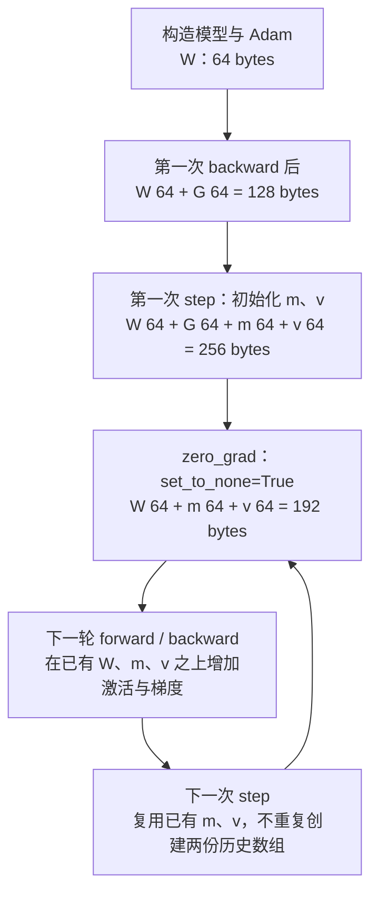
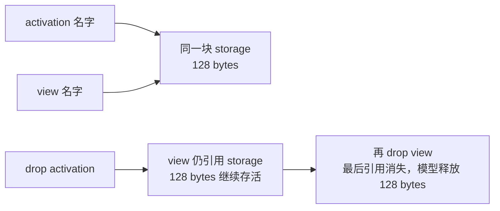

# 参数之外，训练显存究竟花在哪里？

> 参数大小只回答“权重本身占多大”。训练还需要梯度、优化器的历史状态、反向传播要用的数据，以及计算过程中的临时空间。先逐项数清每份存储，再看它们何时同时存在，才能估算训练峰值。
>
> 本篇会带你算出常见的“Adam 每个参数 16 bytes”是怎么来的、何时成立，也会用实际 CPU 实验说明：开了 BF16 autocast，状态载荷为什么仍可能不变。

## 1. 只有 2 GB 的参数，为什么训练会 OOM？

假设一个模型有 10 亿个参数，权重按 BF16 保存。BF16 占 2 bytes，所以权重大小为：

\[
10^9\times 2=2\times10^9\ \text{bytes}\approx 1.86\ \text{GiB}
\]

GB 按十进制计算，GiB 按二进制计算：`1 GiB = 2^30 bytes`。后面会一直把单位写出来。

现在有一张假设容量为 24 GiB 的 GPU。只看权重，会觉得空间十分宽裕。但“能放下模型”和“能跑完训练的一步”之间，还差几笔账。

先不急着套大模型公式。面试官可以从一个更小的问题问起：**如果模型里只有一个待学习的数字，训练时为什么还要存别的数字？**

已有基础可以回看 [浮点格式与精度](../../10/2026-10-22-floating-point-formats/README.md) 和 [梯度与数据并行](../2026-11-03-ddp-gradient-overlap/README.md)。本篇只分析单个设备上的账本；多个设备如何分摊，后续再展开。

## 2. 一个参数之外，为什么还需要梯度和两个历史值？

### 2.1 先从一次“改数字”开始

参数是训练要调整的数，例如一个线性模型中的权重 `w`。模型给出预测，loss 衡量预测有多差；梯度 `g = ∂loss/∂w` 描述在当前位置，`w` 的小变化如何影响 loss。

最简单的更新可以写成：

\[
w_{\text{new}}=w_{\text{old}}-\eta g
\]

其中 `η` 是学习率，控制每次调整多大。于是，即使只有一个权重 `w`，在执行更新时也通常需要梯度 `g`。

例如预测值就是 `w`、目标为 0，取 `loss=(w-0)²`。当 `w=1` 时，loss 为 1、梯度为 2；若学习率为 0.05，上式把 `w` 更新为 `1-0.05×2=0.9`，loss 随之降到 0.81。这个小例子说明梯度如何参与调整，实际训练不保证每一步都降低 loss。

把这个例子放大：如果一个权重矩阵里有 16 个可训练元素，它的梯度通常也是一个有 16 个元素的矩阵，每个位置对应一个权重的梯度。**“一个参数张量”可以包含很多参数元素；本文的参数数量 `P` 指元素数。**

### 2.2 Adam 为什么又多存两个值？

只看这一轮梯度，就像只根据今天的路况决定长期路线。Adam 还为每个参数元素保留两份经过平滑的历史：

- `m`：梯度的指数移动平均，保留近期方向信息。
- `v`：梯度平方的指数移动平均，保留近期幅度信息。

“指数移动平均”先用数字理解：这次的新记录，由“旧记录的一部分”与“新观察的一部分”组成。

\[
m_t=\beta_1m_{t-1}+(1-\beta_1)g_t
\]

\[
v_t=\beta_2v_{t-1}+(1-\beta_2)g_t^2
\]

取 `m₀=0`、`v₀=0`、`g₁=2`、`β₁=0.9`、`β₂=0.999`，第一步得到：

\[
m_1=0.9\times0+0.1\times2=0.2
\]

\[
v_1=0.999\times0+0.001\times2^2=0.004
\]

因为初始记录是 0，早期的平均值会偏向 0。Adam 再做偏差修正：

\[
\widehat m_t=\frac{m_t}{1-\beta_1^t},\qquad
\widehat v_t=\frac{v_t}{1-\beta_2^t}
\]

第一步恰好得到 `m̂₁=2`、`v̂₁=4`，再据此更新参数：

\[
w_t=w_{t-1}-\eta\frac{\widehat m_t}{\sqrt{\widehat v_t}+\epsilon}
\]

`ε` 是分母中的小正数。我们暂时不讨论超参数怎么调，只抓住内存上的结论：**下一轮仍要用 `m`、`v`，所以更新结束后不能把它们当作一次性结果丢掉。** `v` 是未中心化的二阶矩估计，即对 `g²` 的平均，不是直接计算 `g` 的方差。[Adam 原论文 v9，Algorithm 1、§2—§3](https://arxiv.org/abs/1412.6980v9)

因此，16 个 FP32 参数元素，在梯度已经存在、两个历史数组也已经初始化时，有下面四份载荷：

| 名称 | 存什么 | 元素数 | 单元素宽度 | 合计 |
| --- | --- | --- | --- | --- |
| 参数 `W` | 当前权重 | 16 | 4 bytes | 64 bytes |
| 梯度 `G` | 当前更新所需梯度 | 16 | 4 bytes | 64 bytes |
| 一阶状态 `m` | 梯度的移动平均 | 16 | 4 bytes | 64 bytes |
| 二阶状态 `v` | 梯度平方的移动平均 | 16 | 4 bytes | 64 bytes |
| 总计 | 上述四份互不共享存储 | — | — | 256 bytes |

于是“每个参数元素 16 bytes”来自 `4+4+4+4`。它描述的是一个明确的存储布局，并不是 Adam 论文规定每个数都必须用 FP32。

## 3. 这四份数组，从程序启动起就一直存在吗？

不一定。一次参数更新常叫 optimizer step，对应程序中的 `optimizer.step()`。先按默认新建的 PyTorch Adam、所有参数这轮都有梯度、没有额外引用的情况，看下面的过程。



这幅图只数四类张量载荷，暂时略去 step 标量、激活和临时结果。它有两个实际用途。

第一，**第一次更新是一个需要单独检查的时点。** 新建 Adam 时没有立即为所有参数分配 `m`、`v`；首次 `step()` 遇到有梯度的参数，才初始化相应状态。因此，“模型已经加载成功、forward 也成功”不能证明第一次更新能放得下。[Adam 延迟初始化](https://github.com/pytorch/pytorch/blob/665ecdd5784fd7c8dfdf7dbb184fceb2b31c387f/torch/optim/adam.py#L140-L196)

第二，`zero_grad(set_to_none=True)` 把参数的 `.grad` 设为 `None`，不会删除 Adam 的 `m`、`v`。如果没有其他引用持有梯度 storage，其载荷可以释放；CUDA 分配器是否马上把显存还给驱动，是另一层问题。`set_to_none=False` 则通常保留梯度张量，只把数值清零。**数值变成 0，不等于那份存储不存在。** 两种设置也可能改变无梯度参数的更新行为，不能只把它们理解为内存开关。[zero_grad 实现和行为说明](https://github.com/pytorch/pytorch/blob/665ecdd5784fd7c8dfdf7dbb184fceb2b31c387f/torch/optim/optimizer.py#L1108-L1172)

从头冻结且没有梯度的参数，不会在该初始化路径中新建状态；训练过后才冻结，并不会自动删除已经存在的 optimizer state。需要根据实际参数组、梯度和 state 检查，不能只拿模型总参数量乘一个固定系数。

## 4. 开了 BF16，为什么账本不一定减半？

### 4.1 “用 BF16 算”与“权重以 BF16 存”是两个问题

下面这段代码中，`model` 默认仍保存 FP32 参数：

```python
model = torch.nn.Linear(4, 4, bias=False)
optimizer = torch.optim.Adam(model.parameters(), foreach=False, fused=False)

with torch.autocast("cpu", dtype=torch.bfloat16):
    output = model(inputs)
    loss = 0.5 * output.float().square().mean()

loss.backward()
optimizer.step()
```

这里的 autocast 为符合条件的算子选择计算 dtype。它不会把已存在的 FP32 参数对象统统改成 BF16，也不能据此推断所有激活都变成 BF16。上例中的矩阵运算输出可以是 BF16，但存储的参数以及本次实验的参数梯度、默认 Adam 状态仍为 FP32。官方用法也是在默认精度创建模型，再对 forward 和 loss 使用 autocast。[autocast 说明与 CPU 示例](https://github.com/pytorch/pytorch/blob/665ecdd5784fd7c8dfdf7dbb184fceb2b31c387f/torch/amp/autocast_mode.py#L51-L137)

### 4.2 把 dtype 写进表里，结论就清楚了

下面均假设 `P` 个元素、梯度存在、状态已初始化、无 storage 共享，不计标量和临时空间：

| 明确的布局 | 参数 | 梯度 | `m`、`v` 合计 | 额外 master copy | 合计 |
| --- | --- | --- | --- | --- | --- |
| 全部 FP32 | `4P` | `4P` | `8P` | 0 | `16P` bytes |
| FP32 参数配合 BF16 autocast，状态按上述默认布局 | `4P` | `4P` | `8P` | 0 | `16P` bytes |
| 显式 BF16 参数，梯度与新建默认 Adam moment 也用 BF16 | `2P` | `2P` | `4P` | 0 | `8P` bytes |
| 显式指定的另一种布局：低精度参数与梯度，FP32 moment 与 master | `2P` | `2P` | `8P` | `4P` | `16P` bytes |

最后一行的 master copy 是额外保存的高精度权重副本，用来承载更精细的参数更新；这是一种需要训练实现明确提供的布局。不要在 FP32 参数本来就承担高精度权重角色时，又无条件加一份“AMP 必有的 master”。前三行的 CPU 配置已经实际运行；最后一行仅验证字节模型，未执行对应训练实现。

第三行也不是稳定训练的推荐：BF16 moment 与权重更新会受到舍入精度影响，小实验能运行不能证明大模型会收敛。格式的数值限制见第 03 篇。

**回到开头的 10 亿参数：** 若采用第一行配置，四份状态载荷已经是 `16×10⁹ bytes ≈ 14.90 GiB`，还没有计入激活和临时空间。它与开头只存 BF16 权重的 1.86 GiB 属于不同的配置。先确认真实 dtype 和副本，才有资格讨论能否放进 24 GiB；剩余约 9.10 GiB 也不能全算给激活，还要考虑后文的其他占用。

进阶时可以进一步把参数 dtype 与状态 dtype 分开选择。今天固定的 main 文档就有手动创建 BF16 moment、保持 FP32 参数与梯度的 functional AdamW 示例；仅按它指定的三类 dtype，账本是 `4P+4P+2P+2P=12P`。这里核对的是官方示例的存储设定，没有执行或验证它的 fused CUDA 路径，也不把它当作高层 Adam 的默认行为。[当前文档中的显式状态布局](https://github.com/pytorch/pytorch/blob/665ecdd5784fd7c8dfdf7dbb184fceb2b31c387f/docs/source/optim.md#L295-L329)

## 5. 四份状态之外，激活和临时空间是什么？

### 5.1 为什么 forward 算完，还不能把中间数据都扔掉？

考虑一个矩阵乘法：

\[
Y=XW
\]

反向传播收到输出梯度 `dY` 后，需要计算：

\[
dW=X^T dY,\qquad dX=dY W^T
\]

于是，算 `dW` 要用到 forward 时的 `X`；如果还要向前传播输入梯度，算 `dX` 需要 `W`。这解释了“为什么要为 backward 保存张量”。保存什么取决于导数公式，以及实际需要哪些输入的梯度；不是每个输出都必存，也不意味着保存一次就复制一份完整数据。

神经网络层的输出通常叫激活。做训练容量估算时，人们还常把相关的 saved tensors 一并归入“激活内存”；严格来说，backward 保存的内容也可能包含输入或参数引用，**不能把所有 saved tensor 的逻辑大小再加到参数大小上。** 当前 SavedVariable 对部分输入直接保留原变量／tensor data，而不是无条件 clone。[保存路径](https://github.com/pytorch/pytorch/blob/665ecdd5784fd7c8dfdf7dbb184fceb2b31c387f/torch/csrc/autograd/saved_variable.cpp#L15-L87)、[saved tensor 的含义](https://github.com/pytorch/pytorch/blob/665ecdd5784fd7c8dfdf7dbb184fceb2b31c387f/torch/autograd/graph.py#L297-L317)

来算一块具体的激活。batch 大小 `B=2`、序列长度 `S=1024`、隐藏维度 `H=4096`，一个 `[B,S,H]` 的 BF16 张量有：

\[
2\times1024\times4096\times2=16{,}777{,}216\ \text{bytes}=16\ \text{MiB}
\]

这只是**一块**张量。层数、MLP 扩展、Attention 实现、保存策略和 dtype 都会改变整网需求，不能直接把这个数字当成每层固定总成本。朴素 Attention 中的大矩阵以及分块算法为什么会改变中间数据规模，见 [第 10 篇](../../10/2026-10-23-attention-online-softmax/README.md)。

减小 micro-batch 往往能降低随 batch 增长的激活，但通常不会缩小这组参数及 Adam 状态。用梯度累积维持有效 batch 时，还要正确处理 loss 分母，见第 17 篇；不能假设任意拆 batch 都与原训练完全等价。

### 5.2 临时张量为什么会让 `step()` 也有峰值？

回到 Adam 的分母：需要计算平方根、偏差修正和 `ε`。某些实现会为这些计算产生临时结果。因此，保存下来的 `W、G、m、v` 只是账本的一部分，不是 optimizer step 的完整峰值。

今天固定的普通 single-tensor 路径中，`exp_avg_sq.sqrt()` 等操作构造更新分母；foreach 路径则批量生成对应中间结果。官方也明确提示 foreach 可能比逐张量循环多出约一份参数大小的峰值中间空间。这是选择实现时要测量的代价，不能据此给每种 dtype、每个模型都固定再加 `4P`。[single-tensor 更新](https://github.com/pytorch/pytorch/blob/665ecdd5784fd7c8dfdf7dbb184fceb2b31c387f/torch/optim/adam.py#L529-L547)、[foreach 中间结果](https://github.com/pytorch/pytorch/blob/665ecdd5784fd7c8dfdf7dbb184fceb2b31c387f/torch/optim/adam.py#L779-L800)、[foreach 的内存提示](https://github.com/pytorch/pytorch/blob/665ecdd5784fd7c8dfdf7dbb184fceb2b31c387f/torch/optim/optimizer.py#L272-L280)

其他临时空间还可能来自 kernel workspace、dtype 转换和通信缓冲区。通信桶有时与梯度 storage 存在复用关系，不能不看配置就重复相加。它们的具体大小属于实际运行路径，不能由参数量单独推断。

## 6. 为什么不能把各部分的“最大值”直接加起来？

因为它们可能不在同一时刻出现。先只讨论张量载荷，定义 `S(t)` 为时刻 `t` 仍然存活的、去重后的 storage 集合：

\[
M_{\text{payload}}(t)=\sum_{s\in S(t)}\operatorname{bytes}(s),\qquad
M_{\text{payload,peak}}=\max_t M_{\text{payload}}(t)
\]

这句话包含两个条件：**同一时刻**和**同一块 storage 只算一次**。

### 6.1 先看时间

假设已有参数及两个 moment，总计 `64+64+64=192 bytes`。接着发生下列事件，数字全部是教学假设，不是 GPU 测量：

| 时点 | 新发生的事情 | 事件后的存活载荷 |
| --- | --- | --- |
| A | 保存 128 bytes 激活 | `192+128=320` |
| B | 创建激活的 view | 仍是 `320` |
| C | 新增 64 bytes 梯度 | `192+128+64=384` |
| D | 激活及其 view 都释放 | `192+64=256` |
| E | optimizer 临时空间 96 bytes | `192+64+96=352` |
| F | 临时空间释放，梯度设 None | 回到 `192` |

峰值是 384 bytes。把各部分最大值机械相加，却会得到：

\[
192+128+64+96=480\ \text{bytes}
\]

这假设了激活与 optimizer 临时空间同时存在，与本例的时间线不符。不过，如果 view 被程序保留，128 bytes 激活 storage 到 E 时仍在，峰值确实会升到 480 bytes。**同一份张量大小，生命周期不同，峰值就不同。**

### 6.2 再看共享存储



把 `activation` 这个名字删掉，还剩 `view` 持有相同 storage。它仍然活着；只有最后一个引用消失，教学模型才记作释放。在真实 CUDA 程序里，还要考虑异步使用与 allocator 的回收时机，所以这不是 CUDA 回收模拟器。

甚至一个很小的切片，也可能持有原来较大的整块 storage。实际 CPU 探针使用一个 16 元素 FP32 的 base、它前 8 个元素的 view，以及 view 的 clone：

- 各张量 `numel × element_size` 相加：`64+32+32=128 bytes`。
- base 与 view 共享 64 bytes，clone 独占 32 bytes；唯一 storage 总计 `96 bytes`。
- 如果只看 view 的逻辑大小，会看到 32 bytes，但它仍引用 base 的 64 bytes storage。

这是 [Tensor 布局篇](../../10/2026-10-22-tensor-shape-stride-contiguity/README.md) 中“张量是数据加元信息”在容量估算中的直接应用。具体训练图可能还有共享权重、梯度桶视图等别名，不能逐对象相加就当成真实占用。

## 7. 源码里如何找到这些账？

本次实际 fetch PyTorch 官方 main 并固定到 `665ecdd5784fd7c8dfdf7dbb184fceb2b31c387f`。检索时最新稳定发布元数据为 **v2.15.0**；没有把这个 tag 的实现混称为 main。实际运行环境是本机 **PyTorch 2.9.1、CPU**，三个版本层次分别记录在 [版本证据](evidence/versions.json) 中。

### 7.1 顺着 `step → _init_group → adam` 读

先回答“状态在哪里出现”，再看更新公式，阅读会轻松很多。下面是从固定源码提炼的教学伪代码，省略设备、复杂数和其他分支：

```python
for p in group["params"]:
    if p.grad is None:
        continue
    state = self.state[p]
    if len(state) == 0:
        state["step"] = scalar_zero()
        state["exp_avg"] = zeros_like(p)
        state["exp_avg_sq"] = zeros_like(p)
    # 收集 p、p.grad、两个状态，交给 adam 更新
```

由此可以核对四件事：

1. 检查的是 `.grad is not None`；没有梯度就跳过，不等同于梯度数值恰好为 0。
2. 新建状态在 `len(state)==0` 的条件里；之后复用已有状态。
3. `zeros_like(p)` 没有显式指定新 dtype，因此默认新状态跟随参数 dtype；加载已有 state 或其他 optimizer 的情况应另查。
4. `step` 是每个参数张量对应的一个标量计数，不能按每个参数元素再加一份标量。

[初始化原文](https://github.com/pytorch/pytorch/blob/665ecdd5784fd7c8dfdf7dbb184fceb2b31c387f/torch/optim/adam.py#L140-L212)、[step 调用链](https://github.com/pytorch/pytorch/blob/665ecdd5784fd7c8dfdf7dbb184fceb2b31c387f/torch/optim/adam.py#L216-L271)

接下来才把实现和论文对应起来：`exp_avg.lerp_(grad, 1-beta1)` 等价于前面的 `β₁m+(1−β₁)g`；二阶状态用 `mul_(beta2).addcmul_(grad, grad, value=1-beta2)`。论文给的是算法，代码则还要决定 dtype、状态什么时候创建、走单张量还是 foreach／fused 路径。[moment 更新](https://github.com/pytorch/pytorch/blob/665ecdd5784fd7c8dfdf7dbb184fceb2b31c387f/torch/optim/adam.py#L455-L476)

若启用 AMSGrad，初始化还会创建 `max_exp_avg_sq`，需再计一份状态；本篇没有展开该算法，也没有用其收敛性质支持优化结论。

### 7.2 和真实 CPU 数据对上

[完整探针](code/payload_probe.py) 使用固定的 `Linear(4,4,bias=False)`、16 个参数元素、`foreach=False, fused=False, capturable=False`，输出如下。这里仅数参数、梯度、moment 和 step 的 CPU 张量载荷，不是整个程序 RSS，更不是 GPU 峰值。

| 实际配置 | 构造后 | backward 后 | 首次 step 后 | 梯度设为 None 后 |
| --- | --- | --- | --- | --- |
| FP32 | 64 | 128 | 260 | 196 |
| FP32 参数 + CPU BF16 autocast | 64 | 128 | 260 | 196 |
| 显式 BF16 参数 | 32 | 64 | 132 | 100 |

单位均为 bytes。为什么 FP32 是 260，而不是前面算的 256？因为此例的一个参数张量还对应一个 FP32 step 标量，增加 4 bytes。清梯度后则为 `64+64+64+4=196`。这些计数没有把输出、loss 或 optimizer 内部的瞬时中间结果一起计入。

探针还检查了没有梯度的另一参数不会新建 Adam 状态，用 FP64 标量实际核对第 2 节的 `g=2、m≈0.2、v≈0.004` 及偏差修正后的更新，并验证前述 view／clone 的 128 与 96 bytes 区别。状态 dtype、键名、四个采样点和断言结果均归档在 [CPU 原始记录](evidence/runs/cpu-payload.json)；不是手工填出的表。

## 8. `allocated`、`reserved` 和显卡工具显示的占用，为什么不同？

前面数的是张量 storage 的字节。真正诊断 CUDA OOM，还要看分配器与驱动的口径。

可以把分配器理解为向 GPU 申请大块空间、再管理小块分配的管理者。在常见 CUDA caching allocator 口径下：

| 观察值 | 主要回答的问题 | 如何使用 |
| --- | --- | --- |
| `memory_allocated()` | 当前活跃张量分配占了多少字节？ | 与当前代码阶段、活跃对象对应 |
| `memory_reserved()` | allocator 总共管理了多少显存？ | 已经包含其管理的活跃分配，也含可缓存或尚不能释放的空间 |
| `max_memory_allocated()` | 统计区间内 allocated 的峰值是多少？ | 区分首次迭代与稳态，并明确何时 reset |
| `nvidia-smi` 等驱动工具 | 进程／设备层面看到了哪些占用？ | 还会包含 context 等其他占用，不能等同于张量载荷 |

**不要把 allocated 和 reserved 相加。** 也不要直接把 `reserved-allocated` 全叫“碎片”；其中可能是可复用缓存、分配粒度或未能整体释放的块。某些统计还依赖 allocator backend，比较前要固定配置。`numel×element_size` 则是逻辑载荷，既没有自动解决别名，也不等于 allocator 对齐后的统计。[CUDA 内存管理说明](https://github.com/pytorch/pytorch/blob/665ecdd5784fd7c8dfdf7dbb184fceb2b31c387f/docs/source/notes/cuda.md#L543-L563)、[allocated／reserved 入口](https://github.com/pytorch/pytorch/blob/665ecdd5784fd7c8dfdf7dbb184fceb2b31c387f/torch/cuda/memory.py#L530-L580)、[分配取整统计](https://github.com/pytorch/pytorch/blob/665ecdd5784fd7c8dfdf7dbb184fceb2b31c387f/torch/cuda/memory.py#L314-L321)、[backend 统计边界](https://github.com/pytorch/pytorch/blob/665ecdd5784fd7c8dfdf7dbb184fceb2b31c387f/docs/source/notes/cuda.md#L738-L745)

`empty_cache()` 释放的是未被使用的缓存，不能把还活着的权重、moment 或被 view 持有的 storage 删除。它在部分碎片场景中可能有帮助，但不能改变一个活跃工作集本来就超容量的事实。[实现入口和限制](https://github.com/pytorch/pytorch/blob/665ecdd5784fd7c8dfdf7dbb184fceb2b31c387f/torch/cuda/memory.py#L222-L234)

本机没有 CUDA，本篇没有运行这些 GPU API，也没有给出 GPU 实测峰值。后续在目标 GPU 上应固定模型、dtype、序列长度、micro-batch、optimizer 路径与分配器配置，分别观察加载、forward、backward、第一次 step 和稳态迭代。异步与计时边界可参考 [第 06 篇](../../10/2026-10-23-gpu-asynchronous-timing/README.md)；阶段采样也不能替代统计区间内的峰值或分配 trace。

## 9. 真遇到 OOM，先动哪一笔账？

先定位增长来自哪里，再选择办法。下表给出机制与代价，不提供未经测量的节省比例或加速倍数。

| 主要压力 | 可以考虑的方向 | 为什么有用 | 条件与代价 |
| --- | --- | --- | --- |
| 梯度和 optimizer state | 减少真正需训练的参数、采用经过验证的低精度状态；跨设备分摊或迁移状态 | 减少或搬走本设备上的那部分 storage | 冻结不自动删除旧状态；改变状态精度要验数值，分摊／迁移增加通信、传输与实现约束 |
| 随输入增长的激活 | 减小 micro-batch、缩短输入，或 activation checkpointing | 降低并发激活规模，或少存一部分、反向时重算 | 要维持训练目标；重算增加计算，具体保存边界和随机性需核验，下一篇详讲 |
| 大型中间矩阵或临时结果 | 采用适用的分块／融合实现，比较 optimizer 实现路径 | 避免某些物化结果，或缩短临时结果的存活区间 | 依赖算子支持、布局、dtype 和正确性；省内存不保证更快 |
| 超出预期的存活对象 | 检查缓存的激活、view、retain_graph 与其他引用 | 避免不必要地延长 storage 生命周期 | 先确认 backward 需求；不能随意 detach 训练所需计算图 |
| 张量账本与驱动占用相差很大 | 检查 allocator snapshot、context 和外部分配 | 找出口径差异或分配模式 | 有缓存不等于泄漏，调 allocator 也替代不了缩小超大的工作集 |

判断方法同样重要：如果减小 micro-batch 后，峰值明显下降，但首次 step 仍 OOM，可能还有状态初始化的压力；如果状态载荷已经接近容量，单纯优化激活也未必足够。这里是诊断线索，不是仅凭 OOM 阶段就确定根因。

## 10. 代码练习：把两种账本亲手做出来

练习使用 [统一接口与运行说明](code/README.md)。在本篇目录运行，不需要 GPU。前两项只需 Python 标准库，真实 probe 另外使用已有 PyTorch。

```bash
python3 -m unittest discover -s code -p 'test_*.py' -v
python3 code/run_lab.py
python3 code/payload_probe.py
```

### 练习一：实现明确布局下的状态字节估算

完成 [exercises.py](code/exercises.py) 的 `estimate_state_bytes`。输入为元素数、参数／梯度／moment／可选 master 的元素宽度，以及梯度是否存在、状态是否已初始化、是否启用 AMSGrad。

要求分别返回六项载荷和总数，不把 step 标量、激活或 allocator cache 混进去。master 是调用者明确指定的额外副本，不随 Adam moment 的延迟初始化开关消失。非法计数、宽度和非布尔开关必须抛 `ValueError`；完整契约见代码说明。

独立验收例子：

| 输入场景 | 预期总 bytes |
| --- | --- |
| 16 元素，参数／梯度／两个 moment 全 FP32 | 256 |
| 同上，但还没 backward，也没初始化状态 | 64 |
| 状态已初始化，梯度不存在 | 192 |
| 显式 BF16 参数／梯度、FP32 moment、额外 FP32 master | 256 |
| 全 FP32，状态已初始化并启用 AMSGrad | 320 |

<details>
<summary>详解与参考答案</summary>

先写每一项，不要先背总系数。令单元素宽度分别为 `bW、bG、bM、bMaster`，两个 moment 的宽度都为 `bM`。状态已初始化且梯度存在时：

\[
M=P b_W+P b_G+2P b_M+P b_{\text{Master}}
\]

AMSGrad 再加 `P bM`。梯度不存在就去掉梯度项；状态未初始化就去掉 moment 和 AMSGrad 项；没有 master 时其宽度为 0。这个模型无法自动推断框架是否创建 master，调用者必须根据实现填写。

例如 `estimate_state_bytes(16, 2, 2, 4, 4)` 得到 `32+32+64+64+64=256`。`estimate_state_bytes(16, 4, 4, 4, gradients_live=False)` 得到 `64+0+64+64=192`。

[完整答案](code/answers.py) 使用整数乘法和 frozen dataclass；零元素返回全零，禁止把 `True` 当作元素数。异构配置应逐组计算，还要排除共享 storage，不能不加判断地套全模型。

常见错误有三个：见到 BF16 就把所有宽度设为 2；把 master 强行加入每种 AMP；认为 `.grad` 清空后 moment 也没了。真实 probe 中多出来的 step 标量，是本题明确排除的一项，不应篡改断言去“凑”256。

实际结果：[单元测试](evidence/runs/tests.txt)、[布局 lab](evidence/runs/lab.json)。基础接口完成后，用 `EXERCISE_IMPL=exercises` 运行同一组测试即可验收。

</details>

### 练习二：实现知道 alias 的生命周期账本

完成 `replay_lifetimes(events)`，接收 `alloc`、`alias`、`drop` 事件。每次分配建立新 storage；别名只增加引用；最后一个引用消失后才移除载荷。每个事件返回之后都记录存活字节数，并找出峰值、首次达到峰值的事件序号和最终值。

输入使用 `Event`，完整事件约束见 [代码契约](code/README.md)。峰值序号从 0 开始；名字删掉后可以重用，但新分配不能继承旧 storage 的身份。

把第 6 节的时间线编码为 lab 中的 11 个事件：先分配 `weights、m、v`，再分配激活、建 view、分配梯度、删除激活及 view，最后创建／删除临时空间并删除梯度。应得到：

```text
逐点载荷：64, 128, 192, 320, 320, 384, 384, 256, 352, 256, 192
峰值：384 bytes；首次峰值事件：5；最终：192 bytes
```

再省去 `drop view`，解释并验证为什么峰值变成 480、最终变成 320 bytes。

<details>
<summary>详解与参考答案</summary>

需要把“名字”和“存储”分开管理：

1. `names` 把存活名字映射到 storage ID。
2. `sizes` 保存每个 storage 的大小，`references` 保存它被多少名字引用。
3. `alloc` 创建单调递增的新 ID；`alias` 复用 source 的 ID，不增加字节；`drop` 减少引用，减到 0 才从总数中扣除大小。
4. 每步记录总数；严格大于旧峰值时更新位置，保证并列时取第一次。

为什么不能直接用名字作为 storage ID？假设先分配 `a`、令 `b` 引用它、删除 `a`，再为新 `a` 分配另一块空间；旧 `b` 必须继续引用旧空间。本题的名字复用测试就是在防这个错误。

正常时间线里，激活 128 bytes 与临时空间 96 bytes 没有重叠，峰值是 `192+128+64=384`。省去 `drop view` 后，临时空间出现时还要保留激活，因此峰值为 `192+128+64+96=480`；最后梯度清空，只剩状态 192 与旧激活 128，总计 320。

[完整答案](code/answers.py) 不修改输入，返回不可变结果。测试还覆盖别名链、最后引用、名字复用、空 trace、峰值并列、非法操作和重复存活名字。这里的 `drop` 是模型事件，不是保证 Python `del` 后 CUDA 会立刻回收的承诺。

实际结果见 [lab 时间线](evidence/runs/lab.json)；真实 PyTorch 的别名对应关系由 [CPU probe](evidence/runs/cpu-payload.json) 另行验证。两者都不提供 GPU 峰值测量。

</details>

## 11. 面试官继续追问

| 层次 | 追问 | 回答要点 |
| --- | --- | --- |
| 基础 | “Adam 16 bytes／参数”里的四份是什么？ | FP32 权重、梯度和两个 FP32 moment；要声明梯度存在、状态已初始化，以及忽略了哪些项 |
| 基础 | `v` 是梯度的方差吗？ | 是对梯度平方的移动平均，即未中心化二阶矩估计；不是直接减去均值后的方差 |
| 实现 | 为什么首次 step 才 OOM？ | 可能是延迟创建 moment 或 step 临时空间，但还需检查输入和其他存活对象，不能仅按阶段断言根因 |
| 实现 | 参数 FP32、autocast BF16 时，moment 一定 BF16 吗？ | 本文默认新建 Adam 不会；状态由 zeros_like 参数初始化，计算 dtype 不等于状态存储 dtype |
| 实现 | `zero_grad(set_to_none=True)` 是否删除 optimizer state？ | 不删除；也要检查是否有其他引用持有原梯度 storage，区分载荷与 allocator 保留空间 |
| 容量 | 为什么 `numel×element_size` 的总和可能算错？ | 不去重会重复算别名；小 view 可能引用完整大 storage；还没有反映分配粒度和外部分配 |
| 方案 | 激活占主导时，状态分摊一定最有效吗？ | 未必；应先看各部分与峰值时间线，再比较 micro-batch、重算或中间张量优化的收益和代价 |
| 排障 | 为什么 empty_cache 后仍 OOM？ | 活跃张量和仍被引用的 storage 不会因此消失；先核对工作集是否超容量，再看缓存和碎片 |
| 验证 | 一段 CPU probe 能证明 GPU 训练放得下吗？ | 不能；这里只验证选定配置的状态 dtype、载荷和别名，GPU 还要实测 allocator、临时空间、异步与外部占用 |

## 12. 这篇读完，下一步该看什么？

现在可以独立完成两件事：对一个明确配置列出状态账本；沿一次迭代判断哪些 storage 同时存活。容量计算还必须绑定真实代码路径与硬件，不能把本文的 16P、12P、8P 当成通用总显存公式。

下一篇研究“用重算换显存的代价如何计算”：既然某些激活只在 backward 用到，能不能先不存、需要时再算？那会增加多少计算，又如何保证随机性与梯度仍然正确？

资料归档：[参考资料与证据](references.md)。审查与实验：[审查记录](review.md)。返回 [Wiki 索引](../../../index.md)。
