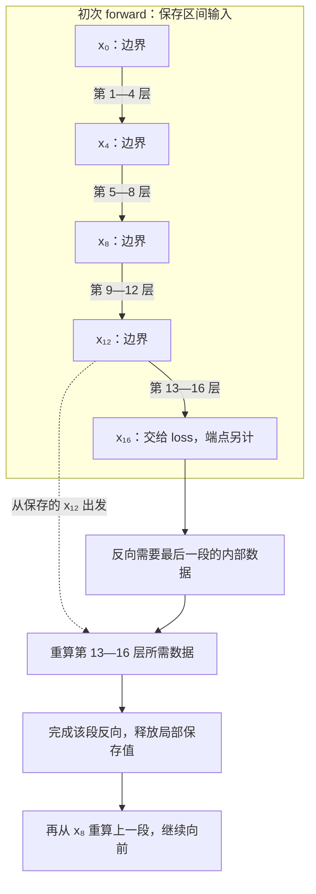

# 用重算换显存的代价如何计算？

> 一条假设有 16 层的网络，如果每层反向要用的中间结果各占 1 MiB，长期保留它们需要约 16 MiB。按每 4 层一段，只保留段边界，反向时重算当前段，可以把一个简化的激活预算降到 8 MiB，但需要额外计算。
>
> Activation checkpointing 用部分中间结果的重新计算换取更短的存储生命周期。它适合激活占用成为瓶颈的训练；要判断是否值得，必须同时检查全步峰值、训练耗时和梯度是否保持正确。本篇会先推导账本，再用 CPU 实验复现“loss 相同，梯度却错了”的情况。

## 1. 参数已经放得下，为什么增加序列长度还是 OOM？

假设模型参数、梯度和优化器状态已经能放进设备，短序列也能训练，但把输入序列加长后，forward 或 backward 出现 OOM。这时需要检查反向传播所依赖的中间数据是否增大，而不只是继续压缩权重。本文使用 `1 MiB = 2^20 bytes`，容量按二进制计算。

[第 18 篇：训练内存账本](../2026-11-04-training-memory-accounting/README.md) 已经说明，峰值来自某个时刻同时存活的存储。今天只改变其中一项：**把部分反向需要的数据从“保留到使用”改成“使用前重建”。** 参数、梯度与优化器状态的载荷不会因此自动缩小。

这里的 checkpoint 是选择重算边界。训练恢复用的 checkpoint 文件则保存模型、优化器等持久状态；两者解决的是不同问题。本篇不涉及断点恢复或文件格式。

先从一个面试问题开始：**反向传播为什么需要 forward 已经算完的东西？**

## 2. 一个乘法的反向，究竟要记住什么？

设输入为 `x`，待训练的权重为 `w`，计算：

\[
z=wx,\qquad y=z^2
\]

取 `x=2`、`w=3`，forward 得到 `z=6`、`y=36`。现在求 `y` 对 `w` 的梯度。先对平方求导，再对乘法求导：

\[
\frac{\partial y}{\partial z}=2z=12,\qquad
\frac{\partial z}{\partial w}=x=2
\]

\[
\frac{\partial y}{\partial w}=12\times2=24
\]

平方的反向需要知道 `z`，乘法对 `w` 的反向需要知道 `x`。即使最终输出 `y` 已经算出来，也不能只留下 `y` 就指望每个局部反向算子取得所需数据。

训练中的“激活”通常指这些中间张量；实际需要保存哪些，取决于算子的求导规则。自动求导系统（autograd）会记录运算依赖，并按需要保存反向所用的张量，不是无条件保存每个中间值。

现在有两种保存安排：

- 保留 `x` 和 `z`，反向时直接读取 `z=6`。
- 保留边界 `x=2`，反向需要 `z` 时，用同一个 `w=3` 再算一次 `wx`，得到 `z=6`。

第二种安排少保留一份中间结果，多做一次乘法。这里没有近似求导；**只要重建的数据和执行条件正确，算出的梯度仍是 24。** 在本例的 forward 与重算之间修改 `w`，就破坏了这个前提。

实际网络中一个区间会包含许多算子。重算边界要保存该区间所需的输入；区间内部的反向数据可以稍后重建。PyTorch 的保存与重取接口见固定源码中的 [saved_tensors_hooks](https://github.com/pytorch/pytorch/blob/4892050dadb28d1ca1065268e35084747967e34e/torch/autograd/graph.py#L297-L391)。

## 3. 为什么切成几段，比一层一层 checkpoint 更容易省空间？

### 3.1 先看 16 层、每段 4 层

把第 `i` 层的输出记为 `xᵢ`，原始输入为 `x₀`。四个区间的输入依次为 `x₀`、`x₄`、`x₈`、`x₁₂`。



图源：[segment-replay.mmd](assets/segment-replay.mmd)。图中“释放”以没有额外引用为前提；如果业务代码把内部张量一直放在列表里，checkpoint 不会替它删掉引用。

初次 forward 仍要经过全部 16 层，才能得到输出。差别在于内部张量不再都作为反向保存值长期驻留。反向从最后一段开始，利用边界重建该段所需数据，做完这一段，再处理前一段。

### 3.2 把边界与局部工作集分开数

令 `n` 为层数，`s` 为每段最多的层数，`A` 为均匀假设下每份激活的字节数。段数为：

\[
k=\left\lceil\frac{n}{s}\right\rceil
\]

长期保留的边界约有 `k` 份；重算并反向处理当前段，局部最多按 `s` 份预算。为了得到一个易复算的规划代理，取：

\[
M_{\text{proxy}}(s)=\left(\left\lceil\frac ns\right\rceil+s\right)A
\]

这是**教学槽位模型**：不扣除边界与局部值的重叠，不逐事件跟踪释放；原始输入、最终输出等端点的常数处理也被简化。它不包含参数、梯度、RNG（随机数生成器）状态、图元数据、临时工作空间（workspace）或分配器成本，不能当成真实模型总显存的上界。

取 `n=16`、`A=1 MiB`，逐项计算：

| 每段层数 `s` | 段数 `k` | 边界加局部份数 | 激活规划值 |
| --- | --- | --- | --- |
| 1 | 16 | `16+1=17` | 17 MiB |
| 2 | 8 | `8+2=10` | 10 MiB |
| 4 | 4 | `4+4=8` | 8 MiB |
| 8 | 2 | `2+8=10` | 10 MiB |
| 16 | 1 | `1+16=17` | 17 MiB |

切得过细，边界太多；切得过粗，当前段的局部工作集太大。端点处甚至得到 17 份，说明这个保守代理不会保证 checkpoint 必然小于普通执行的约 `nA`。

忽略取整，最小化 `n/s+s`，令导数 `1-n/s²=0`，得到 `s≈√n`，于是激活量级约为 `2√n A`。这个均匀链结论对应 [Chen 等人的原论文 v2：Algorithm 1、§4.3、公式（1）](https://arxiv.org/abs/1604.06174v2)。论文的 `k` 表示段数，本篇的 `s` 表示段长，不能把两个符号直接互换。

现实中每层大小和计算成本并不相同，分支与跨层引用也会延长生命周期。`√n` 适合建立直觉，具体边界要按实际存储和重算成本选；本题的穷举不实现论文完整的图优化算法。

## 4. “多一次 forward”，为什么既不等于慢一倍，也不保证只慢三成？

令原 forward 耗时为 `F`，原 backward 耗时为 `B`，实际新增的重算耗时为 `C`，其余新增开销为 `H`，这些量都指同一输入和执行配置下的耗时：

\[
T_0=F+B,\qquad T_{\text{ckpt}}=F+B+C+H
\]

\[
\frac{T_{\text{ckpt}}}{T_0}=1+\frac{C+H}{F+B}
\]

如果恰好完整重算一次 forward，且忽略额外开销，`C=F`。再假设 `B=2F`，时间比才是：

\[
\frac{2F+B}{F+B}=\frac43
\]

这只是条件明确的算术例子，不是吞吐保证。若 `B=F`，相同比较给出 1.5；如果只重算一部分，`C` 又会变化。RNG 保存恢复、区间调用和编译变化也会改变 `H`。

练习一用一组**假设输入**进一步算：`F=16 μs`、`B=32 μs`，每段开销 `h=0.2 μs`，并假定所有层完整重算一次。`s=4` 时有 4 段：

\[
T_{\text{ckpt}}=2\times16+32+4\times0.2=64.8\ \mu s
\]

原来是 48 μs，因此时间比为 1.35。若激活预算为 10 MiB，表中的 `s=8` 同样能放下，只有 2 段，估算耗时为 64.4 μs。在本模型中它比 `s=4` 略快，但多用 2 MiB 激活预算。

**这些微秒数没有在 Mac mini 或 GPU 上测量。** 真实训练步还可能包含通信、优化器更新、数据等待和它们之间的重叠；不能把各阶段独立计时简单相加。当腾出的空间允许增加有效 batch 时，还要分别比较相同 batch 的步延迟，以及满足相同训练设置时的 samples/s 或 tokens/s。

## 5. PyTorch 怎样做到“图还在，内部张量却可以不留”？

### 5.1 先固定今天读的版本

本次在 2026-11-05 实际浅克隆官方 `pytorch/pytorch` 默认分支 `main`，固定到 `4892050dadb28d1ca1065268e35084747967e34e`，并 fetch 稳定 tag `v2.15.0`，对应 `31a77fc9c0a7c6fff15a1ff58c743f53b1a9d457`。

源码分析以下述 main 为准；实验运行的是本机 PyTorch 2.15.0，包报告的构建 SHA 为 `d0f2af8b66b20da4baa50644c0cd3f887a2eae2e`，**没有执行或构建 main**。本机 `torch/utils/checkpoint.py` 的 SHA-256 与稳定 tag 中该文件一致；这只确认这一个文件相同，不代表核对了整套二进制包。完整来源和差异见 [资料记录](references.md) 与 [源码阅读笔记](evidence/source-reading.md)。

本文显式使用：

```python
value = checkpoint(
    block,
    value,
    use_reentrant=False,
    preserve_rng_state=True,
)
```

`use_reentrant=False` 是官方推荐的非重入实现。它在初次 forward 中仍记录 autograd 图，通过保存／重取 hooks 改变张量的留存方式。另一个重入实现初次 forward 使用 `no_grad`，反向再重跑整个函数，两条路径不能混讲。[两种实现的差别](https://github.com/pytorch/pytorch/blob/4892050dadb28d1ca1065268e35084747967e34e/torch/utils/checkpoint.py#L472-L525)

### 5.2 边界输入、占位对象与反向重取

带着三个问题看实际路径：边界在哪里保存，内部数据由什么替代，什么时候开始重算？

1. [`checkpoint → _checkpoint_impl`](https://github.com/pytorch/pytorch/blob/4892050dadb28d1ca1065268e35084747967e34e/torch/utils/checkpoint.py#L437-L713) 选择非重入分支，先推进 `_checkpoint_without_reentrant_generator_impl`，在它建立的上下文中运行用户函数，再完成后处理。
2. [生成器与 `_CheckpointFrame.save_inputs`](https://github.com/pytorch/pytorch/blob/4892050dadb28d1ca1065268e35084747967e34e/torch/utils/checkpoint.py#L1894-L2075) 保存输入，并进入 `_checkpoint_hook`。算子本来要保存内部张量时，pack hook 返回 `_Holder` 占位对象，同时记录元数据，避免按原方式一直持有那份内部张量。
3. [反向的 unpack hook](https://github.com/pytorch/pytorch/blob/4892050dadb28d1ca1065268e35084747967e34e/torch/utils/checkpoint.py#L1354-L1424) 发现该反向任务尚未重算，取回边界输入，调用 `recompute_fn`。重算 hook 把新得到的所需张量关联回占位对象；反向算子随后取走相应数据。

这解释了“记录计算图”与“长期保留所有中间载荷”为何是两件事。纸上的分段算法和这里的实现都在恢复反向需要的数据；PyTorch 使用运行时 autograd hooks，没有直接照搬论文的静态图构造代码。

### 5.3 不一定把整段函数完整执行第二遍

非重入实现默认开启 early stop：当所需保存张量已重建，`_recomputation_hook` 会用内部 `_StopRecomputationError` 结束这次重算。重入实现则完整重跑函数。因此，练习一的 `C=F` 是完整重放的教学假设；它没有预测当前非重入实现实际执行多少算子。[early stop 条件](https://github.com/pytorch/pytorch/blob/4892050dadb28d1ca1065268e35084747967e34e/torch/utils/checkpoint.py#L1288-L1334)

这也带来一个实用限制：不要把函数末尾的打印或计数当作可靠的重算完成标志。实验在函数**入口**记录 block 编号，只用来证明进入过该区间。

## 6. 为什么 loss 一样，梯度却可能不一样？

### 6.1 Dropout 的“再算一遍”需要同一份随机选择

Dropout 在训练时随机屏蔽部分元素。设丢弃概率为 `p`，随机掩码为 `m`，每个位置以 `1-p` 的概率取 1，则：

\[
\operatorname{dropout}(h)=\frac{m\odot h}{1-p}
\]

`⊙` 表示逐元素相乘。初次 forward 若使用掩码 `m₁`，重算却使用 `m₂`，反向取得的随机计算条件就可能不同；输入 shape、dtype 和 device 都没变，也不能保证梯度一致。

PyTorch 在开启 `preserve_rng_state` 时保存 forward 的 CPU RNG 状态，并在重算的 `fork_rng` 上下文中恢复它；退出重算时还会还原外部随机流。对非 CPU 设备还有设备推断与状态保存范围限制，不能理解成自动覆盖任意设备、Python `random`、NumPy 或自定义 Generator。[保存与重算恢复路径](https://github.com/pytorch/pytorch/blob/4892050dadb28d1ca1065268e35084747967e34e/torch/utils/checkpoint.py#L1975-L2047)

“在程序开头设置过 seed”只能确定初始随机状态；中间每段已消耗多少随机数仍需要正确处理。本篇的实验限定为 CPU eager，没有验证 `torch.compile` 或多设备的 RNG 行为。

### 6.2 用一个真正会失败的对照做验收

本次 CPU 实验使用 4 个顺序 block，每个为 `Linear(8,8) → sin → Dropout(p=0.4)`。输入 shape 为 `(2,8)`，dtype 为 FP64（64 位浮点数），CPU seed 为 2026；loss 为输出平方的平均，执行一次 `SGD(lr=0.01)`，即按 `θ←θ−0.01g` 更新参数，不使用 momentum。每次都创建相同初始参数的全新模型。

三次运行的初次 forward loss 都是 `0.0930865327475642`，但完整比较得到：

| 相对普通执行 | checkpoint，保存 RNG | checkpoint，不保存 RNG |
| --- | --- | --- |
| 初次输出最大绝对误差 | 0 | 0 |
| 输入梯度最大绝对误差 | 0 | 约 0.026735 |
| 参数梯度最大绝对误差 | 0 | 约 0.122306 |
| 一次 SGD 后参数最大绝对误差 | 0 | 约 0.00122306 |
| 后续 CPU 随机样本是否相同 | 是 | 否 |

原始记录：[lab.json](evidence/runs/lab.json)。这是固定 CPU 实验的正确性结果，不是收敛试验。**只比较初次 forward 的 loss，会把这个错误对照判成通过。** 保存 RNG 的路径还逐张量验证全部 8 份参数梯度和更新后参数，使用 `rtol=atol=1e-12`。

默认 `determinism_check="default"` 也不能替代上述数值比较：源码检查保存数量，以及重算张量的 shape、dtype、device 等元数据，没有逐元素核对值。在这个关闭 RNG 的对照中，程序没有抛出错误，但梯度已经不匹配。[元数据匹配检查](https://github.com/pytorch/pytorch/blob/4892050dadb28d1ca1065268e35084747967e34e/torch/utils/checkpoint.py#L1029-L1101)

### 6.3 随机性之外，还要检查可变状态

重算函数应在所需数据和执行条件上与原 forward 一致。修改全局分支条件、原地改动边界、更新缓存，或再次推进 BatchNorm 一类模块的运行统计，都需要单独核查。RNG 保护不会自动回滚这些业务状态。

early stop 还意味着函数副作用未必完整重复一次；不能在 checkpoint 区间里依赖“每次调用恰好更新一次外部状态”。实验中的入口列表只用于观测，不参与张量计算。真实训练代码中，应把有业务含义的状态变化移到可明确控制的位置，或为相应实现设计专门的验证。

## 7. 少保存了多少，应该怎样量？

这个小实验同时在模型初次 forward 外围放了 `saved_tensors_hooks`。只记录 storage 的设备、地址和大小，按 storage 去重；排除参数、原始输入和零字节 storage。pack 返回 detached alias，即共享原存储、断开求导关系的张量，不额外复制载荷，统计表中不持有 Tensor。

得到的外层可见保存载荷为：

- 普通执行：1408 bytes。
- 逐 block checkpoint：384 bytes。

每个 `(2,8)` FP64 张量的载荷是 `2×8×8=128 bytes`。普通路径的 1408 bytes 对应该实验中的 11 份不同 storage；checkpoint 路径的 384 bytes 是后续三个 block 的输入边界。原始输入已被排除。

**这只统计外层 hooks 在模型 forward 中观察到的激活 storage，并没有测全步峰值。** 内层 hooks 会覆盖外层观察；loss、RNG 快照、图元数据、重算 workspace 和分配器缓存也都不在统计中。这个很小的 CPU 示例里，保护随机状态的成本本身就可能盖过省下的激活，不能把 `1408→384` 换算成实际总内存下降比例。

在 GPU 上做工程决策时，应固定模型、batch、序列长度、dtype、优化器、编译和分布式配置，先验证输出、梯度与更新，再预热并重复测完整训练步。同步执行边界，重置峰值统计，记录 `max_memory_allocated`、reserved 口径及步耗时的统计量；必要时用 trace 看 OOM 时点和重算路径。CPU 保存载荷、CUDA 分配器峰值、驱动侧占用和训练吞吐分别报告。

从第 18 篇延续的判断顺序是：先确认峰值主要由哪一项决定，再选优化。若瓶颈主要是参数或优化器状态，单独压缩激活可能无法解决；若业务代码额外持有内部激活，先修复生命周期；若激活确实主导，再搜索满足容量约束的低重算成本区间。

## 8. 代码练习

### 练习一：在给定激活预算内选择分段

在 [exercises.py](code/exercises.py) 实现容量代理和选择函数，输入为层数、每段层数、单份激活大小、整网 `F`／`B`、每段开销和激活预算。输出段数、激活份数、字节数、原耗时、新耗时与时间比；超预算无解返回 `None`。

验收条件：`n=16,A=1 MiB,F=16 μs,B=32 μs,h=0.2 μs` 时，`s=4` 得到 8 MiB 与 64.8 μs；10 MiB 预算内选择 `s=8`，7 MiB 预算内无解。还要处理尾段取整、无穷／非数时间、非法整数与合成时间溢出。完整契约见 [练习说明](code/README.md)。

<details>
<summary>推导、完整答案与常见错误</summary>

先用 `(n+s-1)//s` 做整数向上取整，再按 `k+s` 数槽位。不要用浮点除法计算大整数的字节数；不要把整网 `F` 又乘一次层数。时间为 `2F+B+kh`，预算只覆盖当前模型的激活项。

答案：[answers.py](code/answers.py)。选择函数枚举 `s=1..n`，在可行方案中先最小化耗时，再按内存和段长打破平局，使用 `O(n)` 时间、`O(1)` 额外空间。这个小规模教学选择器不实现非均匀图的生产规划。

```bash
PYTHONDONTWRITEBYTECODE=1 /Users/wangyuxiao/miniforge3/envs/ai-infra/bin/python -m unittest discover -s code -p test_answers.py -v
```

本次 19 项容量与边界测试通过。测试使用手算预期，也覆盖“切得更细不一定更省”的两端情况。

</details>

### 练习二：验出一次“loss 对了，梯度错了”的重算

在 [exercise_checkpoint.py](code/exercise_checkpoint.py) 实现第 6 节的三组 CPU 训练步。返回输出、输入梯度、全部参数梯度、SGD 后参数、下一份随机样本、保存 storage 的统计和 block 入口顺序。不得只比 loss；实验结束还需恢复调用者的 CPU RNG。

验收条件：保存 RNG 时逐项匹配基线；不保存时初次输出相同，但至少一份参数梯度不同。关闭 Dropout 后，即使不保存 RNG，也应恢复梯度等价。观察入口顺序与更少的外层保存载荷，同时保留统计边界。

<details>
<summary>实现思路、完整答案与结果解释</summary>

完整答案：[torch_probe.py](code/torch_probe.py)。每次在隔离的 CPU RNG 上下文中建立新模型与输入，通过 `checkpoint(block, value, use_reentrant=False, preserve_rng_state=...)` 包裹区间。forward 之后再计算 loss、backward、复制梯度并执行 SGD。

计数 hook 只保留整数元数据；返回值中的梯度和更新后参数使用 detached clone，避免随后更新共享对象使对照失真。初次 forward 的输出相同，说明重算前的计算一致；只有进一步对比梯度，才能检出第二次随机掩码的影响。

```bash
PYTHONDONTWRITEBYTECODE=1 /Users/wangyuxiao/miniforge3/envs/ai-infra/bin/python -m unittest discover -s code -p test_torch_probe.py -v
PYTHONDONTWRITEBYTECODE=1 /Users/wangyuxiao/miniforge3/envs/ai-infra/bin/python code/run_lab.py
```

本次 12 项实验测试通过，组合运行共 31 项。普通执行的入口序列为 `0,1,2,3`，checkpoint 多出 `3,2,1,0`。只有一个 block 时，排除原始输入后的外层保存统计为 0；它不是“零内存训练”。真实输出见 [测试记录](evidence/runs/tests.txt) 和 [实验 JSON](evidence/runs/lab.json)。

</details>

## 9. 面试官继续追问

| 层次 | 追问 | 参考回答要点 |
| --- | --- | --- |
| 基础解释 | 为什么 forward 结束后还不能释放所有激活？ | 局部求导需要相应输入或中间结果；先用平方与乘法的链式法则说明具体需要什么。 |
| 基础解释 | checkpoint 少存了什么，多做了什么？ | 保留区间边界，延后重建内部反向数据；并未自动减少参数和优化器状态。 |
| 机制推导 | 为什么均匀链会出现平方根量级？ | 边界约 `n/s` 份，段内约 `s` 份；平衡两项得到 `s≈√n`，并说明端点和非均匀层的限制。 |
| 实现分析 | 非重入实现记录了图，怎么还能省激活？ | 图结构与载荷留存不同；pack 返回占位对象，反向 unpack 按需触发重算并交付张量。 |
| 实现分析 | 每个 block 的计算一定完整翻倍吗？ | 默认非重入 early stop 可提前终止，不能从入口计数推断全部算子重跑；重入路径又不同。 |
| 正确性 | loss 相同能证明优化正确吗？ | 不能；初次 loss 可完全相同，而重算 Dropout 的随机状态不同导致梯度和参数更新改变。 |
| 正确性 | 默认 determinism check 会比较张量数值吗？ | 当前固定实现比较保存数量与元数据，不逐元素验值；需要显式数值对照。 |
| 方案选择 | 低预算下应把每一层都 checkpoint 吗？ | 边界也占存储，区间过细还有开销；按实际保存字节、可重算成本和峰值约束选边界。 |
| 排障验证 | 保存载荷减少，为什么仍然 OOM？ | 检查真正峰值时点、参数／优化器状态、重算 workspace、额外引用，以及 allocated／reserved／驱动口径。 |
| 排障验证 | 如何判断吞吐损失是否值得？ | 先在相同配置下比较全步峰值和时间，再单独评估可增加 batch 的收益，保持有效训练设置与数值验收一致。 |

## 10. 适用范围与延伸

本文的两个例子分别是均匀链规划代理和小型 CPU eager 正确性实验。没有执行 GPU 显存、吞吐、编译模型、多设备 RNG、FSDP 或长期收敛验证；没有把论文的静态图优化算法当作 PyTorch 当前代码。

源码中还提供 selective activation checkpointing，可按算子选择保存与重算。它涉及独立缓存策略，和用户 saved-tensor hooks 的交互在此次 main 与 v2.15.0 之间已有差异；本篇实验使用普通 checkpoint，未验证该策略，不把当前统计方法直接推广过去。差异归档在 [main 与稳定版本 diff](evidence/upstream/main-v2.15.0.diff)。

前置阅读：[Tensor 的存储与布局](../../10/2026-10-22-tensor-shape-stride-contiguity/README.md)、[浮点格式与误差](../../10/2026-10-22-floating-point-formats/README.md)、[训练显存账本](../2026-11-04-training-memory-accounting/README.md)。下一题可以检查：省下激活空间以后，训练还在等数据时，如何区分磁盘、CPU 处理与传输瓶颈？

资料归档：[参考资料与证据](references.md)。审查与实验：[审查记录](review.md)。返回 [Wiki 索引](../../../index.md)。
