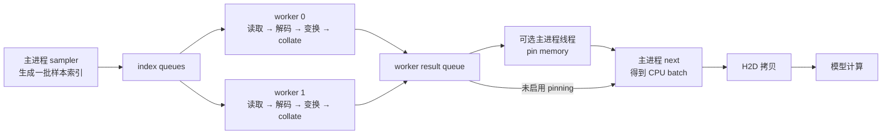

# 训练在等数据，怎样判断瓶颈在磁盘、CPU 还是传输？

训练中的空闲间隔可能来自数据读取、CPU 准备、主机到设备的拷贝，也可能来自这些阶段之间的等待。先分开测量取数等待、各阶段工作和设备执行，再用受控替换缩小范围，才能判断增加 worker、加深预取或引入异步传输的收益。

本篇沿一条训练输入路径建立模型，追踪 PyTorch DataLoader 的真实实现，并提供可以在 CPU 上复现的两道练习。计算和内存基础可参照 [第 04 篇](../../10/2026-10-22-roofline-basics/README.md)、[第 06 篇](../../10/2026-10-23-gpu-asynchronous-timing/README.md) 与 [第 18 篇](../2026-11-04-training-memory-accounting/README.md)。

## 1. 一步训练开始前，数据经历了什么？

假设训练要读取图片文件。一个样本是“一张图片及其标签”，一个 batch 是本次模型一起处理的一组样本。把多个样本整理成批的过程称为 collate，常见操作包括把同形状 Tensor 堆叠起来，或为变长序列补齐长度。

输入路径可以拆成读取文件、解码图片、随机变换、合批、把 CPU Tensor 拷贝到设备，以及执行模型。后面的模型阶段包含前向、反向和本步需要的更新工作。主机到设备的拷贝简称 H2D，本文涉及设备传输的推导以 CUDA 为背景。CPU 练习实际运行到合批与消费阶段。[DataLoader 官方说明](https://docs.pytorch.org/docs/2.15/data.html)

先给每批一个教学用的时间预算。

| 阶段 | 时间 | 在例子中的含义 |
| --- | --- | --- |
| 读取 | 4 ms | 每批占用共享存储服务的时间 |
| CPU 准备 | 16 ms | 解码、变换与合批 |
| H2D | 3 ms | CPU batch 到设备的拷贝 |
| 模型 | 10 ms | 消费这一批的设备计算 |

完全串行时，一批需要 `4+16+3+10=33 ms`。如果后台进程能在模型处理当前批时准备下一批，稳态间隔可能下降。这里需要同时看两个量。

- 从创建迭代器到首批可用的延迟包含启动与准备，第 7 节分别记录创建耗时和第一次 next 等待。
- 稳态间隔描述流水线填充后，每隔多久能消费下一批。

PyTorch 中的 worker 是后台取数进程。设置 `num_workers=0` 时，读取、变换与合批在主进程调用取数时发生。设置为正数时，DataLoader 把取数任务分配给多个 worker，主进程接收结果。[固定源码中的两条迭代路径](https://github.com/pytorch/pytorch/blob/b79f21bab5e9e221b05bc903f7d8171a8c04a8a0/torch/utils/data/dataloader.py#L756-L815)

## 2. 两个 worker 能把 33 ms 变成多少？

### 2.1 先数资源，再写公式

一个 worker 先读数据，再做 CPU 准备，完成一批占用它 `4+16=20 ms`。两个 worker 理想均摊后，每 10 ms 能准备一批。共享存储每批需要 4 ms 服务，增加 worker 后仍然需要提供这些字节。

设备侧还要看执行顺序。CUDA stream 是一条有序执行队列。如果每批的拷贝和计算都提交到同一 stream，它们在该 stream 中依次执行，每批占用 `3+10=13 ms`。因此这个教学模型的理想稳态间隔下界是 `max(4,10,13)=13 ms`。首批启动与流水线填充还会增加延迟。[CUDA stream 语义](https://docs.pytorch.org/docs/2.15/notes/cuda.html#cuda-streams)

把符号补齐，令每批共享存储服务时间为 `R`，CPU 准备时间为 `C`，worker 数为 `w≥1`，H2D 与模型时间为 `H`、`G`，单位均为 ms。

```text
I_storage = R
I_worker  = (R + C) / w
I_device  = H + G
I_ideal   = max(I_storage, I_worker, I_device)
T_serial  = R + C + H + G
```

这些量是服务能力对应的间隔约束。模型假定每批负载均匀、CPU 核充足、理想分配，并把额外存储排队、进程间通信、pinning 和调度成本留到实测。实际间隔会受到这些额外成本影响。worker 等待读取时仍被该任务占用，所以 `I_worker` 要包含 `R`。模型适用于后台准备与设备消费可并行的稳态路径，主进程串行消费时要按真实调用顺序重新列出约束。

例如把共享存储服务时间改为 20 ms，即使增加到 32 个 worker，`I_storage=20 ms` 仍约束供给。先验证瓶颈，才能解释调大并行度的结果。

### 2.2 拷贝与计算怎样才能重叠？

跨 batch 使用独立的拷贝与计算 stream，并满足硬件并发拷贝能力、合适的页锁定主机内存及正确依赖时，可以用另一个理想模型。

```text
I_device_overlap = max(H, G)
I_ideal_overlap  = max(R, (R + C) / w, H, G)
```

例子得到 `max(4,10,3,10)=10 ms`，这时 worker 准备与模型计算同时达到约束。这个数值是条件化的容量推导。

`non_blocking=True` 允许相关拷贝路径减少主机端同步。普通 pageable 内存也能使用该参数，实际行为取决于拷贝方向、内存类型和运行时路径。要在设备时间线上观察到 H2D 与计算重叠，还需安排不同 stream 的工作，用 event 或 stream 等待建立“数据准备好才能消费”的关系，并管理主机源缓冲区与设备缓冲区的生命周期。源数据在异步读取完成前必须保持有效和稳定。[官方传输教程](https://docs.pytorch.org/tutorials/intermediate/pinmem_nonblock.html)、[CUDA 同步与 stream 文档](https://docs.pytorch.org/docs/2.15/notes/cuda.html#cuda-streams)

## 3. 沿源码看一份 batch 怎样到达主进程

本次核验的 PyTorch 官方默认分支提交为 `b79f21bab5e9e221b05bc903f7d8171a8c04a8a0`，提交时间为 2026-11-06。稳定版本是 `v2.15.0`，本机实际执行 PyTorch 2.15.0。main、稳定 tag 与安装包的关系及文件校验见 [版本记录](evidence/versions.json) 和 [源码清单](evidence/source-manifest.json)。

图中展示自动合批、多进程、普通 CPU dataset 的主要路径。pin-memory 线程只在相应开关和设备条件满足时出现。箭头表示数据或任务流向，图是源码结构示意。



可重建图源见 [input-pipeline.mmd](assets/input-pipeline.mmd)。单进程模式把 worker 内的取数工作放回主进程，启用的 pinning 也在取数路径内执行。[迭代器与队列源码](https://github.com/pytorch/pytorch/blob/b79f21bab5e9e221b05bc903f7d8171a8c04a8a0/torch/utils/data/dataloader.py#L756-L815)

### 3.1 一个任务里包含哪些工作？

自动合批时，主进程生成一组样本索引，把它作为一个任务交给 worker。`_worker_loop` 调用 fetcher。对于普通 map-style dataset，也就是通过索引访问样本的 dataset，`_MapDatasetFetcher.fetch` 优先使用可用的批量 `__getitems__`，否则逐项调用 `dataset[idx]`，最后执行 `collate_fn`。读取、变换与合批在这条 worker 路径内连续发生。[worker 源码](https://github.com/pytorch/pytorch/blob/b79f21bab5e9e221b05bc903f7d8171a8c04a8a0/torch/utils/data/_utils/worker.py#L244-L380)、[fetcher 源码](https://github.com/pytorch/pytorch/blob/b79f21bab5e9e221b05bc903f7d8171a8c04a8a0/torch/utils/data/_utils/fetch.py)

这也解释了优化批量读取的入口。若底层数据格式支持一次读出一组样本，dataset 的批量访问可以减少逐项调用和读取开销。收益要用相同样本内容、batch 组成和变换语义验证。[官方批量取数说明](https://docs.pytorch.org/docs/2.15/data.html#single-and-multi-process-data-loading)

### 3.2 prefetch factor 为 2，是否说明有两批数据随时可用？

`num_workers=2,prefetch_factor=2` 时，初始化尝试放入 `2×2=4` 个预取任务。`_try_put_index` 使用这个乘积作为任务容量约束，任务可能还在索引队列、正在读取，或者已返回结果。自动合批条件下，一份任务对应一批索引。[预取与任务计数](https://github.com/pytorch/pytorch/blob/b79f21bab5e9e221b05bc903f7d8171a8c04a8a0/torch/utils/data/dataloader.py#L1234-L1278)、[提交任务](https://github.com/pytorch/pytorch/blob/b79f21bab5e9e221b05bc903f7d8171a8c04a8a0/torch/utils/data/dataloader.py#L1532-L1570)

用 `K=w×p` 表示配置的任务槽位数，再用 `Q` 表示当前已经就绪且能够按消费顺序交付的 batch 数。它们分别描述调度容量和当下可用数据。

假设供给突然停顿 40 ms，消费者每 13 ms 消费一批，停顿开始就使用第一批，供给恢复后立刻可用。若已有 2 批就绪，它们覆盖 26 ms，暴露的等待为 `40−26=14 ms`。若已有 4 批就绪，覆盖 52 ms，这次孤立停顿可被隐藏。

```text
exposed_pause = max(0, pause_ms - Q × consumption_interval_ms)
```

这是一次孤立停顿的教学模型。持续供给能力低于消费需求时，队列最终会耗尽。真实系统还要考虑恢复后的准备延迟和连续抖动。

### 3.3 后来的任务先完成，会怎样？

默认 `in_order=True`。`_next_data` 用 `_rcvd_idx` 跟踪下一份应交付的任务，提前到达的后续结果暂存在 `_task_info`。前一批很慢时，即使后续有已完成结果，也可能等待指定批次。这会形成队头阻塞。[结果排序源码](https://github.com/pytorch/pytorch/blob/b79f21bab5e9e221b05bc903f7d8171a8c04a8a0/torch/utils/data/dataloader.py#L1469-L1530)

`in_order=False` 可以改变交付顺序，适合允许乱序且已经验证数据统计影响的场景。官方文档提示它可能影响可复现性，并在数据不均衡时造成供给分布偏斜。选择时同时检查样本覆盖、次序要求和训练统计。[参数及警告](https://docs.pytorch.org/docs/2.15/data.html)

## 4. pinned memory 与主机内存要一起看

Pinned memory 是主机侧的页锁定内存，常用于更高效的 CPU 与 CUDA 设备之间传输。`pin_memory()` 在需要时会分配 pinned storage 并复制数据，已经 pinned 的 Tensor 可复用自身。这个准备步骤有时间和主机内存成本。[ATen 内存实现](https://github.com/pytorch/pytorch/blob/b79f21bab5e9e221b05bc903f7d8171a8c04a8a0/aten/src/ATen/native/Memory.cpp)

在本次源码中，多进程 DataLoader 启用有效的 pinning 时，会在主进程创建专门线程，从结果队列接收 batch，并递归处理 Tensor 和容器。单进程模式在 `_next_data` 内执行 pinning。运行时还会检查加速器条件，所核验 main 明确为 MPS 路径关闭该功能。本篇 CPU 实验使用 `pin_memory=False`。[设备条件](https://github.com/pytorch/pytorch/blob/b79f21bab5e9e221b05bc903f7d8171a8c04a8a0/torch/utils/data/dataloader.py#L656-L685)、[线程创建](https://github.com/pytorch/pytorch/blob/b79f21bab5e9e221b05bc903f7d8171a8c04a8a0/torch/utils/data/dataloader.py#L1192-L1213)、[递归 pinning](https://github.com/pytorch/pytorch/blob/b79f21bab5e9e221b05bc903f7d8171a8c04a8a0/torch/utils/data/_utils/pin_memory.py)

再回到 4 个任务槽位。若每份 batch 载荷为 64 MiB，按每槽一份载荷规划，得到 `4×64=256 MiB`。MiB 表示 `2²⁰` 字节。真实主机峰值还要计入 dataset 副本、worker 私有对象、处理中间数据、进程间共享、pinning 的新旧副本、文件缓存以及分配器开销，所以需要结合进程内存和实际 batch 生命周期测量。官方特别说明多进程可能复制父进程被访问的 Python 对象，dataset 结构会影响成本。[多进程内存警告](https://docs.pytorch.org/docs/2.15/data.html#multi-process-data-loading)

## 5. 实际排障，怎样区分三个瓶颈？

### 5.1 先固定口径，再逐段替换

先保留相同 batch size、Tensor 形状、dtype、样本与变换语义，记录完整训练步时间及正确性。然后执行三层对照。

1. 重复消费已在设备上的 batch，建立模型计算与必要通信的基线。
2. 使用已经准备好的 CPU batch，加入真实 H2D，观察拷贝与计算时间线。
3. 接回完整 dataset，分别记录 `next()` 等待、读取、解码、变换和合批，再改变一个数据路径参数。

这些替换会改变缓存与执行条件，需明确对照假设。在 CUDA 上，主机计时器包住 `.to(..., non_blocking=True)` 主要观测调用侧的耗时，设备完成时间还需 CUDA event 或 profiler 验证。测完整步时，在规定测量边界同步，并保留预热与多轮统计。时间口径可结合 [第 06 篇](../../10/2026-10-23-gpu-asynchronous-timing/README.md) 理解。

`next()` 的等待反映当前输入路径能否交付所需 batch。根因还需阶段证据。单次样本读取的墙钟时间可能包含文件缓存、存储排队、网络与人为等待，阶段时间在不同 worker 之间也会重叠。把所有 worker 的工作时间相加，应解释为工作量统计。

### 5.2 用哪些证据选择优化？

| 观察与需要补充的证据 | 可尝试的改变 | 生效条件与成本 |
| --- | --- | --- |
| 读取占比高，冷／热缓存分别测量后吞吐仍受共享存储限制 | 数据分片、减少小文件调用、批量读取、本地缓存 | 格式与访问模式要匹配，同时处理缓存容量、随机性和数据一致性 |
| 解码或变换占比高，CPU 资源仍有余量 | 增加 worker，优化批量变换，检查内部线程数量 | worker 启动、进程通信、dataset 副本与 CPU 争用会增加成本 |
| 平均准备能力足够，但有短时供给抖动 | 增加合适的预取深度 | 用额外主机内存覆盖抖动，检查可消费的就绪批数与队头阻塞 |
| H2D 在设备时间线上形成关键空隙 | 评估 pinned memory、独立 copy stream 与显式依赖 | 需要设备支持和正确生命周期，pinning 自身会增加准备工作 |
| 每轮首批很慢，稳态较快 | 评估 `persistent_workers=True` | 保留 worker 与 dataset 状态，跨 epoch 的状态、随机性与内存要管理 |

`persistent_workers=True` 会使 DataLoader 在后续迭代重用 worker 并重置迭代状态。它要求 worker 数为正，保留进程也会保留 worker 内的 dataset 实例。[构造约束与迭代器复用](https://github.com/pytorch/pytorch/blob/b79f21bab5e9e221b05bc903f7d8171a8c04a8a0/torch/utils/data/dataloader.py#L286-L297)、[DataLoader.__iter__](https://github.com/pytorch/pytorch/blob/b79f21bab5e9e221b05bc903f7d8171a8c04a8a0/torch/utils/data/dataloader.py#L497-L514)

worker 数量还要结合 CPU、数据格式和线程库观测。本次 `_worker_loop` 设置 PyTorch 线程数为 1，用户解码库的线程策略仍需单独核验。[worker 初始化](https://github.com/pytorch/pytorch/blob/b79f21bab5e9e221b05bc903f7d8171a8c04a8a0/torch/utils/data/_utils/worker.py#L270-L280)

## 6. 两道代码练习与详解

### 练习一　计算服务能力和队列覆盖

在 [exercises.py](code/exercises.py) 完成 `pipeline_budget` 与 `exposed_pause`。输入为四段时间、正整数 worker 数、prefetch factor 和 batch 字节数。输出包括各阶段约束、理想间隔、串行成本、任务槽位、载荷规划值和所有并列限制项。默认拷贝与计算串行，通过显式布尔参数才能使用重叠模型。

用第 2 节的 `4、16、2、3、10 ms` 例子验收 13 ms 理想间隔、33 ms 串行成本与 256 MiB 载荷。再检查 40 ms 暂停、2 份就绪 batch、13 ms 消费间隔，暴露等待应为 14 ms。有限性、正负范围、布尔值与整数类型均要检查，非法输入和合成时间溢出按契约抛 `ValueError`。完整约束见 [练习说明](code/README.md)。

<details>
<summary>详解与参考答案</summary>

先计算 worker 完整占用 `(R+C)/w`，再加入共享存储约束和设备约束，取最大值。预取参数只进入任务容量与载荷计算。队列覆盖题先计算 `Q×D`，再把剩余暂停截断到非负。

参考实现保留字节与任务数的整数运算，用标准库 `Fraction` 处理大整数参与的除法与覆盖计算。先检查合成时间的有限性，再转 worker 间隔，确保极端输入符合异常契约。完整代码见 [answers.py](code/answers.py)，手算与边界断言见 [test_answers.py](code/test_answers.py)。

常见错误是漏掉 worker 读取期间的占用，把同一 stream 上的两段工作直接取最大值，以及把任务槽位数量代入就绪队列模型。测试分别覆盖了这些情况。

在本篇目录运行参考答案验收。

```bash
PYTHONDONTWRITEBYTECODE=1 /Users/wangyuxiao/miniforge3/envs/ai-infra/bin/python -m unittest discover -s code -p test_answers.py -v
```

</details>

### 练习二　记录真实 DataLoader 的等待和样本

在 [probe_exercises.py](code/probe_exercises.py) 实现 `run_trial`，使用 [models.py](code/models.py) 中的结果类型。每轮在独占临时目录生成 40 个 JSON 文件，记录 ID 和四个连续整数。读取、校验后计算 FP64 平方和，逐项结果应为 `4i²+12i+14`。

设置 batch size 4、顺序读取、保留尾批、`pin_memory=False`，分别测试 0 与 2 个 worker。源阶段每样本人为等待 5 ms，消费者每批人为等待 20 ms，模拟后台准备与消费重叠。多进程使用 `spawn`，类定义放在模块顶层，入口使用 main guard。单独记录迭代器创建、每次 next 等待、消费和样本阶段时间，默认排除前 2 批后统计稳态 next 等待。

验收需要每个 ID 恰好一次、两种 worker 配置逐项结果相同，40 个样本总 checksum 为 92080。另测 10 个样本的 `4、4、2` 尾批、非法输入、调用者随机状态与异常收尾。计时断言只检查范围和结构。完整输入输出契约见 [练习说明](code/README.md)。

<details>
<summary>详解与参考答案</summary>

先生成文件，再开始计时。dataset 每条返回结果、实际 worker ID 和各阶段墙钟时间，由 DataLoader 合批。主进程围绕 `next(iterator)` 记录等待，再执行合成消费工作。各 worker 的样本阶段时间按批汇总，保留与主进程墙钟等待的不同口径。

使用独立的 CPU Generator 隔离 DataLoader 的种子消耗。正常路径耗尽迭代器。异常路径显式关闭 worker，随后清理临时目录。本实验固定 PyTorch 2.15.0，收尾依赖该版本私有 `_shutdown_workers()`，升级时需复查。故障注入测试保留迭代器引用和异常 traceback，验证 worker 也已退出。

完整实现见 [loader_probe.py](code/loader_probe.py)，组合实验见 [run_lab.py](code/run_lab.py)，验收见 [test_loader_probe.py](code/test_loader_probe.py)。多进程导入、dataset 序列化与平台行为可结合官方说明核对。[平台相关行为](https://docs.pytorch.org/docs/2.15/data.html#platform-specific-behaviors)

```bash
PYTHONDONTWRITEBYTECODE=1 /Users/wangyuxiao/miniforge3/envs/ai-infra/bin/python -m unittest discover -s code -p 'test_*.py' -v
PYTHONDONTWRITEBYTECODE=1 /Users/wangyuxiao/miniforge3/envs/ai-infra/bin/python code/run_lab.py
```

</details>

## 7. 本机实际观测到了什么？

实验机器为 Mac mini，Apple M6、macOS 27、arm64，Python 3.12.16、PyTorch 2.15.0，主进程 PyTorch CPU 线程数为 1。数据是每轮刚写好的 40 个小 JSON 文件，文件缓存状态未控制，人为等待是主要负载。两个配置各运行 3 轮，交替顺序。以下均为 ms。

| worker 数 | iterator 创建耗时中位数 | 首次 next 等待中位数 | 每轮稳态 next 中位数的中位数 | checksum 总和 |
| --- | --- | --- | --- | --- |
| 0 | 0.140 | 23.674 | 24.390 | 92080 |
| 2 | 13.164 | 658.296 | 0.260 | 92080 |

两进程配置的首批等待包含 spawn、导入和流水线填充。稳态时，后台读取可以利用消费者人为等待的时间，所以主进程调用 next 的等待明显下降。next 等待没有包含消费阶段，整体运行还包含启动与收尾，要结合完整迭代时间和真实训练负载评价收益。原始逐批记录、逐轮总耗时与统计口径保存在 [lab.json](evidence/runs/lab.json)。

这里实际验证了 CPU 文件读取、JSON 解析、Tensor 变换、样本顺序及 spawn 流水线。磁盘冷缓存带宽、CUDA H2D、pinned memory 与真实模型的重叠，需要依照第 5 节在对应设备和数据上测量。第 2 节的设备容量数字属于教学估算。

## 8. 面试官继续追问

| 层次 | 追问 | 参考回答要点 |
| --- | --- | --- |
| 基础 | batch 与 collate 分别是什么？ | batch 是一次消费的一组样本，collate 把各样本整理为批结构 |
| 基础 | 增加 worker 为什么可能有收益？ | 后台准备可与消费重叠，独立样本工作可并行，还需共享存储与 CPU 资源支持 |
| 推导 | 为什么 worker 约束是 `(R+C)/w`？ | 一个 worker 在读取和 CPU 准备期间都被该任务占用，理想均摊后得到供给间隔下界 |
| 实现 | prefetch factor 2 是否能保证隐藏两批消费时间？ | 配置约束任务数，覆盖暂停需要已就绪且可按顺序交付的数据 |
| 实现 | 后续 batch 已完成，next 为何仍会等待？ | 默认有序交付跟踪下一任务索引，前一任务可能形成队头阻塞 |
| 实现 | pinning 发生在哪里？ | 单进程在取数路径，多进程可在主进程独立线程，取决于开关和设备条件 |
| 选择 | 何时增加 prefetch factor？ | 平均容量够用但供给存在短抖动时，评估覆盖时间与主机内存增长 |
| 选择 | 何时保留 persistent workers？ | epoch 启动开销明显时评估，同时管理长期 dataset 状态、随机性和资源 |
| 排障 | next 变快能否直接量化训练收益？ | 继续测完整步或总迭代，并核对启动、消费、设备执行和同步边界 |
| 排障 | 如何确认拷贝与计算真的重叠？ | 在设备时间线观察对应 stream、拷贝和 kernel，核对数据依赖与缓冲区生命周期 |

## 9. 适用范围与下一步

本篇聚焦训练数据输入，使用均匀 batch 的容量下界和孤立停顿模型建立直觉。真实数据的长尾、存储共享、进程通信、pinning、跨 epoch 状态与多卡数据分片需要进一步观测。DataLoader 的实现结论限定于本次固定源码，CPU 实验结果限定于所记录的环境与合成负载。

下一篇候选是 FSDP／ZeRO 如何分片参数、梯度与优化器状态，可衔接 [第 17 篇数据并行](../2026-11-03-ddp-gradient-overlap/README.md) 和 [第 18 篇训练内存](../2026-11-04-training-memory-accounting/README.md)，继续讨论容量、通信与正确性的取舍。

资料与源码笔记见 [参考资料](references.md)，审查与验证见 [审查记录](review.md)，返回 [Wiki 索引](../../../index.md)。
