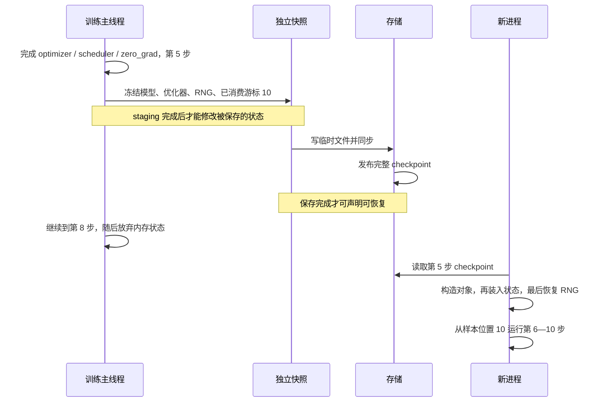

# 训练中断后，checkpoint 怎样恢复一致的进度？

训练到第 8 步时进程退出，磁盘上最后一份 checkpoint 保存于第 5 步。恢复后应从第 6 步继续，重做已经丢失的第 6—8 步。要做到这一点，模型、优化器、随机数和已消费的数据位置必须对应同一个保存时刻，文件也必须已经完整发布。

本篇用一个含 Dropout 的 CPU 小模型验证这条原则，再追踪 PyTorch 的状态字典与分布式保存路径。读完应能列出恢复状态、选择保存边界，并用缺项对照检查“程序能跑”和“接着原来的训练跑”之间的差别。

## 1. 为什么只保存参数还不够？

先看最容易数清楚的例子：20 个样本，固定打乱一次，每批 2 个，训练 10 步。完成 5 次参数更新时，已经消费了排列中的前 10 个样本。此时保存，恢复后的下一批应读取排列中位置 10、11 的样本。

保存的参数表示第 5 步后的模型；进度也必须表示第 5 步。如果参数来自第 5 步，数据游标却来自第 8 步，恢复后会跳过尚未体现在这些参数中的样本；如果游标归零，则会重复训练前半段。这就是本篇所说的**一致性**：所有状态共同描述一个可继续执行的训练时刻。

优化器也有记忆。第 [18 篇](../2026-11-04-training-memory-accounting/README.md) 解释过 Adam 的矩；把其一阶矩简写为：

\[
m_t=\beta_1m_{t-1}+(1-\beta_1)g_t.
\]

其中，\(t\) 是参数更新次数，\(g_t\) 是当次梯度，\(m_t\) 是累计的梯度统计量。即便参数和下一批数据相同，重新创建的优化器把 \(m_{t-1}\) 当作零，下一次更新也会改变。二阶矩、优化器内部步数和学习率同样影响更新。官方 [Saving and Loading Models](https://docs.pytorch.org/tutorials/beginner/saving_loading_models.html) 因此把 optimizer state 纳入 general checkpoint。

## 2. 一个训练时刻究竟包括什么？

本篇选在“一次 optimizer 更新、scheduler 更新和梯度清零都完成后”保存。这样，梯度不再承载待完成的工作，进度计数可以明确表示**已完成更新数**。

记 \(S_t\) 为完成第 \(t\) 次更新后的状态：

\[
S_t=(\theta_t,b_t,O_t,L_t,R_t,D_t,C).
\]

\(\theta_t\) 是参数，\(b_t\) 是模型 buffer（例如 BatchNorm 的运行统计），\(O_t\) 是优化器状态，\(L_t\) 是调度器状态，\(R_t\) 是随机数生成器状态，\(D_t\) 是数据消费进度，\(C\) 是解释这些状态所需的模型／数据／训练配置。下一步由状态与输入共同决定：

\[
S_{t+1}=F(S_t,\text{下一批数据}).
\]

这是一种教学建模：真实训练若使用 AMP，还需 scaler 状态；有 EMA、独立随机生成器或其他影响更新的组件，也要一并保存。若在梯度累积中间保存，尚未应用的梯度、累积次数与对应数据进度都会进入状态，本文的“梯度已清零”边界就不再成立。

随机状态要保存当前位置。相同 seed 只会把生成器重新放回序列起点；训练已经消费过的 Dropout mask、数据增强随机数不会自动被跳过。本文同时使用 torch CPU RNG 和 Python random，并在对象构造完成后恢复两者，因为模型构造本身也会消耗随机数。第 [19 篇](../2026-11-05-activation-checkpointing/README.md) 讨论的是前向激活重算，此处讨论的是持久化训练进度，两者需要分别理解。

数据进度也要数“训练已消费多少”。第 [20 篇](../2026-11-06-dataloader-input-pipeline/README.md) 的 worker 预取会提前读数据；worker 已经读取的位置可能走在训练前面。本文直接保存完整样本排列和已消费游标，避免把预取队列混入最小实验。生产输入流水线还需要明确 epoch、分片规则、数据版本、worker 随机状态，以及重放或丢弃预取数据的约定。

## 3. 从第 5 步走到真正可恢复的文件

在固定 batch size 为 2、没有丢弃尾批的本例中：

\[
\text{cursor}=2\times\text{completed\_steps}.
\]

第 5 步保存时 cursor = 10；第 8 步退出时内存中的 cursor = 16，但磁盘上的完整 checkpoint 仍是 10。恢复后重新执行 5 步，最终完成第 10 步，cursor = 20。以下为机制示意，图源保存在 [checkpoint-lifecycle.mmd](assets/checkpoint-lifecycle.mmd)。



这里有两个不同的完成时刻。**快照完成**表示后续训练不会改变要保存的值；**保存完成**表示存储写入已经完成，可以把它选为恢复点。文件 I/O 在后台运行时，两者尤其容易混淆。

第一道练习在同一目录创建唯一临时文件，写完后 flush、fsync、关闭，再 os.replace 成为正式文件。Python 的 [fsync 文档](https://docs.python.org/3.12/library/os.html#os.fsync) 说明缓冲文件需要先 flush；[os.replace 文档](https://docs.python.org/3.12/library/os.html#os.replace) 说明成功的替换具有原子性，跨文件系统可能失败。这样，进程内可捕获的写入异常发生在发布前时，旧文件仍在。

原子可见性与断电后的持久性需要分别验证。练习没有同步父目录，也没有测试断电、强杀、网络文件系统和多写者竞争；不能据此承诺这些故障下旧版或新版一定可用。强杀还可能遗留未发布的临时文件。路径由调用方拥有，题设只有一个写者。

## 4. 源码怎样支撑这些边界？

本次实际 fetch 官方 PyTorch main，固定为 `a68f117948121cdff578ff7813c5c906ff529b57`。查询到的稳定版本为 v2.15.0，tag commit 为 `31a77fc9c0a7c6fff15a1ff58c743f53b1a9d457`。本机实际运行包为 torch 2.15.0、build Git `d0f2af8b66b20da4baa50644c0cd3f887a2eae2e`；源码分析与本机实验分别记录，避免把不同 SHA 当成同一构建。

### 4.1 state_dict 会自动冻结值吗？

先回答“训练继续一步，会不会改变待保存内容”。[Module.state_dict](https://github.com/pytorch/pytorch/blob/a68f117948121cdff578ff7813c5c906ff529b57/torch/nn/modules/module.py#L2203-L2220) 明确返回包含参数和持久 buffer 引用的浅拷贝。因此，把 `model.state_dict()` 交给后台线程后立即更新参数，不能自然得到固定时刻的快照。

练习用 deepcopy 冻结模型、优化器、调度器和进度组成的字典；测试会在快照之后继续更新模型，确认保存的值保持不变。恢复时还会 deepcopy 优化器状态，避免 load_state_dict 复用输入快照中的 Tensor，使恢复后的训练反向改变这份快照。GPU 上的数据拷贝、stream 同步和后台 staging 需要额外协议，不能从本例的 CPU deepcopy 推出 GPU 异步拷贝已经安全。

接着回答“优化器怎样找到原来的参数”。[Optimizer.state_dict](https://github.com/pytorch/pytorch/blob/a68f117948121cdff578ff7813c5c906ff529b57/torch/optim/optimizer.py#L724-L744) 描述保存 ID 与当前参数组的顺序配对；恢复不能依靠任意改名后自动匹配。[load_state_dict](https://github.com/pytorch/pytorch/blob/a68f117948121cdff578ff7813c5c906ff529b57/torch/optim/optimizer.py#L934-L985) 还要求先初始化学习率调度器，避免其初始化覆盖加载的学习率。练习固定结构与参数组顺序，依次创建 model、optimizer、scheduler，加载 scheduler 与 optimizer 状态，最后恢复 RNG。

### 4.2 分片训练的保存完成由谁确认？

第 [21 篇](../2026-11-09-fsdp-zero-state-sharding/README.md) 中，训练状态分散在多个 rank。DCP（Distributed Checkpoint，分布式 checkpoint）负责规划、写分片与元数据，但应用仍要把所有 rank 的训练状态对齐到约定的逻辑步，并显式纳入自己的 RNG 和数据进度。参见 [2.15 DCP 文档](https://docs.pytorch.org/docs/2.15/distributed.checkpoint.html)。

在本次固定源码中：

1. [async_save](https://github.com/pytorch/pytorch/blob/a68f117948121cdff578ff7813c5c906ff529b57/torch/distributed/checkpoint/state_dict_saver.py#L206-L238) 调用 stager，再启动存储执行器。异步 stager 返回 Future 时，接口返回 AsyncSaveResponse，其中 `staging_completion` 与 `upload_completion` 分别对应快照与保存完成；同步 staging 分支返回 upload Future。调用方必须按实际返回类型等待。
2. [AsyncStager 协议](https://github.com/pytorch/pytorch/blob/a68f117948121cdff578ff7813c5c906ff529b57/torch/distributed/checkpoint/staging.py#L40-L64) 要求 staged state 能安全供保存使用。在 snapshot 尚未隔离时改变原训练状态会破坏这一目的。官方 [异步保存示例](https://docs.pytorch.org/tutorials/recipes/distributed_async_checkpoint_recipe.html) 区分等待 staging 与等待上传，不能把前者完成报告成 checkpoint 已落盘。
3. 默认 `use_collectives=True` 的 [_save_state_dict 路径](https://github.com/pytorch/pytorch/blob/a68f117948121cdff578ff7813c5c906ff529b57/torch/distributed/checkpoint/state_dict_saver.py#L494-L519) 等待各 rank 的 write_data，再由 finish_checkpoint 调用 writer.finish。显式关闭 collective 的实验路径不具有同一套跨 rank 协调。
4. [文件系统 writer.finish](https://github.com/pytorch/pytorch/blob/a68f117948121cdff578ff7813c5c906ff529b57/torch/distributed/checkpoint/filesystem.py#L766-L803) 收集写入结果，先写临时 metadata，再同步并改名。它还可能移除已有 metadata；覆盖同一目录不能被解释为“整套旧 checkpoint 与整套新 checkpoint 原子切换”。[FileSystemWriter](https://github.com/pytorch/pytorch/blob/a68f117948121cdff578ff7813c5c906ff529b57/torch/distributed/checkpoint/filesystem.py#L977-L1021) 的假设包含空目录或新目录。工程上宜为每个保存版本使用独立目录，确认整个保存完成后再更新应用的 latest 指针，并保留上一份可恢复版本。

本篇追踪的是指定配置的官方实现，没有运行 DCP 或多机恢复。main 与 v2.15.0 的 saver、staging 两个完整源文件相同；其他文件差异已保存为 [版本差异](evidence/upstream/stable-to-main.diff)。main 的优化器加载 dtype 策略相关改动也在其中，不能概括为两个版本所有加载行为都相同。本文使用 CPU float64，未据此验证混合 dtype 恢复。

## 5. 保存频率与异步化怎样取舍？

保存太频繁会增加暂停、CPU 内存占用与存储流量；保存间隔太长会增加中断后的重做。先用明确假设算暂停比例：每隔 K 个更新同步保存一次，每步计算 t 秒，每次保存 C 秒，忽略失败和重叠，则一个周期中保存占比为

\[
\frac{C}{Kt+C}.
\]

例如 K = 100、t = 1 秒、C = 10 秒时，保存占 10 / 110 ≈ 9.09%。这是自拟数字的时间模型，未测量本机或生产 checkpoint 的吞吐。

异步化把存储写入与训练重叠，但训练在安全快照形成前仍需等待或遵守依赖。它还会占用 staging 内存和后台带宽；若同时挂起多份保存，额外内存和 I/O 队列可能反过来拖慢训练。需要测量 staging 等待、upload 完成时间、CPU 内存和训练吞吐，并限制未完成保存数量。官方异步示例中的 pinned memory 与 CUDA staging 条件属于进阶路径，本篇 CPU 实验没有测量它们。

排障时先缩小到同一环境和短序列：记录保存步、下一批样本 ID、学习率、第一步恢复 loss，再比较参数与优化器状态。若数据 ID 已错，先检查已消费进度；ID 相同而 loss 不同，检查 RNG、模型 buffer 与执行环境；loss 相同而更新后参数不同，再检查优化器、学习率和精度状态。这个顺序是定位线索，需要结合具体组件验证。

## 6. 代码练习与实际结果

### 练习一：写入失败时保住旧 checkpoint

从 [exercise_1.py](code/exercise_1.py) 开始，实现已冻结字典的保存与 CPU 加载。父目录已存在、单写者；输入只含 Tensor 与基础类型，路径属于调用方。测试应覆盖正常替换以及半截写入、fsync、rename 失败。

<details>
<summary>详解与完整答案</summary>

[checkpoint_io.py](code/checkpoint_io.py) 先创建唯一临时文件，序列化并同步后才替换正式路径；finally 清理本次临时文件。加载显式指定 `map_location="cpu", weights_only=True`，并要求根对象是字典。该选项不代替来源检查与 schema 校验。

[test_checkpoint_io.py](code/test_checkpoint_io.py) 的失败注入实际向临时文件写入部分字节再抛异常，然后重新加载正式路径，验证旧 tensor 和 step 未变。全部 8 项 I/O 测试通过；边界见 [练习说明](code/README.md)。

</details>

### 练习二：在新进程中接着同一训练时刻运行

从 [exercise_2.py](code/exercise_2.py) 开始，完成状态验证与恢复。固定 20 个样本、batch size 2、含 Dropout 的两层模型、Adam、每 3 步衰减一次的 StepLR；保存后从第 5 步恢复，运行剩余 5 步。与连续 10 步比较，并分别漏掉 optimizer、RNG、cursor、scheduler 做错误对照。

<details>
<summary>详解与完整答案</summary>

[resume_probe.py](code/resume_probe.py) 的 snapshot 冻结完整字典；restore 先检查 schema、固定配置、排列和 cursor = 2 × completed_steps，再恢复对象。RNG 放在最后，防止初始化消耗它。run_probe 为五种恢复策略分别启动新 Python 进程，模型构造使用不同 seed，确保没有从生产者偷带内存状态。

在 Mac mini（Apple M6、macOS 27 arm64）上，用现有 Python 3.12.16、torch 2.15.0、CPU float64、1 个算子线程运行。测试集共 26 项通过，独立实验报告得到：

| 恢复策略 | 最终参数最大绝对差 | 第 6—10 步样本 ID | 其他观察 |
| --- | --- | --- | --- |
| 全部恢复 | 0 | 相同 | Adam 矩与逐步 loss 最大差均为 0，学习率、RNG、优化器步数相同 |
| 漏 optimizer | 0.0372971812 | 相同 | 优化器步数不同，加载的学习率状态也丢失 |
| 漏 RNG | 0.0102299672 | 相同 | loss 最大差 0.250260611，随机状态不同 |
| 漏 cursor | 0.0165213865 | 不同 | 重读前 10 个样本，结束 cursor 为 10 |
| 漏 scheduler | 0.0118917319 | 相同 | scheduler_epoch 为 5，完整恢复为 10 |

完整恢复下一批的样本 ID 是 [17, 9]；漏 cursor 读到 [15, 6]。两者的 completed_steps 都能显示 10，说明只看步数和“没有报错”不足以验收。

这些是同一 CPU 环境下的确定性观察；实验模拟放弃第 6—8 步的内存状态，然后以真实新进程读取文件，未实施操作系统崩溃。不同硬件、内核、拓扑或数据处理实现下的位级一致性需要另外验证。

</details>

在本篇根目录运行：

```bash
PYTHONDONTWRITEBYTECODE=1 /Users/wangyuxiao/miniforge3/envs/ai-infra/bin/python -m unittest discover -s code -p 'test_*.py' -v
PYTHONDONTWRITEBYTECODE=1 /Users/wangyuxiao/miniforge3/envs/ai-infra/bin/python code/run_lab.py --output /tmp/checkpoint-lab-new-report.json
```

输出文件必须尚不存在。完整题目、答案和边界见 [代码入口](code/README.md)，原始数据见 [lab.json](evidence/runs/lab.json)、[测试输出](evidence/runs/tests.txt) 与 [验证说明](evidence/validation.md)。

## 7. 面试官继续追问

| 层次 | 追问 | 参考回答要点 |
| --- | --- | --- |
| 基础 | 同一个 seed 为什么还不够？ | seed 定义序列起点，恢复需要当前 RNG 位置，还要覆盖实际使用的各生成器 |
| 基础 | model.state_dict 保存了什么？ | 参数与持久 buffer；不包含优化器、调度器和应用数据进度，返回值还引用原存储 |
| 实现 | 为什么最后恢复 RNG？ | 模型与其他对象的初始化可能消耗 RNG；恢复后到下一步之间还应控制随机操作 |
| 实现 | 为什么先创建 scheduler 再装入 optimizer？ | scheduler 初始化会设置学习率相关状态；应遵循所用版本的加载顺序并验证下一步 LR |
| 选择 | 梯度累积一半保存可以吗？ | 可以设计协议，但必须额外保存待应用梯度、累积相位及对应进度；完整更新边界更易验证 |
| 选择 | staging 完成可以删上一份 checkpoint 吗？ | 应等整个保存成功并确认恢复策略可用后再按保留规则回收旧版 |
| 排障 | 步数正确，loss 却从恢复点开始偏离，先查什么？ | 对齐下一批 ID、RNG、模型 buffer、LR 与优化器矩，比较首次分歧发生在前向还是更新后 |
| 进阶 | 改 world size 后加载成功说明什么？ | 分片可重排与训练轨迹一致是不同验收对象；还需检查全局 batch、样本分配、RNG 与数值顺序 |

## 8. 本篇边界与后续问题

本文验证固定模型、固定参数组、固定数据版本、单进程 CPU、完整更新边界的恢复；没有执行 AMP、GPU、梯度累积中途、worker 预取恢复、分布式 DCP、强杀或断电实验。DCP 部分有当日固定源码与官方文档证据，不能把源码阅读计为运行通过。

配置标签和 schema 是解释状态的约定。生产中应把影响恢复的配置、数据版本、软件版本和保存完成状态纳入校验，具体字段取决于训练系统。本文的固定 fixture 校验仅覆盖练习约束。

下一篇候选：AllReduce 的数据怎样沿链路流动，为什么增加 GPU 后通信反而更慢？它连接已发布的 DDP 与状态分片，补充网络拓扑和通信成本的基础。

资料归档：[参考资料与证据](references.md)。审查与实验：[审查记录](review.md)。返回 [Wiki 索引](../../../index.md)。
