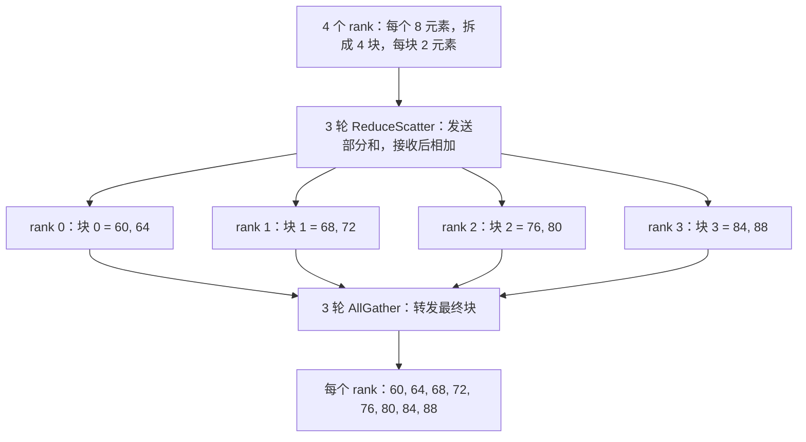
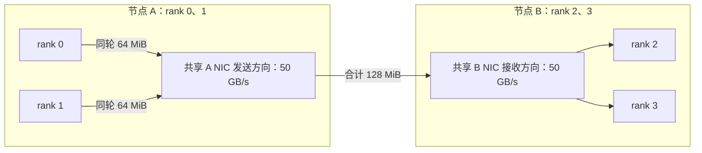

# AllReduce 的数据怎样沿链路流动，为什么增加 GPU 后通信反而更慢？

4 个 GPU 每个都有一份 256 MiB 梯度，换成 8 个 GPU 后，单次 AllReduce 仍要处理每个 rank 的完整梯度。GPU 数增加不会自动把这份梯度变小，通信还可能增加启动轮数，或让更多流共享同一 NIC（网络接口卡）。判断扩容收益，要同时数清消息、字节和物理链路。

本篇先用 4 个 rank、每个 8 个数推演环归约，再建立带启动成本和共享资源的模型，最后核对当前 NCCL。CPU 实验验证数学结果与记账；所有毫秒级成本表都是自拟参数的模型估算。

## 1. AllReduce 到底让谁得到什么？

rank 是通信组中一个参与进程的编号，常见训练配置是每个进程管理一个 GPU。对于 SUM，AllReduce 使每个 rank 都获得逐元素之和：

\[
y_r[i]=\sum_{q=0}^{P-1}x_q[i],\qquad r=0,\ldots,P-1.
\]

\(P\) 是 rank 数，\(x_q\) 是 rank q 的输入向量，\(y_r\) 是 rank r 的输出。它不是把不同位置拼接起来，也不天然表示平均值。平均需要相应的缩放；第 [17 篇](../2026-11-03-ddp-gradient-overlap/README.md) 讨论过训练梯度的归约与有效分母。官方 [Collective Operations](https://docs.nvidia.com/deeplearning/nccl/user-guide/docs/usage/collectives.html) 给出了这一语义。

本例输入为：

| rank | 8 个输入元素 |
| --- | --- |
| 0 | 0, 1, 2, 3, 4, 5, 6, 7 |
| 1 | 10, 11, 12, 13, 14, 15, 16, 17 |
| 2 | 20, 21, 22, 23, 24, 25, 26, 27 |
| 3 | 30, 31, 32, 33, 34, 35, 36, 37 |

第一个位置是 0 + 10 + 20 + 30 = 60，第二个是 1 + 11 + 21 + 31 = 64。最终每个 rank 都要有 [60,64,68,72,76,80,84,88]。接下来的问题是：这些数怎样流动，才能避免让一个根进程收发所有完整向量？

## 2. 环为什么分成 ReduceScatter 和 AllGather？

把每份向量按位置分成 4 块：块 0 包含位置 0、1，块 1 包含位置 2、3，依此类推。逻辑环为 0 → 1 → 2 → 3 → 0。

第一阶段是 ReduceScatter：边传递边归约，最后每个 rank 只拥有一块的完整和。第一轮先发送：

| 发送边 | 发送块 | 接收者把它加到本地对应块后 |
| --- | --- | --- |
| 0 → 1 | 块 3：[6,7] | rank 1 的块 3 为 [22,24] |
| 1 → 2 | 块 0：[10,11] | rank 2 的块 0 为 [30,32] |
| 2 → 3 | 块 1：[22,23] | rank 3 的块 1 为 [54,56] |
| 3 → 0 | 块 2：[34,35] | rank 0 的块 2 为 [38,40] |

下一轮转发刚得到的部分和，让它再吸收一个 rank 的贡献。3 轮后，rank 0 持有块 0 的完整和，rank 1 持有块 1，依此类推。每个块吸收了另外 3 个 rank 的数据。

第二阶段是 AllGather：已有的块都归约完成了，只需再沿环转发 3 轮，不再求和。每个 rank 最终集齐全部 4 块。阶段示意见下图，[图源](assets/ring-phases.mmd) 为本篇原创教学图。



用下标核对实现：ReduceScatter 的第 s 轮（从 0 开始），rank r 发送块 \((r-s-1)\bmod P\)；AllGather 第 s 轮发送块 \((r-s)\bmod P\)。每轮先取得全部发送值，再更新接收者，使教学 trace 的轮次边界清楚。实际 GPU 实现可以流水线执行，不需要全体 rank 在每轮做全局 barrier。

这一机制与 [Patarasuk、Yuan 的原始论文](https://www.cs.fsu.edu/~xyuan/paper/09jpdc.pdf) §4.1、图 1 对应。论文组合了 ReduceScatter＋AllGather、逻辑环和树拓扑上的无争用环构造；它不是说任意环映射到任意网络都不会争用。论文笔记和版本见 [paper-notes.md](evidence/paper-notes.md)。

## 3. 每个 rank 究竟发送多少字节？

先固定口径：S 表示**每个 rank 的完整输入字节数**，不是全组输入的和；块等分，每块 S/P。每阶段 P−1 轮，每轮每 rank 发一块，所以：

\[
V_{\mathrm{TX,rank}}=2(P-1)\frac{S}{P},\qquad
V_{\mathrm{TX,total}}=2(P-1)S.
\]

第一个数是单 rank 的发送量，第二个是全组发送量。每个 rank 的接收量与发送量相同；发送加接收会再翻倍，比较单向链路容量时不要重复计数。多跳网络中的物理链路字节数还需要按路由逐跳累计。

本例若用逻辑 4 字节元素，S = 8 × 4 = 32 字节，每 rank 共发 6 次、每次 8 字节，总共 48 字节，全组发送 192 字节。第 [21 篇](../2026-11-09-fsdp-zero-state-sharding/README.md) 讨论的 ReduceScatter 正是只保留第一阶段的结果；它与每个 rank 最终都持有完整输出的 AllReduce 有不同状态布局。

论文 §2.2 使用大消息线性模型，忽略启动和归约计算；§3 给出独立、无压缩、点对点部分结果传输等假设下的下界，§4.1 定理 1 在等分与无争用环条件下达到带宽最优。浮点求和不严格满足结合律，改变归约括号可能改变舍入结果；本篇模拟器用精确整数避免把这种差异混入通信教学，见第 [03 篇](../../10/2026-10-22-floating-point-formats/README.md)。

## 4. 字节数接近最优，为什么仍会慢？

### 4.1 增加 rank 会增加启动轮数

在论文的大消息模型上加入每轮启动时间 alpha（秒），设每条独立有向边有效带宽 B（字节／秒），忽略归约计算与协议开销，得到教学模型：

\[
T_{\mathrm{ring}}\approx2(P-1)\alpha+
\frac{2(P-1)}{P}\frac{S}{B}.
\]

alpha 是每轮准备、协调等启动成本的抽象，不是某个固定 NCCL 参数。按第 [04 篇](../../10/2026-10-22-roofline-basics/README.md) 的量纲检查，字节数除以字节／秒得到秒。第一项随 P 近似线性增长；第二项的系数从 P = 4 时的 1.5 变为 P = 8 时的 1.75。相同每 rank payload 下，更多 rank 不意味着单次通信更快。

取自拟参数 alpha = 5 μs、B = 50 GB/s（十进制），模型结果为：

| 每 rank 输入 | P = 4 | P = 8 |
| --- | --- | --- |
| 4 KiB | 30.123 μs | 70.143 μs |
| 256 MiB | 8.083 ms | 9.465 ms |

小消息更容易受启动项影响。大消息要看每 rank 字节数和有效带宽；强扩展时，每 GPU 的计算量可能减少，而 DDP 的梯度 payload 仍由模型参数规模决定，暴露的通信就更难摊薄。实际训练还要看通信与计算的重叠，不能把单次 collective 时间直接加成端到端训练时间。

作为另一种教学基线，整块 binomial Reduce 再 Broadcast 在 P 为 2 的幂、每层一对 peer、独立链路且无争用时，有 \(2\log_2P\) 轮，每轮传 S 字节，时间为 \(2\log_2P(\alpha+S/B)\)。它减少启动轮数，却在关键路径上重复传完整向量。**这个基线不代表 NCCL Tree。** 分块、双树、流水线和 recursive halving／doubling 都会改变取舍；原论文也讨论了匹配无争用网络时，同时优化启动轮数与带宽项的方案。不能凭一个消息阈值把所有系统归类为“小消息用树、大消息用环”。

### 4.2 逻辑边会共享物理资源

两个节点 A、B，各有 2 个 rank：A 上为 0、1，B 上为 2、3。每节点有一个 NIC，每个方向容量 50 GB/s；节点内有向边设为 200 GB/s。

环 [0,1,2,3] 每轮只有一条 A → B 的边与一条 B → A 的边；环 [0,2,1,3] 每轮同方向有两条跨节点边。这两条边共享 NIC，不能各自获得完整的 50 GB/s。对于 S = 256 MiB，每块 64 MiB，交错环在 A 的发送方向每轮累计 128 MiB。下图只展开 A → B 方向，反向使用另一组有向资源。[图源](assets/shared-nic.mmd)。



令 \(L_e\) 为同一轮经过物理资源 e 的总字节数，\(B_e\) 为其字节／秒容量。在同步轮次、充分流水线的理想流体模型中：

\[
T_{\mathrm{model}}=2(P-1)\left(\alpha+\max_e\frac{L_e}{B_e}\right).
\]

按节点相邻的环估计为 8.083 ms，交错环为 16.136 ms。带宽项约翻倍，启动项相同。这是给定路由的容量估计，忽略逐跳启动、包调度、归约计算和流水线填充，不是完整网络时序模拟或实测预测。

同样的推理还适用于共享 PCIe 上行、多个 channel 争用同一出口、以及 NIC 与 GPU 之间绕经较慢路径。实际 NCCL 会根据拓扑构造不同 channel 的通信图；它的环顺序不必等于应用 rank 的数字顺序。此处的交错环是反例，不是在断言 NCCL 默认使用它。

## 5. 当前 NCCL 代码怎样实现与选择？

今日实际 clone 官方仓库并读取默认分支 master，固定完整 SHA：

`ad2d192c1f279aefcaf340f67e07880b65a1116b`。

查询到的稳定 release 为 v2.32.6-1（2026-11-09 UTC 发布），该 tag 解引用到同一 commit；本次默认分支与稳定 tag 因而是同一份代码。本次文档提取返回的页面标注为 2.32.3，缓存获取日与今日请求日期分别记录于 [versions.json](evidence/versions.json)。本机没有 CUDA，未构建或运行 NCCL。

### 5.1 从 AllReduce API 到具体环步骤

[ncclAllReduce](https://github.com/NVIDIA/nccl/blob/ad2d192c1f279aefcaf340f67e07880b65a1116b/src/collectives.cc#L192-L211) 构造 ncclInfo，带上 count、datatype、归约操作和 stream，交给 [ncclEnqueueCheck](https://github.com/NVIDIA/nccl/blob/ad2d192c1f279aefcaf340f67e07880b65a1116b/src/enqueue/enqueue.cc#L3570-L3612) 校验并入队。准备阶段的 [ncclTaskPrepare](https://github.com/NVIDIA/nccl/blob/ad2d192c1f279aefcaf340f67e07880b65a1116b/src/enqueue/task_prep/task_prep.cc#L11-L29) 调用 ncclTuningCompute，之后分类与调度。

当执行路径选择这里分析的常规 Ring kernel 时，[all_reduce.h::runRing](https://github.com/NVIDIA/nccl/blob/ad2d192c1f279aefcaf340f67e07880b65a1116b/src/device/all_reduce.h#L14-L81) 读取当前 channel 的 ring.index、prev、next，把 channel 数据分为 chunk。顺着前面的教学问题看：

1. directSend 先推出一块数据。
2. directRecvReduceDirectSend 继续接收、归约并转发部分和。
3. directRecvReduceCopyDirectSend 完成自己负责块的归约，保存结果并立即向后转发。
4. directRecvCopyDirectSend 与最后的 directRecv 收齐其余完整块。

第三步把两个阶段的交界融合了；教学模拟器把它们分开，方便观察块所有权。channel 是并行通信通道，protocol 是具体传输与同步协议，slice 是流水线中的更小传输片段。真实代码还有通道划分、尾块对齐和分片推进，不能把模拟的一个块当成一次完整设备传输或一个 CUDA kernel。Ring 的 SIMPLE、LL、LL128 以及其他候选路径都受实际调度条件影响。API 入队完成也不等于 GPU 通信完成，计时需要相关 stream 的同步或事件边界，参见第 [06 篇](../../10/2026-10-23-gpu-asynchronous-timing/README.md)。

### 5.2 为什么不能写死“总是 Ring”？

[ncclTuningCompute](https://github.com/NVIDIA/nccl/blob/ad2d192c1f279aefcaf340f67e07880b65a1116b/src/tuning/tuning.cc#L125-L239) 枚举有效候选，并按估算成本选择；配置的 tuner plugin 可以调整成本信息。[Ring 模型](https://github.com/NVIDIA/nccl/blob/ad2d192c1f279aefcaf340f67e07880b65a1116b/src/tuning/ring.cc#L24-L141) 实际读取节点数、计算能力、图中的 bwIntra／bwInter、channel 数和 protocol，包含额外的延迟与平台修正。

[ncclTuningGetNsteps](https://github.com/NVIDIA/nccl/blob/ad2d192c1f279aefcaf340f67e07880b65a1116b/src/tuning/tuning_general.cc#L18-L26) 中 AllReduce 的环步数为 2(P−1)，与前面的推演对应；完整成本和候选集合远多于两项教学公式。正文没有据此给出生产环境的最优算法或固定阈值。

## 6. 工程上该测什么？

先固定输入口径：每 rank 的 count、dtype、payload 字节数、rank 数、每节点 GPU 数和 rank／GPU／NIC 映射。依次比较单节点与跨节点、小消息与大消息，并同时记录正确性。再用 trace 观察训练中真正暴露的通信与慢 rank；一个 rank 晚进入 collective，也会让其他 rank 的等待看起来像网络慢。

诊断应结合 GPU 间 P2P、GPU 到 NIC 的路径、实际传输方式与共享出口。NCCL 依赖系统暴露的拓扑信息；官方 [GPU troubleshooting](https://docs.nvidia.com/deeplearning/nccl/user-guide/docs/troubleshooting/gpu_troubleshooting.html) 说明了这些检查的作用。本篇没有在 Mac 上执行 Linux 驱动或系统配置命令。

官方 [Logging](https://docs.nvidia.com/deeplearning/nccl/user-guide/docs/troubleshooting/logging.html) 支持按 INIT、GRAPH、NET、TUNING 等子系统筛选。可在目标 GPU 环境中为一次受控实验记录拓扑、算法／protocol、channel 与网络选择；日志等级和构建决定具体输出，TRACE 开销也要控制。诊断日志和正式计时应分开，不能让详细日志成为被测性能的一部分。

使用 nccl-tests 时还要区分两个指标。固定 benchmark 源码 [AllReduceGetBw](https://github.com/NVIDIA/nccl-tests/blob/afd59abab774a6a4b492eb344bd0c845a0b7bb4d/src/all_reduce.cu#L59-L67) 计算：

\[
\mathrm{algbw}=\frac{S}{T},\qquad
\mathrm{busbw}=\mathrm{algbw}\cdot\frac{2(P-1)}{P}.
\]

algbw 以每 rank 输入大小除以完成时间；busbw 乘以通信量归一化因子。它不是 NIC 的逐包计数器，不能直接当作某一物理端口的吞吐。层次拓扑、Tree 或硬件归约会让这种解释更需要小心；官方仓库的 [issue 274](https://github.com/NVIDIA/nccl-tests/issues/274) 讨论也解释了其平坦点对点网络模型的边界。

## 7. 两道代码练习与实测

### 练习一：写出环的消息 trace

从 [exercise_ring.py](code/exercise_ring.py) 开始，实现等分块整数 SUM，返回每个 rank 的最终结果、ReduceScatter 后的块、两阶段消息和发送字节数。题目输入、约束与验收见 [代码入口](code/README.md)。完成后把函数复制到 ring.py 再测试，避免只修改模板却仍在验收参考实现。

<details>
<summary>详解与完整答案</summary>

[ring.py](code/ring.py) 复制输入，按前面的块下标先产生本轮全部消息，再做接收更新。rank r 在 ReduceScatter 后拥有块 r；AllGather 将完整块复制给其他 rank。4 个 rank、每 rank 8 个逻辑 4 字节元素时，每 rank TX 为 48 字节。单 rank 不产生消息，3 个 rank 也能工作；本练习要求等块，未实现 NCCL 的尾块和对齐。

[test_answers.py](code/test_answers.py) 同时检查结果、所有权、两阶段轮次、TX 字节数与输入不变。Python 整数是精确算术，element_bytes 只用于逻辑流量记账，不代表 Python 对象大小，也不测试固定宽度整数溢出。

</details>

### 练习二：让共享 NIC 真正进入模型

从 [exercise_costs.py](code/exercise_costs.py) 开始，把每条逻辑边映射到物理资源，累计同轮负载，比较 [0,1,2,3] 与 [0,2,1,3]。输入包含容量与 alpha，必须检查单位和有限性；输出每轮资源负载与模型时间。

<details>
<summary>详解与完整答案</summary>

[costs.py](code/costs.py) 对共享资源的字节数求和，再取最慢容量项。整数负载先保留为整数，有理数除法完成后才转换最终时间，避免中间浮点溢出；单 rank 返回零。无法表示为有限 float 的标量或最终时间会明确报错。

最终 28 项测试全部通过，包括审查补充的 5 项数值边界回归。[run_lab.py](code/run_lab.py) 还真实启动 4 个 CPU／Gloo 进程，float64 SUM 均得到 [60,64,68,72,76,80,84,88]，并与模拟器一致；手动除以 4 后均值为 [15,16,17,18,19,20,21,22]。

本机为 Mac mini（Apple M6、macOS 27 arm64），现有 Python 3.12.16、torch 2.15.0，子进程各设置 1 个算子线程。Gloo 实验验证 collective 结果，没有验证 NCCL 环路径、GPU／NIC 带宽或延迟。模型表格均来自自拟输入，未把 CPU 执行时间当成 GPU 性能。

</details>

从本篇根目录运行：

```bash
PYTHONDONTWRITEBYTECODE=1 /Users/wangyuxiao/miniforge3/envs/ai-infra/bin/python -m unittest discover -s code -p test_answers.py -v
PYTHONDONTWRITEBYTECODE=1 /Users/wangyuxiao/miniforge3/envs/ai-infra/bin/python code/run_lab.py --output /tmp/allreduce-lab-new.json
```

输出文件须尚不存在。完整结果见 [lab.json](evidence/runs/lab.json)、[测试输出](evidence/runs/tests.txt) 与 [验证说明](evidence/validation.md)。

## 8. 面试官继续追问

| 层次 | 追问 | 参考回答要点 |
| --- | --- | --- |
| 基础 | AllReduce 与 AllGather 有什么区别？ | 前者按位置归约后每 rank 得到完整结果；后者收集不同 rank 的分片 |
| 基础 | 2(P−1)S/P 中 S 指什么？ | 每 rank 的完整输入字节数；该式是等块环的单 rank 发送量，接收另计 |
| 实现 | 两阶段为何能合并一个动作？ | 最后一次归约得到自己块的最终值后，可立即保存并转发，衔接 AllGather |
| 实现 | channel 越多一定越快吗？ | 可以增加并行，但还受同一物理出口、协议、GPU 资源与同步成本约束 |
| 选择 | 环带宽最优是否意味着所有消息都最快？ | 最优结论有网络与大消息假设；启动轮数、计算、争用与协议仍影响时间 |
| 选择 | Tree 一定只适合小消息吗？ | 不能用朴素整块树代替现代分块／流水线／双树算法，应看实际候选与目标环境验证 |
| 排障 | 扩到多节点后慢很多，先看什么？ | 对齐 payload 与进入时间，区分进程迟到、共享 NIC、GPU-NIC 路径、传输方式及拓扑识别 |
| 排障 | busbw 超过某个 NIC 标称值意味着什么？ | 先确认归一化口径与参与拓扑；它不是那个 NIC 的直接计数，需配合端口和路径证据 |

## 9. 适用范围与下一步

本篇覆盖 SUM 的逻辑语义、等块环、原始论文假设、当前 NCCL 指定代码路径，以及单机 CPU 正确性验证。未运行 CUDA、NCCL、RDMA、跨节点 collective 或硬件性能实验；不同 dtype 的浮点轨迹也需单独验收。

下一篇候选：CUDA Graph 怎样减少重复提交开销，哪些动态行为会让捕获失效？它连接已发布的异步执行、算子融合与训练调度，并扩展编译与执行主题。

资料与源码：[参考资料](references.md)。审查：[review.md](review.md)。返回 [Wiki 索引](../../../index.md)。
