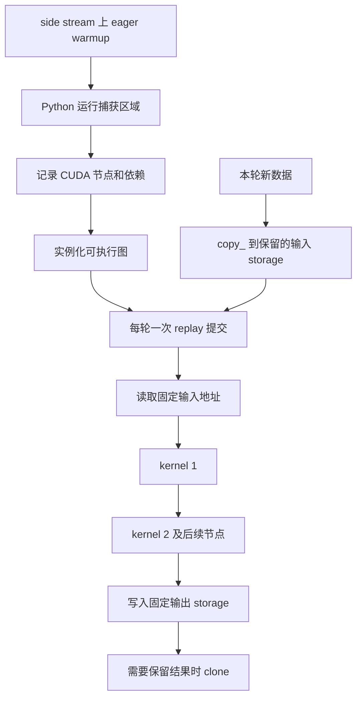

# CUDA Graph 怎样减少重复提交开销，哪些动态行为会让捕获失效？

一次推理要依次运行 10 个小 kernel。假设每个 kernel 的 GPU 工作只需 1 μs，而 CPU 提交每个 kernel 需要 3 μs。即使 GPU 能很快算完，后续工作仍可能迟迟没有提交到队列中。CUDA Graph 把可重复的 CUDA 操作和依赖记录下来，实例化为可执行图，然后通过一次图提交启动整段工作。它适合重复次数多、提交开销明显、输入布局和执行结构可控的区域。图的构建、固定缓冲区、数据复制和显存保留共同构成代价。[CUDA Programming Guide §4.2](https://docs.nvidia.com/cuda/cuda-programming-guide/04-special-topics/cuda-graphs.html)

本篇先推导这个 10 个 kernel 的例子，再解释“输入数据可以变”与“输入地址需要稳定”如何同时成立，最后沿 PyTorch 的 Python 包装层走到 `cudaGraphLaunch`。

前置阅读可回看异步队列、事件与端到端计时，以及算子融合的启动成本。第 06 篇建立时间线，第 09 篇解释融合带来的数据流和资源变化。[异步执行与计时](../../10/2026-10-23-gpu-asynchronous-timing/README.md)、[算子融合](../../10/2026-10-23-kernel-fusion/README.md)

本篇实际运行环境是 Mac mini、Python 3.12.16、PyTorch 2.15.0 CPU。基础练习验证队列模型和 CPU Tensor 的 storage、复制及别名行为。CUDA 捕获与重放脚本保存在本篇目录，当前执行结果为 `cuda_unavailable`，CUDA 正确性和性能验证仍待 CUDA 设备。所有微秒数字均为教学模型输入及其计算结果。[环境与实际输出](evidence/runs/02-cpu-lab.json)、[CUDA 探测结果](evidence/runs/03-cuda-probe.json)

## 1. 面试官先问，GPU 为什么还会等 CPU？

### 1.1 从一次普通调用开始

CPU 执行 Python、框架调度和 CUDA API，把工作提交到 stream。stream 是有序工作队列，同一 stream 上相邻操作按依赖执行。提交调用返回后，GPU 可以继续处理队列里的工作，CPU 也可以继续提交后续工作。

当 kernel 很短时，GPU 可能在下一个 kernel 提交前就已经完成当前工作。把整段操作保存为图，可以减少每轮反复穿过 Python、框架和驱动提交路径的成本。图的节点表示操作，边表示依赖。节点可以包括 kernel、复制等操作。[PyTorch 2.15 CUDA Graph 说明](https://docs.pytorch.org/docs/2.15/notes/cuda.html#cuda-graphs)、[CUDA Graph 结构](https://docs.nvidia.com/cuda/cuda-programming-guide/04-special-topics/cuda-graphs.html#graph-structure)

### 1.2 捕获、实例化和重放分别发生什么？

1. **准备与 warmup**。运行真实 eager 操作，让相关库、工作区和执行路径完成初始化。PyTorch 文档要求 warmup 使用 side stream，并通过 stream 依赖连接调用方的准备工作。
2. **capture**。Python 执行捕获区域，向捕获 stream 发出的 CUDA 操作被加入图。该阶段记录操作及参数，捕获的 CUDA 工作在后续 replay 时执行。
3. **instantiate**。CUDA 将图模板变成可执行图，完成执行准备与优化。
4. **replay**。把可执行图提交到 stream，GPU 按已记录的操作与依赖运行。

普通 Python 逻辑在捕获时执行一次。后续 `graph.replay()` 复用已经记录的 CUDA 工作。Python 的计数器更新、日志和普通 `if` 判断需要在调用方按业务需求执行。[PyTorch API 与捕获约束](https://docs.pytorch.org/docs/2.15/notes/cuda.html#pytorch-api)、[CUDA 图构建与执行](https://docs.nvidia.com/cuda/cuda-programming-guide/04-special-topics/cuda-graphs.html#building-and-running-graphs)



图中的 `copy_` 和 `clone` 位于本篇示例的捕获区域外，每轮都要支付相应成本。图源保存在本篇目录。[可重建图源](figures/capture-replay.mmd)

## 2. 具体数字怎样算，为什么需要考虑 CPU／GPU 重叠？

### 2.1 定义一个可复算的模型

模型只包含一个 CPU 提交者、一个有序 GPU 队列。每步依次运行相同的 \(m\) 个 kernel，持续时间为 \(d_1,\ldots,d_m\)。CPU 每次 eager 提交耗时为 \(h\)，每次整图提交耗时为 \(q\)。图额外准备耗时为 \(C\)，发生在全部图提交之前。所有单位均为 μs，重复次数为正整数 \(N\)。

每个操作提交完成后即可进入 GPU 队列。模型中的图节点执行时间与 eager 相同。warmup、输入复制、输出快照、其他 stream 干扰和真实驱动调度开销留给后续实机测量。

第一步第 \(j\) 个 kernel 提交完成于 \(jh\)，其 GPU 完成时刻满足

\[
F_0=0,\qquad F_j=\max(F_{j-1},jh)+d_j.
\]

`max` 表达两个启动条件，前一个 kernel 已完成，当前 kernel 已提交。令第一步完成时刻 \(A=F_m\)，每步 GPU 工作总时长 \(D=\sum_j d_j\)。重复相同序列时

\[
E=\max(mh,D),\qquad G=\max(q,D),
\]

\[
T_{\mathrm{eager}}(N)=A+(N-1)E,
\]

\[
T_{\mathrm{graph}}(N)=C+q+D+(N-1)G.
\]

可以把递推展开成“某次提交完成时间，加上其后所有 kernel 的执行时间”的最大值。同一 kernel 在相邻两步中的候选值相差 \(mh-D\)，因此最大候选来自第一步或最后一步，得到上面的周期式。这里的稳态间隔取两条流水线中较慢的一侧。把全部 CPU 时间与全部 GPU 时间直接相加，会重复计算两者重叠的区间。[完整模型与复算测试](code/launch_model.py)、[逐操作队列对照测试](code/test_answers.py)

### 2.2 10 个短 kernel，重复多少次才划算？

取 \(m=10\)、每个 \(d_j=1\)、\(h=3\)、\(q=4\)、\(C=10000\)。这里的 10 ms 图准备时间和全部微秒参数均由题目设定。

第一步 eager 的前两个 kernel 分别在 4 μs、7 μs 完成，第 10 个在 31 μs 完成。因此 \(A=31\)、\(D=10\)、\(E=30\)、\(G=10\)，图第一步完成时刻为 \(10014\) μs。

| 重复次数 \(N\) | eager 完成时刻 | graph 完成时刻 | 比较 |
| --- | --- | --- | --- |
| 1 | 31 μs | 10014 μs | 准备成本占主导 |
| 100 | 3001 μs | 11004 μs | 累计收益仍不足 |
| 500 | 15001 μs | 15004 μs | 相差 3 μs |
| 501 | 15031 μs | 15014 μs | graph 首次严格更快 |
| 1000 | 30001 μs | 20004 μs | graph 累计减少 9997 μs |

若 \(E>G\)，严格获益要求

\[
(N-1)(E-G)>C+q+D-A.
\]

右侧非负时，最早严格获益次数为

\[
N_{\min}=\left\lfloor\frac{C+q+D-A}{E-G}\right\rfloor+2.
\]

本例结果为 501。等时点需要继续增加一次，测试专门检查了这个严格边界。[模型实际输出](evidence/runs/02-cpu-lab.json)

### 2.3 如果 GPU 本身已经很忙呢？

仍然运行 10 个 kernel，把每个 kernel 改成 100 μs，则 \(D=1000\)、\(E=G=1000\)。重复 1000 次时，模型给出 eager 为 1000003 μs，graph 为 1010004 μs。两者稳态间隔相同，图准备成本持续影响总时间。

实际 CUDA Graph 还可能改变设备调度开销，实际 workload 也可能包含更复杂的依赖。因此本模型用于检查提交瓶颈和成本摊销的逻辑，具体收益需要在目标设备上测量。[模型输出与验证范围](evidence/runs/02-cpu-lab.json)、[CUDA Graph 收益来源](https://docs.nvidia.com/cuda/cuda-programming-guide/04-special-topics/cuda-graphs.html)

## 3. 输入可以变化，为什么地址仍然需要固定？

### 3.1 先区分变量、Tensor 与 storage

Python 变量持有 Tensor 引用，Tensor 描述 shape、dtype、stride 和底层 storage。普通捕获记录 kernel 参数，包括数据指针和与执行相关的尺寸、布局。后续 replay 使用这些记录。

假设捕获时输入 storage 的地址记为 A。`source = new_tensor` 让 Python 变量改为引用新对象，图中已有的指针仍指向 A。`static_input.copy_(new_tensor)` 则把新数据写到 A 指向的保留空间中，图下次运行可以读到新内容。因此需要同时保留图、输入 Tensor 和输出 Tensor 的生命周期。[PyTorch 捕获约束与示例](https://docs.pytorch.org/docs/2.15/notes/cuda.html#pytorch-api)

```python
# 保留 static_input 和 static_output，与 graph 一起持有。
static_input.copy_(new_input)
graph.replay()
saved_output = static_output.clone()
```

本段展示的是 CUDA 使用流程，完整补充脚本包含 stream 依赖、warmup 和正确性断言。当前机器的实跑范围见脚本探测记录。[CUDA 补充脚本](code/cuda_demo.py)、[实际探测输出](evidence/runs/03-cuda-probe.json)

### 3.2 结果为什么也会“变掉”？

图每次写入同一个输出缓冲区。若第一次只保存 `first = static_output`，第二次 replay 会覆盖这块 storage，`first` 随之看到新值。需要保留独立历史结果时，应在合适的 stream 顺序下生成快照，并把其复制成本计入端到端测量。[PyTorch 输入输出生命周期示例](https://docs.pytorch.org/docs/2.15/notes/cuda.html#pytorch-api)

CPU 练习对 \(y=2x+1\) 实测得到以下结果。初始输入是 `[[0,1,2],[3,4,5]]`，随后令调用方的变量引用一个全为 4 的新 Tensor。

| 动作 | 观察结果 |
| --- | --- |
| 第一次计算并 clone | 保存 `[[1,3,5],[7,9,11]]` |
| 只改调用方变量，再运行 | 保留输入仍得到 `[[1,3,5],[7,9,11]]` |
| 把全 4 的新数据 copy_ 到保留输入，再运行 | 输出全为 9 |
| 查看第一次借用的输出引用 | 现在也全为 9 |
| 查看第一次 clone 的结果 | 仍为 `[[1,3,5],[7,9,11]]` |
| 比较两次 input／output 的 data_ptr | 两个缓冲区各自地址保持一致 |

这些观察由 CPU Tensor 运算产生。CPU 练习的 `replay()` 每次都执行 Python 和 CPU 算子，它帮助验证固定缓冲区与别名语义。CUDA 设备上的图捕获、调度和性能需要补充实机验证。[CPU 实验记录](evidence/runs/02-cpu-lab.json)

### 3.3 哪些动态行为需要调整？

| 行为 | 普通捕获／重放中的影响 | 可行处理与代价 |
| --- | --- | --- |
| 同 shape、dtype 的新数据 | 已捕获输入指针保持原值 | 每轮复制到保留输入，支付复制成本 |
| Python 浮点数 `scale` 改值 | 既有节点仍使用捕获时记录的参数 | 重新捕获，或设计读取固定设备 Tensor 的路径并核对算子实现 |
| Python 普通 `if` 依赖本轮数据 | 捕获时只记录实际执行路径 | 在图外选择已准备的图，或使用受支持的条件节点路径 |
| `.item()` 等 CPU 读取 GPU 结果 | 捕获期间发生 CPU／GPU 同步会报错 | 把必要读取放到捕获区域外，计入同步成本 |
| batch、shape 或内部 stride 改变 | 既有图中的尺寸、布局及参数继续沿用 | 按布局和形状分桶、padding 或重新捕获，计入填充工作和多图显存 |
| 每轮需要历史输出 | 固定输出 storage 会被后续重写 | 按业务生命周期 clone 或消费完成后复用 |
| 多 stream 并行工作 | 捕获与重放都需要完整的依赖顺序 | 建立 fork／join，保留准备工作到 replay 的跨 stream 依赖 |

普通重放的固定参数约束与 CUDA 底层图更新、条件节点能力共同存在。当前 PyTorch 2.15 文档已经介绍用 `torch.cond` 表达 GPU 数据相关分支，以及 `torch.compile(..., backend="cudagraphs")` 的使用路径。普通 Python `if` 在捕获时求值。条件节点路径的支持范围和限制应按具体 backend、版本及设备验证。[PyTorch 条件控制流](https://docs.pytorch.org/docs/2.15/notes/cuda.html#graph-data-dependent-control-flow)、[CUDA 图更新与条件节点](https://docs.nvidia.com/cuda/cuda-programming-guide/04-special-topics/cuda-graphs.html#updating-instantiated-graphs)

## 4. 沿当前源码寻找 capture、instantiate 和 replay

### 4.1 这次读的是哪些版本？

2026-11-12 实际更新 PyTorch 官方源码缓存，默认分支 `main` 固定在 `18f2eae1b30a6057d56ad2585a89fb3b965c3f43`。GitHub 最新正式 release 查询返回 v2.15.0，发布于 2026-10-28，其源码 tag 对应 `31a77fc9c0a7c6fff15a1ff58c743f53b1a9d457`。本机 torch 包报告 2.15.0，构建 commit 为 `d0f2af8b66b20da4baa50644c0cd3f887a2eae2e`，实验环境和上游 tag 分别记录。[版本记录](evidence/versions.json)、[正式 release](https://github.com/pytorch/pytorch/releases/tag/v2.15.0)

### 4.2 谁决定捕获在哪条 stream 上开始？

Python 的 `torch.cuda.graph` 上下文选择传入的 stream，省略时创建内部 side stream。进入上下文时先完成同步和缓存准备，再切换 stream 并调用 `capture_begin`。C++ `CUDAGraph::capture_begin` 核对 stream，要求使用非默认 stream，记录 capture stream／device，建立内存池分配范围，然后调用 `cudaStreamBeginCapture`。[main Python 上下文](https://github.com/pytorch/pytorch/blob/18f2eae1b30a6057d56ad2585a89fb3b965c3f43/torch/cuda/graphs.py#L1299)、[main C++ capture_begin](https://github.com/pytorch/pytorch/blob/18f2eae1b30a6057d56ad2585a89fb3b965c3f43/aten/src/ATen/cuda/CUDAGraph.cpp#L157)

捕获期间，CPU／GPU 同步、捕获 stream 的状态查询等行为有专门约束。PyTorch 文档还要求进程内同一时刻只进行一次捕获，捕获期间其他线程的非捕获 CUDA 工作也应停止。本篇采用单线程、单捕获的前向示例。[PyTorch 捕获约束](https://docs.pytorch.org/docs/2.15/notes/cuda.html#constraints)、[CUDA 禁止与未处理操作](https://docs.nvidia.com/cuda/cuda-programming-guide/04-special-topics/cuda-graphs.html#prohibited-and-unhandled-operations)

### 4.3 结束捕获后，何时得到可执行图？

`capture_end_pre` 在开始捕获的同一 stream 上调用 `cudaStreamEndCapture`，结束池分配范围并核验捕获结果。默认 `keep_graph=False` 路径随后调用 `instantiate()`，获得可执行图，再销毁图模板。`keep_graph=True` 允许保留图模板，在显式实例化时或第一次 replay 前实例化。把实例化推迟到第一次 replay 会把这段成本放进首次调用延迟。[main Python capture_end 与 instantiate](https://github.com/pytorch/pytorch/blob/18f2eae1b30a6057d56ad2585a89fb3b965c3f43/torch/cuda/graphs.py#L669)、[main C++ capture_end 与 instantiate](https://github.com/pytorch/pytorch/blob/18f2eae1b30a6057d56ad2585a89fb3b965c3f43/aten/src/ATen/cuda/CUDAGraph.cpp#L277)

### 4.4 replay 到底提交了什么？

Python 包装层处理实例化、生命周期检查和 hooks，随后进入 C++ `CUDAGraph::replay`。C++ 层核对成功捕获和实例化状态，处理已捕获的随机数状态，最后提交

```cpp
cudaGraphLaunch(graph_exec_, at::cuda::getCurrentCUDAStream())
```

因此一次 replay 可以提交包含多个 kernel 的执行图。图内 kernel 继续按自身网格、资源与依赖运行。融合则通过改变算子组织减少 kernel 数量、中间数据流或相关开销，两种优化可以组合使用。[main C++ replay](https://github.com/pytorch/pytorch/blob/18f2eae1b30a6057d56ad2585a89fb3b965c3f43/aten/src/ATen/cuda/CUDAGraph.cpp#L405)

当前 `main` 的 replay 文档明确要求跨 stream 重放时，调用方建立对 capture stream 上捕获前准备工作的等待。本篇 CUDA 脚本在 warmup 后以及捕获结束后，都让调用 stream 等待 side stream，再在调用 stream 上顺序执行输入复制、replay 和输出 clone。[main Python replay](https://github.com/pytorch/pytorch/blob/18f2eae1b30a6057d56ad2585a89fb3b965c3f43/torch/cuda/graphs.py#L717)、[完整脚本](code/cuda_demo.py)

### 4.5 显存为什么可能增加？

allocator 的 `Interaction with CUDA graph capture` 注释解释了固定地址问题。原生 caching allocator 在捕获时使用 graph-private pool，让图中使用的地址在后续 replay 仍可用。池会保留其使用高水位对应的空间，图及相关 Tensor 的生命周期影响回收。多 shape、多图可能增加保留显存。[main allocator 说明](https://github.com/pytorch/pytorch/blob/18f2eae1b30a6057d56ad2585a89fb3b965c3f43/c10/cuda/CUDACachingAllocator.cpp#L141)、[PyTorch 图内存管理](https://docs.pytorch.org/docs/2.15/notes/cuda.html#graph-memory-management)

这也解释了为什么“捕获期间的分配”需要按 allocator 和 API 区分。PyTorch 可以把受支持的 Tensor 分配纳入图的内存管理。会触发不安全 CUDA 分配、同步或懒初始化的路径需要在捕获前处理。共享私有池可以节省空间，PyTorch 文档给出的安全使用前提包括按捕获顺序重放、避免并发重放，并遵守输出生命周期。[PyTorch 池共享说明](https://docs.pytorch.org/docs/2.15/notes/cuda.html#sharing-memory-across-captures)

### 4.6 稳定版与默认分支有哪些已核对的区别？

| 核对项 | v2.15.0 tag 与当天 main 的关系 |
| --- | --- |
| capture → instantiate → replay → cudaGraphLaunch | 两边都能追踪到该主路径 |
| Python replay 的跨 stream 准备依赖说明 | 当天 main 增加了明确的等待说明 |
| RNG 状态准备 | 当天 main 在 capture_begin 前段预分配状态，Python 包装层保留相关缓冲区 |
| 文件整体 | 4 个核对文件均存在差异，版本记录保存各文件 blob 哈希及差异行数 |
| 本篇演示 | 使用两边共有的基础 API，CUDA 实机验证待执行 |

CUDA C API 还提供受限制的整图更新和单节点参数更新。PyTorch 的 `keep_graph=True`、`raw_cuda_graph` 等接口允许更底层的管理，修改图模板后需要按 API 要求重新实例化。实际更新流程、条件节点、autograd 和分布式图都需要各自的专项验证。本篇主线覆盖普通前向捕获与重放。[PyTorch 2.15 CUDAGraph API](https://docs.pytorch.org/docs/2.15/generated/torch.cuda.CUDAGraph.html)、[CUDA 图更新](https://docs.nvidia.com/cuda/cuda-programming-guide/04-special-topics/cuda-graphs.html#updating-instantiated-graphs)、[本地版本与源码证据](references.md)

## 5. 工程上怎样选择和验证？

### 5.1 适用场景与代价一起检查

| 工程情境 | 收益来源与条件 | 需要计入的代价 |
| --- | --- | --- |
| 固定形状的短 kernel 重复序列 | CPU 提交占比高，执行区域可捕获 | warmup、capture、instantiate、输入输出处理 |
| decode 中按 batch 桶复用执行图 | 每桶的参数、布局和地址可保持稳定 | padding 工作、多图显存、桶选择与调度 |
| GPU kernel 已长期占满计算或带宽 | 主体设备工作持续时间仍决定下限 | 实测剩余提交成本和设备调度变化 |
| 经常改变 shape 或 Python 分支 | 可把稳定子区域单独捕获 | 图外 eager 工作、重新捕获、缓存管理 |
| 多路并发 replay | 依赖、缓冲区和生命周期可协调 | 每路输入输出隔离、内存峰值、同步与池共享约束 |

这张表把“复用执行结构”的条件映射到常见工作负载。具体推理引擎的分桶和缓冲区实现需要另外读取该引擎源码，本篇没有对某个引擎的默认策略作出结论。

### 5.2 实机计时应该回答哪些问题？

先验证相同输入下的输出与必要状态，再分别记录冷启动和稳定重复调用。冷启动包含 warmup、捕获和实例化，稳定调用测量按业务实际执行的 copy、replay、输出消费及必要同步。CPU wall time 需要在计时边界等待 GPU 完成，CUDA event 可辅助观察设备时间。端到端测量与设备事件采用各自明确的边界。[异步计时前置篇](../../10/2026-10-23-gpu-asynchronous-timing/README.md)、[CUDA 图执行](https://docs.nvidia.com/cuda/cuda-programming-guide/04-special-topics/cuda-graphs.html#graph-execution)

记录 GPU 型号、驱动、CUDA、PyTorch build、输入 shape／dtype／stride、执行图数量、重复次数、峰值显存和数值误差。利用 trace 检查 CPU 提交间隙、图内 kernel、复制和同步的位置。若收益不足，可分别检查 GPU 工作量、图外复制、频繁 recapture 和输出快照的占比。

## 6. 代码练习

### 练习一，写出考虑队列重叠的成本模型

完成 `estimate_replays(kernels_us, launch_us, graph_launch_us, setup_us, replays)`。输入是一组非负有限 kernel 持续时间、三项非负有限成本及正整数重复次数。输出为 `ReplayEstimate`，包含两种完成时刻、每步设备工作量、稳态间隔和最早严格获益次数。没有获益次数时返回 `None`。空 kernel 序列、布尔值、非法数值和不可表示的最终时间应抛出 `ValueError`。

从题面递推推导闭式重复公式，运行时间应随 kernel 个数增长，避免按巨大 `replays` 展开全部操作。起始代码与验收测试均可先独立阅读。[起始代码](code/exercise_launch.py)、[验收测试](code/test_answers.py)

<details>
<summary>详解与完整答案</summary>

先计算第一步的 \(A\) 和 \(D\)，再用 \(E=\max(mh,D)\)、\(G=\max(q,D)\) 计算重复完成时刻。若第一步 graph 已严格更快，最早次数为 1。若第一步尚无收益且 \(E\leq G\)，后续无法摊平差额。其余情况使用严格不等式的向下取整公式。

参考实现将规范化后的有限浮点输入转成 `Fraction`，保持中间加法、乘法和严格边界比较，最后转换成可表示的浮点输出。输入规范化按 Python `float` 精度处理。最终超范围会给出 `ValueError`，巨大重复次数与全零成本仍可计算。实现主体对 kernel 序列遍历一次，精确数值运算成本还随数字位数变化。[完整答案](code/launch_model.py)

在本篇目录运行

```bash
PYTHONDONTWRITEBYTECODE=1 /Users/wangyuxiao/miniforge3/envs/ai-infra/bin/python -m unittest discover -s code -p test_answers.py -v
```

launch 模型的 16 项测试覆盖 501 次获益、等时边界、计算受限例子、逐 kernel 队列对照和数值范围。题面的 1000 次短 kernel 例子预期得到 eager 30001 μs、graph 20004 μs。[实际测试输出](evidence/runs/04-tests.txt)

常见错误包括把全部 host 与 device 时间相加、遗漏图首次准备成本，以及把等时点计为严格获益。模型中的参数应由题目或明确测量提供。

</details>

### 练习二，实现保留地址的输入输出缓冲区

实现 CPU `StaticAffine`，完成前向 \(y=\mathrm{scale}\cdot x+\mathrm{bias}\)。构造时接受非空二维、dense strided、float32 或 float64 的 CPU Tensor，创建独立、连续的输入缓冲区和固定输出缓冲区。`copy_input` 检查新 Tensor 的 device、shape、dtype 和布局后复制数据。相同 shape 的非连续来源应能复制进固定连续输入。`replay` 在保留缓冲区中计算并返回借用输出，关闭梯度跟踪。

通过 `input_buffer` 和 `output_buffer` 观察地址。调用方应遵守缓冲区的 shape、dtype 和生命周期约定，公开属性供本练习观察及原地数据操作。结果遵循 PyTorch 对应 dtype 的浮点运算规则。这个 CPU 类帮助观察 storage 行为，其每次调用包含 Python 与 CPU 算子执行。[起始代码](code/exercise_buffers.py)、[验收测试](code/test_answers.py)

<details>
<summary>详解与完整答案</summary>

用 `example.detach().contiguous().clone()` 创建独立、连续且无梯度的保留输入。用 `empty_like` 创建输出。在 `no_grad` 中先 `torch.mul(..., out=output)`，再 `output.add_(bias)`，避免给输出变量绑定新 Tensor。`copy_input` 先完成输入校验。若来源与保留输入共享 storage，先生成临时快照再复制，支持来源是保留输入自身的转置视图。临时快照属于该 CPU 教学包装的复制成本。[完整答案](code/static_buffers.py)

用 `data_ptr()` 比较同一个缓冲区在两次运算前后的地址，用两个相互独立的检查解释变量与别名。只改变调用方引用时，旧输入内容继续参与计算。把新值复制到保留输入后，再计算得到新结果。借用输出随后被重写，clone 的快照保留旧值。

缓冲区部分的 17 项测试覆盖 shape／dtype／device 拒绝、非连续及共享 storage 来源、输入独立性、输出复用、快照和 forward-only 边界。另有 4 项 CUDA 示例辅助测试，检查 CPU 输出断言对默认 dtype／device 的独立性、形状拒绝和不可用状态反馈。完整测试共 37 项。运行实验时，为 `--output` 指定一个尚不存在的文件路径，脚本以独占创建方式保留结果。

```bash
PYTHONDONTWRITEBYTECODE=1 /Users/wangyuxiao/miniforge3/envs/ai-infra/bin/python code/run_lab.py --output /tmp/cuda-graph-cpu-lab-new.json
PYTHONDONTWRITEBYTECODE=1 /Users/wangyuxiao/miniforge3/envs/ai-infra/bin/python code/cuda_demo.py
```

第二条命令在 CUDA 机器上执行 side stream warmup、capture 和两次新输入 replay，并核对输出为全 7、全 9。当前 Mac mini 的实际输出为 `cuda_executed=false`，捕获与重放验证保持待执行状态。脚本包含 CUDA 路径的完整实现和断言，其性能测量需要独立设计。[CPU 实验输出](evidence/runs/02-cpu-lab.json)、[CUDA 补充脚本](code/cuda_demo.py)、[实际 CUDA 探测](evidence/runs/03-cuda-probe.json)

</details>

## 7. 面试官继续追问

| 层次 | 追问 | 回答要点 |
| --- | --- | --- |
| 基础 | 图内还有 10 个 kernel，为什么会更快？ | 整图一次提交复用节点与依赖，减少重复 host 路径，设备工作仍按节点运行 |
| 推导 | GPU 时间已大于每步提交时间，模型还会预测持续收益吗？ | 比较两个稳态间隔及首轮差额，设备侧下限相同时检查准备成本 |
| 数据 | 换一个同 shape Tensor 后，图会自动读新指针吗？ | 普通 replay 沿用记录的参数，把新数据复制到保留输入或采用明确的图更新流程 |
| 状态 | 保存第一次输出的引用，为何后来数值改变？ | 后续 replay 写同一 storage，需要按消费生命周期决定快照与复制 |
| 控制流 | 输入值决定分支时如何处理？ | 图外选择、稳定子区域捕获，或核验 torch.cond／条件节点路径的具体支持 |
| 内存 | kernel 数相同，为什么 capture 后显存变多？ | 固定地址生命周期、私有池高水位、多 shape 图及输入输出缓冲区 |
| 实现 | capture_end 与 replay 之间谁负责实例化？ | 默认路径 capture_end 实例化，keep_graph 路径可显式实例化或首次 replay 前完成 |
| 验证 | 怎样证明收益来自图复用？ | 相同数值工作量、相同输入输出边界，分别测冷启动与稳态并用 trace 检查提交与空隙 |

## 8. 适用范围与下一题

本篇主线是手动前向 capture／replay。CPU 基础实验验证了队列公式、固定缓冲区和别名行为，CUDA 调度与收益仍待目标设备实测。模型采用单 host、单有序 device 队列以及重复相同 kernel 序列。训练状态、随机数、分布式 collective、并发图池和编译器自动管理需要进一步的专项实验。

下一篇候选为“`torch.compile` 怎样捕获计算，graph break 与重新编译各会增加什么开销？”，延续本篇的执行复用问题，补充 Python 图捕获、guards 与动态输入的前置知识。

资料和本地源码证据、两轮审查及验证记录均归档在本篇目录。[参考资料与证据](references.md)、[审查记录](review.md)、[Wiki 索引](../../../index.md)
