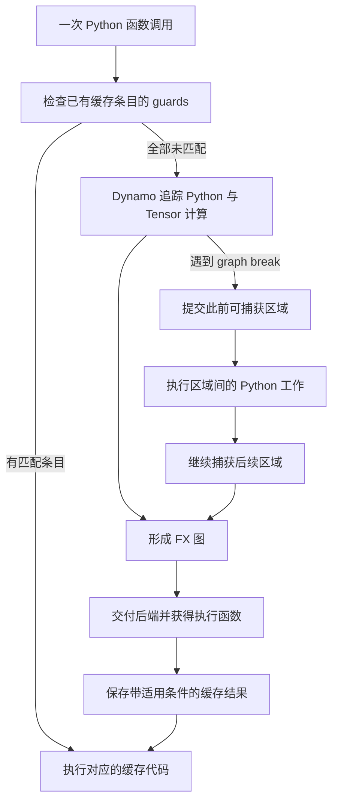

# torch.compile 怎样捕获计算，graph break 与重新编译各会增加什么开销？

同一个函数连续调用三次，输入都是 shape 为 (2,3) 的全 1 Tensor，只把 Python 参数 scale 从 2.0 改为 3.0，再改回 2.0。输出依次全为 3、4、3。本篇 CPU 实验观察到，交给后端处理的 FX 图累计为 1、2、2。第一次建立执行结果，第二次因常量条件变化生成另一份，第三次复用已有结果。[实际实验与完整 FX 图](evidence/runs/02-compile-lab.json)

理解 `torch.compile` 的收益，需要同时看计算如何被捕获、既有结果在什么条件下可以复用，以及运行中在哪里回到 Python。graph break 会把捕获区域分成多段，guard 检查则决定哪份缓存结果适用于本轮输入。两者分别影响优化范围、调用边界和重新编译成本。[PyTorch 编译排障文档](https://docs.pytorch.org/docs/2.15/user_guide/torch_compiler/torch.compiler_troubleshooting.html)

前置篇已经解释异步计时、融合和 CUDA Graph。本篇补充 Python 到 FX 图的捕获与复用条件，再说明这些机制如何影响前后端工作。[异步计时](../../10/2026-10-23-gpu-asynchronous-timing/README.md)、[算子融合](../../10/2026-10-23-kernel-fusion/README.md)、[CUDA Graph](../2026-11-12-cuda-graph-replay/README.md)

## 1. 从能手算的函数开始

`affine` 先乘 scale，再加 1，最后把负数截成 0。

```python
def affine(x, scale):
    return (x * scale + 1).relu()
```

取 x 为全 1 的 (2,3) Tensor，scale=2.0。每个元素按 1×2+1=3 计算，relu 后仍为 3。捕获时，这段计算可以表示为输入节点、乘法、加法、relu 和输出节点。FX 是 PyTorch 表示这类计算关系的机制，GraphModule 保存图及相应的可执行 forward。

本篇提供一个自定义后端，收到 GraphModule 时记录图，然后返回它的 forward。这样可以实际运行 `torch.compile`，并直接观察何时有新图交付到后端。记录对象保存生成的代码、算子目标、输入占位符和样例输入类型。[后端答案](code/counting_backend.py)、[官方自定义后端协议](https://docs.pytorch.org/docs/2.15/user_guide/torch_compiler/torch.compiler_custom_backends.html)

本机为 Mac mini、Python 3.12.16、PyTorch 2.15.0 CPU。实验使用上述计数后端，运行范围覆盖 Dynamo／FX 捕获、guards、缓存和改写后的数值语义。优化代码生成、Inductor 性能和 CUDA 性能仍待专项验证。图交付次数表示后端入口调用次数，后续 kernel 的生成与数量由具体后端决定。[环境、运行代码哈希与范围](evidence/runs/02-compile-lab.json)

## 2. 从一次捕获走到多次复用

### 2.1 Python、FX 图和后端各做什么？

TorchDynamo 在 Python 执行过程中分析字节码，追踪可捕获的 Tensor 计算并构建 FX 图。后端接收 GraphModule 与样例输入，返回语义等价的执行函数。默认后端 Inductor 可以进一步进行优化和代码生成，训练路径还可以通过 AOTAutograd 等机制处理前向与反向。自定义后端也可以像本篇一样返回 GraphModule.forward，帮助观察前端交付。[torch.compile API](https://docs.pytorch.org/docs/2.15/generated/torch.compile.html)、[自定义后端](https://docs.pytorch.org/docs/2.15/user_guide/torch_compiler/torch.compiler_custom_backends.html)

首次执行时，捕获依赖输入、Python 状态和执行路径作出假设。框架把适用条件保存为 guards。常见条件涉及 Tensor 的 dtype、device、shape、stride，以及 Python 常量和相关对象状态。后续调用先检查已有缓存条目的条件，有匹配结果就复用。所有可用条目都无法匹配时，才需要再次捕获及后端处理。[guards 与重新编译](https://docs.pytorch.org/docs/2.15/user_guide/torch_compiler/torch.compiler_troubleshooting.html#guards)

本例在 `dynamic=False` 下产生 scale==2.0 的条件。scale 改成 3.0 时，已有条目无法使用，创建第二份结果。再传入 2.0 时，第一份结果仍然可匹配。因此图累计数停在 2。[实际 guards 日志](evidence/runs/03-torch-logs.txt)



图中“有匹配条目”需要综合已有结果，单个条目失败后还可能匹配其他条目。graph break 路径把一次函数调用拆成多个可独立处理的区域。[图源](figures/compile-cache.mmd)

### 2.2 graph break 怎样把一个函数分成两段？

为了让边界清楚可见，基础实验使用内部调试 API 显式插入分界。

```python
def split_affine(x):
    y = x * 2
    torch._dynamo.graph_break()
    return y.relu() + 1
```

在 `fullgraph=False` 下，首次调用交付两张图，第一张计算乘法并返回 y，第二张接收 y，计算 relu 和加法。第二次调用使用相同元数据，累计仍为两张图。graph break 的位置保留在函数中，已经生成的两段结果可以继续复用。[实验 explicit_break](evidence/runs/02-compile-lab.json)、[原始工作负载](code/workloads.py)

`fullgraph=True` 要求本篇函数的捕获区域形成一个 FX 图，遇到显式分界会抛出 Unsupported。本例在图交付后端前被拒绝，计数为 0。它适合在开发时发现捕获边界，具体代码仍需要按输入和 backend 验证。[fullgraph API](https://docs.pytorch.org/docs/2.15/generated/torch.compile.html)、[测试与预期拒绝](code/test_answers.py)

### 2.3 为什么改 batch 也会重新编译？

静态捕获可能把 shape 的具体值作为条件。第一次 batch=2，第二次 batch=4，已有 shape 条件失败，需要另一份结果。动态形状则用符号和约束描述可变化的维度，让一份结果处理一组尺寸。

本篇对同一算术函数分别设置三种模式，按顺序传入 (2,3)、(4,3)、(5,3)，每行从独立缓存状态开始。

| dynamic 参数 | 三次调用后的累计图交付数 | 本例观察 |
| --- | --- | --- |
| False | 1、2、3 | 每个新 batch 使用一份专用结果 |
| None | 1、2、2 | 先静态捕获，尺寸变化后自动尝试泛化 |
| True | 1、1、1 | 从第一次就用动态形状覆盖这组输入 |

这组数字来自当前构建与算术函数。动态形状仍受算子、分支、约束和优化选择影响。对 batch 为 0、1、2、4 的补充实验，即使设置 True，累计图数也为 1、2、3、3。尺寸 0、1 涉及空 Tensor、广播和连续性等特殊关系，当前实现会进行专门处理。[完整结果](evidence/runs/02-compile-lab.json)、[动态形状配置](https://docs.pytorch.org/docs/2.15/generated/torch.compile.html)、[0／1 特化说明](https://docs.pytorch.org/docs/2.15/user_guide/torch_compiler/compile/dynamic_shapes_zero_one_specialization.html)

## 3. 用 Tensor 数据改写变化的参数与分支

### 3.1 scale 变化时，什么可以放进数据？

本篇算术函数允许把 scale 表示为同 dtype、同 device 的零维 Tensor。传入值为 2、3、2 的三个新零维 Tensor，形状和元数据相同，数值参与乘法，累计图数为 1、1、1。原始 Python float 版本在本例静态配置下为 1、2、2。[实际 scalar 对照](evidence/runs/02-compile-lab.json)、[常量转 Tensor 的官方示例](https://docs.pytorch.org/docs/2.15/user_guide/torch_compiler/compile/programming_model.recompilation.html#wrapping-constants-with-tensors)

参数接口变化也有代价。调用方需要维护 dtype、device、广播语义和 Tensor 的创建或更新。真实代码里的 Python 数字还可能控制循环次数、shape 或其他结构，改写时需要逐项检查用途。本篇只把算术中的 scale 改为零维 Tensor。[Tensor 算术答案](code/solutions.py)

### 3.2 输入数值决定 Python 分支时怎么办？

下面的判断依赖 Tensor 数据。Python 需要知道整体求和是否大于 0，才能选择执行哪个分支。

```python
def python_branch(x):
    y = x * 2
    if x.sum() > 0:
        return y + 1
    return y - 1
```

该函数在本篇 `fullgraph=True` 测试中因数据相关分支抛出 Unsupported。对于这组固定 shape、两侧都合法的算术，可以用零维布尔 Tensor 和 `torch.where` 表达选择。

```python
def tensor_branch(x, scale):
    y = x * scale
    return torch.where(x.sum() > 0, y + 1, y - 1)
```

条件是整体 x 的元素和大于 0，随后把同一个选择广播到整个输出。和为 0 时选择减 1。实验同时改变 batch、scale 的数据和求和符号，累计图数仍为 1、1、1，三次输出均与 eager 参考计算一致。[改写答案](code/solutions.py)、[tensor_selection 场景](evidence/runs/02-compile-lab.json)

构造 `torch.where` 的参数时，两侧算术表达式都会求值。复杂分支的计算成本和副作用需要重新分析，涉及非法操作或昂贵分支时可以继续核对 `torch.cond` 等控制流接口的支持范围。本篇使用两侧均为合法同 shape 算术的有限值输入。[官方数据相关操作说明](https://docs.pytorch.org/docs/2.15/user_guide/torch_compiler/torch.compiler_troubleshooting.html#data-dependent-operations)

## 4. 沿当前源码找出捕获、后端交付与缓存匹配

### 4.1 版本怎样固定？

2026-11-13 实际 fetch PyTorch 官方 main，固定为 `a0d96468b7f2089907f400411eda3b09feda8f76`。GitHub 最新正式 release 查询为 v2.15.0，其 tag 对应 `31a77fc9c0a7c6fff15a1ff58c743f53b1a9d457`。本机 2.15.0 包报告构建 SHA 为 `d0f2af8b66b20da4baa50644c0cd3f887a2eae2e`。运行结果按该实际包记录，源码结论分别标注 main 和稳定 tag。[版本 JSON](evidence/versions.json)、[更新输出](evidence/runs/00-upstream-fetch.txt)、[正式 release](https://github.com/pytorch/pytorch/releases/tag/v2.15.0)

### 4.2 谁把 fullgraph、dynamic 和 backend 交给 Dynamo？

公开入口位于 `torch/__init__.py` 的 compile。它处理 backend 包装，把 fullgraph 映射到 nopython 参数，并把 dynamic 等设置传给 `torch._dynamo.optimize`。这样能把前面实验里的三个参数连接到实际前端路径。[main compile 入口](https://github.com/pytorch/pytorch/blob/a0d96468b7f2089907f400411eda3b09feda8f76/torch/__init__.py#L3095)、[本地片段](evidence/upstream/main/torch-init.lines.txt)

`torch/_dynamo/eval_frame.py` 的 _optimize 根据 nopython 等配置选择严格捕获路径或允许分段的路径，并设置后端及转换回调。普通路径继续进入 convert_frame，追踪并构建执行结果。[main _optimize](https://github.com/pytorch/pytorch/blob/a0d96468b7f2089907f400411eda3b09feda8f76/torch/_dynamo/eval_frame.py#L1906)、[本地片段](evidence/upstream/main/eval-frame.lines.txt)

### 4.3 计数后端为什么能观察到这些事件？

`torch/_dynamo/output_graph.py` 的 OutputGraph 负责整理已捕获计算。compile_subgraph 处理子图边界，后续路径构建 FX GraphModule 并交付用户后端。_call_user_compiler 最终执行如下调用并检查返回值可调用。

```python
compiled_fn = compiler_fn(gm, example_inputs)
```

本篇把 CountingBackend 放在该协议入口，每次调用记录一次，因此能观察初始图、分段图和重新捕获结果的后端交付。框架的其他配置还可能影响前后端缓存，计数应结合 guard 日志和具体场景解释。[main 后端交付](https://github.com/pytorch/pytorch/blob/a0d96468b7f2089907f400411eda3b09feda8f76/torch/_dynamo/output_graph.py#L3499)、[本地片段](evidence/upstream/main/output-graph.lines.txt)

### 4.4 条件怎样与执行代码绑定，再被检查？

convert_frame 生成执行代码后构建 guards，用 GuardedCode 把代码与 guard manager 关联起来。C++ extra_state.cpp 的 lookup_in_list 遍历相应缓存条目，核对 backend 并运行 guard manager。匹配成功返回条目，全部失败则返回空结果，交给调用方继续处理。[main GuardedCode 构建](https://github.com/pytorch/pytorch/blob/a0d96468b7f2089907f400411eda3b09feda8f76/torch/_dynamo/convert_frame.py#L1994)、[main 缓存匹配](https://github.com/pytorch/pytorch/blob/a0d96468b7f2089907f400411eda3b09feda8f76/torch/csrc/dynamo/extra_state.cpp#L128)

这条路径解释了 scale 改回 2.0 后可以复用旧结果，也解释了同一函数可以保留多份带不同适用条件的执行代码。dtype、stride 等条件同样可能改变匹配结果，本篇测试分别核验了两者。[条件与缓存回归测试](code/test_answers.py)

### 4.5 稳定版与当天 main 有哪些已核对的差异？

| 核对范围 | 结果 |
| --- | --- |
| compile 参数到 Dynamo、用户后端交付、GuardedCode 和缓存检查 | 两个版本均能追踪到对应机制 |
| Python float 包装 | 当天 main 的 builder.py 移除了 unspecialize_float_killswitch 条件，其他特化分支仍存在 |
| 重编译和 0／1 特化文档源码 | 本次核对的两个文件在 tag 与 main 之间内容一致 |
| 其他 6 个实现文件 | 整体均有变化，源码清单记录 blob 哈希、行号和差异行数 |

因此本文将“实验累计图数”限定为本机实际构建、明确输入序列和编译参数。Python 数值是否自动泛化还涉及具体版本和配置，不能仅根据一次新版本提交推断所有调用的条件。该日 main 提交及相关浮点分支都已实际阅读并归档。[main 当日提交](https://github.com/pytorch/pytorch/commit/a0d96468b7f2089907f400411eda3b09feda8f76)、[浮点构建片段](evidence/upstream/main/float-builder.lines.txt)、[源码与版本笔记](evidence/source-notes.md)

## 5. 怎样估算与定位实际开销？

### 5.1 先把成本写清楚

假定 N 次调用串行进行，编译事件的耗时在测量边界内逐项相加，可以按本篇教学模型记为

\[
T=\sum_{e\in\mathcal E}C_e+\sum_{n=1}^{N}(G_n+R_n+B_n).
\]

其中，编译事件集合中的每个事件 e 有捕获和后端处理成本 C_e。第 n 次调用的 G_n 为条件与派发开销，R_n 为实际 Tensor 及必要 Python 工作，B_n 为区域衔接成本。各项采用一致的时间单位，按同一测量边界归属成本。

graph break 可能改变区域数量、边界成本和融合机会。guard 条件频繁失败则可能增加编译事件，抬高首项。真实优化还可能改变 R_n，最终需要测端到端时间。[graph break 与重编译机制](https://docs.pytorch.org/docs/2.15/user_guide/torch_compiler/torch.compiler_troubleshooting.html)

用一组假设数字复算，设 N=1000，每个编译事件 50 ms，所有区域的常规执行及条件检查合计为每次 0.42 ms。

| 教学假设 | 编译事件成本合计 | 稳态及衔接合计 | 总时间 |
| --- | --- | --- | --- |
| 一段图，生成一次 | 50 ms | 1000×0.42=420 ms | 470 ms |
| 一段图，三份特化结果 | 150 ms | 1000×0.42=420 ms | 570 ms |
| 两段图，各生成一次，另有每次 0.08 ms 衔接成本 | 100 ms | 1000×0.50=500 ms | 600 ms |

这些时间由教学假设计算。本篇计数后端用于验证事件和语义，运行中没有执行优化代码生成，也没有测得上述速度。不同真实后端与图大小对应的编译成本需要另行测量。

### 5.2 graph break 也可能用于缩小重新编译范围

若稳定的大区域后面接一小段经常变化的 Python 常量逻辑，将它们分开，有时能让稳定前半段复用，只有后半段重新处理。官方重编译文档给出了这种拆分示例。收益取决于减少的编译成本、增加的衔接成本和损失的优化机会。[官方拆分示例](https://docs.pytorch.org/docs/2.15/user_guide/torch_compiler/compile/programming_model.recompilation.html#graph-breaking-to-reduce-recompilation-costs)、[固定版本文档片段](evidence/upstream/main/recompilation-doc.lines.txt)

### 5.3 看到变慢时，怎样把证据连起来？

首先固定输出正确性与输入分布，再查看以下证据。

| 观察 | 要核对的内容 | 常用记录 |
| --- | --- | --- |
| 第一次调用较慢 | 捕获、后端处理及初始化 | 分阶段日志与首次 wall time |
| 输入变化后再次变慢 | 哪个 guard 失败，是否产生新结果 | recompiles、guards、dynamic |
| 单次函数包含多个编译区域 | 区域边界是否对应 graph break | graph_breaks、FX 图与调用位置 |
| 稳态仍慢 | 图外 Python、边界、真实算子和后端代码 | profiler、算子／kernel trace、端到端计时 |
| 图数量持续增加 | 输入类别、缓存条件、重编译限制 | 典型 shape／dtype／stride／参数分布 |

本篇实际使用的日志开关如下，原始日志与 JSON 结果均已归档。

```bash
TORCH_LOGS="graph_breaks,recompiles,guards,dynamic" PYTHONDONTWRITEBYTECODE=1 /Users/wangyuxiao/miniforge3/envs/ai-infra/bin/python code/run_lab.py --output /tmp/compile-lab-new.json
```

官方 API 文档说明缓存与 Python code object 相关，重新创建函数包装并不自动保证独立缓存。配置还包含重编译限制，到达限制后的行为需要结合当前模式判断。本篇实验进程在场景之间调用 torch.compiler.reset，每个场景内部保留缓存连续调用，复现时应保留这个边界。[官方 API 与限制](https://docs.pytorch.org/docs/2.15/generated/torch.compile.html)、[实际执行命令](evidence/runs/08-verification.json)、[原始 guard 日志](evidence/runs/03-torch-logs.txt)

## 6. 代码练习

### 练习一，写一个能记录 FX 图交付的后端

完成 CountingBackend.__call__(graph_module, example_inputs)。每次接收到 FX 图时新增一个 GraphRecord，记录完整生成代码、call_function／call_method／call_module 的目标、placeholder 名称和样例输入类型，最后返回与图语义等价的 callable。输入中可能出现 SymInt，记录时保留其类型信息。

验收时分别用 FX symbolic_trace 构建的小图和真实 torch.compile 调用检查返回值、算子记录、JSON 序列化与多次图交付。目标是观察后端协议，记录逻辑应放在后端入口。[起始代码](code/exercise_backend.py)、[验收测试](code/test_answers.py)

<details>
<summary>详解与完整答案</summary>

遍历 graph_module.graph.nodes，把计算节点和输入节点分别保存为字符串元组。GraphRecord 是冻结的数据类，记录值可以转换为 JSON。最后返回 graph_module.forward，保持图的实际运算语义。[完整答案](code/counting_backend.py)

该记录器会看到不同区域或特化结果的交付，因此必须结合实验配置解释累计次数。本篇 explicit_break 首次收到 2 张图，第二次仍为 2。本篇 Python scalar 在静态配置下得到 1、2、2，第三次检查到已有结果可用。

在本篇目录运行

```bash
PYTHONDONTWRITEBYTECODE=1 /Users/wangyuxiao/miniforge3/envs/ai-infra/bin/python -m unittest discover -s code -p test_answers.py -v
```

测试覆盖后端协议与 CPU 捕获行为，共 22 项。记录算子目标时只统计计算节点，placeholder 和 output 各有独立角色。输入类型需要接纳动态形状下的符号信息。[实际测试输出](evidence/runs/04-tests.txt)

</details>

### 练习二，保留数值语义并让变化进入 Tensor 数据

实现两个函数，输入 x 是非空或空的二维有限值 CPU float32／float64 Tensor，scale 是同 dtype、同 device 的零维 Tensor。

1. tensor_affine 返回 relu(x×scale+1)。
2. tensor_branch 在整体 x.sum()>0 时返回 x×scale+1，其余情况返回 x×scale−1。

要求捕获区域内保留 Tensor 算术与 Tensor 条件。在固定 metadata 下改变 scale 和输入数值，验证数值正确及缓存复用，再用 dynamic=True 对 batch=2、4、5 检查图交付。[起始代码](code/exercise_rewrites.py)、[验收测试](code/test_answers.py)

<details>
<summary>详解与完整答案</summary>

第一题让 scale 直接参与乘法，避免把其数据转成 Python 值。第二题先计算 y，再用整体求和产生零维布尔条件，通过 torch.where 选择 y+1 或 y−1。和为 0 时应走减 1，混合正负元素的测试检查了整体求和语义。[完整答案](code/solutions.py)

在本篇输入范围内，两侧算术都有定义。若业务分支包含不可执行的另一侧或昂贵操作，需要重新设计控制流，评估 torch.cond 等接口及后端支持。动态形状也应按 0／1 和其他实际尺寸覆盖。

运行完整实验时，给 --output 指定尚不存在的路径。脚本以独占创建方式保存 JSON，包含每次调用的输入 shape、输出、累计图数、完整 FX 图和预期异常。每个成功调用都与 eager 参考做数值对照。

```bash
PYTHONDONTWRITEBYTECODE=1 /Users/wangyuxiao/miniforge3/envs/ai-infra/bin/python code/run_lab.py --output /tmp/compile-lab-new.json
```

本机实际完成 11 个场景、27 次数值对照和 2 次预期 fullgraph 拒绝。CPU 结果支持捕获、条件匹配和改写语义，目标后端的优化效果仍需实测。[完整运行结果](evidence/runs/02-compile-lab.json)、[范围与命令](evidence/runs/08-verification.json)

</details>

## 7. 面试官继续追问

| 层次 | 追问 | 回答要点 |
| --- | --- | --- |
| 基础 | 第二次调用一定还要重新捕获吗？ | 检查已有结果的适用条件，有匹配条目就复用 |
| 图结构 | 两张 FX 图意味着两次后端交付可能从哪里来？ | 可来自分段，也可来自不同输入条件下的特化，结合时间顺序与日志 |
| 参数 | scale 改回旧值为何累计仍为 2？ | 旧条目还存在，其 guard 可再次匹配 |
| 形状 | dynamic=True 能否保证所有尺寸一张图？ | 算子、条件和 0／1 特化等仍可生成不同结果，按实际输入验证 |
| 分支 | where 改写要先检查什么？ | 条件广播、两侧形状、两侧表达式求值与合法性 |
| 工程 | 哪些 graph break 可以保留？ | 对低频路径或隔离变化区域评估编译成本与边界成本 |
| 实现 | 自定义后端何时收到 GraphModule？ | Dynamo 整理捕获图并调用用户后端，后端返回等价执行函数 |
| 排障 | 累计图数不增加但稳态仍慢，接着看什么？ | 图外 Python、算子、数据搬运、区域边界及实际生成代码与测量边界 |

## 8. 适用范围与延伸

本篇以小规模前向算术解释 Dynamo／FX、guards 和图分段。测试覆盖当前 CPU 计数后端，张量值、shape、dtype、stride 和参数接口的若干变化。训练反向、Inductor 代码生成、CUDA Graph 集成及真实服务吞吐需要相应后端和工作负载验证。编译和 CUDA Graph 可以出现在同一执行栈中，前者的计算捕获及优化与后者的 CUDA 提交复用分别有各自的条件。

下一篇候选为“CUDA caching allocator 怎样复用显存，为什么会出现碎片与 OOM？”，连接 Tensor storage、训练显存和图私有池，继续分析容量与分配失败。

正文引用、源码、图源、练习、输出与审查记录均在本篇目录。[参考资料](references.md)、[审查记录](review.md)、[Wiki 索引](../../../index.md)
