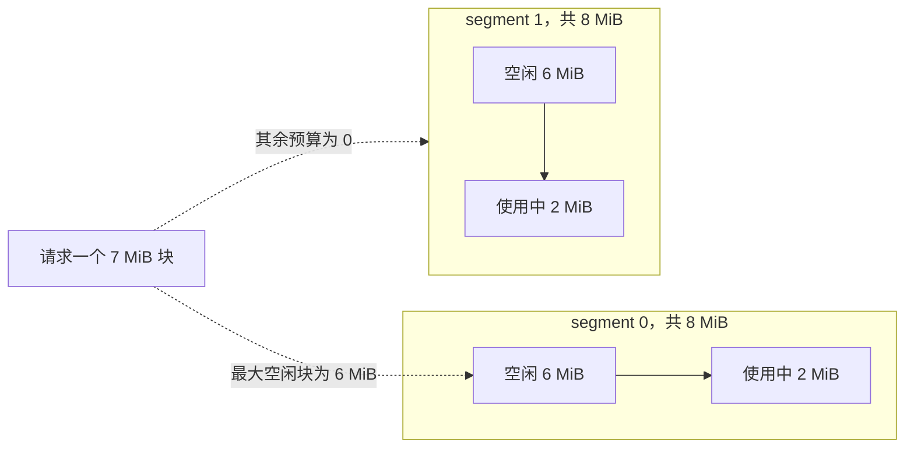

# CUDA caching allocator 怎样复用显存，为什么会出现碎片与 OOM？

设一个教学内存池的预算为 16 MiB，每次至少取得一个 8 MiB 的大段。依次申请 6、2、6、2 MiB，再释放两个 6 MiB 块，池里共有 12 MiB 空闲。此时申请 7 MiB 仍然失败。两个空闲块各为 6 MiB，它们身旁的 2 MiB 块仍在使用，池也没有预算再取得一个新段。[CPU 模型与实际输出](evidence/runs/05-model-lab.json)

这个例子对应变长 batch、临时工作区与长寿命缓冲区交错的容量问题。缓存分配器把已经取得的显存留下复用，减少反复向 CUDA 申请和归还的次数。容量是否够用，还受空闲块大小、相邻关系、stream 生命周期和所属内存池影响。[当前 native 实现证据](evidence/upstream/main/native-core.lines.txt)

本篇从这个布局推导统计口径与回收条件，再追踪 PyTorch 实现。练习在 CPU 上运行，使用单池、普通 segment、精确字节的教学模型。8 MiB 段大小属于教学参数，真实 CUDA 分配、事件等待、碎片发生概率与性能需要 GPU 验证。[环境与版本](evidence/versions.json)

前置阅读包括 Tensor 与 storage 的关系、训练显存的组成，以及 CUDA Graph 的地址生命周期。[Tensor 布局](../../10/2026-10-22-tensor-shape-stride-contiguity/README.md) · [训练显存核算](../2026-11-04-training-memory-accounting/README.md) · [CUDA Graph](../2026-11-12-cuda-graph-replay/README.md)

## 1. 先区分一整段显存与一次申请

一次普通 `cudaMalloc` 得到的内存范围，在这里称为 segment。分配器可把它切成多个 block，每个 block 记录一段子范围的大小与状态。申请 6 MiB 时，模型把一个 8 MiB segment 切成 6 MiB 已分配和 2 MiB 空闲。紧接着的 2 MiB 请求正好复用后半段，取得 segment 的次数仍为 1。[分裂路径](evidence/upstream/main/native-core.lines.txt) · [模型参考答案](code/allocator_model.py)

释放 6 MiB 后，它成为可复用 block。若旁边 2 MiB 也已释放，两个相邻空闲块可以合回 8 MiB。若旁边仍有活跃分配，合并便停在这个边界。不同普通 segment 的 block 也具有各自的地址范围，合并操作沿同一 segment 的邻接关系进行。[`free_block` 与 `try_merge_blocks`](https://github.com/pytorch/pytorch/blob/2a2d844941bf776d1a49a8ff8730e90f5242f836/c10/cuda/CUDACachingAllocator.cpp#L4032-L4096)

开篇释放后的状态如下。箭头表示各段内部的地址顺序，两个 2 MiB 块把各自的 segment 钉在池中。



图源与模型布局可以互相复核。[Mermaid 源文件](figures/allocator-layout.mmd) · [实际布局](evidence/runs/05-model-lab.json)

## 2. 空闲总数为什么仍不够？

两个 6 MiB 空闲块的总量为 12 MiB。当前可直接复用的最大单块只有 6 MiB，申请需要一个地址连续的 7 MiB 范围。真实 CUDA 内存的底层物理页映射另由驱动管理。模型选择满足请求的最小空闲块，称为 best-fit。此次查找失败后，它尝试取得新 segment，但预算已经全部被两个原有 segment 占用。

用 q 表示请求大小，用 F 表示池内空闲 block 的总字节数，用 L 表示其中最大一块。开篇满足 F=12 MiB、L=6 MiB、q=7 MiB，因此 F≥q，且 L<q。这里还固定了单池、无额外预算、没有可整段归还的 segment，这些条件共同导致模型 OOM。真实实现还会检查 stream、池、配置与回收路径。[查找与重试源码](https://github.com/pytorch/pytorch/blob/2a2d844941bf776d1a49a8ff8730e90f5242f836/c10/cuda/CUDACachingAllocator.cpp#L1883-L1950)

接着释放第一段中的 2 MiB 块，第一段便合回 8 MiB。7 MiB 请求可从中取得内存，剩余 1 MiB 空闲；第二段仍为 6 MiB 空闲与 2 MiB 使用中。最终已分配字节为 7+2=9 MiB，reserved 仍为 16 MiB，模型取得 segment 的累计次数仍为 2。[失败与恢复的断言记录](evidence/runs/05-model-lab.json)

再换一个条件，先申请两个 8 MiB 段，再把它们全部释放。此时申请 12 MiB，已有单块最大为 8 MiB，但两个 segment 都能整体归还。模型在容量压力下归还 16 MiB 缓存，再取得一个 12 MiB segment，请求成功。可整段回收的缓存能够为新布局腾出预算。PyTorch 的正常分配失败路径也包含缓存回收与重试，具体次序、池与捕获约束由版本决定。[整段回收实验](evidence/runs/05-model-lab.json) · [native 重试分支](evidence/upstream/main/native-core.lines.txt)

## 3. 怎样把统计数字还原成状态？

先看模型的三种 block 状态。`active_allocated` 表示仍被一次分配持有，`active_awaiting_free` 表示所有者已经请求释放，但其他使用尚未完成，`inactive` 表示已经可进入空闲复用集合。PyTorch snapshot 使用相同的三个状态名称。[官方 snapshot 结构](https://docs.pytorch.org/docs/2.15/torch_cuda_memory.html#snapshot-api-reference)

对同一时刻、同一范围内的 segment，用 R 表示总保留字节，用 A、W、F 分别表示上述三种状态的块大小之和。逐块分类后有以下恒等式。

\[
R=A+W+F,\qquad R-A=W+F.
\]

这个推导使用 allocator block 的大小。Tensor 的逻辑元素字节数还会受到共享 storage、分配舍入和生命周期的影响，核算时需要统一对象。`requested_bytes` 与 `allocated_bytes` 的差异可以帮助观察分配舍入成本。[统计定义与 snapshot 字段](evidence/upstream/main/memory-api.lines.txt)

同样的 R−A=8 MiB，可以来自三个不同布局。

| 教学布局 | R | A | W | F | 当前可整段归还 |
| --- | --- | --- | --- | --- | --- |
| 一个完全空闲的 8 MiB 段 | 8 MiB | 0 | 0 | 8 MiB | 8 MiB |
| 一个等待完成的 8 MiB 块 | 8 MiB | 0 | 8 MiB | 0 | 0 |
| 一个 16 MiB 段，8 MiB 使用中、8 MiB 空闲 | 16 MiB | 8 MiB | 0 | 8 MiB | 0 |

三个布局均由练习程序生成并断言。第三行的空闲块仍可服务适当的新请求，只是当前无法把所在普通 segment 整体归还。第一行通常体现缓存复用机会，第二行需要先满足使用完成条件。[同差值的三种状态](evidence/runs/05-model-lab.json)

在 native 统计中，`allocated_bytes.all.current` 观察当前已分配块，`active_bytes.all.current` 还涉及等待安全释放的活跃块，`inactive_split_bytes.all.current` 关注不能整块归还的空闲分裂块。最后一项的实现明确排除了 expandable segments，所以它的数值必须结合 backend 与 segment 类型解释。[计数更新与适用范围](https://github.com/pytorch/pytorch/blob/2a2d844941bf776d1a49a8ff8730e90f5242f836/c10/cuda/CUDACachingAllocator.cpp#L4032-L4085)

`nvidia-smi` 的设备占用还涉及 CUDA 上下文、其他进程和分配器之外的内存。NCCL 等外部分配未必进入 PyTorch 的 allocator snapshot。比较时应对齐设备、进程与采样时间，保留外部分配这一证据缺口。[官方内存可视化说明](https://docs.pytorch.org/docs/2.15/torch_cuda_memory.html#identifying-non-pytorch-allocations)

## 4. 沿源码追踪申请、释放与回收

本次实际 fetch 的官方默认分支为 `main`，固定 commit 为 `2a2d844941bf776d1a49a8ff8730e90f5242f836`。最新稳定 release 为 `v2.15.0`，tag 对应 `31a77fc9c0a7c6fff15a1ff58c743f53b1a9d457`。本机 Python 包为 PyTorch 2.15.0，构建 SHA 为 `d0f2af8b66b20da4baa50644c0cd3f887a2eae2e`，三者分别记录。下面追踪 `main` 的 native 普通默认池，稳定版对照另列。[版本与获取记录](evidence/versions.json) · [源码清单与许可证](evidence/upstream/manifest.json)

### 4.1 一次申请怎样找到已有空闲块？

`NativeCachingAllocator::allocate` 取得设备和当前 stream，调用其 `malloc`，再进入该设备的 `DeviceCachingAllocator::malloc`。后者先执行 `round_size`，选择池并计算新段大小，再调用 `get_free_block`。查找失败后还会运行释放回调、尝试取得新段，以及按条件回收缓存重试。[入口与设备分配器](https://github.com/pytorch/pytorch/blob/2a2d844941bf776d1a49a8ff8730e90f5242f836/c10/cuda/CUDACachingAllocator.cpp#L5521-L5546) · [本地调用路径证据](evidence/upstream/main/native-core.lines.txt)

`get_free_block` 在有序集合中使用 `lower_bound` 查找，并检查候选块的 stream，还会考虑 expandable 状态和大块复用限制。因此，对整个进程统计出的最大空闲块，还需要满足当前请求的池与 stream 条件。[查找函数](https://github.com/pytorch/pytorch/blob/2a2d844941bf776d1a49a8ff8730e90f5242f836/c10/cuda/CUDACachingAllocator.cpp#L4215-L4272)

找到块后，`should_split` 决定是否分裂，分配路径更新相邻指针并把剩余块放回空闲集合。普通大块的分裂条件会考虑请求大小与 `max_split_size`，并要求剩余空间大于 `kSmallSize`。小池和 expandable 路径使用另一组条件。模型采取“只要还有正字节余量就分裂”的简化。[分裂与余量条件](evidence/upstream/main/native-core.lines.txt)

### 4.2 真实默认段大小为什么会放大一次小请求？

默认配置中，`kMinBlockSize` 为 512 字节，普通请求会按相应策略舍入。下面用 q 表示舍入后的请求，并固定默认段配置、native backend、普通段与缓存未命中。

| q 的范围 | `get_allocation_size` 给出的新段大小 |
| --- | --- |
| q≤1 MiB | 2 MiB |
| 1 MiB<q<10 MiB | 默认 20 MiB |
| q≥10 MiB | 向上取 2 MiB 的整倍数 |

按这个分支推导，一次新的 6 MiB 请求会进入默认 20 MiB 段的路径。开篇模型的 8 MiB 段用于手算，模型输出的布局限定在练习参数内。`large_segment_size_mb` 等配置也会改变上述默认关系。[常量与默认值](evidence/upstream/main/allocator-config.lines.txt) · [`round_size`、池选择与段大小](evidence/upstream/main/native-core.lines.txt)

稳定版与当天 main 的 `should_split`、`get_allocation_size` 两个函数文本完全相同，已计算匹配哈希。main 的 `free_locked` 入口另有捕获追踪动作，稳定版相应函数直接从清除 allocated 标记开始。这个对照覆盖指定函数与路径，文章中的 CUDA Graph 池行为仍受相应版本的捕获逻辑约束。[函数对照记录](evidence/source-comparison.json) · [稳定版源码片段](evidence/upstream/v2.15.0/native-core.lines.txt)

### 4.3 释放请求何时变成可复用块？

`free_locked` 先清除 allocated 标记并减少 allocated 统计。普通非捕获场景中，如果记录了其他 stream 的使用，会插入 CUDA event，等待这些使用结束。事件处理完成后才进入 `free_block`，减少 active 统计并尝试邻块合并。这解释了已分配字节下降后，active 字节仍可能维持高位的状态。[释放与事件处理](evidence/upstream/main/native-core.lines.txt)

同一分配 stream 的使用通常依靠 stream 顺序，`recordStream` 对这种情况直接返回。跨 stream 的数据依赖和内存生命周期需要分别建立正确关系，调用 `record_stream` 负责让分配器追踪后续使用，读写顺序还要通过恰当的 stream 依赖保证。[stream 语义与示例](https://docs.pytorch.org/docs/2.15/notes/cuda.html#cuda-streams)

模型用 `free(handle, deferred=True)` 表示等待中的释放，再用 `complete_deferred()` 显式完成。模型自身会执行状态转移和合并，CUDA event 的创建、查询与等待留给源码分析和 GPU 环境验证。[延迟释放实验](evidence/runs/05-model-lab.json)

### 4.4 `empty_cache()` 怎样走到系统回收？

Python `torch.cuda.empty_cache()` 经 `_cuda_emptyCache` 绑定进入 C++ 分配器。native 的设备 `emptyCache` 调用 `release_cached_blocks`。在没有捕获的默认池路径，它会先 `synchronize_and_free_events`，再回收缓存，可能承担等待事件的成本。普通 segment 只有满足整段释放条件才走 `release_block`，活跃分配仍持有其内存。[Python API](evidence/upstream/main/memory-api.lines.txt) · [Python／C++ 绑定](evidence/upstream/main/python-binding.lines.txt) · [回收与同步源码](evidence/upstream/main/native-core.lines.txt)

练习的 `release_free_segments()` 只归还已经完全 inactive 的段，调用者通过单独的方法完成延迟状态。它的返回值用于观察当前布局可以直接归还多少字节，真实 `empty_cache()` 的事件等待由上述路径说明。[模型方法与接口](code/allocator_model.py)

## 5. 工程上怎样选择与验证？

先看每个训练步骤或请求结束后的稳定区间，再看 OOM 前的峰值。采样应覆盖同一输入序列、设备与 backend，至少记录 allocated、active、reserved、inactive split、分配重试，以及必要的 snapshot。峰值容量与稳态吞吐需要分别验收。[统计字段](evidence/upstream/main/memory-api.lines.txt)

| 已核验的现象 | 优先检查或调整 | 条件与代价 |
| --- | --- | --- |
| 活跃块接近可用容量 | 检查仍被持有的 Tensor、激活、工作区，评估 batch、重算或分片 | 改变工作负载容量需求，可能增加重算或通信 |
| 普通段中有大量 inactive split，并伴随失败请求 | 对照分配顺序、寿命和请求大小，评估形状分桶与缓冲复用 | 更稳定的大小有助于复用，padding 与常驻缓冲也消耗资源 |
| 多个完全空闲的普通段占用缓存 | 在阶段边界评估归还缓存给其他使用者 | 后续重新分配可能增加系统调用与等待成本 |
| allocated 下降后 active 仍高 | 检查其他 stream 的使用、完成事件与采样时刻 | 建立正确依赖，按吞吐和容量权衡等待位置 |

`max_split_size_mb` 会限制 native 大块的切分。当 OOM 与大量 inactive split 已有对应证据时，可把它作为针对性的实验变量，比较重试、峰值和吞吐。少切分可能保留大块，也可能降低小请求的利用率或增加新段需求。官方将其列为特定 OOM 场景的后置调节手段。[配置与适用条件](https://docs.pytorch.org/docs/2.15/notes/cuda.html#optimizing-memory-usage-with-pytorch-alloc-conf)

`expandable_segments` 使用分离的虚拟地址预留与物理内存映射，让段按需求扩展，有助于某些尺寸变化场景复用容量。空物理页可以按映射机制回收，映射与解除映射也有成本。活跃块两侧的空闲范围仍受地址布局约束，扩展段内的这种空洞仍需要具体分析。虚拟地址预留量与已映射设备内存应分别解释。[实现设计注释](evidence/upstream/main/native-core.lines.txt) · [官方工程分析](https://docs.pytorch.org/devlogs/eager/2026-06-01-cuda-caching-allocator/)

当前官方文档把 `native` 列为默认 backend，`cudaMallocAsync` 使用 CUDA 的异步分配器，并要求 CUDA 11.4 或更新版本。切换 backend 会改变适用的配置和统计口径，部分统计在异步 backend 下恒为零。本篇普通段的模型与 inactive split 推导限定于所述范围。配置变量的当前名称为 `PYTORCH_ALLOC_CONF`，旧名称 `PYTORCH_CUDA_ALLOC_CONF` 作为兼容别名保留。[官方 backend 说明](https://docs.pytorch.org/docs/2.15/notes/cuda.html#optimizing-memory-usage-with-pytorch-alloc-conf) · [统计限制](evidence/upstream/main/memory-api.lines.txt)

缓存的收益可以先用操作数量理解。本篇模型循环申请并释放 4 MiB，共运行 200 次，只取得 1 次 8 MiB segment，结束时归还 1 次。逐次向系统申请和释放的教学参照需要各 200 次。实际时间还取决于命中查找、系统分配、同步和工作负载，次数变化需要配合 GPU 测量才能转化为吞吐或延迟结论。[实际循环与计数](evidence/runs/05-model-lab.json)

## 6. 代码练习

练习的单位统一为字节，1 MiB=1,048,576 字节。`Block`、`Segment` 与 `Totals` 使用本篇的不可变数据类型，输入状态名称沿用 native snapshot。调用者提供这些类型的合法值，segment 的 block 元组按地址顺序排列。该接口处理本篇的单池教学快照。[共享类型](code/model_types.py)

### 练习一，分清空闲、等待与可归还容量

完成 `exercise_stats.summarize(segments)`。输入为一组 `Segment`，输出为 `Totals`，分别包含 reserved、allocated、awaiting、inactive、可整段归还、受活跃块约束的空闲、最大单个空闲块和段数。空输入各项为零，段内各块大小为正整数。[起始代码](code/exercise_stats.py)

验收输入包括一个 8 MiB 段，按顺序包含 4 MiB 使用中、2 MiB 等待完成、2 MiB 空闲，再加一个完全空闲的 8 MiB 段。应得到 R=16 MiB、A=4 MiB、W=2 MiB、F=10 MiB、可整段归还 8 MiB、受活跃块约束的空闲 2 MiB，以及最大空闲块 8 MiB。

<details>
<summary>推导与完整参考答案</summary>

先把每段的 block 按三个状态分别求和，再把每段结果相加。判断一段所有 block 都为 inactive 时，把该段的空闲量计入 `releasable_bytes`，其余段的空闲量计入 `trapped_bytes`。最大空闲块从单个 inactive block 的大小中取最大值。

上述输入的空闲部分为 2+8=10 MiB，只有第二段能直接整体归还。检查 R=A+W+F 和 F=releasable+trapped 可以捕获漏计、重复计数和把 awaiting 当作空闲的错误。`trapped_bytes` 是本模型字段，真实 `inactive_split_bytes` 还受实现、segment 类型与 backend 影响。[完整答案](code/snapshot_stats.py)

</details>

### 练习二，实现复用、合并与失败恢复

完成 `exercise_allocator.Allocator` 的接口。构造参数为总预算 `capacity` 和新段最小大小 `segment_size`，均为正整数字节。`malloc(size)` 返回唯一的整数 handle，选择满足大小的最小 inactive block，相同大小时按段 ID 和位置确定选择。未命中时，新段大小为 `max(segment_size, size)`。[起始代码与方法签名](code/exercise_allocator.py)

`free(handle)` 释放所有者并合并同段相邻 inactive 块，`deferred=True` 则先进入等待状态。`complete_deferred()` 完成全部等待状态并返回其总字节数。`release_free_segments()` 只归还当前完全空闲的段，返回归还字节数。`snapshot()` 返回与后续修改隔离的不可变值。

预算不足时，计一次 `allocation_retries`，归还全部完全空闲的段后再判断预算。仍失败则计一次 `ooms` 并抛出 `MemoryError`，存活 handle 继续有效。失败期间已经归还的空闲段会从池中移除。无效大小抛出 `ValueError`，未知、重复或已经等待释放的 handle 抛出 `KeyError`。依次运行开篇的 6、2、6、2 MiB 布局和整段回收的 12 MiB 请求，解释两种结果。

<details>
<summary>实现步骤与完整参考答案</summary>

把池表示为“段 ID → 地址顺序的 block 列表”。申请时遍历 inactive 候选，按大小、段 ID、位置取最小值。命中后把一个 block 替换为已分配部分及可选空闲余量。释放后顺序扫描同一段，只在两个相邻 block 都为 inactive 时相加。等待状态保留其边界，显式完成后再参与合并。[完整答案](code/allocator_model.py)

容量判断先计算当前 reserved，再加新段大小。超预算时先归还整段缓存，再用更新后的 reserved 判断。开篇两个 6 MiB 洞都受 2 MiB 活跃块约束，归还量为零，所以 7 MiB 请求失败。另一组两个完全空闲的 8 MiB 段可归还 16 MiB，随后 12 MiB 新段可以取得预算。

本模型以遍历方式寻找候选，块数为 B 时查找为 O(B)，它便于检查每个状态。真实 native 的有序空闲集合、stream 匹配、池隔离、锁与回调属于源码中的工程实现。测试还覆盖双向邻块合并、快照隔离、重复释放、失败后继续运行和 500 步固定随机轨迹的字节守恒。[验收测试](code/test_answers.py)

</details>

在本篇目录运行参考答案和实验。以下命令使用本机现有 Python，普通 CPU 即可完成。

```bash
PYTHONDONTWRITEBYTECODE=1 /Users/wangyuxiao/miniforge3/envs/ai-infra/bin/python -m unittest discover -s code -p test_answers.py -v
PYTHONDONTWRITEBYTECODE=1 /Users/wangyuxiao/miniforge3/envs/ai-infra/bin/python code/run_lab.py
```

测试默认导入参考答案。练习完成后，将 `test_answers.py` 中对应的导入改为 `from exercise_stats import summarize` 或 `from exercise_allocator import Allocator`，再运行同一测试命令。当前参考答案通过 24 项测试，包含 `python -O` 下状态转移仍会执行的回归。[实际测试输出](evidence/runs/02-tests.txt) · [命令、退出码与代码哈希](evidence/runs/06-verification.json)

## 7. 面试官继续追问

| 层次 | 追问 | 参考回答要点 |
| --- | --- | --- |
| 基础解释 | 删除 Tensor 后 reserved 为什么可能维持高位？ | 检查 storage 的其他持有者，区分所有者释放、stream 使用完成与 allocator 缓存的生命周期 |
| 基础解释 | 池里空闲总数大于请求，为什么还能失败？ | 核对最大适配块、相邻关系、所属池、stream 和取得新段的预算 |
| 实现分析 | 为什么 free 之后先减少 allocated，稍后才减少 active？ | 其他 stream 使用尚未完成时，块会等待 event，完成后再进入空闲和合并路径 |
| 实现分析 | `empty_cache()` 会做哪些工作？ | 追踪 Python 绑定、native 回收、事件同步和普通整段释放，说明 graph pool 与 expandable 路径的边界 |
| 方案选择 | 何时评估 `max_split_size_mb`？ | 已观察到与失败对应的大量 inactive split，再比较利用率、新分配、重试、吞吐与峰值 |
| 方案选择 | expandable segments 能改善什么？ | 解释扩展映射如何缓解某些尺寸变化与分段布局问题，同时检查活跃块分隔空闲范围和映射成本 |
| 排障验证 | `nvidia-smi` 高而 snapshot 较小，怎样继续？ | 统一设备、进程和采样时刻，检查上下文、其他进程与 NCCL 等外部分配 |
| 排障验证 | 怎么证明调节后更好？ | 使用同一输入序列与正确性条件，比较峰值、重试、稳态吞吐和尾延迟，归档具体 backend、版本和布局 |

## 8. 适用范围与延伸

本篇执行了 CPU 模型、字节统计、普通模式与优化模式回归。模型处理单个普通池，按精确字节申请，每个正余量都可切分。真实分配器的舍入、小／大池、stream 复用域、graph-private 池、虚拟地址映射、外部占用与并发锁由源码和文档解释。CUDA 分配、CUDA event 与 GPU 容量和性能实验仍待对应环境验证。

下一篇候选为 Tensor Parallel 怎样切分线性层，AllReduce 与 AllGather 分别出现在何处，前置为矩阵乘法、梯度通信与 collective 数据流。

资料归档与论文范围见 [参考资料与证据](references.md)，实验修正与验证见 [审查记录](review.md)。返回 [Wiki 索引](../../../index.md)。
