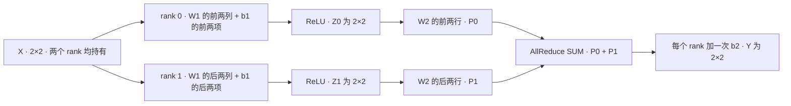
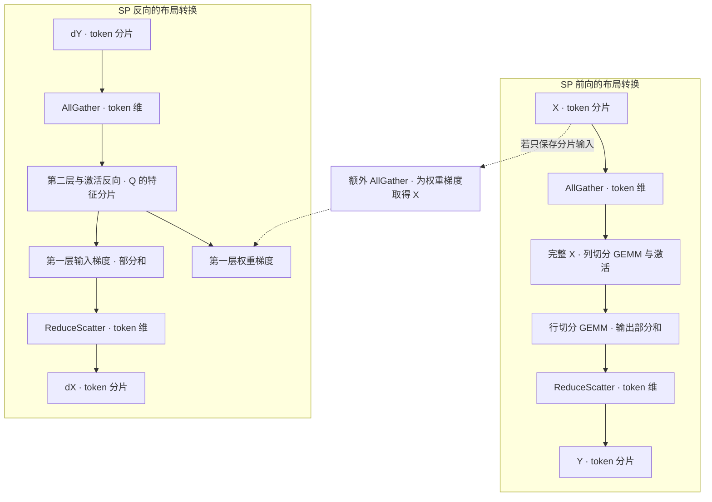

# Tensor Parallel 怎样切分线性层，AllReduce 与 AllGather 分别出现在何处？

两个 rank 处理同一批输入，把第一层的输出特征分开计算，再让第二层接着使用这些分片，可以将两个大权重矩阵分摊到设备上。第一层的中间激活能够保持分片，第二层产生的部分和通过归约合成完整输出。反向传播还需要合成输入梯度。

本篇从一个 `2×2 → 2×4 → 2×2` 的两层 MLP 开始，推导列切分、行切分和通信位置，再对照 PyTorch 与 Megatron 的固定源码。基础练习在单进程 CPU 中验证代数和梯度，另外用两个真实 CPU／Gloo 进程检查 PyTorch TP 的通信。GPU 性能与 NCCL 内部算法需要相应设备验证。

## 1. 两张卡怎样共同计算同一个线性层？

### 1.1 先明确模型、输入和目标

设 `X` 有 `N` 行，每行是一条 token 的隐藏向量，隐藏宽度为 `H`。本文把 batch 与 sequence 展平成 token 行。两层 MLP 先扩展到 `F` 个中间特征，再投影回 `H`。

\[
A=XW_1+b_1,\qquad Z=\operatorname{ReLU}(A),\qquad Y=ZW_2+b_2.
\]

其中 `X∈ℝ^{N×H}`、`W₁∈ℝ^{H×F}`、`W₂∈ℝ^{F×H}`。bias 沿 token 行广播。ReLU 对每个元素取 `max(a,0)`，因此每个输出元素只依赖对应输入元素。本篇用它简化手算，原始 Megatron MLP 论文使用 GeLU，后者同样能逐特征应用。

Tensor Parallel（TP）让同一层的权重和计算分布在一个进程组中。这个组内的 rank 是进程编号。下文用两个 rank 表示两份计算和存储。在 GPU 训练中常由每个 rank 管理一张 GPU，本篇实测使用本机 CPU。

TP 组共同处理同一批 token。数据并行组中的模型副本则处理各自的数据，再同步相应参数梯度。TP 的归约要合并同一个计算的不同贡献，数据并行的梯度同步要遵守样本权重与 loss 分母约定。[DDP 的梯度与有效分母](../2026-11-03-ddp-gradient-overlap/README.md)

### 1.2 一个列切分能留下哪些数据？

沿 `W₁` 的列，也就是中间输出特征维切成两块。

\[
W_1=[W_{1,0}\ W_{1,1}],\qquad b_1=[b_{1,0}\ b_{1,1}].
\]

两个 rank 都有完整 `X`，分别计算

\[
A_i=XW_{1,i}+b_{1,i},\qquad Z_i=\operatorname{ReLU}(A_i).
\]

每个 `Zᵢ` 的形状是 `N×F/2`，二者对应不同输出特征。完整激活为 `Z=[Z₀ Z₁]`。逐元素激活能在各自分片内完成，后续如果能直接接受这些特征分片，就可以让 `Z` 保持这个布局。

完整输出特征需要合成时，AllGather 会沿特征维收集并拼接 `Z₀`、`Z₁`，使每个 rank 获得 `N×F` 的张量。是否调用它，由消费方需要的布局决定。

## 2. 为什么第二层适合接行切分？

第二层的输入正好按 `F` 维分片。沿 `W₂` 的行分成与它们对应的两块。

\[
W_2=\begin{bmatrix}W_{2,0}\\W_{2,1}\end{bmatrix},\qquad
ZW_2=Z_0W_{2,0}+Z_1W_{2,1}.
\]

每个 rank 本地得到 `Pᵢ=ZᵢW₂,ᵢ`，形状都是 `N×H`。这些元素代表同一输出坐标的不同部分贡献。对 `P₀`、`P₁` 做求和 AllReduce，就能让两个 rank 都得到完整的矩阵乘法结果，再加 `b₂`。

\[
Y=\operatorname{AllReduce}_{\rm sum}(P_i)+b_2.
\]

这里有两类不同的分布关系。

| 本地结果 | 每份数据表达什么？ | 合成完整值的方式 |
| --- | --- | --- |
| 列切分得到的 `Zᵢ` | 不同输出特征 | 沿特征维拼接，可用 AllGather |
| 行切分得到的 `Pᵢ` | 同一坐标的部分贡献 | 对应元素求和，可用 AllReduce |

### 2.1 用具体数字计算完整路径

取 `N=2、H=2、F=4`，下列均为自编合成数据。

\[
X=\begin{bmatrix}1&-2\\-1&1\end{bmatrix},\quad
W_1=\begin{bmatrix}1&-1&2&0\\0&2&-1&1\end{bmatrix},\quad
b_1=[2,0,1,3].
\]

\[
W_2=\begin{bmatrix}1&0\\0&1\\1&-1\\2&1\end{bmatrix},\qquad b_2=[1,-1].
\]

完整第一层的激活前值和激活为

\[
A=\begin{bmatrix}3&-5&5&1\\1&3&-2&4\end{bmatrix},\qquad
Z=\begin{bmatrix}3&0&5&1\\1&3&0&4\end{bmatrix}.
\]

rank 0 持有 `Z₀` 的前两个特征，rank 1 持有后两个特征，各自乘以第二层对应的权重行。

\[
P_0=\begin{bmatrix}3&0\\1&3\end{bmatrix},\qquad
P_1=\begin{bmatrix}7&-4\\8&4\end{bmatrix}.
\]

AllReduce 合成 `[[10,-4],[9,7]]`，加一次 `b₂` 得到

\[
Y=\begin{bmatrix}11&-5\\10&6\end{bmatrix}.
\]

例如第一行中，rank 0 的激活为 `[3,0]`，第二层贡献为 `[3,0]`。rank 1 的激活为 `[5,1]`，第二层贡献为 `5×[1,-1]+1×[2,1]=[7,-4]`。两份贡献合成后再加 `[1,-1]`，得到 `[11,-5]`。



### 2.2 bias 和非线性放错位置会怎样？

第二层若先给每个 `Pᵢ` 加完整 `b₂` 再归约，将得到 `ΣPᵢ+2b₂`。本例会变成 `[[12,-6],[11,5]]`。教学答案把第二层 bias 放在求和之后，测试还单独检查它只生效一次。具体后端可以融合或重新表示这一计算，但必须保持相同的数学语义。

第一层如果沿输入维产生两个部分贡献 `u` 和 `v`，需要先合成完整激活前值，再应用非线性。例如 `u=1、v=-2`，`ReLU(u+v)=0`，而分别激活后求和得到 `1`。列切分让每个 rank 得到完整的部分输出特征，因此可以直接对这些特征应用非线性。这个性质解释了两层的配对方式。[Megatron-LM 原始论文，§3 与公式（1）—（3）](https://arxiv.org/html/1909.08053v4#S3)

## 3. 反向传播在哪个位置需要通信？

设下游传回完整输出梯度 `D=∂L/∂Y`。先看第二层，各 rank 分别计算

\[
\frac{\partial L}{\partial W_{2,i}}=Z_i^TD,\qquad
\frac{\partial L}{\partial Z_i}=DW_{2,i}^T.
\]

这些结果对应本地权重和本地特征。经过本地 ReLU 导数后得到 `Qᵢ=∂L/∂Aᵢ`，第一层的梯度为

\[
\frac{\partial L}{\partial W_{1,i}}=X^TQ_i,\qquad
\left(\frac{\partial L}{\partial X}\right)_i=Q_iW_{1,i}^T.
\]

所有输出特征都会影响同一个 `X`，因此完整输入梯度需要合并这些贡献。

\[
\frac{\partial L}{\partial X}=\sum_i Q_iW_{1,i}^T.
\]

在需要继续向更早层传播输入梯度的普通配对方案中，一次 MLP 前向在行切分输出做一次 AllReduce，反向在列切分输入梯度做一次 AllReduce。组内有相同输出副本的 rank 会获得相同的下游梯度，框架的 autograd 通信实现要保持这份逻辑张量的副本语义。

### 3.1 本例的梯度能对齐吗？

取目标值 `T=[[1,-1],[2,1]]`，损失为四个元素上的均方误差。

\[
L=\frac14\|Y-T\|_F^2=51.25,\qquad
D=\frac12(Y-T)=\begin{bmatrix}5&-2\\4&2.5\end{bmatrix}.
\]

两个 rank 分别算出的输入梯度贡献为

\[
G_{X,0}=\begin{bmatrix}5&0\\1.5&5\end{bmatrix},\qquad
G_{X,1}=\begin{bmatrix}14&1\\0&10.5\end{bmatrix}.
\]

求和后为 `[[19,1],[1.5,15.5]]`。本篇验证了完整模型和分片模型的输出、全部参数梯度及输入梯度，还用中心有限差分检查了 `26` 个变量的导数。[代数与梯度的实际输出](evidence/runs/08-answers.json)、[测试结果](evidence/runs/04-tests.txt)

TP 这里对不同计算贡献求和。计算 loss 时，应沿原有逻辑样本和输出元素定义分母。两个 rank 具有同一输出的副本，并不增加这一步的逻辑样本数。参数分片的梯度随后还可能在数据并行组中同步，通信组和分母需要与训练配置对应。

## 4. AllGather 会在哪些场景出现？

一个本地张量的 shape 还不足以说明它是否已经完整。把布局写出来，更容易判断需要的通信。

| 布局变化 | 目标 | 常见动作 |
| --- | --- | --- |
| `Shard(feature) → Replicate` | 每个 rank 都需要所有输出特征 | 沿特征维 AllGather |
| `Partial(sum) → Replicate` | 每个 rank 都需要各部分贡献的总和 | AllReduce SUM |
| `Partial(sum) → Shard(token)` | 归约后每个 rank 只保留部分 token | 沿 token 维 ReduceScatter |
| `Shard(token) → Replicate` | 列切分线性层需要完整 token 输入 | 沿 token 维 AllGather |
| `Replicate → Shard` | 每个 rank 取自己负责的完整值切片 | 通常可本地切片 |

`Replicate` 表示组内副本，`Shard` 表示按某一维分布的不同切片。`Partial(sum)` 表示各 rank 保留待相加的贡献，例如第二层的 `Pᵢ`。当前 PyTorch 的布局重分布实现将这些关系映射到相应 collective 或本地操作。[布局重分布源码](https://github.com/pytorch/pytorch/blob/479e2b59bebcc8f65283548837332b1ad42f99c3/torch/distributed/tensor/_redistribute.py#L180-L204)

### 4.1 消费方要求完整中间特征

如果把第一层输出指定为 `Replicate`，后端会把中间特征 AllGather。再进入要求特征分片的第二层时，可能又要本地切片。对本篇逐元素激活和配对第二层来说，中间分片本来已经足够使用。

PyTorch 的接口允许指定这种输出布局。本篇实际比较了默认配对布局与显式收集完整中间激活的布局，二者计算相同函数，通信计数和本地激活形状有差异。

### 4.2 Sequence Parallel 在 token 维转换布局

LayerNorm 等操作可以对各 token 分别处理。Sequence Parallel（SP）让这些区域的激活沿 token／sequence 维分片。在进入列切分线性层时，先沿 token 维 AllGather，恢复完整 `X`。第二层产生部分和后，可以通过 ReduceScatter 合成数值并让输出继续沿 token 维分片。

如果只统计这对输入输出布局转换及其反向操作，一次 MLP 的完整前后向有 `2` 次 AllGather 和 `2` 次 ReduceScatter。2022 年原始论文在 §4.2.2、图 5—6 中推导了这种转换。[Sequence Parallel 原始论文](https://arxiv.org/html/2205.05198v1#S4.SS2.SSS2)

训练还要决定保存哪些激活。第一层权重梯度需要完整 token 输入。如果只保存各 rank 的 token 分片，就要在反向计算权重梯度前再次 AllGather 输入。上述论文同节也说明了这一额外收集和重叠方式，当前 Megatron 普通线性层路径同样包含它。本篇预算因此同时列出布局转换的四次通信，以及加上输入重新收集的五次通信。[保存输入与前向收集](https://github.com/NVIDIA/Megatron-LM/blob/1a82f514b87d6bd4cc81d1a175a6c4ce6e54faec/megatron/core/tensor_parallel/layers.py#L744-L797)、[权重梯度前的重新收集](https://github.com/NVIDIA/Megatron-LM/blob/1a82f514b87d6bd4cc81d1a175a6c4ce6e54faec/megatron/core/tensor_parallel/layers.py#L801-L876)

这项额外 AllGather 在 SP 启用且当前执行权重梯度计算的路径生效。激活保存、梯度延后、重算和专用融合实现会改变具体调度。本篇 CPU 两进程实验验证普通 TP 与强制中间收集，SP 的执行次数分析依据论文和指定源码。



图中四个基本布局转换与虚线处的额外输入收集分别计数，参数梯度的其他同步按具体后端处理。

## 5. 当前源码怎样连接这些步骤？

### 5.1 PyTorch 的列／行维度怎样对应 `nn.Linear.weight`？

正文的数学权重是 `W[in,out]`，`nn.Linear.weight` 存放为 `[out,in]`，其计算为 `X @ weight.T + bias`。因此，数学上的列切分对应存储权重的第 `0` 维切分，数学上的行切分对应存储权重的第 `1` 维切分。

固定 PyTorch main 快照中，`ColwiseParallel` 默认输入为 `Replicate`，输出为 `Shard(-1)`，`_partition_linear_fn` 将 weight 和 bias 放到 `Shard(0)`。`RowwiseParallel` 默认输入为 `Shard(-1)`、输出为 `Replicate`，weight 使用 `Shard(1)`，bias 使用 `Replicate`。这些约定使两个线性层可以组合。[Colwise 源码](https://github.com/pytorch/pytorch/blob/479e2b59bebcc8f65283548837332b1ad42f99c3/torch/distributed/tensor/parallel/style.py#L86-L152)、[Rowwise 参数布局](https://github.com/pytorch/pytorch/blob/479e2b59bebcc8f65283548837332b1ad42f99c3/torch/distributed/tensor/parallel/style.py#L221-L279)

行切分输出的 `_prepare_output_fn` 会按目标布局重分布。源码注明，目标为副本时做 AllReduce，目标为切片时做 ReduceScatter。第一层也会在请求完整输出时重分布。[Rowwise 输出处理](https://github.com/pytorch/pytorch/blob/479e2b59bebcc8f65283548837332b1ad42f99c3/torch/distributed/tensor/parallel/style.py#L294-L307)

以下配置与本篇真实进程实验对应，完整初始化和验证保存在脚本中。

```python
model = nn.Sequential(
    nn.Linear(2, 4, dtype=torch.float64),
    nn.ReLU(),
    nn.Linear(4, 2, dtype=torch.float64),
)
parallelize_module(model, mesh, {
    "0": ColwiseParallel(),
    "2": RowwiseParallel(),
})
```

`use_local_output=True` 时，层可以返回普通本地 Tensor，代码仍要遵守其隐含的分片布局。改变 reshape、归一化或下一层的输入约定时，需要重新核对维度。PyTorch `2.15` 文档说明了这些布局参数与默认值。[PyTorch TP API](https://docs.pytorch.org/docs/2.15/distributed.tensor.parallel.html)

### 5.2 Megatron 的普通线性层在哪些位置通信？

本篇阅读 `megatron/core/tensor_parallel/layers.py` 的普通 `ColumnParallelLinear`／`RowParallelLinear` 路径，重点限定于常规 TP、需要梯度的线性层，另展开 SP 分支。现代模型可使用不同 MLP submodule、Transformer Engine、expert 或重算配置，具体选择要沿相应模型规格追踪。

列切分前向计算本地输出，`gather_output` 或运行时覆盖参数为真时会收集完整输出，常规配对可保持分片。普通输入梯度归约由 `allreduce_dgrad` 控制，条件包含组大小大于 `1`、SP 关闭以及梯度归约未被禁用，随后传入自定义线性层反向。反向在合适分支执行异步 AllReduce。[列切分前向](https://github.com/NVIDIA/Megatron-LM/blob/1a82f514b87d6bd4cc81d1a175a6c4ce6e54faec/megatron/core/tensor_parallel/layers.py#L1404-L1467)、[输入梯度归约条件](https://github.com/NVIDIA/Megatron-LM/blob/1a82f514b87d6bd4cc81d1a175a6c4ce6e54faec/megatron/core/tensor_parallel/layers.py#L1319-L1321)、[反向通信](https://github.com/NVIDIA/Megatron-LM/blob/1a82f514b87d6bd4cc81d1a175a6c4ce6e54faec/megatron/core/tensor_parallel/layers.py#L847-L876)

行切分在本地矩阵乘法中传 `bias=None`，随后根据普通 TP／SP 等条件做归约。完成后可以直接加 bias，或在 `skip_bias_add` 路径返回 bias，由调用者继续融合。MLP 构建代码启用了返回 bias 的方式，所以阅读时还要跟到消费该返回值的位置。[行切分归约与 bias](https://github.com/NVIDIA/Megatron-LM/blob/1a82f514b87d6bd4cc81d1a175a6c4ce6e54faec/megatron/core/tensor_parallel/layers.py#L1730-L1776)、[MLP 构建接口](https://github.com/NVIDIA/Megatron-LM/blob/1a82f514b87d6bd4cc81d1a175a6c4ce6e54faec/megatron/core/transformer/mlp.py#L239-L274)

### 5.3 一次通信在反向时怎样处理？

2019 年论文用两个算子表达基本配对边界。输入边界前向保持值，反向合成输入梯度。输出边界前向合成部分和，反向传递相应梯度。当前 `mappings.py` 中仍可读到 `_CopyToModelParallelRegion` 和 `_ReduceFromModelParallelRegion` 的这一约定，优化线性层则可以把通信放到其自定义反向内部。[基本 autograd 通信映射](https://github.com/NVIDIA/Megatron-LM/blob/1a82f514b87d6bd4cc81d1a175a6c4ce6e54faec/megatron/core/tensor_parallel/mappings.py#L205-L242)

AllGather 的反向处理还依赖消费者的梯度语义。例如特征收集映射可在反向本地切分副本梯度，sequence 收集映射在后续并行计算产生不同贡献时采用 ReduceScatter。先判断每个梯度是副本还是不同贡献，才能解释相应通信。[特征收集的反向](https://github.com/NVIDIA/Megatron-LM/blob/1a82f514b87d6bd4cc81d1a175a6c4ce6e54faec/megatron/core/tensor_parallel/mappings.py#L264-L282)、[sequence 收集的反向分支](https://github.com/NVIDIA/Megatron-LM/blob/1a82f514b87d6bd4cc81d1a175a6c4ce6e54faec/megatron/core/tensor_parallel/mappings.py#L304-L356)

## 6. 本机两个真实进程观察到了什么？

脚本在同一 CPU 上启动两个 Gloo rank，使用 PyTorch `parallelize_module`。它把模型与完整参考模型逐项比较，分别用 `CommDebugMode` 记录前向和反向中的框架 collective。参数分片初始化位于计数范围之外。

| 方案 | 每 rank 的中间激活形状 | 每 rank 前向 | 每 rank 反向 |
| --- | --- | --- | --- |
| 默认列切分接行切分 | `2×2` | `1` 次 AllReduce | `1` 次 AllReduce |
| 第一层输出要求完整副本，第二层接收完整输入 | `2×4` | `1` 次 AllGather + `1` 次 AllReduce | `1` 次 AllGather + `1` 次 AllReduce |

四条记录覆盖两个方案的两个 rank，输出均为 `[[11,-5],[10,6]]`，loss 为 `51.25`，输入梯度一致，参数梯度对参考模型的最大绝对误差为 `0.0`。这些计数属于 CPU／Gloo 的框架通信调用，GPU 上的算法、kernel 数量、带宽和重叠效果需要另外测量。[两进程实际结果](evidence/runs/09-distributed.json)、[原始输出](evidence/runs/09-distributed.txt)

运行使用现有 PyTorch 环境，从本篇目录执行。该固定脚本要求两个 rank。

```bash
PYTHONDONTWRITEBYTECODE=1 GLOO_SOCKET_IFNAME=lo0 \
python -m torch.distributed.run --standalone --nnodes=1 --nproc-per-node=2 \
    code/distributed_cpu.py
```

`lo0` 是本次 macOS 本地回环网卡。其他系统按本机可用网卡选择 Gloo 接口，或按其网络配置省略该环境变量。脚本使用超时和进程组销毁收尾，数值检查会在不一致时失败。[完整脚本](code/distributed_cpu.py)

## 7. TP 能省多少，通信要付出什么代价？

### 7.1 权重减少与矩阵规模同时变化

对 `H→F→H` 的两层权重，均匀 `p` 路 TP 的主要权重元素数为 `2HF/p`，忽略 bias。前向两个 GEMM 按一次乘加计 `2 FLOP`，每 rank 工作量约为 `4NHF/p`。本地矩阵变窄之后，实际 GEMM 效率可能变化，因此计算时间不能直接按 `1/p` 推定。

取教学规模 `N=2048、H=8192、F=32768、p=8`，权重与通信元素都假定为 `2 B`。两个完整权重共 `1 GiB`，每 rank 主要权重为 `128 MiB`。输入或输出边界张量为 `N×H×2=32 MiB`，本地中间激活为 `N×(F/p)×2=16 MiB`。SP 的 token 分片边界为 `4 MiB`，执行期间还会出现收集后的临时张量和工作区。

这些是给定形状下的容量估算。梯度、优化器状态、激活保存、缓存分配和其他模型区域需要继续按各自布局核算。[训练显存核算](../2026-11-04-training-memory-accounting/README.md)

### 7.2 怎样定义通信量，才能比较方案？

设一次输入／输出边界张量有 `D` 字节。采用均分 chunk 的理想 ring，单次 AllReduce 每 rank 发送约 `2(p−1)D/p` 字节，单次 AllGather 或 ReduceScatter 每 rank 发送约 `(p−1)D/p` 字节。接收量分别相同，这里单独计算发送和接收。

令每轮延迟为 `α`、有效链路带宽为 `B`，单次 ring AllReduce 可用下式作成本估算。

\[
T_{AR}\approx 2(p-1)\alpha+\frac{2(p-1)D}{pB}.
\]

这是教学 ring 模型，实际通信后端会受拓扑、算法、协议、并发和重叠影响。增加 TP degree 虽然减少本地矩阵工作量，边界张量 `D=NHs` 却仍可能保持相同量级，通信与小 GEMM 效率逐渐限制收益。[环通信量与链路模型](../2026-11-11-allreduce-links-topology/README.md)、[GEMM 的数据复用](../../10/2026-10-23-gemm-tiling/README.md)

在上述 `D=32 MiB、p=8` 的例子中，一个 MLP 前后向的估算为

| 统计范围 | collective 次数 | ring 总轮数 | 每 rank 发送 | 每 rank 接收 |
| --- | --- | --- | --- | --- |
| 普通 TP 输入／输出边界 | `2 AR` | `28` | `112 MiB` | `112 MiB` |
| SP 仅输入／输出布局转换 | `2 AG + 2 RS` | `28` | `112 MiB` | `112 MiB` |
| SP 再包含权重梯度前重新收集输入 | `3 AG + 2 RS` | `35` | `140 MiB` | `140 MiB` |

相同 ring 阶段的理想字节量可以相等，实际调用开销、张量存活期和可重叠区间仍需测量。第三行额外的一次 AG 对应 `28 MiB` 发送，属于指定保存策略下的额外通信。表中未加入 bias／LayerNorm 等复制参数的额外梯度同步，也未加入 MLP 之外的操作。预算程序会明确输出范围和计数。[预算真实输出](evidence/runs/08-answers.json)

### 7.3 什么时候值得增加 TP degree？

大线性层的参数或训练状态使单卡容量受限，且组内链路和本地 GEMM 能支撑相应规模时，TP 可以分摊权重与计算。选择 degree 时要同时测本地 shape 的 GEMM、collective、端到端 step，以及相同数值策略下的训练结果。

如果计算块已经很小、TP 组跨越较慢或共享链路，通信和利用率损失可能抵消分摊计算的收益。增加 rank 还会改变内存布局、初始化、checkpoint 和其他并行组的组合。先记录组成员、张量布局和输入规模，才能比较两个配置的结果。

## 8. 代码练习

### 练习一，在 CPU 上实现列／行配对的 MLP

起始接口位于 `code/exercises.py`。输入包括二维浮点 `X、W₁、W₂`、一维 bias 和正整数 `tp_size`。数学权重使用 `[in,out]` 排布。要求中间特征 `F` 能均匀切成非空分片，支持 `p=1、2、4`，并保持 autograd 可用。

返回字典中的 `preactivations`、`hidden_shards`、`partial_outputs` 均为各 rank 的 Tensor 列表，`output` 为合成后的 Tensor。每个 rank 先做第一层列切分与本地 ReLU，再计算第二层行切分贡献，最后合成输出并加一次第二层 bias。这个练习用单进程计算模拟各分片，通信通过本地合成表达。

验收应包含本篇数值、全部参数和输入梯度、`26` 个有限差分导数，以及无效 degree、不能均分的中间宽度和 shape 不匹配。`H` 只需满足矩阵形状约定，本练习不要求它能被 `p` 整除。[起始代码](code/exercises.py)、[验收测试](code/test_answers.py)

<details>
<summary>详解与完整答案</summary>

沿 `W₁` 的第 `1` 维和 `b₁` 的第 `0` 维切分，沿 `W₂` 的第 `0` 维切分。相同编号的分片配对。每个 `Pᵢ` 已是完整输出形状，只需要求和。将第二层 bias 加在合成之后，可以保持它的系数为 `1`。

参考实现使用 `chunk`、本地矩阵乘法和 `stack(...).sum(...)`，保留梯度链路。它按上述形状约束报错，基础测试还覆盖 `H=3、F=8、p=4`，检查中间切分与隐藏输入宽度的区别。[完整答案 `tp_mlp`](code/answers.py)

```bash
PYTHONDONTWRITEBYTECODE=1 python -m unittest discover -s code -p test_answers.py -v
PYTHONDONTWRITEBYTECODE=1 python code/run_answers.py
```

本例的输出应为 `[[11,-5],[10,6]]`，loss 为 `51.25`，输入梯度为 `[[19,1],[1.5,15.5]]`。单进程结果说明切分代数与 autograd 对齐，两个真实 rank 的实现另由 `distributed_cpu.py` 验证。[实际输出](evidence/runs/08-answers.json)

</details>

### 练习二，为一个 MLP 计算通信预算

实现 `collective_budget(tokens, hidden, tp_size, element_bytes, ...)`。输入均为正整数，输出边界与输入梯度采用相同元素大小。采用均分 chunk 的 ring 模型，字节 payload 应能均分；SP 模型还要求 token 行能均分。这些是本预算模型的适用条件。

分别计算普通 `2 AR`、仅布局转换的 `2 AG + 2 RS`，以及包含权重梯度输入重新收集的 `3 AG + 2 RS`。返回 `payload_bytes`、三类 collective 调用次数、`ring_rounds`、`sent_bytes_per_rank` 和 `received_bytes_per_rank`。`p=1` 时通信次数及流量为 `0`。输入重新收集选项适用于 SP 模式。

验收 `N=2048、H=8192、p=8、s=2 B` 得到上一节的三行结果，同时检查非法整数、均分约束和 `p=1`。[起始代码](code/exercises.py)、[预算测试](code/test_answers.py)

<details>
<summary>详解与完整答案</summary>

先计算 `D=N×H×s`。把一次 AR 计为两个 ring 阶段，一次 AG 或 RS 计为一个阶段。每个阶段有 `p−1` 轮，每轮每 rank 发送 `D/p` 字节。因此

\[
k=2n_{AR}+n_{AG}+n_{RS},\qquad
V_{send}=V_{recv}=k(p-1)D/p.
\]

普通 TP 的 `k=4`，SP 的基本布局转换也是 `4`，加入一次输入重新收集后为 `5`。这些量分别得到 `112、112、140 MiB` 每 rank 发送量。`p=1` 时各 collective 都退化成无跨 rank 工作。

参考答案显式区分可选的 `regather_input_for_wgrad`。源码阅读发现该保存策略后，先为新增情况补了两项失败测试，再实现预算扩展并复验。[完整答案 `collective_budget`](code/answers.py)、[新增回归红灯](evidence/runs/03-regather-red.txt)、[最终测试](evidence/runs/04-tests.txt)

数值代表给定 ring 假设下的流量和阶段计数，真实链路速度、通信协议和 GPU step 时间要由设备实验取得。

</details>

## 9. 面试官继续追问

| 层次 | 追问 | 参考回答要点 |
| --- | --- | --- |
| 基础 | 列切分与行切分中的“行列”以哪个权重为准？ | 先写 `XW` 与矩阵形状，再说明 `nn.Linear.weight` 存放转置后的形式 |
| 基础 | 为什么两个本地输出 shape 相同，还可能需要不同 collective？ | 特征分片保存不同坐标，部分和保存相同坐标的不同贡献，分别拼接和求和 |
| 推导 | 列切分后能直接做 ReLU／GeLU，原因是什么？ | 每个分片已包含对应输出特征的完整激活前值，激活逐元素生效 |
| 推导 | 第一层的输入梯度为什么需要求和？ | 每个输出特征分支都对同一 `X` 有贡献，完整导数为各分支导数之和 |
| 实现 | 在哪里查当前 Megatron 的列切分 dgrad 通信？ | 查看 `allreduce_dgrad` 条件和传入的自定义线性层 backward，结合 SP／禁用归约等分支 |
| 实现 | `gather_output=True` 后会发生什么？ | 按输出特征收集完整值，核对下一层是否又要求分片，并追踪实际前后向通信 |
| 选择 | SP 与普通 TP 的通信预算为什么可能不同？ | 基本布局转换可作 ring 分解比较，保存分片输入可能引入 wgrad 前额外 AllGather，还有参数梯度同步和其他操作 |
| 选择 | TP degree 翻倍，训练会快一倍吗？ | 同时检查 GEMM shape 效率、边界张量通信、链路、重叠和显存，使用端到端相同条件测量 |
| 排障 | 输出对齐，输入梯度恰好多一个或少一个 `p`，先查哪里？ | 检查 TP 求和／平均、副本梯度语义、loss 分母和重复归约，逐个分片对齐梯度 |
| 排障 | 通信调用次数正确，GPU 仍很慢，下一步测什么？ | 记录具体 shape、dtype、组与拓扑，再看实际算法、排队、同步、带宽及计算通信的重叠 |

## 10. 验证、资料版本与范围

本机使用既有 Python `3.12.16`、PyTorch `2.15.0`，build commit 为 `d0f2af8b66b20da4baa50644c0cd3f887a2eae2e`，`Darwin arm64`，Gloo 可用、CUDA 不可用。`20` 项 unittest 在普通与 `-O` 模式通过，Ruff lint 和格式检查通过。两 rank 实验的两个布局都对齐完整模型的输出及全部梯度。[实际命令、版本与代码摘要](evidence/runs/verification.json)

实现阅读使用当日更新的官方默认分支，稳定 release 另列。运行环境与源码快照分别记录。

| 来源 | 固定默认分支 commit | 核验时最新 release |
| --- | --- | --- |
| PyTorch | `479e2b59bebcc8f65283548837332b1ad42f99c3` | `v2.15.0` |
| NVIDIA Megatron-LM | `1a82f514b87d6bd4cc81d1a175a6c4ce6e54faec` | `core_v0.20.0` |

本篇采用均匀分片、普通两层 MLP 和一致 dtype，省略 dropout、attention、expert、低精度策略及其他并行组。SP 的通信与保存策略通过原始论文和指定源码核对，GPU 上的实际通信性能与融合分支留待对应配置验证。更完整的层间流水线调度可以继续研究 Pipeline Parallel 的 microbatch、气泡和激活生命周期。

资料归档见 [参考资料](references.md)、[论文笔记](evidence/paper-notes.md) 和 [固定源码清单](evidence/source-manifest.json)。练习与运行入口见 [代码说明](code/README.md)，审查见 [审查记录](review.md)。图源见 [配对前向](assets/forward.mmd) 和 [SP 布局转换](assets/sequence.mmd)。返回 [Wiki 索引](../../../index.md)。
