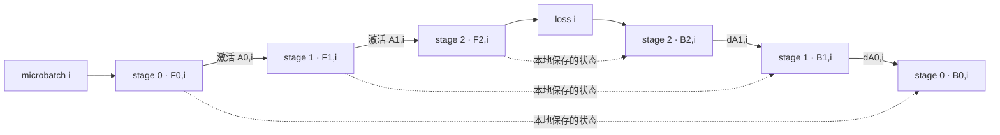

# Pipeline Parallel 怎样调度 microbatch，气泡和激活显存之间如何取舍？

把模型依次放到三台设备上，再把一个 batch 拆成四份，可以让设备同时处理不同份的数据。在本篇的单位时间模型中，GPipe 和普通 1F1B 都花 `12` 个时间单位，待反向的激活组峰值却分别为 `[4,4,4]` 和 `[3,2,1]`。调度顺序改变了激活的存活期，也改变了运行时需要协调的通信。

本篇先亲手排这个小例子，再推导气泡、batch 大小和显存的关系，对照当前 PyTorch 与 Megatron 的实现。两道基础练习在 CPU 上验证时序及梯度，另外用两个真实 CPU／Gloo 进程验证框架调度。所有 GPU 耗时与显存数字均明确区分假设和实际测量。

## 1. 模型放到了多张卡上，为什么仍可能只有一张卡在忙？

设一个模型有六层。stage 0 保存第 `1—2` 层，stage 1 保存第 `3—4` 层，stage 2 保存第 `5—6` 层。stage 是按执行依赖划出的模型片段，本篇让每个 stage 对应一个进程和一份计算资源。Pipeline Parallel（PP）通过这些 stage 共同执行完整模型。

如果把整个 batch 交给 stage 0，stage 1 要等待它的输出，stage 2 又要等 stage 1。模型参数虽然分散了，单个输入的前向依赖仍然存在。反向也需要按相反方向传回梯度。

现在将 `8` 个样本拆成 `4` 个 microbatch，每份 `2` 个样本。microbatch 是这次执行和梯度累积中的一个小份额。当 stage 1 计算第 `0` 份时，stage 0 可以计算第 `1` 份。前一份数据继续前进，后面的数据逐步进入，于是不同设备开始重叠工作。

这里需要数清三种并行维度。PP 把不同模型片段串联；TP 可以在某个 stage 内继续切分一层；DP 则让不同模型副本处理各自的数据。本篇采用每个 DP 副本一条完整流水线的常见 batch 约定，令 DP degree 为 `d`、每份样本数为 `b`、一次更新累积 `m` 份，则

\[
B_{\rm global}=d\,m\,b.
\]

PP 的 `p` 个 stage 共同处理同一条流水线的数据，TP 组也共同计算这些数据，因此这个式子不再乘 PP 或 TP degree。序列长度和有效 token 分母另行核算。[DP 与有效分母](../2026-11-03-ddp-gradient-overlap/README.md)、[TP 的层内切分](../2026-11-17-tensor-parallel-linear/README.md)

## 2. 一个 microbatch 的前后向究竟依赖什么？

用 `Fᵣ,ᵢ` 表示 stage `r` 对 microbatch `i` 的前向，`Bᵣ,ᵢ` 表示相应反向。反向在这里包含该片段的输入梯度和参数梯度计算。对于同一份数据：

- `F₁,ᵢ` 需要 `F₀,ᵢ` 产生的激活，后面的 stage 同理。
- `B₁,ᵢ` 需要本地前向保存的信息，以及 `B₂,ᵢ` 返回的输出梯度。
- 每个 stage 在本篇模型中一次执行一个完整的 `F` 或 `B`。



相邻 stage 通过点对点通信传激活和对应梯度。接收方把收到的激活作为本地计算的输入，反向得到它的梯度，再将这份梯度传回前一个 stage。通信两端需要约定 microbatch 身份、张量结构、shape、dtype 和梯度语义。

这个过程中，各 stage 还累积自己的参数梯度。需要继续通信的激活梯度与留在本地的参数梯度是两种对象。组合 DP、TP 或共享参数时，还会有相应的参数梯度同步，不能用一条 PP 边界的收发量代表整个训练通信。

## 3. GPipe 怎样填满再排空流水线？

先采用容易手算的假设：三个 stage，每个 microbatch 的一次前向和一次反向都耗时 `1`，通信耗时为 `0`，各 stage 不同时执行两个计算。所有 microbatch 都使用本次更新前的同一组参数。

GPipe 的基本顺序是先完成所有 microbatch 的前向，再完成它们的反向，最后更新参数。本文选用当前 PyTorch 实现的 FIFO 反向顺序，即 `B0、B1、B2、B3`。[GPipe 原始论文，§2.2 与图 2](https://arxiv.org/html/1811.06965v5#S2.SS2)

下面每一列是区间 `[t,t+1)`，`..` 表示该 stage 在这个模型中空闲。`F0` 代表对第 `0` 份数据做前向，不代表 stage 编号。

```text
t        0  1  2  3  4  5  6  7  8  9 10 11
stage 0 F0 F1 F2 F3 .. .. .. .. B0 B1 B2 B3
stage 1 .. F0 F1 F2 F3 .. .. B0 B1 B2 B3 ..
stage 2 .. .. F0 F1 F2 F3 B0 B1 B2 B3 .. ..
```

例如 stage 2 在区间 `[6,7)` 完成 `B0`，stage 1 才能在 `[7,8)` 做自己的 `B0`，然后 stage 0 在 `[8,9)` 完成它。三个 stage 共执行 `3×4×2=24` 个计算单位，占用的设备时间容量为 `3×12=36`，因此这个模型的计算利用率为 `24/36=2/3`。

代价出现在激活保存上：各 stage 在第一次反向之前，都已经完成四次前向，最多需要同时保留四份待反向状态。即使只保存重算所需的输入，也要为这四份输入保留相应空间。GPipe 原论文把重算与流水线结合，本文先把调度和每份状态的大小分别分析。[重算如何减少每份状态](../2026-11-05-activation-checkpointing/README.md)

## 4. 1F1B 怎样更早释放激活？

普通同步 1F1B 在预热后交替安排一份前向与一份反向。已经完成反向的 microbatch 可以释放其待反向状态，后续数据继续进入。所有 microbatch 的参数梯度仍在一次更新中累积。

对于 stage `r`，本篇采用 Megatron 非交错调度的划分方法：先做

\[
w_r=\min(p-r-1,m)
\]

份预热前向，随后做 `m−wᵣ` 对前向／反向，最后完成剩余 `wᵣ` 份反向。stage 编号从 `0` 开始。在三阶段、四份数据的例子里，stage 0 的局部顺序为 `F0、F1、F2、B0、F3、B1、B2、B3`。

同样的单位时间模型排成：

```text
t        0  1  2  3  4  5  6  7  8  9 10 11
stage 0 F0 F1 F2 .. .. B0 F3 B1 .. B2 .. B3
stage 1 .. F0 F1 .. B0 F2 B1 F3 B2 .. B3 ..
stage 2 .. .. F0 B0 F1 B1 F2 B2 F3 B3 .. ..
```

stage 0 完成前三份前向后等待 `B0`，峰值为三份；完成 `B0` 后释放一份，再接纳 `F3`，峰值不再增加。stage 1 峰值为两份，stage 2 为一份。因此

\[
n_{\rm saved,r}^{\rm GPipe}=m,\qquad
n_{\rm saved,r}^{\rm 1F1B}=\min(m,p-r).
\]

这里的一份指“前向已完成、反向尚未完成的 microbatch 状态”。假定每份占 `Aᵣ(b)` 字节，相应保存量为 `n_saved,r×Aᵣ(b)`。参数、梯度、优化器状态、收发缓冲区、合并输出、反向工作区和 allocator 保留量要另算。[训练显存的不同组成](../2026-11-04-training-memory-accounting/README.md)

两张时序表的总长度仍然都是 `12`，空闲分布发生了变化。2021 年 Megatron 论文 §2.2.1 明确比较了 GPipe 与 PipeDream-Flush：在其平衡模型下，气泡时间相同，后者将待反向份数限制到流水线深度。本篇研究的是这种同步、非交错的 1F1B。无 flush 的异步调度以及交错多 chunk 调度有各自的参数版本和通信条件。[原始论文，§2.2.1—2.2.2](https://arxiv.org/html/2104.04473v5#S2.SS2.SSS1)

## 5. 气泡比例中的分母是什么？

令所有 stage 的单份前向时间为 `t_f`，反向时间为 `t_b`，仍忽略通信与其他开销。在上述平衡、非交错模型中，理想的每 stage 有效工作时间、气泡带来的额外步耗时及实际步耗时分别为

\[
T_{\rm ideal}=m(t_f+t_b),\qquad
T_{\rm bubble}=(p-1)(t_f+t_b),\qquad
T=(m+p-1)(t_f+t_b).
\]

`T_bubble` 是相对理想步耗时的差额，不是把所有设备的空闲时间直接相加。两个常用比例为

\[
\frac{T_{\rm bubble}}{T_{\rm ideal}}=\frac{p-1}{m},\qquad
\frac{T_{\rm bubble}}{T}=\frac{p-1}{m+p-1}.
\]

在这个模型中，第二个比例也等于设备时间中的平均空闲占比，计算利用率为 `m/(m+p−1)`。2021 年论文的气泡公式采用第一个分母。[论文 §2.2.1 的定义](https://arxiv.org/html/2104.04473v5#S2.SS2.SSS1)

例如 `p=4、m=8、t_f=2 ms、t_b=4 ms`，则 `T_ideal=48 ms`、`T_bubble=18 ms`、`T=66 ms`。气泡相对理想时间为 `37.5%`，占总时间为 `27.27%`，计算利用率为 `72.73%`。这些是给定假设的推算。

stage 不均衡、通信排队、CPU 提交、重算和同步会改变实际时间。本篇模拟器允许各 stage 有不同的前后向耗时，此时由依赖计算时间线，不能继续直接套用平衡公式。

## 6. microbatch 改变了，怎样保证仍在训练同一个目标？

设本次所有输出共 `C` 个有效元素，误差为 `eⱼ=ŷⱼ−yⱼ`。本篇使用均方误差

\[
L=\frac1C\sum_{j=1}^{C}e_j^2.
\]

把元素分成各 microbatch 的集合 `Iᵢ` 后，每份反向的损失可以写成

\[
L_i=\frac1C\sum_{j\in I_i}e_j^2,\qquad
\nabla L=\sum_i\nabla L_i.
\]

这样可以直接累积梯度。整个过程只清一次梯度，每份都使用同一组参数，最后做一次 optimizer step。浮点累加顺序仍可能产生微小差异，因此数值验收需要容差。

### 6.1 为什么平均各份的 mean loss 有时会错？

取一个标量预测 `θ=0`，四个目标为 `[0,2,2,2]`。按 `[1,3]` 个元素拆分后，两份的 mean loss 为 `0` 和 `4`。直接平均得到 `2`，正确的全局 mean 则为 `(0+4+4+4)/4=3`。

前者对 `θ` 的梯度为 `−2`，后者为 `−3`。只有各份有效元素数相等时，简单平均各份 mean 才与全局 mean 一致。不等长序列和 loss mask 下，应按有效元素数加权；存在 DP 时，还需让副本间归约与全局分母一致。[实际反例测试](code/test_answers.py)

当前 PyTorch 单 stage 调度的 `scale_grads=True` 会按 microbatch 数缩放参数梯度，需与 loss 的归约方式配合。本文的真实进程脚本已经令每份 loss 为 `SSE/C`，所以显式使用 `scale_grads=False`，避免再次除以 `m`。[PyTorch 2.15 API](https://docs.pytorch.org/docs/2.15/distributed.pipelining.html#torch.distributed.pipelining.schedules.PipelineScheduleSingle)、[梯度缩放源码](https://github.com/pytorch/pytorch/blob/6e95b054945729c0edc7ecf9227386e1b63e45d0/torch/distributed/pipelining/stage.py#L1051-L1065)

这些对齐还要求模型对分块具有相应语义。跨样本 BatchNorm、dropout 的随机数分配、mask 及其他跨份状态都要单独检查。本篇固定模型只包含逐行 Linear／Tanh，分布式实验采用等长分块，CPU 基础答案另外验证不等长分块。

## 7. 当前代码把调度、保存和通信放在哪里？

### 7.1 PyTorch 的两个调度器

从 `PipelineScheduleSingle.step` 进入，输入与 target 被拆为 microbatch，然后交给具体调度器。`ScheduleGPipe._step_microbatches` 先循环全部前向，再按递增编号循环反向，之后完成相应梯度缩放。[前向循环](https://github.com/pytorch/pytorch/blob/6e95b054945729c0edc7ecf9227386e1b63e45d0/torch/distributed/pipelining/schedules.py#L1399-L1418)、[反向与缩放](https://github.com/pytorch/pytorch/blob/6e95b054945729c0edc7ecf9227386e1b63e45d0/torch/distributed/pipelining/schedules.py#L1430-L1464)

当前 `Schedule1F1B` 将最初 `min(m,p−r)` 次前向算作预热，再执行反向／前向交替与排空。它比前文 Megatron 的预热计数多 `1`，因为把稳态第一份前向划到了预热中。对本篇两阶段例子，二者都对应 stage 0 的 `F0、F1、B0、F2、B1、F3、B2、B3`。[预热](https://github.com/pytorch/pytorch/blob/6e95b054945729c0edc7ecf9227386e1b63e45d0/torch/distributed/pipelining/schedules.py#L1554-L1580)、[稳态中的批量收发与反向](https://github.com/pytorch/pytorch/blob/6e95b054945729c0edc7ecf9227386e1b63e45d0/torch/distributed/pipelining/schedules.py#L1610-L1645)

当前该类构造器要求 `m≥p`。本文的数学模拟器可排出 `m<p` 的序列，这并不代表该框架接口支持这个配置。实际进程脚本使用 `p=2、m=4`。[构造条件](https://github.com/pytorch/pytorch/blob/6e95b054945729c0edc7ecf9227386e1b63e45d0/torch/distributed/pipelining/schedules.py#L1524-L1528)

`PipelineStage` 在前向保存按 chunk 编号索引的状态，反向按相同编号取出。用于最终合并返回的输出还有自己的保存路径，因此待反向组数不能直接换算成 allocator 峰值。激活发送与梯度发送则由相应 P2P 操作构建，调度器协调何时提交和等待。[前向状态](https://github.com/pytorch/pytorch/blob/6e95b054945729c0edc7ecf9227386e1b63e45d0/torch/distributed/pipelining/stage.py#L1203-L1216)、[反向取出](https://github.com/pytorch/pytorch/blob/6e95b054945729c0edc7ecf9227386e1b63e45d0/torch/distributed/pipelining/stage.py#L1261-L1279)、[发送激活](evidence/upstream/pytorch/forward-p2p-ops.txt)、[发送梯度](evidence/upstream/pytorch/backward-p2p-ops.txt)

### 7.2 Megatron 的非交错路径

本篇限定普通、每个 rank 一段模型的非交错路径。当前调度选择器在 PP 大于 `1` 且未设置虚拟流水线大小时选择 `forward_backward_pipelining_without_interleaving`。[路径选择](https://github.com/NVIDIA/Megatron-LM/blob/91260b59e815f0be44d625d75ba22cb8473e5981/megatron/core/pipeline_parallel/schedules.py#L162-L169)

该函数计算 `wᵣ=min(p−r−1,m)`，预热时将输入输出加入队列；稳态先做前向，再发送激活并接收反向梯度，取出队首的旧 microbatch 完成反向。后续批量动作组合反向发送与下一份前向接收。排空阶段处理队列中剩余的反向。[预热计数](https://github.com/NVIDIA/Megatron-LM/blob/91260b59e815f0be44d625d75ba22cb8473e5981/megatron/core/pipeline_parallel/schedules.py#L2301-L2316)、[保存队列](evidence/upstream/Megatron-LM/warmup-save-queue.txt)、[稳态队列及收发](https://github.com/NVIDIA/Megatron-LM/blob/91260b59e815f0be44d625d75ba22cb8473e5981/megatron/core/pipeline_parallel/schedules.py#L2449-L2485)、[排空](evidence/upstream/Megatron-LM/cooldown.txt)

这些普通路径解释了调度和状态生命周期。实际多模块、虚拟流水线、重算、通信重叠、共享 embedding 和其他并行组合需要沿相应配置继续追踪，本文未运行 Megatron 的 GPU 路径。

## 8. 两个真实 CPU rank 得到了什么？

脚本将合成模型 `Linear(3,5) → Tanh → Linear(5,2)` 分成两段。batch 为 `8×3`，target 为 `8×2`，拆成四份，每份两行。使用 float64 和 Gloo，分别运行 PyTorch 的两个调度器，并与同一参数的完整模型比较。

| 调度 | stage 0 的计算顺序 | stage 1 的计算顺序 | 待反向调用峰值 |
| --- | --- | --- | --- |
| GPipe | `F0 F1 F2 F3 B0 B1 B2 B3` | `F0 F1 F2 F3 B0 B1 B2 B3` | `[4,4]` |
| 1F1B | `F0 F1 B0 F2 B1 F3 B2 B3` | `F0 B0 F1 B1 F2 B2 F3 B3` | `[2,1]` |

两者的完整 MSE 都为约 `0.37916318132772353`。全部参数梯度的最大绝对误差不超过 `1.12×10⁻¹⁶`，一次 `lr=0.05` 的 SGD 更新后，参数最大绝对误差不超过 `2.78×10⁻¹⁷`，均通过 `rtol=atol=1e-12` 验收。计数来自对框架前后向调用的记录，包含两个调度、两个 rank 的四条实际结果。[实际输出](evidence/runs/09-distributed.json)

从本篇目录使用已有 PyTorch 环境运行：

```bash
PYTHONDONTWRITEBYTECODE=1 GLOO_SOCKET_IFNAME=lo0 \
python -m torch.distributed.run --standalone --nnodes=1 --nproc-per-node=2 \
    code/distributed_cpu.py
```

`lo0` 是本次 macOS 的本地回环接口，其他系统按可用网络接口调整。脚本设置了超时并销毁进程组，只有最后一段返回合并后的完整输出。一次 schedule step 完成并取得参数梯度后，各 stage 才执行自己的一次 optimizer step。[完整脚本](code/distributed_cpu.py)

### 8.1 一次实际失败解释了什么接口约定？

首次静态元数据中的示例 Tensor 未声明 `requires_grad`，框架派生的梯度元数据为 `None`，反向失败。源码的 `_derive_grad_metas` 会将不需要梯度的输入元数据映射为 `None`。修正跨段输入及输出的标志后，真实进程验证通过。[原始失败](evidence/runs/02-distributed-metadata-red.txt)、[派生规则](https://github.com/pytorch/pytorch/blob/6e95b054945729c0edc7ecf9227386e1b63e45d0/torch/distributed/pipelining/_utils.py#L331-L353)

本篇使用显式静态元数据，当前框架也有运行时推导元数据的模式，具体行为以对应版本为准。除 shape／dtype 以外，梯度是否存在、跨段如何传播，也属于接口约定。CPU 调用峰值不等于 GPU 显存测量，脚本为了比较结果还保存了最后一段的合并输出。

## 9. microbatch 越小，气泡越少，为什么仍可能更慢？

固定 `B_global=64、d=2、p=4`，每条流水线一次更新处理 `32` 个样本，因而 `m=32/b`。当 `b` 改变时，stage 的前后向时间也随 GEMM shape、固定开销和效率变化。需要比较

\[
T(b)\approx\left(\frac{B_{\rm global}}{db}+p-1\right)
\left[t_f(b)+t_b(b)\right].
\]

这是平衡、零通信模型的估算式，不能把 `t_f+t_b` 当成与 `b` 无关的常数。原论文 §3.4 用 microbatch 大小分析同一类取舍。[论文 §3.4](https://arxiv.org/html/2104.04473v5#S3.SS4)

下面故意采用一组自编耗时假设，并假定每 stage 每样本保存 `16 MiB` 的待反向状态。全部数值由练习程序计算，**属于教学预算，没有做 GPU 性能测量**。

| `b` | `m` | 假设 `t_f+t_b` | 估算 step | 模型计算利用率 | GPipe 每 stage 保存峰值 | 1F1B 各 stage 保存峰值 |
| --- | --- | --- | --- | --- | --- | --- |
| `2` | `16` | `1.3+2.6=3.9 ms` | `74.1 ms` | `84.21%` | `512 MiB` | `[128,96,64,32] MiB` |
| `4` | `8` | `2+4=6 ms` | `66 ms` | `72.73%` | `512 MiB` | `[256,192,128,64] MiB` |
| `8` | `4` | `3.6+7.4=11 ms` | `77 ms` | `57.14%` | `512 MiB` | `[512,384,256,128] MiB` |

`b=2` 的气泡占比更小，但每样本计算效率在这组假设中更低，最后仍比 `b=4` 慢。模型中的“计算利用率”只描述设备时间有多少分配给了计算，没有描述这些计算离硬件峰值多远。

固定一次更新的数据量后，GPipe 的全部 microbatch 保存量在这里保持不变，1F1B 的每份变小后还能降低保存峰值。如果固定的是 `b`，再增加 `m`，则 global batch 也会变大，需要同时评估优化目标、训练收敛和调度收益。

### 9.1 通信总字节和消息数量怎样变化？

再假定一条相邻 stage 边界传形状为 `[b,S,H]` 的激活，`S=2048、H=8192`，每元素 `s=2 B`，对应激活梯度同样大小。单份、单向 payload 为

\[
D_{\mu}=bSHs.
\]

`b=4` 时为 `128 MiB`，一次更新有八份，该边界前向合计 `1 GiB`，反向合计 `1 GiB`。双向 payload 合计 `2 GiB`；边界两端各发送 `1 GiB` 并接收 `1 GiB`。这里的 MiB 和 GiB 分别取 `2²⁰` 与 `2³⁰` 字节。

在固定每条流水线 `32` 个样本的条件下，改变 `b` 不改变这条边界每步的 payload 总量，但单向消息份数从 `m` 次变化，双向合计为 `2m`。真实实现可能对消息进行聚合、分块或重叠，启动与排队成本也需测量。TP／SP 布局、压缩、不同 dtype 或额外跨段边会改变这个预算。[实际计算出的三组预算](evidence/runs/08-answers.json)

### 9.2 工程上先测什么？

先按相同输入、参数版本与 loss 分母验收输出、梯度和一次更新。然后测每个 stage 的前后向与通信等待，找出慢段，不能仅按层数均分。记录实际 peak allocated／reserved、保存激活与工作区，并扫描合法的 `b、m` 组合，最终比较端到端 step 时间和相同目标下的训练进度。

异步 P2P 需要匹配收发顺序和缓冲区生命周期。某个 rank 的 shape、microbatch 数或梯度存在性不一致，可能表现为报错或其他 rank 等待。交错多 chunk 可以改变气泡和边界通信次数；更多配置带来的收益应由对应实现与设备结果证明。[通信与链路的测量口径](../2026-11-11-allreduce-links-topology/README.md)

## 10. 代码练习

### 练习一：实现一个能检查依赖的调度模型

实现 `simulate_pipeline(stages, microbatches, schedule, ...)`，支持 `gpipe` 和 `1f1b`。每个 stage 可指定正整数的前向和反向耗时，默认均为 `1`。通信耗时固定为 `0`，一个 stage 一次只做一个完整操作，采用正文的 FIFO 局部次序。

返回 `events`，每个事件包括 `stage、phase、microbatch、start、end`，并返回 `makespan_ticks`、`compute_utilization`、`busy_ticks_per_stage` 和 `peak_saved_microbatches`。要求所有依赖满足、同一 stage 不重叠；假定一次 step 内参数固定，模拟器不执行参数更新。数学模型可处理 `m<p`，与特定框架的接口约束分别看待。[起始接口](code/exercises.py)、[验收测试](code/test_answers.py)

<details>
<summary>详解与完整答案</summary>

先为每个 stage 建立本地操作序列。GPipe 为全部 `F` 后全部 `B`，1F1B 为预热、交替和排空。操作开始时间取本 stage 上一个操作结束时间及所有数据依赖结束时间的最大值。只有依赖都已安排的操作才能加入时间线；没有任何操作能够前进时，说明构造出了依赖环。

对每个 stage 按本地完成次序计数，`F` 完成增加一份，`B` 完成减少一份。利用率为总计算时间除以 `p×makespan`。这只统计模型定义的待反向状态与计算时隙。[完整答案](code/answers.py)

`p=3、m=4` 的两种调度应都得到 `12`，峰值分别为 `[4,4,4]` 与 `[3,2,1]`。测试还遍历多组规模、非对称 stage 耗时、`p=1`、`m<p` 和非法输入，检查前后向依赖及 stage 互斥。[真实测试结果](evidence/runs/04-tests.txt)

```bash
PYTHONDONTWRITEBYTECODE=1 python -m unittest discover -s code -p test_answers.py -v
PYTHONDONTWRITEBYTECODE=1 python code/run_answers.py
```

</details>

### 练习二：让不等长 microbatch 得到完整 batch 的梯度

实现 `microbatch_backward(model, inputs, targets, chunk_sizes)`。输入和 target 为非空二维浮点 Tensor，模型为确定性的逐行计算；每份输出必须与对应 target 的 shape 完全一致。分块大小为正整数，恰好覆盖输入行。[起始接口](code/exercises.py)

函数应清理旧参数梯度，按同一全局 MSE 目标累积全部梯度，返回按原始行顺序合并的 `output` 和全局 `loss`，函数内部不做 optimizer step。用合成模型与 `[1,3,4]`、`[2,2,2,2]` 等划分比较完整 batch 的输出、loss、全部参数梯度，最后由调用者做一次 SGD 更新并比较参数。

<details>
<summary>详解与完整答案</summary>

每份采用 `square().sum() / targets.numel()`，因而不依赖该份有多少行。各份梯度直接相加就是全局 mean 的梯度。若先算局部 mean，则需要再乘“本份有效元素数／全局有效元素数”，两种写法具有相同数学目标。

参考答案只清一次梯度，每份调用一次 backward，保留同一组参数。合成模型不含跨样本状态。测试覆盖单份、逐行分份、不等长份、旧梯度清理、非法划分及 shape 错误，并包含 `θ=0` 的错误分母反例。[完整答案](code/answers.py)、[完整验收](code/test_answers.py)

`[1,3,4]` 的 loss 应约为 `0.37916318132772353`，输出和全部参数梯度与完整模型通过 `1e-12` 容差对比。真实两 rank 脚本额外检查等长分块下的框架收发与一步更新，未将单进程不等长结果当成分布式不等长通信验证。[数值输出](evidence/runs/08-answers.json)、[代码运行说明](code/README.md)

</details>

## 11. 面试官继续追问

| 层次 | 追问 | 回答要点 |
| --- | --- | --- |
| 基础 | 将模型按层切开，为什么仍会有空闲设备？ | 同一份数据有前后向依赖；需要多份数据形成重叠，仍有填充与排空 |
| 基础 | global batch 要乘 PP degree 吗？ | 常见约定为 `dmb`，各 PP stage 共同处理同一批数据 |
| 推导 | 普通 1F1B 相比 GPipe 改善了什么？ | 更早完成反向并释放保存状态；平衡非交错模型的气泡时间相同 |
| 推导 | `(p−1)/m` 和 `(p−1)/(m+p−1)` 哪个是气泡比例？ | 前者相对理想计算时间，后者相对总步时间，先说明分母 |
| 实现 | 为什么两个框架的预热数可能差 `1`？ | 检查是否把交替阶段第一份前向划入预热，再比较完整本地序列 |
| 实现 | 保存状态的组数为什么不能直接当显存？ | 每份大小、输出保留、通信缓冲区、反向工作区与 allocator 都另有生命周期 |
| 选择 | 小 microbatch 气泡少，为什么仍可能更慢？ | 固定成本、GEMM 效率、更多消息和排队，比较完整 `T(b)` |
| 正确性 | 各份 mean loss 再平均什么时候失效？ | 有效元素数不同，需要按全局目标加权，并避免重复除以 `m` |
| 排障 | 第一次反向收到 `None` 梯度，从哪里查？ | 检查跨段输入输出、requires_grad 和梯度元数据，再核对对应 microbatch |
| 排障 | 部分 rank 等待很久，如何缩小范围？ | 对照 stage／microbatch 次序、shape／dtype、收发配对及首个报错 rank，区分依赖等待与慢段 |

## 12. 资料版本、验证范围和下一步

实现阅读来自当日 fetch 的官方默认分支，稳定 release 与实际 CPU 运行 build 分别记录。

| 对象 | 固定默认分支 commit | 当时核验的稳定 release |
| --- | --- | --- |
| PyTorch | `6e95b054945729c0edc7ecf9227386e1b63e45d0` | `v2.15.0` |
| Megatron-LM | `91260b59e815f0be44d625d75ba22cb8473e5981` | `core_v0.20.0` |

本机实际运行 Python `3.12.16`、PyTorch `2.15.0`，build commit 为 `d0f2af8b66b20da4baa50644c0cd3f887a2eae2e`，`Darwin arm64`，Gloo 可用、CUDA 不可用。普通与 `-O` 模式的 `21` 项测试、Ruff lint／format 以及两个真实进程的两种调度均通过。[命令、环境与代码哈希](evidence/runs/verification.json)

基础模型省略通信时间、重叠计算、重算及其他并行组；真实进程只验证 CPU、两 stage、等长份和普通 Linear／Tanh。尚未验证 GPU 吞吐、NCCL、真实激活显存、不等长分布式分块、动态形状与其他调度。后续候选是 Context Parallel 的长序列切分与 K／V 交换，需要继续连接 Attention 的分块与全局归一化。[Attention 前置篇](../../10/2026-10-23-attention-online-softmax/README.md)

资料与原始论文笔记见 [参考资料](references.md)，练习、答案及运行方法见 [代码说明](code/README.md)，审查与边界见 [审查记录](review.md)，图源见 [数据依赖](assets/dependencies.mmd) 和 [单位时间表](assets/timelines.txt)。返回 [Wiki 索引](../../../index.md)。
