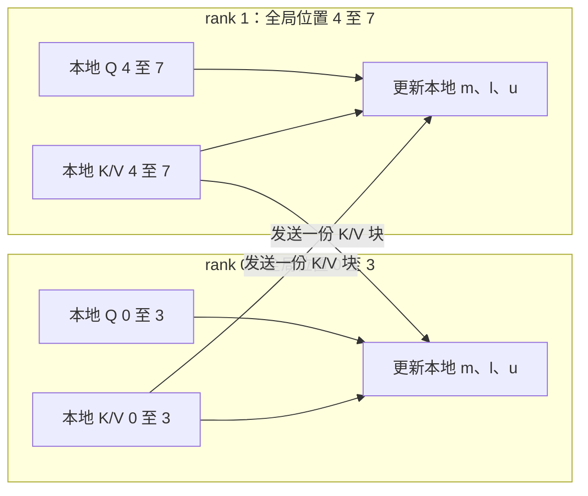

# Context Parallel 怎样切分长序列，Attention 如何在各 rank 间交换 K／V？

> Context Parallel（CP，上下文并行）让不同设备负责同一条序列的不同 token。每个设备保留自己的 Q，逐块获得全局 K／V，并用统一的 Softmax 归一化合并结果；训练时，还要把所有 query 分片对同一个 K／V 分片的梯度相加。
>
> 本篇从能手算的 Attention 出发，解释环形交换、因果布局和反向传播，再对应到 Megatron Core 与 Transformer Engine 的固定源码。练习和双进程实验验证 CPU 正确性，GPU 的显存收益、通信重叠和吞吐需要另行测量。

## 1. 为什么序列切开以后，Attention 仍然需要跨卡通信？

假设训练一条长文档，序列有 `32768` 个 token。单个样本已经很长，增加 Data Parallel 的副本数，并不能把这一条样本内部的激活分到更多设备。我们希望让 `4` 个设备各负责 `8192` 个 token，同时保留完整的 Attention 语义。

先缩小到 `8` 个 token 和 `2` 个设备。把设备在进程组中的编号叫作 **rank**：rank 0 负责位置 `[0,1,2,3]`，rank 1 负责 `[4,5,6,7]`。一次 Attention 中，Q 是当前位置提出的查询，K 用来计算与查询的匹配分数，V 是按匹配权重汇总的内容。

以因果 Attention 为例，位置 `6` 的 Q 必须看到位置 `0…6` 的 K／V；它不能只看到 rank 1 保存的部分。若每个 rank 各自在本地跑一次 Attention，结果就变成了两个互不相见的短文档。

线性投影、逐 token 的 LayerNorm 和普通 MLP 则可以在本地 token 上计算。CP 的关键困难，是 Attention 存在这种跨 token 的依赖。[Megatron 官方 CP 概览](https://docs.nvidia.com/megatron-core/developer-guide/latest/user-guide/features/context_parallel.html)也以这个区别解释需要交换 K／V 的原因。

前置阅读：[Attention 与 online softmax](../../10/2026-10-23-attention-online-softmax/README.md)、[训练显存](../2026-11-04-training-memory-accounting/README.md)、[通信链路](../2026-11-11-allreduce-links-topology/README.md)、[TP 与 SP](../2026-11-17-tensor-parallel-linear/README.md)。本篇会重新推导需要用到的归一化机制。

## 2. 一个四 token 的例子：局部结果为什么不能平均？

### 2.1 先算完整答案

只考虑一个 Attention head，每个 Q、K、V 都是一个数，因此 head dimension `D=1`，缩放因子 `1/√D=1`。设：

```text
全局位置：  0      1       2       3
Q：         1      1       1       1
K：         0     ln 2    ln 3    ln 4
V：        10     20      30      40
```

最后一个 query 允许看到所有 key。它的匹配分数为 `[0, ln 2, ln 3, ln 4]`，指数权重就是 `[1,2,3,4]`。因此：

\[
O_3=\frac{1\cdot10+2\cdot20+3\cdot30+4\cdot40}{1+2+3+4}=30.
\]

因果 mask 让前面的 query 只能看更短的前缀，所以完整输出依次为：

```text
[10, 50/3, 140/6, 30]
≈ [10, 16.666667, 23.333333, 30]
```

这里的 mask 是“是否允许一个 query 与一个 key 配对”的规则。切分以后仍须使用**全局位置**判断 `key_position <= query_position`。把 rank 1 的第一个 token 当作全局位置 `0`，会把正常的历史依赖遮掉。

### 2.2 分成两块后丢失了什么？

把 K／V 按前两个、后两个 token 切分。对最后一个 query，两块各自做 Softmax，得到：

\[
O_A=\frac{10+40}{3}=\frac{50}{3},\qquad
O_B=\frac{90+160}{7}=\frac{250}{7}.
\]

平均两个输出得到约 `26.190476`，与 `30` 不同。原因可以直接数出来：A 块的总权重是 `3`，B 块是 `7`；平均把两块误当成各占一半。正确合并是 `(3 O_A + 7 O_B)/10`。

这也解释了为什么通信协议不能只交换“局部 Attention 输出”。还必须保留能恢复相对权重的归一化统计量。接下来将权重和改写为不容易溢出的形式。

## 3. 从一次合并推导 online softmax

对一个固定 query，把允许访问的 key 的分数记为 `s_j`。每处理完一批 key，维护三个量：

\[
m=\max_j s_j,\qquad
\ell=\sum_j e^{s_j-m},\qquad
u=\sum_j e^{s_j-m}V_j.
\]

`m` 是一个标量最大值，`ℓ` 是一个标量分母，`u` 是与 V 特征维度一样宽的加权向量。最终输出是 `O=u/ℓ`。先减去最大值，让指数不超过 `1`，避免直接计算巨大指数。

如果已有摘要 `(m_a, ℓ_a, u_a)`，新块的摘要是 `(m_b, ℓ_b, u_b)`，两者必须换到同一个指数基准：

\[
M=\max(m_a,m_b),\quad
\alpha=e^{m_a-M},\quad \beta=e^{m_b-M},
\]
\[
\ell'=\alpha\ell_a+\beta\ell_b,\qquad
u'=\alpha u_a+\beta u_b,\qquad m'=M.
\]

上面的例子中，A 块有 `m_a=ln 2，ℓ_a=1.5，u_a=25`；B 块有 `m_b=ln 4，ℓ_b=1.75，u_b=62.5`。所以 `α=0.5，β=1`，合并后 `ℓ'=2.5，u'=75`，输出仍为 `30`。

也可以存储 `L=m+ln ℓ`，即 **logsumexp（LSE）**，它是原始指数权重和的对数。合并两个归一化输出时：

\[
L'=\log(e^{L_a}+e^{L_b}),\qquad
O'=e^{L_a-L'}O_a+e^{L_b-L'}O_b.
\]

这正是后面 Transformer Engine 的 LSE 校正与输出校正所表达的数学关系。它不要求 K／V 块按全局位置顺序抵达；位置控制 mask，摘要负责合并。浮点数的不同合并次序仍可能产生舍入差异，所以验收使用明确容差。

**完全遮蔽的块要单独想清楚。** 对早期 query，未来的整个 K／V 块都可能无效。其摘要应为 `(-∞,0,0)`，对结果没有贡献。直接执行 `-∞-(-∞)` 会得到 NaN；练习先选择有限的减法基准，再让被遮蔽的指数权重为 `0`。若一个 query 的所有块都无效，本教学接口约定输出为零、LSE 为 `-∞`，并验证输出反向梯度为零。这是本接口的明确约定，不能据此假设所有底层 kernel 在任意 mask 下都相同。

## 4. Ring Attention：Q 留在本地，K／V 块逐步经过

每个 rank 都需要自己的 Q 与全局 K／V 配对。最直接的基线，是 AllGather 全部 K／V，再计算本地 query。它容易核对正确性，但会在每个 rank 上物化完整 K／V。

环形方案把“收齐后再算”变成“块抵达后增量合并”。例如两个 rank：



图中箭头展示一次本地计算加一次跨 rank 交换后的依赖，不表示测得的并发时序。Q 和输出的所有权保持不变，跨 rank 发送的是 K／V 块。rank 0 对未来 key 的无效配对不计入分母。[图源](figures/ring.mmd)。

推广到 `p` 个 rank，设每个 rank 向下一个 rank 发送、从前一个 rank 接收，则 rank `r` 看到的 owner 顺序为：

```text
r, (r-1) mod p, (r-2) mod p, …
```

需要处理 `p` 个 owner，完成 `p-1` 次必要的跨 rank 旋转即可覆盖所有块。发送一份数据不会转移原始 token 的参数或梯度归属。一次处理完收到的块，就可以继续下一步；实际内存还取决于通信缓冲、反向所需状态和重算策略。

[Ring Attention 原始论文 v4](https://arxiv.org/html/2310.01889v4)第 3 节将本地 blockwise Attention 与 K／V 环形通信结合；附录 A 的 JAX 实现用 `lax.scan` 遍历全部 owner，用 `lax.ppermute` 旋转数据。论文 Algorithm 1 是简化伪代码，工程验收应检查每个 query 是否确实覆盖全部有效 key。本文前向演示省掉最后一次无用旋转，训练实现还要安排反向归约。自己的逐节笔记保存在[论文笔记](evidence/paper-notes.md)，未把论文的通信隐藏结论当作本机实测。

## 5. 因果 Attention 为什么常把首尾两段配给同一张卡？

连续切分虽直观，却会造成因果有效配对数不均。仍以 `S=8、p=2` 为例，位置 `i` 有 `i+1` 个有效 key：

| 布局 | rank 0 的 query 位置 | rank 1 的 query 位置 | 各 rank 的有效配对数 |
| --- | --- | --- | --- |
| 连续 | `[0,1,2,3]` | `[4,5,6,7]` | `10`、`26` |
| 首尾配对（zigzag） | `[0,1,6,7]` | `[2,3,4,5]` | `18`、`18` |

zigzag 的做法是先切成 `2p` 个等长块，rank `r` 持有块 `r` 与块 `2p-1-r`。前面的 query 少算，后面的 query 多算，两者配在一起。若每小块有 `c=S/(2p)` 个 token，每对首尾 query 的全局位置和为 `S-1`，有效 key 数和为 `S+1`；每个 rank 有 `c` 对，所以都得到 `c(S+1)=S(S+1)/(2p)` 个有效配对。

这个推导要求标准完整因果序列、等长可整除切分；packed sequence 的文档边界、padding、滑动窗口等会改变条件。它算的是数学上的有效配对数，**不能直接当作 GPU 执行时间**。教学实现仍对块内遮蔽位置计算部分分数；实际 kernel 的 tile 跳过、形状和通信会决定负载。[Megatron 当前源码的切分契约](https://github.com/NVIDIA/Megatron-LM/blob/43a2ef6d35a0188a4f0601a5ce5e569d2c011562/megatron/core/utils.py#L2644-L2658)明确采用 `2p` 分块与首尾配对；[实际索引代码](https://github.com/NVIDIA/Megatron-LM/blob/43a2ef6d35a0188a4f0601a5ce5e569d2c011562/megatron/core/utils.py#L2685-L2702)选择 `[cp_rank, 2*cp_size-cp_rank-1]`。

这里也能看出为什么局部行号不够：rank 0 的第三行是全局位置 `6`，不是 `2`。位置编码、因果 mask 和最终输出恢复顺序，都须遵守同一份布局。

## 6. 训练多了什么：K／V 梯度为什么必须跨 rank 相加？

前向结束后，query `i` 使用的是全局概率 `P_ij`。对允许的配对，设 `dO_i` 是输出梯度，定义 `δ_i=dO_i·O_i`，则：

\[
dS_{ij}=P_{ij}(dO_i\cdot V_j-\delta_i),
\]
\[
dQ_i=\frac{\sum_jdS_{ij}K_j}{\sqrt D},\quad
dK_j=\frac{\sum_idS_{ij}Q_i}{\sqrt D},\quad
dV_j=\sum_iP_{ij}dO_i.
\]

被 mask 的配对贡献为零。Q 的一行由一个 rank 拥有，它需要遍历所有允许的 key 来完成自己的 `dQ`；一个 K 或 V 却可能被所有 query rank 使用，因此它的梯度必须汇总所有 query 分片的贡献：

\[
dK_j=\sum_r dK_j^{(r)},\qquad dV_j=\sum_r dV_j^{(r)}.
\]

这就是“前向收集 K／V，反向归约并返回其 owner”的语义。具体实现可以用 ReduceScatter，也可以用 P2P 的传递与累加来实现相应归约。原论文附录 A 在反向一起旋转 K、V、dK、dV；Transformer Engine 的 P2P 自定义反向也管理 K／V 与梯度缓冲，并执行梯度累加。[反向通信](https://github.com/NVIDIA/TransformerEngine/blob/c2b5a322fc0220770171b9dc6b9b922cb3ddcbdd/transformer_engine/pytorch/attention/dot_product_attention/context_parallel.py#L2700-L2740)、[梯度累加](https://github.com/NVIDIA/TransformerEngine/blob/c2b5a322fc0220770171b9dc6b9b922cb3ddcbdd/transformer_engine/pytorch/attention/dot_product_attention/context_parallel.py#L3017-L3051)。这些源码分支不能简化成“反向再照抄一次前向发送量”。

还要统一 loss 分母。实验把全局 `8×2=16` 个输出元素的平方均值作为 loss，各 rank 使用自己的 `SSE/16`，其和才是完整 loss。K／V 梯度已由可微 AllGather 的反向求和，再除一次 CP 大小会把梯度缩小。若完整模型的投影参数在 CP rank 间复制，参数的局部梯度贡献也要由框架在正确的组中归约；本文 Q／K／V 叶子张量的验证不等于完整模型训练验收。

## 7. 从公式追到当前 Megatron／Transformer Engine 代码

### 7.1 先固定“看过的代码”与“实际运行的软件”

本次对三个官方仓库实际执行了 `fetch`（Transformer Engine 缓存首次建立），并单独取得稳定 tag。以下 main 仅指 `2026-11-19` 本次获取的默认分支快照：

| 仓库 | 本次 main commit | 当日最新稳定 release |
| --- | --- | --- |
| Megatron-LM | `43a2ef6d35a0188a4f0601a5ce5e569d2c011562` | `core_v0.20.0` |
| Transformer Engine | `c2b5a322fc0220770171b9dc6b9b922cb3ddcbdd` | `v2.21.0` |
| PyTorch | `55e45fb47412a2ffdab02ca0ee62da51c1d58f31` | `v2.15.0` |

稳定版本的完整 SHA、release 时间、获取记录和每个片段的文件哈希见[源码清单](evidence/source-manifest.json)与[更新记录](evidence/source-update.json)。本次还核对了稳定 tag 的 CP 通信配置、P2P 分派和 LSE／输出合并；没有因此宣称两个版本所有功能与限制相同。[Megatron release](https://github.com/NVIDIA/Megatron-LM/releases/tag/core_v0.20.0)、[TE release](https://github.com/NVIDIA/TransformerEngine/releases/tag/v2.21.0)、[PyTorch release](https://github.com/pytorch/pytorch/releases/tag/v2.15.0)。

真实执行使用已有 Python `3.12.16`、CPU PyTorch `2.15.0`，包报告的 build SHA 是 `d0f2af8b66b20da4baa50644c0cd3f887a2eae2e`，平台为 Darwin arm64。它与上述 main、release tag SHA 分开记录。本机没有执行 CUDA／NCCL／TE kernel。

### 7.2 CP 组怎样交给 Attention？

现在要找的是：哪个组件知道当前 query 的 K／V 应与谁通信？Megatron 的 `TEDotProductAttention` 在 `context_parallel_size>1` 时，向 TE 传入 `cp_group`、`cp_global_ranks` 与专用 stream；支持相应接口的版本下，未显式指定通信类型时传入 `p2p`。实际 forward 将 Q／K／V 交给 TE 父类。[组与配置入口](https://github.com/NVIDIA/Megatron-LM/blob/43a2ef6d35a0188a4f0601a5ce5e569d2c011562/megatron/core/extensions/transformer_engine.py#L2439-L2470)、[forward 委托](https://github.com/NVIDIA/Megatron-LM/blob/43a2ef6d35a0188a4f0601a5ce5e569d2c011562/megatron/core/extensions/transformer_engine.py#L2690-L2698)。

在 TE 内，符合条件的 FlashAttention 或 fused backend 调用 `attn_forward_func_with_cp`；它根据 `cp_comm_type` 分派到 `AttnFuncWithCPAndKVP2P`、`AttnFuncWithCPAndKVAllGather` 或 A2A 实现。本文主要分析普通 softmax、无 dropout、标准因果 self-attention 的 P2P 路线，练习的单 head CPU 代码也限定在这组数学语义内。[backend 入口](https://github.com/NVIDIA/TransformerEngine/blob/c2b5a322fc0220770171b9dc6b9b922cb3ddcbdd/transformer_engine/pytorch/attention/dot_product_attention/backends.py#L1256-L1294)、[通信分派](https://github.com/NVIDIA/TransformerEngine/blob/c2b5a322fc0220770171b9dc6b9b922cb3ddcbdd/transformer_engine/pytorch/attention/dot_product_attention/context_parallel.py#L5746-L5794)。

### 7.3 哪几行对应“边交换边合并”？

`AttnFuncWithCPAndKVP2P.forward` 把 K／V 打包，准备交替使用的通信缓冲。在循环中先等待所需块到达，在还需其他块时发起下一次收发，再执行对应的 Attention。源码的 `range(cp_size+1)` 包含结果合并的流水收尾；实际块计算是 `cp_size` 步，不能把它数成多看了一个 owner。[缓冲与循环](https://github.com/NVIDIA/TransformerEngine/blob/c2b5a322fc0220770171b9dc6b9b922cb3ddcbdd/transformer_engine/pytorch/attention/dot_product_attention/context_parallel.py#L1913-L1949)。

每一步的局部输出已由 kernel 归一化，所以 TE 合并 LSE，再按 `exp(L_old-L_new)` 与 `exp(L_step-L_new)` 校正输出；这对应第 3 节的等价写法。[LSE 合并](https://github.com/NVIDIA/TransformerEngine/blob/c2b5a322fc0220770171b9dc6b9b922cb3ddcbdd/transformer_engine/pytorch/attention/dot_product_attention/context_parallel.py#L156-L164)、[输出重标定](https://github.com/NVIDIA/TransformerEngine/blob/c2b5a322fc0220770171b9dc6b9b922cb3ddcbdd/transformer_engine/pytorch/attention/dot_product_attention/context_parallel.py#L181-L193)、[调用位置](https://github.com/NVIDIA/TransformerEngine/blob/c2b5a322fc0220770171b9dc6b9b922cb3ddcbdd/transformer_engine/pytorch/attention/dot_product_attention/context_parallel.py#L2169-L2193)。

因果布局又将步骤区分为 diagonal、lower-triangle、upper-triangle 等区域，选择相应的 Q／K／V 部分，避免把每一步都当作完整无 mask Attention。[因果 tile 选择](https://github.com/NVIDIA/TransformerEngine/blob/c2b5a322fc0220770171b9dc6b9b922cb3ddcbdd/transformer_engine/pytorch/attention/dot_product_attention/context_parallel.py#L2001-L2053)。练习为便于检查使用全局位置显式 mask，不复刻这些 kernel 调用和布局优化，也不把自己的全遮蔽处理当作 TE 子函数的无条件契约。

### 7.4 CP 不是唯一一种沿序列切分的方法

[Megatron 当前通信配置](https://github.com/NVIDIA/Megatron-LM/blob/43a2ef6d35a0188a4f0601a5ce5e569d2c011562/megatron/core/transformer/transformer_config.py#L1309-L1332)区分 `p2p`、`all_gather`、`a2a`、`a2a+p2p`：前两者主要交换 K／V；A2A 路线沿 head 和 sequence 重新分布 QKV；层次式路线在子组内和子组间组合通信。head 数、布局、kernel 和拓扑会限制选择，不能仅凭一个命令名认为所有模型配置都支持。

前篇 SP 在 TP 组中切分某些逐 token 区域的激活，普通 TP Attention 中仍可能需要收齐序列；本篇 CP 进一步把 Attention 的 query 工作和上下文保留在不同 rank 上。两者可以组合，进程组和边界操作必须明确。官方 CP 概览的 SP 比较针对 Megatron 这类语境，不能把其他论文或引擎中同名的“sequence parallel”一概归为相同算法。

源码也有明确的 backend／mask 限制。例如本次 TE 快照的滑动窗口 CP 分派限定在 `a2a` 或 `all_gather`，`sbhd` 格式的 CP 不支持该 FlashAttention 分支而要求 fused attention。[具体检查](https://github.com/NVIDIA/TransformerEngine/blob/c2b5a322fc0220770171b9dc6b9b922cb3ddcbdd/transformer_engine/pytorch/attention/dot_product_attention/context_parallel.py#L5692-L5716)。排障应沿实际版本检查条件，不能用本篇最小模型推断所有组合。

## 8. 收益、通信量与失效条件怎样估算？

### 8.1 先分清减少了哪一类内存

设 microbatch 有 `b` 条序列、每条长度 `S`，K／V head 数为 `H_kv`，head dimension 为 `D`，每元素占 `t` 字节，CP 大小为 `p`。一层拥有的本地 K／V 负载为：

\[
M_{KV,owned}=2b\frac{S}{p}H_{kv}Dt.
\]

在教学假设 `b=1、S=32768、H_kv=32、D=128、t=2、p=4` 下，本地 K／V 为 `128 MiB`，完整 K／V 为 `512 MiB`。若每个 rank 在完整、未裁剪的前向环中转发 `p-1` 块，则每 rank 发送 `384 MiB`，接收另计 `384 MiB`。这是**一层一次前向的假设负载**，没有包含协议、梯度、重算或完整训练流量，也不是实测带宽。

逐块交换可以避免一次性保留所有远端 K／V，但实际峰值还包括原始张量、通信双缓冲、Q／输出、LSE、kernel workspace、反向保存与分配器状态。练习用普通 autograd 保存中间量，不能用它证明训练显存缩至 `1/p`。CP 也不会自动分片参数与优化器；那是前文 TP、PP、FSDP 等策略的另一组分工。

在标准 MHA、Q 与 V head dimension 相同的简化下，每个 rank 的 dense Attention 计算约为 `O(b H S²D/p)`，全局总工作仍为 `O(S²)`。CP 改变工作分配和容量，没有使 dense Attention 对序列长度变成线性复杂度。GQA／MQA 减少 `H_kv`，可以降低 K／V 负载；具体 backend 和 head 切分约束仍须核验。[官方 CP 文档的 MQA／GQA 说明](https://docs.nvidia.com/megatron-core/developer-guide/latest/user-guide/features/context_parallel.html)。

### 8.2 为什么“异步发送”不等于“通信免费”？

论文第 3 节给出一个简化条件：每块 `c` 个 token、head dimension 为 `D`、有效计算能力为 `F FLOP/s`、链路有效带宽为 `B byte/s`，BF16 K＋V 负载约 `4cD` 字节，两次矩阵乘法约 `4c²D` FLOP。因此隐藏通信至少需要：

\[
\frac{4c^2D}{F}\gtrsim\frac{4cD}{B}
\quad\Longrightarrow\quad c\gtrsim F/B.
\]

这里省略了启动延迟、调度竞争和真实 kernel 效率，并假设相应 MHA 块形状与数据类型。`F`、`B` 必须使用一致单位及实际有效能力，不能随意拿芯片峰值与整机标称带宽相除后宣称达成重叠。

固定全局序列长度继续增加 `p`，会使本地块变小，计算难以覆盖通信；跨慢链路、head 配置不适合、padding 过多，也会降低收益。应同时检查每 rank 的 kernel 时长、收发等待、HBM 峰值和完整 step 时间。本文 P2P 演示每步等待收发完成，没有测量或实现计算通信重叠。

## 9. 代码练习与完整答案

起始接口为 [exercises.py](code/exercises.py)，完整答案为 [answers.py](code/answers.py)，[运行说明](code/README.md)列出文件分工。使用已有 CPU PyTorch 环境，无需安装 TE 或 CUDA。以下命令从本篇目录运行，`python` 指向你选定的已有环境，本次实际解释器与版本见[真实运行记录](evidence/runs/verification.json)。

### 练习一：把任意顺序的 K／V 块合并成一次 Attention

输入 Q 的形状为 `[Nq,D]`，每块提供 `[Nk,D]` 的 K、`[Nk,Dv]` 的 V，以及一维全局 key 位置；另外给出 Q 的全局位置。实现：

```python
streaming_attention(q, blocks, query_positions, *, causal=True)
# 返回 output [Nq,Dv] 和每行的 logsumexp [Nq]
```

约束：支持 float32／float64，Q／K／V 类型和设备一致；所有块的 V 宽度一致；K／V 块应恰好覆盖调用者希望访问的 key 一次。必须处理空块、全遮蔽块和全遮蔽 query；不接受分数计算已经溢出的输入。不能拼接所有 K／V 再一次算完。

验收：四 token 例子输出 `[10,50/3,140/6,30]`；改变块顺序仍在容差内对齐；使用全局位置 `100…107` 时 mask 正确；输出和 Q／K／V 梯度与独立的 PyTorch SDPA 对齐。测试还进行中心有限差分 `gradcheck`，避免只靠两段共享逻辑互证。

<details>
<summary>详解：同时缩放已有分母和已有分子</summary>

答案从 `m=-∞、ℓ=0、u=0` 开始。新分数块形成新的行最大值；将已有摘要乘以 `exp(m_old-m_new)`，再加入当前块在相同基准下的权重和及加权 V，最后除以总分母。[完整实现](code/answers.py)。

关键是分子和分母一起缩放，不能只修分母。全部遮蔽时选择有限的减法基准，空块则保留零贡献的 autograd 路径。最后只把零分母临时替换为 `1` 来返回零输出，同时保持 LSE 为 `-∞`。相应梯度测试覆盖空块和全遮蔽块；大但有限的输入若在矩阵乘法中溢出，则明确报错。

```bash
PYTHONDONTWRITEBYTECODE=1 python -m unittest discover -s code -p test_answers.py -v
PYTHONDONTWRITEBYTECODE=1 python code/run_answers.py
```

本次实际运行 `26` 项测试通过，其中包含第二题的测试。[测试原始记录](evidence/runs/04-tests.txt)、[数值答案](evidence/runs/08-answers.json)。

</details>

### 练习二：恢复 CP 的全局输出与梯度，比较两种布局

输入完整的合成 Q／K／V，以及 `cp_size` 和布局名。用一个进程模拟多个 owner：每个 owner 只计算自己的 query，按 `r,(r-1) mod p,…` 访问 K／V 块，再把所有局部输出恢复为全局位置顺序。`sequence_shards`、`ring_order`、`causal_pair_counts` 的参考辅助实现也已提供；可以按第 5 节的规则自行重写。

```python
cp_attention(q, k, v, cp_size, *, layout="contiguous", causal=True)
# 返回按全局 query 位置排序的 output [S,Dv]
```

验收：`S=8、p=2` 时连续布局配对数为 `[10,26]`，zigzag 为 `[18,18]`；两种布局恢复后的输出都与 dense SDPA 对齐。`S=16、p=4` 的 zigzag 输出与全部 Q／K／V 梯度也应对齐。非因果 Attention 不能沿用因果遮蔽；不满足等长布局可整除条件时须报错。单 rank 特例支持奇数长度。

<details>
<summary>详解：布局、归一化、输出顺序是三个独立检查点</summary>

先构造每个 rank 的全局位置索引，再用这些索引切出 query。每一步从对应 K／V owner 取块，把真实全局位置交给第一题。最后将“rank 次序拼接”的结果按位置排序，恢复 `[0…S-1]` 的输出。直接拼接 zigzag 的结果会得到错误的行顺序，即使局部 Attention 都算对了。

单进程模型对同一份原始 K／V 使用多次索引，autograd 会汇总所有 query owner 的贡献。因此可以与完整 SDPA 的梯度比较。[完整答案](code/answers.py)、[四 owner 梯度测试](code/test_answers.py)。若把起始文件接入现有测试，只替换 `streaming_attention` 与 `cp_attention` 的导入，其余辅助接口仍可使用参考版本。

为进一步检查真实进程通信，另附 [distributed_cpu.py](code/distributed_cpu.py)。它启动两个 CPU／Gloo rank：第一部分用可微 AllGather 收集完整 K／V，核对输出和 Q／K／V 梯度；第二部分真正向邻居收发 K／V 块，只核对环形前向。

```bash
# 本次 macOS 使用 lo0；其他系统使用自己的回环接口。
PYTHONDONTWRITEBYTECODE=1 GLOO_SOCKET_IFNAME=lo0 OMP_NUM_THREADS=1 \
python code/distributed_cpu.py
```

通过本地临时 FileStore rendezvous 启动真实双进程，各 rank 都额外构造完整合成输入以做独立对照。四条结果记录均通过，最大绝对误差约 `1.11×10⁻¹⁶`，验收容差为 `rtol=atol=1e-12`。[原始输出](evidence/runs/09-distributed.txt)、[解析结果](evidence/runs/09-distributed.json)。

可微 AllGather 使用当前安装包仍提供的 `torch.distributed.nn.functional.all_gather`，它发出弃用警告，原样保留在记录中；这是固定环境中的教学正确性基线。其反向在本次 Gloo 路径通过 scatter／AllToAll 模拟并求和，并非直接调用 NCCL ReduceScatter。[安装包实际源码片段](evidence/upstream/pytorch/runtime-all-gather.txt)、[当前上游对应实现](https://github.com/pytorch/pytorch/blob/55e45fb47412a2ffdab02ca0ee62da51c1d58f31/torch/distributed/nn/functional.py#L440-L467)。面向新工程应核验版本推荐的 functional collectives 与 backend 支持。

首次 `torchrun --standalone` 尝试在 `100` 秒后超时，初始包装器没有保存其原始输出，不能据此归因；事实与恢复方式见[启动失败记录](evidence/runs/02-distributed-probe.json)。后续 FileStore 方案完整保存成功输出。没有执行分布式环形反向、CUDA／NCCL、TE kernel、真实显存或性能测试，不能将成功范围扩展到这些部分。

</details>

## 10. 面试官继续追问

| 层次 | 追问 | 参考回答要点 |
| --- | --- | --- |
| 基础解释 | 为什么只切 Q 不够？ | 每个 query 仍依赖所有允许的 K／V；保持完整语义需要跨 owner 获得这些数据。 |
| 数值推导 | 局部输出为什么不能平均？ | 每块的指数权重总和不同；应合并最大值／分母／分子，或使用 LSE 重标定局部输出。 |
| mask 边界 | 收到未来块以后，怎样避免 NaN？ | 未来位置权重为零；完全遮蔽块是中性摘要，不能做 `-∞-(-∞)`。全遮蔽 query 的返回契约要单独验证。 |
| 实现分析 | `cp_size+1` 次循环是否多算一块？ | 本次 TE 循环还包括流水结果合并的收尾；应分别数计算 owner、通信和 drain。 |
| 布局分析 | zigzag 为什么减轻因果负载不均？ | 等长首尾配对让每对 query 的有效 key 总数相等；不代表实际 kernel 时间必然相等。 |
| 梯度分析 | 本地 dQ 正确，训练就正确了吗？ | 还需汇总跨 query owner 的 dK／dV，检查 loss 分母，以及复制参数的梯度归约。 |
| 方案选择 | CP 越大越好吗？ | 块变小、通信启动与链路等待可能难以隐藏；模型状态、head 数和 backend 限制也会影响选择。 |
| 排障验证 | 怎样区分数值错误与通信等待？ | 固定小输入比较全局位置、输出和各梯度，再核对 owner 覆盖、收发配对与组；性能单独用 trace 和 step 时间判断。 |

## 11. 本篇的适用范围

基础模型是单序列、单 head、float64 为主、无 dropout 的完整 self-attention。CPU 模型与双进程实验用于证明数值与通信语义；论文和固定源码用于解释 GPU 工程路径。全遮蔽、空块、GQA、packed sequence 和 fused backend 各有自己的接口边界，本篇没有用一个教学模型替代全部实现。

下一篇候选：**MoE 的 token 怎样路由到专家，为什么 Expert Parallel 需要 AllToAll？** 它会继续区分“谁拥有数据”“谁完成计算”“结果如何回到原位置”。

资料归档：[参考资料与证据](references.md)。审查与实验：[审查记录](review.md)。返回 [Wiki 索引](../../../index.md)。
