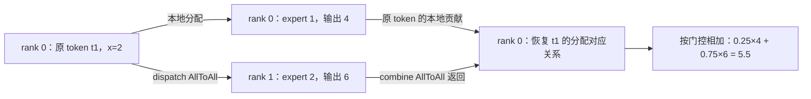

# MoE 的 token 怎样路由到专家，为什么 Expert Parallel 需要 AllToAll？

> 四个 token 各选两个专家，会产生八条“token—expert 分配”，同一个 token 可以出现在多个专家输入中。Expert Parallel（EP，专家并行）把不同专家的参数放在不同设备上，再把这些输入分配送到相应设备，计算后返回原 token 的 owner，按门控权重相加。
>
> 本篇用一组可以手算的数字追踪“选谁、送到哪、怎样回来”，再对应 Megatron 的路由器与 AllToAll dispatcher。两道练习和真实双进程实验验证输出与梯度，容量、负载和 GPU 性能的边界分别说明。

## 1. 先看一个 token 怎样同时使用两套参数

假设有四个专家，编号为 `0…3`。先把专家简化成四个标量函数：`f_e(x)=(e+1)x`。因此输入 `x=2` 时，四个专家分别输出 `2、4、6、8`。它们各有自己的参数，工程里的专家通常是更大的前馈网络（FFN／MLP），接受同宽的 token 向量并输出同宽向量。

一个小网络叫作 **router（路由器）**，根据 token 的表示给专家打分。分数在归一化前称为 logits。假设它给这个 token 的完整 Softmax 概率为：

```text
expert：    0     1     2     3
prob：     0.1   0.2   0.6   0.1
```

Top-2 选择分数最高的专家 `2` 与 `1`。若在被选中的两个分数之间重新做 Softmax，门控权重是 `0.75` 和 `0.25`，则输出为：

\[
y=0.75f_2(2)+0.25f_1(2)=0.75\times6+0.25\times4=5.5.
\]

这里的专家编号决定使用哪套权重，门控权重决定各专家结果的贡献。通常不需要把专家参数随 token 来回搬运；参数驻留在相应 owner，跨设备移动的是 token 激活及必要的路由信息。

主问题随之出现：若专家 `1` 在 rank 0、专家 `2` 在 rank 1，这个 token 的两份计算怎样找到正确设备，又怎样合成原 token 的一个输出？rank 是进程组中的编号，下面先固定两个 rank、每个 rank 持有两个连续编号专家。

前置阅读：[GEMM 分块](../../10/2026-10-23-gemm-tiling/README.md)、[训练梯度通信](../2026-11-03-ddp-gradient-overlap/README.md)、[通信链路](../2026-11-11-allreduce-links-topology/README.md)、[Tensor Parallel](../2026-11-17-tensor-parallel-linear/README.md)。本篇会就地解释路由和专家所有权。

## 2. Top-k、Softmax 和加权输出要先约定清楚

### 2.1 选择相同专家，不代表计算相同

设某 token 对专家 `e` 的分数为 `z_e`，选中集合为 `S`，其大小为 `k`。下面两种门控都可能使用：

\[
g_e^{\mathrm{pre}}=\frac{e^{z_e}}{\sum_{j=0}^{E-1}e^{z_j}},\quad e\in S;
\qquad
g_e^{\mathrm{post}}=\frac{e^{z_e}}{\sum_{j\in S}e^{z_j}},\quad e\in S.
\]

第一种先对全部 `E` 个专家归一化，再保留被选中的概率；第二种只对选中的 `k` 个分数归一化。对普通 Softmax 的同一组有限分数，两者选择的 Top-k 相同，但输出权重不同。

刚才的 token 若使用第一种，权重保留 `0.6` 与 `0.2`，输出是 `4.4`；第二种得到 `5.5`。被选概率和分别为 `0.8` 与 `1`。本篇主例子与练习默认采用第二种，并提供开关验证第一种。

原始稀疏 MoE 论文 [Shazeer 等，2017，式（1）、（3）—（5）](https://arxiv.org/html/1701.06538v1)给出稀疏加权专家输出，并在加噪分数上 KeepTopK 后做 Softmax。本文省略噪声，只验证确定性门控。Switch Transformer 的 [式（1）—（2）与第 2.1 节](https://arxiv.org/html/2101.03961v3)采用完整专家概率并讨论 Top-1；不要把它的门控规则机械替换成本篇默认规则。

一个有帮助的边界是：如果 `k=1` 且只在选中集合内做 Softmax，唯一门控恒为 `1`，主任务不能通过这个常数门控获得路由 logits 的梯度。先对全体专家做 Softmax 再选 Top-1 时，保留的概率仍随 logits 变化。测试专门验证两者差异。路由索引本身的离散变化不由普通反向传播求导；本篇梯度验证针对选中集合不变的邻域。

### 2.2 用四个 token 走完整条路径

令四个 token 的标量输入为 `[1,2,3,4]`，把它们叫作 `t0…t3`。router 的完整概率如下；代码使用这些概率的对数作为 logits：

| token | 原 token 的 rank | 完整专家概率 `[e0,e1,e2,e3]` | 选中的专家及重归一化权重 | 标量输出 |
| --- | --- | --- | --- | --- |
| t0，`x=1` | 0 | `[.5,.3,.15,.05]` | `e0:5/8，e1:3/8` | `11/8=1.375` |
| t1，`x=2` | 0 | `[.1,.2,.6,.1]` | `e2:3/4，e1:1/4` | `11/2=5.5` |
| t2，`x=3` | 1 | `[.05,.15,.3,.5]` | `e3:5/8，e2:3/8` | `87/8=10.875` |
| t3，`x=4` | 1 | `[.4,.1,.35,.15]` | `e0:8/15，e2:7/15` | `116/15≈7.733333` |

把一次选中称为一条 **assignment（分配）**。这里 `T=4、k=2`，共有 `Tk=8` 条分配，各专家分别收到 `[2,2,3,1]` 条。`t1` 发给两个专家的输入值相同，但专家编号和门控权重不同。它们不能在通信前合并成一份“平均专家”。

## 3. AllToAll 怎样把分配送到专家 owner？

### 3.1 先算发送矩阵，再讨论通信

让 rank 0 拥有专家 `[0,1]`，rank 1 拥有 `[2,3]`。每个源 rank 先按目标 rank 把分配打包。令 `S[r,d]` 表示源 `r` 发给目标 `d` 的**分配行数**，则本例为：

\[
S=\begin{bmatrix}3&1\\1&3\end{bmatrix}.
\]

rank 0 的 `t0→e0、t0→e1、t1→e1` 留在本 rank，`t1→e2` 发往 rank 1。rank 1 的 `t2→e3、t2→e2、t3→e2` 留在本 rank，`t3→e0` 发往 rank 0。

对源 rank，发送 splits 是矩阵的一行；对目标 rank，接收 splits 是矩阵的一列，顺序按源 rank 排列。真实路由通常没有这种对称性，不能用自己的发送列表冒充接收列表。各 rank 必须先获得一致的计数，再分配接收缓冲并执行不等长 AllToAll。

如果两个源都只选专家 `[0,1]`，矩阵就变成 `[[4,0],[4,0]]`。rank 0 发送 `[4,0]`，却接收 `[4,4]`；rank 1 发送 `[4,0]`，接收 `[0,0]`。后面的真实双进程实验会运行这个非对称、空 owner 的用例。

**AllToAll** 表示组内每个 rank 可以把不同数据片段发给各个 rank。数据是 token 激活行，不是需要相加平均的同一份梯度。将它替换成 AllReduce，会混淆不同 token 与专家的对应关系。自发自收的片段属于接口的一部分，也不能全部算成跨设备网络流量。

### 3.2 输出回来，还需要反排列和相加

以 `t1` 为例：



这是自编依赖图，不是测得的通信并发时间轴。[图源](figures/dispatch-combine.mmd)。

专家计算后，原发送矩阵的目标／源角色交换，数据沿返回路径回到原 token owner。还要使用打包时保存的逆映射，把专家输出与原分配对应。最后执行：

\[
y_t=\sum_{e\in S_t\,\text{且保留}}g_{t,e}f_e(x_t).
\]

同一 token 的多条结果应做带权 **scatter-add（按索引累加）**。覆盖写会丢掉其他专家贡献，简单平均则会丢掉门控权重。逆通信只负责把行送回来，本地逆排列与累加负责恢复语义。

## 4. 专家容量和负载均衡分别解决什么问题？

### 4.1 两个 rank 都收到四行，为什么仍可能不均衡？

本例两个 rank 各有四条分配，但 rank 1 内两个专家分别处理 `3` 行与 `1` 行。若不同专家形成不同大小的 GEMM，小专家可能无法充分利用硬件；较热专家可能决定计算时间和缓冲需求。

因此至少要同时观察每专家分配数、每 rank 接收行数、跨设备分配数和 padding／drop 数。仅观察每 rank 的 token 总数，会漏掉专家内部的不均匀。实际耗时还依赖分组 GEMM、形状、dtype 和通信，不等于简单的行数计数。

### 4.2 容量是上限，超过它要改变哪些计算？

在一个明确的路由 batch 中，设 token 数为 `T`、专家数 `E`、每 token 选 `k` 个专家，平均每专家有 `Tk/E` 条分配。容量系数为 `a` 时，可定义：

\[
C=\left\lceil a\frac{Tk}{E}\right\rceil.
\]

`T` 的统计范围必须写清楚。本篇练习是在一次调用的输入 batch 上执行容量限制；它不是自动对整个 EP 组建立统一配额。Megatron 被分析的 helper 也从收到的路由矩阵形状计算容量，再由调用方决定其输入范围。[容量公式](https://github.com/NVIDIA/Megatron-LM/blob/2e7c0b68b3aa75c2ebfc7eb35afcc513b7aad72a/megatron/core/transformer/moe/moe_utils.py#L273-L291)、[调用时计入 Top-k 分配](https://github.com/NVIDIA/Megatron-LM/blob/2e7c0b68b3aa75c2ebfc7eb35afcc513b7aad72a/megatron/core/transformer/moe/moe_utils.py#L1271-L1305)。

本例 `a=1`，所以 `C=2`。若按门控分数保留每个专家最高的两条分配，专家 `2` 的三条权重为 `t1:3/4、t2:3/8、t3:7/15`，会丢掉 `t2→e2`。保留计数变成 `[2,2,2,1]`，`t2` 的 MoE 输出从 `10.875` 变成 `7.5`。

这里没有重新归一化剩下的 `5/8` 门控。Megatron 本次非 padding 分支同样将原概率乘以保留 mask，并未追加一次重归一化。容量丢弃会改变模型的专家分支输出，不能当成纯粹无损的通信优化。如果一个 token 的所有分配都被丢弃，它在本教学 MoE 分支输出为零；模型外围的 residual 不在练习中实现。

增大容量可减少丢弃，但固定容量 padding 会增加空槽的计算／通信。dropless 路线不丢分配，代价是动态数量与峰值负载需要容纳。Switch 论文 [第 2.2 节与图 3](https://arxiv.org/html/2101.03961v3)讨论 Top-1 的容量与溢出，本篇式子加入 `k` 后对应多分配计数，未声称二者所有执行细节相同。

### 4.3 辅助 loss 是训练信号，不是硬容量保证

令 `n_e` 为容量丢弃前分给专家 `e` 的条数，完整专家 Softmax 概率为 `p_{t,e}`。一种 Switch 风格的 Top-k 扩展为：

\[
f_e=\frac{n_e}{Tk},\qquad P_e=\frac1T\sum_t p_{t,e},\qquad
L_{aux}=\lambda E\sum_e f_eP_e.
\]

`f_e` 是离散分配频率，普通反向不穿过 Top-k 索引；`P_e` 是连续可导的平均概率。Switch 原文 [式（4）—（6）](https://arxiv.org/html/2101.03961v3)对应 `k=1`；当前 Megatron 的 [归一化说明](https://github.com/NVIDIA/Megatron-LM/blob/2e7c0b68b3aa75c2ebfc7eb35afcc513b7aad72a/megatron/core/transformer/moe/moe_utils.py#L84-L116)与[非融合实现](https://github.com/NVIDIA/Megatron-LM/blob/2e7c0b68b3aa75c2ebfc7eb35afcc513b7aad72a/megatron/core/transformer/moe/moe_utils.py#L171-L175)包含 Top-k 归一化和统计范围。

本例 `f=[.25,.25,.375,.125]`，`P=[.2625,.1875,.35,.2]`，因此 `λ=.01` 时，`L_aux=.01075`。丢弃后再统计负载会遮住原本的热点；本篇练习单独从未丢弃的路由计算辅助项。当前 router 也为辅助 loss 单独构造相应的路由和分数输入，不能把所有策略都简单视作最终 dropped map 的计数。[辅助项输入](https://github.com/NVIDIA/Megatron-LM/blob/2e7c0b68b3aa75c2ebfc7eb35afcc513b7aad72a/megatron/core/transformer/moe/router.py#L1216-L1230)。

即使辅助 loss 数值恰好等于均匀参考值，也不能证明本批负载均匀：所有 logits 相等时，本教学确定性 tie 规则始终选 `[0,1]`，负载为 `[4,4,0,0]`，但 `P` 均匀使该 loss 为 `λ`。要同时看真实计数。辅助 loss 也不能保证每步、每层、每 rank 没有热点。

## 5. 训练反向为什么还需要两次反向交换？

对固定路由集合，输出由多个专家分支相加：

\[
\frac{\partial L}{\partial g_{t,e}}=
\frac{\partial L}{\partial y_t}\cdot f_e(x_t),\qquad
\frac{\partial L}{\partial f_e(x_t)}=g_{t,e}\frac{\partial L}{\partial y_t}.
\]

输出梯度先回到相应专家计算，专家产生输入梯度，再回到原 token owner；同一个 token 的多条输入梯度还要相加。专家参数由专家 owner 持有，其梯度必须包含来自所有 token 源 rank 的分配贡献。

AllToAll 本身是数据重排，第一阶反向就是用对调的 input／output splits 把梯度传回。它不负责额外除以 EP 大小。[Megatron 自定义反向](https://github.com/NVIDIA/Megatron-LM/blob/2e7c0b68b3aa75c2ebfc7eb35afcc513b7aad72a/megatron/core/tensor_parallel/mappings.py#L473-L488)正是交换两组 splits 后再次调用相应通信。

本次双进程实验有 `4` 个 token、每 token 输出宽度 `2`，全局平方均值的分母为 `8`。各源 rank 使用本地 `SSE/8`，两者相加才是完整 loss。若各自取局部均值，专家 owner 收到的总梯度会改变尺度。复制的 router／其他模型参数还可能需要其他进程组的梯度归约；实验只验证独立 logits、token 和分片专家参数，未替代完整训练框架验收。

空专家也要参与正确的反向协议。在压力样例中，所有 token 只选 rank 0 的专家，rank 1 接收零行，仍须调用匹配的通信并保持可导的空张量路径。跳过某个 rank 的 collective，或让空输出脱离反向图，都可能破坏匹配。本篇实际测试了这个边界。

## 6. 从概念追到 Megatron 的具体实现

### 6.1 本次固定了哪些版本？

检索日为 `2026-11-20`。本次实际 fetch 两个官方默认分支与稳定 tag，固定快照如下：

| 仓库 | 本次 main commit | 当日最新稳定 tag 与完整 commit |
| --- | --- | --- |
| Megatron-LM | `2e7c0b68b3aa75c2ebfc7eb35afcc513b7aad72a` | `core_v0.20.1`：`f7aa73b2d9cdda75421be7067d221a5cb90e0f43` |
| PyTorch | `3d9ded4cb906777b32d099ef17dfb28d50b623c2` | `v2.15.0`：`31a77fc9c0a7c6fff15a1ff58c743f53b1a9d457` |

本机实际运行的 PyTorch 包为 `2.15.0`，其 build SHA 为 `d0f2af8b66b20da4baa50644c0cd3f887a2eae2e`，与两个上游快照分开记录。[源码清单](evidence/source-manifest.json)、[获取记录](evidence/source-update.json)、[实际环境](evidence/runs/verification.json)。

**跨版本默认值确实不同。** 本次 main 的 `moe_token_dispatcher_type` 默认是 `alltoall`；最新稳定 `core_v0.20.1` 仍默认 `allgather`。[main 默认值](https://github.com/NVIDIA/Megatron-LM/blob/2e7c0b68b3aa75c2ebfc7eb35afcc513b7aad72a/megatron/core/transformer/transformer_config.py#L1144-L1155)、[稳定版默认值](https://github.com/NVIDIA/Megatron-LM/blob/f7aa73b2d9cdda75421be7067d221a5cb90e0f43/megatron/core/transformer/transformer_config.py#L1010-L1020)。因此复现本文分析时要明确指定 `--moe-token-dispatcher-type alltoall`，不能仅凭浮动文档或另一版本的默认值判断。

### 6.2 路由：先核对 gate，再核对容量

现在要问的是：哪一行决定第 2 节的 `4.4` 与 `5.5`？`TopKRouter.routing` 调用 `topk_routing_with_score_function`，传入 `moe_router_pre_softmax`、score function、分组等参数。[路由入口及容量调用](https://github.com/NVIDIA/Megatron-LM/blob/2e7c0b68b3aa75c2ebfc7eb35afcc513b7aad72a/megatron/core/transformer/moe/router.py#L1187-L1214)。在本篇分析的非融合、普通 Softmax、无分组／专家 bias 路线上，helper 明确区分全专家 Softmax 与选中分数 Softmax，并以 FP32 计算中间概率。[实际分支](https://github.com/NVIDIA/Megatron-LM/blob/2e7c0b68b3aa75c2ebfc7eb35afcc513b7aad72a/megatron/core/transformer/moe/moe_utils.py#L1078-L1094)。练习保留 float64 以便数值对照，并非逐字节复现其 FP32 kernel。

配置中的 `moe_expert_capacity_factor=None` 表示该设置下不主动丢分配；若启用，本次 helper 以容量 mask 限制专家输入，可按概率或其他策略选择。教学实现按最高 gate 保留，并为相同分数定义稳定 tie 顺序；没有把这个顺序当作上游 `torch.topk` 的保证。[默认容量配置](https://github.com/NVIDIA/Megatron-LM/blob/2e7c0b68b3aa75c2ebfc7eb35afcc513b7aad72a/megatron/core/transformer/transformer_config.py#L1173-L1184)、[保留 mask](https://github.com/NVIDIA/Megatron-LM/blob/2e7c0b68b3aa75c2ebfc7eb35afcc513b7aad72a/megatron/core/transformer/moe/moe_utils.py#L1271-L1305)。

### 6.3 打包、分发、专家计算、返回分别在哪？

`MoELayer` 根据显式配置选择 `MoEAlltoAllTokenDispatcher`。它先根据路由计数形成 input／output splits，再排列 hidden states 与概率，并保存逆映射。[dispatcher 选择](https://github.com/NVIDIA/Megatron-LM/blob/2e7c0b68b3aa75c2ebfc7eb35afcc513b7aad72a/megatron/core/transformer/moe/moe_layer.py#L391-L413)、[splits](https://github.com/NVIDIA/Megatron-LM/blob/2e7c0b68b3aa75c2ebfc7eb35afcc513b7aad72a/megatron/core/transformer/moe/token_dispatcher.py#L573-L606)、[排列](https://github.com/NVIDIA/Megatron-LM/blob/2e7c0b68b3aa75c2ebfc7eb35afcc513b7aad72a/megatron/core/transformer/moe/token_dispatcher.py#L674-L694)。

随后 dispatcher 分别对 token 数据和概率执行 AllToAll；local expert 阶段接收分配后的张量、每专家 token 数与概率，调用实际专家模块。返回阶段对调 splits，执行 combine 通信，最后使用保存的排列信息恢复原输出。[token 与概率发送](https://github.com/NVIDIA/Megatron-LM/blob/2e7c0b68b3aa75c2ebfc7eb35afcc513b7aad72a/megatron/core/transformer/moe/token_dispatcher.py#L719-L740)、[专家调用](https://github.com/NVIDIA/Megatron-LM/blob/2e7c0b68b3aa75c2ebfc7eb35afcc513b7aad72a/megatron/core/transformer/moe/moe_layer.py#L707-L729)、[返回 AllToAll](https://github.com/NVIDIA/Megatron-LM/blob/2e7c0b68b3aa75c2ebfc7eb35afcc513b7aad72a/megatron/core/transformer/moe/token_dispatcher.py#L878-L888)、[恢复排列](https://github.com/NVIDIA/Megatron-LM/blob/2e7c0b68b3aa75c2ebfc7eb35afcc513b7aad72a/megatron/core/transformer/moe/token_dispatcher.py#L890-L915)。

两类重排要分开：按目标 owner 排列利于网络发送，按本地专家排列利于专家 GEMM。官方流程在 TP>1 时还可能加入 TP AllGather／ReduceScatter；本篇实验固定 TP=1，不能把完整 Megatron 通信总量简化成两次裸 AllToAll。[官方 dispatcher 流程](https://docs.nvidia.com/megatron-core/developer-guide/latest/apidocs/core/core.transformer.moe.token_dispatcher.html)。

本教学实现把门控留在源 rank，在专家输出返回后加权。所分析的上游路径会发送概率并把它们交给专家模块。两者用于本篇独立专家输出的线性加权时数学语义相同，但消息数与 gate 应用位置不同。`moe_apply_probs_on_input` 的可选路径改变加权位置，并有 Top-1 限制；没有据此宣称所有配置等价。[该选项的专家分支](https://github.com/NVIDIA/Megatron-LM/blob/2e7c0b68b3aa75c2ebfc7eb35afcc513b7aad72a/megatron/core/transformer/moe/experts.py#L2051-L2066)。

## 7. 收益、代价与验证怎样组织？

总专家参数量可以随 `E` 增长，每个 token 只激活其中 `k` 个专家；但 router 仍需打分，专家权重、优化器状态和通信都要占资源。与“把所有专家都算一遍”的参照相比，稀疏计算减少了未选专家工作；不能据此直接宣称它比相同激活规模的 dense 模型快 `E/k` 倍。

若实际跨设备的保留分配共有 `R` 行，FFN 输入／输出宽度都为 `D`，每元素 `b` 字节，则一次前向 dispatch 加返回的远端 hidden-state 负载约为 `2RDb` 字节，口径是**所有 rank 合计发送的远端数据**，不再把同一接收额外算一遍。本例 `R=2`；若假设 `D=4096、b=2`，得到 `32 KiB`。这只是重设宽度后的教学预算，实际程序运行的是 `D=2`、float64。

该预算排除了路由 metadata、概率传输、padding、协议、网络转发与反向，也排除 self 片段。融合 dispatcher 可能减少重复跨节点 token 发送或改变数据布局，必须按具体 backend 重算；本篇没有测量这些优化。[数值与预算 JSON](evidence/runs/06-answers.json)。

工程选择可以按以下证据顺序推进：

1. **先验语义**：固定小输入，对齐 Top-k、门控归一化、drop map、输出和各梯度，确认 loss 分母。
2. **再数负载**：记录 drop 前后每专家分配、每 rank 接收 splits、空专家与最热专家，避免用均值掩盖热点。
3. **再测执行**：在指定硬件／版本上区分打包、通信、专家 kernel、逆排列与整个 step。小 GEMM、跨慢链路或 padding 过多会改变收益。
4. **最后试优化**：分组 GEMM、通信融合、拓扑感知放置、分组路由或 overlap 都需在正确性保持的前提下测量。改变路由集合还会影响模型训练，不能只报告吞吐。

## 8. 两道代码练习与完整详解

代码入口：[起始接口](code/exercises.py)、[完整答案](code/answers.py)、[运行说明](code/README.md)。使用已有 CPU PyTorch，无需安装 Megatron 或 CUDA。下列命令从本篇目录执行。

### 练习一：把 router 分数变成可核对的分配表

实现 `route_tokens(logits, topk, pre_softmax=False, capacity=None)`，返回原 token 索引、专家索引、可导 gate 与统计维度。支持两种 Softmax 位置；按最高 gate 实施容量限制，丢弃后不重新归一化。相同路由分数选更小专家编号，相同容量分数选更早 token；这些是本题的确定性规则。

验收：四 token 例子得到专家计数 `[2,2,3,1]`；容量 `2` 后为 `[2,2,2,1]`，恰好删除 `t2→e2`。检查两种归一化的概率和、非法形状／Top-k／非有限分数，以及 `capacity=0` 的空表。

<details>
<summary>详解：保留身份信息，让后续重排仍能返回原 token</summary>

先按每行 logits 找 Top-k，记录专家索引；按选定语义计算权重，再将 `[T,k]` 展平，同时生成重复的 token 索引。限制容量时只筛除 assignment，保留权重的计算图，不能把 gate 转成 Python 数字重建 Tensor。[完整实现](code/answers.py)。

`load_balance_loss` 单独用完整 Softmax 和丢弃前计数计算，不自动混入主任务。题目不对 Top-k 索引求导；门控与专家的数值梯度在路由集合不变处验收。

```bash
PYTHONDONTWRITEBYTECODE=1 python -m unittest discover -s code -p test_answers.py -v
PYTHONDONTWRITEBYTECODE=1 python code/run_answers.py
```

本次 `23` 项测试通过，包括第二题；还执行了优化模式和有限差分。[测试原始输出](evidence/runs/02-tests.txt)、[数值结果](evidence/runs/06-answers.json)。

</details>

### 练习二：按专家 owner 打包，再正确合并所有返回结果

给定第一题的 Routes，使用每 rank 拥有 `E/p` 个连续专家的布局，构造发送顺序与 splits。专家输出返回后先恢复分配顺序，再实现 `combine_tokens(expert_output, routes)`。不要丢掉同一 token 的多条贡献。辅助 `dispatch_plan` 已给出参考实现，可以自行重写验证。

验收：本例两源 rank 的 splits 为 `[3,1]`、`[1,3]`，标量结果为 `[11/8,11/2,87/8,116/15]`；容量限制后 `t2` 输出为 `7.5`。使用普通两层专家 `tanh(XW1)W2` 时，稀疏打包结果及 token、logits、两组专家权重的梯度都要与“计算全部专家后按门控选择”的独立 dense 对照一致。空分配与未使用专家的梯度应为零。

<details>
<summary>详解：owner 排列、逆映射和 scatter-add 缺一不可</summary>

由 `expert_id // (E/p)` 得到目标 rank，稳定按目标排列 assignment，并统计每个目标的行数。收到的每行只执行指定专家，返回后应用逆排列。最后将 `expert_output * gate` 按原 token 索引累加；这里不能覆盖写，也不能再次平均。[参考实现](code/answers.py)、[单进程测试](code/test_answers.py)。

另附 [distributed_cpu.py](code/distributed_cpu.py)：启动两个真实 CPU／Gloo rank，交换计数和专家 ID，执行可导的不等长 AllToAll dispatch／combine，并在反向对调 splits。它运行两种场景：本例的混合路由，以及所有分配都发往 rank 0 的空 owner 场景。

```bash
# 本次 macOS 的回环接口为 lo0；其他系统按实际接口调整。
PYTHONDONTWRITEBYTECODE=1 GLOO_SOCKET_IFNAME=lo0 OMP_NUM_THREADS=1 \
python code/distributed_cpu.py
```

四条 `EP_RESULT` 均通过，输出、`dx`、`dlogits`、专家 `dW1／dW2` 和一步 SGD 结果与独立 dense 对照一致，最大绝对误差约 `4.34×10⁻¹⁹`，容差 `rtol=atol=1e-12`。[原始输出](evidence/runs/07-distributed.txt)、[解析结果](evidence/runs/07-distributed.json)。

空 owner 场景中，rank 0 接收 splits 为 `[4,4]`，rank 1 为 `[0,0]`；后者仍参加 collective 与反向。实际专家为无 bias 的两层 tanh 网络，保留零贡献的 autograd 依赖以处理空行与未使用参数。SGD 对照是按梯度执行一次 `W-.05dW` 的算术检查，不包含优化器状态。

程序为独立对照还构造完整合成输入，不能用它测训练显存收益。真实分布式部分没有启用容量丢弃、辅助 loss 训练、TP、shared expert、FP8、GPU／NCCL 或 overlap，也不支持通过此包装器推断高阶 collective 梯度。没有把 CPU 正确性当作 GPU 性能。

</details>

## 9. 面试官继续追问

| 层次 | 追问 | 参考回答要点 |
| --- | --- | --- |
| 基础 | token 选两个专家，是否要复制两套专家权重？ | 参数在各专家 owner 驻留；分配复制或重排 token 激活，并记录专家与原 token 身份。 |
| 数值 | Top-k 相同，输出为什么仍不同？ | Softmax 的归一化范围不同；pre／post 的 gate 和不一定相同，Top-1 梯度也不同。 |
| 通信 | 为什么用 AllToAll 而不是 AllReduce？ | 各源需要发送不同 token 行给不同 owner，保持身份；不是对相同位置做全组求和。 |
| 实现 | 返回 AllToAll 后是否就完成了？ | 还要逆排列，并将一个 token 的多专家贡献按 gate 相加。 |
| 容量 | 设定 capacity 会不会保持模型输出不变？ | 超限分配被丢弃，输出和梯度路径会变化；padding 与 dropless 有不同成本。 |
| 负载 | 每个 rank 行数相同就平衡了吗？ | 每专家 GEMM 大小可能不同，还要观察最热专家、空专家、padding 与真正的执行时间。 |
| 训练 | 为什么空专家不能直接跳过所有通信？ | collective 必须匹配，空张量也要保留反向路径；否则其他 rank 可能等待或缺少梯度。 |
| 排障 | 稳定版和 main 的 dispatcher 默认不同，怎么办？ | 记录完整版本，显式设置 dispatcher，按实际分支核对 splits、layout 和 backend；先数值、后性能。 |

## 10. 适用范围与下一步

主线是确定性 token-choice Top-k、标准 Softmax、等数连续专家所有权、TP=1 和无 shared expert 的教学模型。没有复现原论文的噪声门控、完整 Switch 训练配方或 Megatron 的 fused GPU dispatcher。源码固定版本、论文机制和本机实测各自提供不同证据。

下一篇候选：**训练 profiler 的时间轴怎样区分 CPU 提交、GPU 执行与通信等待？** 用本篇已经能解释的重排、通信和专家阶段，继续学习如何验证真正的瓶颈。

资料：[参考资料与证据](references.md)。审查：[审查记录](review.md)。返回 [Wiki 索引](../../../index.md)。
