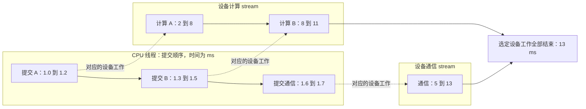

# 训练 profiler 的时间轴怎样区分 CPU 提交、GPU 执行与通信等待？

> 判断训练为什么慢，要先把“CPU 在调用什么”“设备在执行什么”“下一步在等谁”对起来。聚合表帮助找到值得展开的活动，时间轴和依赖帮助解释它们怎样影响整步完成时间。
>
> 本篇用一段可复算的合成 GPU 时间轴说明重叠，再真实采集一个 CPU 训练例子。读完应能区分累计时长、时间覆盖与关键路径，知道一段很长的通信活动还需要哪些证据才能归因。

## 1. 为什么耗时表里的第一名，不一定是优化第一步？

假设更换训练并行配置后，step 变慢。你打开 profiler，看到通信项占比很大，于是想减少 AllReduce 或 AllToAll。但至少有三件事尚未确定：该占比的分母是什么，通信是否与计算重叠，以及通信是否真的推迟了下一步。

前面已经讨论过 [异步计时](../../10/2026-10-23-gpu-asynchronous-timing/README.md)、[DDP 重叠](../2026-11-03-ddp-gradient-overlap/README.md)、[通信链路](../2026-11-11-allreduce-links-topology/README.md)、[流水线气泡](../2026-11-18-pipeline-parallel-schedules/README.md) 和 [MoE token 交换](../2026-11-20-moe-expert-parallel-alltoall/README.md)。今天把这些机制放到同一张观测图里：**怎样从 trace 中描述事实，再用可检验的假设缩小瓶颈范围？**

先看一个熟悉的训练计算：

```python
prediction = batch @ weight
loss = (prediction - target).square().mean()
loss.backward()
```

在本篇 CPU 练习里，这些算术由 CPU 执行。在 CUDA 场景中，Python／框架会选择实现、准备参数和提交设备工作；CPU 范围的结束通常不能作为对应设备工作完成的证据。一个框架算子还可能调用计算库、启动多个 kernel，或只完成视图操作而不启动 kernel。不要预设“一行 Python＝一个 kernel＝同一段时长”。PyTorch 的 CPU 插桩与设备采集分层见 [固定版本实现说明](https://github.com/pytorch/pytorch/blob/8aa44e99457abde4f2c0dd6156a09f5407ac90e0/torch/csrc/profiler/README.md#L59-L101)。

## 2. 先把 15 ms 数清楚

### 2.1 同一个窗口，有不同的执行轨道

下面全部是教学假设，不是 GPU 实测。只观察一块设备，CPU 与设备时间已经对齐，窗口为 `[0,15)` ms。stream 是设备工作队列；本例同一 stream 中的两个计算按顺序执行，通信在另一 stream 上。

| 轨道 | 活动 | 区间，单位 ms | 时长 |
| --- | --- | --- | --- |
| CPU 线程 | 提交计算 A 的 API | `[1.0,1.2)` | 0.2 ms |
| CPU 线程 | 提交计算 B 的 API | `[1.3,1.5)` | 0.2 ms |
| CPU 线程 | 提交通信的 API | `[1.6,1.7)` | 0.1 ms |
| 设备计算 stream | 计算 A | `[2,8)` | 6 ms |
| 设备计算 stream | 计算 B | `[8,11)` | 3 ms |
| 设备通信 stream | 通信活动 | `[5,13)` | 8 ms |

提交 A 的 API 花了 0.2 ms，A 在设备上花了 6 ms。它们描述不同资源上的两个范围，不能用其中一个代替另一个。B 虽然早已提交，仍需等本 stream 上的 A 完成。API 返回到 kernel 开始之间的间隔可能涉及队列、依赖或调度；不能把整段间隔命名为“CPU 启动开销”。kernel 也不必等到发起它的 API 范围完全返回才开始。应通过采集器提供的关联查看对应关系，不能只找时间上最近的 API。[Nsight Systems 时间轴关联说明](https://archive.docs.nvidia.com/nsight-systems/2026.4/UserGuide/index.html#timeline-correlation)



图中的实线表示队列顺序或教学完成条件，虚线表示提交与设备活动的对应关系。图不是按节点宽度绘制的实际 trace。两条设备轨道的交叠由数字判断：通信从 5 ms 开始，计算持续到 11 ms，因此有 6 ms 同时存在。图源保存在 [timeline.mmd](figures/timeline.mmd)。

### 2.2 为什么 6＋3＋8 不等于这一段经过的时间？

逐项时长相加是 `17 ms`，但计算和通信的并集只有 `[2,13)`，长度是 `11 ms`。同时发生的 6 ms 在逐项求和时算了两遍。

把计算区间集合记为 `C`、通信区间集合记为 `N`，`|·|` 表示区间并集的时间长度，窗口为 `W`。先将每个区间裁剪到窗口，再计算：

\[
|C|=9\text{ ms},\quad |N|=8\text{ ms},\quad |C\cap N|=6\text{ ms}
\]

\[
|C\cup N|=|C|+|N|-|C\cap N|=11\text{ ms}
\]

\[
|N\setminus C|=2\text{ ms},\qquad |W\setminus(C\cup N)|=4\text{ ms}
\]

所以，通信活动有 `6/8=75%` 的时间与选定计算交叠，另有 2 ms 没被这些计算覆盖。这只是一组区间的集合关系：**2 ms 并不自动等于删除通信后能节约的 step 时间**。计算、通信可能竞争 SM、内存带宽和链路；改变一种活动，还可能改变另一种活动的时长或调度。

同样，剩下的 4 ms 只能称为“窗口内没有选定计算／通信区间覆盖的时间”。其中可能有 CPU 准备、拷贝、未采集的设备活动或采集缺失。`11/15` 是选定活动的时间覆盖率，也不是 SM 利用率、算力利用率或硬件占用率。练习一会验证这几个不同口径。

这里用 ms 方便手算，代码与 Chrome JSON 使用 μs；`1 ms=1000 μs`。先统一单位和观察窗口，才能比较各条轨道。

### 2.3 那真正拖住完成的是谁？

关键路径是使目标完成时间最长的依赖链。一个简化模型中，节点 `v` 是一个活动，时长为 `d_v`，前置节点集合为 `pred(v)`，则最早完成时间为：

\[
F_v=d_v+\max_{u\in pred(v)}F_u
\]

无前置节点时从指定起点计算。资源串行约束也必须体现为依赖；只有观测到的矩形范围，没有足够的边，还不能完整重建这张图。

在上面的固定时序模型里，如果只把通信从 8 ms 缩短到 4 ms，开始时间仍为 5 ms，且其他时长、队列和依赖全部不变，那么通信结束从 13 ms 提前到 9 ms，但计算仍到 11 ms，选定工作的完成只能从 13 ms 提前到 11 ms。模型收益是 2 ms。真实优化必须重新测量，不能直接用“通信累计 8 ms”预测节约 8 ms。

## 3. 看表之前，先认清范围和分母

### 3.1 CPU total 和 Self CPU 各表示什么？

设一个 `forward` CPU 范围持续 100 μs，内部有一个同步子范围 `matmul`，持续 80 μs。父范围 CPU total 为 100 μs，Self CPU 为 20 μs；若把父子两行 total 相加，就会得到没有墙钟意义的 180 μs。

PyTorch 为同步 CPU 事件按线程和节点构造嵌套关系，再从父事件 total 中减去直接子事件 total。这里的 self 是“没有归入这些子范围的部分”。它仍可能包含等待、Python 调度或没有更细插桩的工作，不能解释为 CPU 核心实际忙碌的时间。跨线程工作也不能用同线程嵌套树简单扣掉。[父子范围条件](https://github.com/pytorch/pytorch/blob/8aa44e99457abde4f2c0dd6156a09f5407ac90e0/torch/autograd/profiler_util.py#L142-L172)、[self time 计算](https://github.com/pytorch/pytorch/blob/8aa44e99457abde4f2c0dd6156a09f5407ac90e0/torch/autograd/profiler_util.py#L916-L945)

### 3.2 Device total 是某个连续的设备窗口吗？

在本文核验的非 legacy 路径中，一个 CPU 算子的 device total 会累计关联 kernel 的 duration，并纳入 CPU 子事件的 device total。它没有先对并行 stream 的区间做并集；父子条目之间还可能再次包含同一批活动。因此，聚合表的 device total、独立设备事件的累计时长、设备时间覆盖，必须分别解释。[device total 与 self device total 的实现](https://github.com/pytorch/pytorch/blob/8aa44e99457abde4f2c0dd6156a09f5407ac90e0/torch/autograd/profiler_util.py#L934-L986)

`key_averages()` 按算子名称，以及可选 shape／stack 等键进行聚合。它能回答“哪类操作累计较多、调用了多少次”，不能单凭一行恢复“第几个 microbatch、哪个 rank 的哪次通信挡住了谁”。百分比的分母要按工具和字段核验，不要把汇总表中占列总量的百分比当成整步墙钟占比。[聚合入口](https://github.com/pytorch/pytorch/blob/8aa44e99457abde4f2c0dd6156a09f5407ac90e0/torch/profiler/profiler.py#L862-L887)、[Nsight 汇总与时间字段](https://archive.docs.nvidia.com/nsight-systems/2026.3/AnalysisGuide/index.html)

## 4. 这些范围怎样进入 PyTorch profiler？

### 4.1 先固定版本边界

2026-11-23 实际 fetch 的 PyTorch 默认分支为 `main`，commit 为 `8aa44e99457abde4f2c0dd6156a09f5407ac90e0`。同期核验的最新正式 release 为 `v2.15.0`，tag commit 为 `31a77fc9c0a7c6fff15a1ff58c743f53b1a9d457`，release 发布时间为 2026-10-28。

本机安装包报告 `torch==2.15.0`，构建 SHA 却是 `d0f2af8b66b20da4baa50644c0cd3f887a2eae2e`。本篇没有把“同一个版本字符串”当成“同一个源码构建”：源码分析固定到上述 main／tag，运行结论只属于记录的本机安装包。[获取记录](evidence/source-update.json)、[运行环境](evidence/runs/verification.json)

以下主线分析普通配置下的 Kineto 路径，Kineto 是 PyTorch 对接活动采集的后端。本次 main 和稳定 tag 都有显式配置的 Cuspy 分支，不能说所有后端都只走一套实现；本篇没有启用或验证该分支。[main 的选择条件](https://github.com/pytorch/pytorch/blob/8aa44e99457abde4f2c0dd6156a09f5407ac90e0/torch/profiler/profiler.py#L411-L426)、[稳定 tag 的选择条件](https://github.com/pytorch/pytorch/blob/31a77fc9c0a7c6fff15a1ff58c743f53b1a9d457/torch/profiler/profiler.py#L411-L420)

### 4.2 从 Python 的采样周期走到 C++ 回调

第一个问题是：为什么设置了 profiler，却只有几步出现在文件里？

`schedule` 返回一个“step 编号 → 采集动作”的函数。`wait=1,warmup=1,active=2,repeat=1` 对从零开始的编号给出：

| 训练步编号 | 动作 | 解释 |
| --- | --- | --- |
| 0 | NONE | 等待，不纳入 active trace |
| 1 | WARMUP | 准备采集设施，不纳入最终 active trace |
| 2 | RECORD | 活动采集 |
| 3 | RECORD_AND_SAVE | 本轮最后一个活动采集步 |
| 步 3 末尾调用 `prof.step()` | 转到编号 4 的 NONE | 完成窗口并触发回调，回调读到 `step_num=4` |

`prof.step()` 负责通知采集器进入下一步；它不会训练模型，也不等同于 `optimizer.step()`。本例在每个训练步末尾调用一次。多轮采样应在 `on_trace_ready` 中分别导出，避免结束时只拿到最后一个窗口。[schedule](https://github.com/pytorch/pytorch/blob/8aa44e99457abde4f2c0dd6156a09f5407ac90e0/torch/profiler/profiler.py#L1065-L1100)、[动作转换](https://github.com/pytorch/pytorch/blob/8aa44e99457abde4f2c0dd6156a09f5407ac90e0/torch/profiler/profiler.py#L1367-L1403)、[官方 API](https://docs.pytorch.org/docs/2.15/profiler.html)

第二个问题是：`phase::forward` 或 `aten::mm` 的 CPU 范围从何而来？按已核验代码读下去：

1. `torch.profiler.profile.prepare_trace` 创建底层 autograd profiler，并传入 `use_kineto=True` 和 shape／stack 等选项。
2. 底层 `_prepare_trace`、`_start_trace` 分别调用原生准备和启用接口。
3. C++ 注册 `RecordFunction` 进入／退出回调；`onFunctionEnterTLS` 把当前操作交给线程子队列的 `begin_op`。
4. `begin_op` 保存名称、scope 等字段，并在没有禁用外部关联时推入 correlation ID。用户标记与普通算子的关联 scope 分开处理。

这些是从调用入口到记录点的实际路径。它们解释为什么手工标记能与框架算子一起出现，而不是“性能分析器读到了所有 Python 函数”。没有打开相应采集功能，普通 Python 代码不一定有细粒度范围。[Python 准备入口](https://github.com/pytorch/pytorch/blob/8aa44e99457abde4f2c0dd6156a09f5407ac90e0/torch/profiler/profiler.py#L482-L526)、[原生启用](https://github.com/pytorch/pytorch/blob/8aa44e99457abde4f2c0dd6156a09f5407ac90e0/torch/autograd/profiler.py#L401-L428)、[C++ 回调](https://github.com/pytorch/pytorch/blob/8aa44e99457abde4f2c0dd6156a09f5407ac90e0/torch/csrc/autograd/profiler_kineto.cpp#L453-L459)、[记录与关联](https://github.com/pytorch/pytorch/blob/8aa44e99457abde4f2c0dd6156a09f5407ac90e0/torch/csrc/profiler/collection.cpp#L359-L385)

### 4.3 怎样把 CPU 操作和设备活动联系起来？

在 CUDA 的相应采集路径中，Kineto 与 CUDA 的活动采集接口 CUPTI 等设施交互，再把设备活动交回 profiler 做关联与导出。CPU 操作时间、CUDA 运行时／驱动 API 时间与设备 kernel 时间是不同记录。[固定版本架构说明](https://github.com/pytorch/pytorch/blob/8aa44e99457abde4f2c0dd6156a09f5407ac90e0/torch/csrc/profiler/README.md#L95-L101)

Python 的 `_parse_kineto_results` 按 `linked_correlation_id()` 建立映射，再将关联的设备事件挂到相应 CPU 事件。它还过滤没有有效 external ID 的未关联记录，避免把数值偶然相同的 ID 当成同一个操作。**ID 要连同采集器语义、进程／设备作用域解释，不能把任意两个名为 correlation 的字段直接跨文件连接。** 稳定 tag 中也核对到这条过滤路径。[main 关联逻辑](https://github.com/pytorch/pytorch/blob/8aa44e99457abde4f2c0dd6156a09f5407ac90e0/torch/autograd/profiler.py#L773-L811)、[稳定 tag](https://github.com/pytorch/pytorch/blob/31a77fc9c0a7c6fff15a1ff58c743f53b1a9d457/torch/autograd/profiler.py#L779-L811)

CPU 支持采集、CUDA 可以使用、CUDA 设备活动真的出现在导出文件里，是三个不同条件。官方 API 还说明，缺少 CUPTI 时可能回退到 legacy CUDA 计时：表里有 CUDA 时间，JSON 却没有对应设备 trace。遇到设备轨道为空，应先检查采集能力和输出完整性，不能判定“GPU 没工作”。本机只有 CPU activity，因此本篇不验证 CUDA 关联本身。[官方能力与回退说明](https://docs.pytorch.org/docs/2.15/profiler.html)

## 5. 怎样从“通信很长”推进到可检验的解释？

### 5.1 先分清 CPU 提交、设备活动和依赖等待

一次 collective（参与进程共同完成的集合通信）可以经历应用调用、runtime 调度、kernel 提交和设备执行。分组、非阻塞 communicator、CUDA Graph 等配置会改变这些阶段的线程和对应关系。某些工具提供的 NCCL（GPU 集合通信库）投影或扩展 tracing 还依赖版本与采集模式，不能把一行 CPU NCCL 范围当成完整的设备传输范围。[Nsight Systems 的 NCCL 执行概念](https://docs.nvidia.com/nsight-systems/UserGuide/index.html)

下面的 rank 表示参与分布式训练的进程身份编号。

假设两个 rank 要进行同一轮 AllReduce：rank 0 先准备好梯度，rank 1 因前面的计算晚到。早到 rank 的通信活动可能包含等待对端推进的时间；长范围并不能单独说明实际传输带宽低。反过来，CPU 的等待 API 可能承接此前异步设备工作的完成等待，“CPU 这一行很长”也不意味着这段代码消耗了很多 CPU 算力。这些是机制允许的解释，必须用下一步的观测区分。

至少检查这些互相配合的证据：

- 同一步、同一 process group、同一 collective 序号与消息大小，各 rank 什么时候准备好输入，什么时候提交、开始、完成？不能只对照两个同名 AllReduce。
- 哪个依赖消费者在等这次结果，等待是否位于 step 的完成路径上？是否有 stream event 或队列顺序作证？
- 其他 rank 在此前做什么，是否存在输入等待、计算不均、PP 气泡、MoE 专家负载不均或资源竞争？
- 在固定消息、拓扑和正确性条件下，通信微基准是否也退化？如果只在真实训练中出现，要继续核查到达偏斜、并发和资源竞争。

不同主机的原始时间戳未经对时与误差评估，不适合直接相减得到微秒级等待。先匹配逻辑 step／collective 身份，再明确工具是否完成跨主机时钟对齐及其精度。单机轨道对齐并不能证明多机时钟已经对齐。

### 5.2 采集和优化各付出什么代价？

先在无 profiler 条件下确定稳定训练的 step 时间、有效 token/s 或样本/s，再抽取少量有代表性的 step。GPU 墙钟测量需要在所选测量边界建立完成条件；若给每个算子都加设备同步，会破坏本来想观察的重叠。[异步计时前置篇](../../10/2026-10-23-gpu-asynchronous-timing/README.md)

| 观察到的现象 | 下一项可检验的行动 | 可能的收益与代价 |
| --- | --- | --- |
| 设备活动之间有空档，CPU 提交密集 | 对照 runtime 轨道、输入阶段与队列依赖；再评估融合或 Graph | 若由提交开销主导可改善；融合会增加资源压力，Graph 有地址和动态行为约束 |
| 通信结果位于末尾依赖链，部分通信没有计算覆盖 | 改变梯度桶、调度或切分，检查到达时刻与 step 结果 | 可能提前就绪；桶过小增加启动次数，也可能增加资源竞争 |
| 一些 rank 的通信范围比其他 rank 长 | 对齐相同 collective，比较前置计算和消息条件 | 能区分到达偏斜与传输问题；同步探针本身会改变时序 |
| 少数 kernel 很长，关键路径确实经过它们 | 固定 shape、dtype、布局，进一步查看设备硬件计数与实现 | 才能判断算力／带宽等限制；细粒度采集可能扰动执行，需回到无采集器基准复验 |

开始时关闭 `record_shapes`、`with_stack`、`profile_memory` 等额外采集，只为具体问题打开需要的字段。官方文档指出，shape／stack 采集有额外成本，保留 Tensor 引用还可能影响依赖引用计数的优化。profiler 的准备、切换与导出也有成本，不能把带采集器的速度直接当成生产吞吐。[官方开销说明](https://docs.pytorch.org/docs/2.15/profiler.html)

## 6. 两道可以在 CPU 上完成的练习

### 练习一：对时间轴做集合运算

在 [起始代码](code/exercises.py) 中实现 `overlap_summary`。输入同一设备上的计算／通信区间和观察窗口，单位为 μs。输出 `window_us`、`compute_us`、`communication_us`、`overlap_us`、`communication_only_us`、`any_activity_us`、`no_selected_activity_us`、`summed_activity_us`。

用第 2 节的例子验收，还要支持无序、嵌套、相邻、重复、越界和空输入。非法窗口、负 duration、非有限数应拒绝。完整类型与数值契约见 [练习说明](code/README.md)。不要将 CPU 父范围和 GPU kernel 放进同一个“设备忙碌”集合。

<details>
<summary>详解与完整答案</summary>

先把区间裁剪到窗口，删除空区间，分别排序并合并。合并时，如果下一个起点不超过当前终点，就延长当前区间；否则开启新区间。两组已合并列表再用双指针求交集，每次推进先结束的一侧。

排序成本为 `O(n log n + m log m)`，合并和交集扫描为线性。完整实现与输入校验在 [answers.py](code/answers.py)。注意，计算原始累计时长必须使用裁剪后、尚未合并的区间；重复事件是否应当存在需要另外审计，本题只是忠实展示“求和”与“覆盖”的差别。

```text
窗口：15000 μs
计算并集：9000 μs；通信并集：8000 μs
交集：6000 μs；通信独占：2000 μs
总并集：11000 μs；窗口内未覆盖：4000 μs
各原始活动时长之和：17000 μs
```

这段输出由 [真实运行记录](evidence/runs/answers-run.txt) 中的合成数据部分支持，没有拿 CPU 运行时间冒充 GPU 时间。测试还用整数单位格集合做独立 oracle，避免只重复实现里的同一条公式。[测试代码](code/test_answers.py)

</details>

### 练习二：只采两步，证明采到的是它们

用确定性公开张量完成四步单线程 CPU SGD：`X[16,8] @ W[8,4]`，目标为 `[16,4]`，均方误差，`float64`，学习率为 `0.01`。给输入准备、前向、损失、反向和更新分别加标记。

实现 [起始代码](code/exercises.py) 的第二题，设置 `wait=1,warmup=1,active=2,repeat=1`，每步末尾调用 `prof.step()`。验收需要同时证明：trace 中只有编号 2、3 的活动步，每种阶段各出现 2 次，回调看到编号 4，四步损失和最终权重与无 profiler 基准一致。不能用“文件已生成”代替这些检查。

<details>
<summary>详解、真实结果与边界</summary>

完整训练、回调、导出与线程数恢复在 [cpu_profile.py](code/cpu_profile.py)，命令入口在 [run_answers.py](code/run_answers.py)。从本篇目录执行：

```bash
PYTHONDONTWRITEBYTECODE=1 python -m unittest discover -s code -p test_answers.py -v
PYTHONDONTWRITEBYTECODE=1 python code/run_answers.py --output-dir /tmp/public-profiler-demo
```

本机已有环境实际运行了 **22 项测试**，普通模式与 `-O` 模式都通过，Ruff 检查与格式检查也通过。真实答案运行导出 140 个 CPU／用户标记完整事件，包含 `ProfilerStep#2`、`ProfilerStep#3`，五种阶段各 2 个。四步损失为约 `0.083063595、0.080891992、0.078777230、0.076717822`，与基准完全一致，最终权重最大绝对差为 `0`。[环境、命令和退出码](evidence/runs/verification.json)、[数值结果](evidence/runs/results.json)

运行结果逐次保存了前向标记的 CPU total、self 和直接子事件数，测试核对了它们的范围关系。这是本次安装包在这个极小输入上的插桩结果，不用于比较硬件速度。同一个 `aten::mm` 名称还会在反向出现，聚合表里的调用次数不能直接解释成“前向执行了几次”。[逐次记录](evidence/runs/results.json)、[原始聚合表](evidence/runs/cpu_table.txt)

结果中的 `capture_wall_seconds` 记录四步带采集、切换和导出的墙钟。其中只有两步属于 active 窗口，因此这个值与两步范围之和有不同分母，也不是无采集器吞吐。初始化、采集器准备和导出开销，在这样的小模型里尤其不能忽略。

归档的 [CPU trace](evidence/runs/cpu_trace.json) 是真实数据的投影：保留完整 CPU 事件的名称和原始 duration，删除参数与全局元数据，平移时间原点并重映射进程／线程号。它不是未经修改的完整原始 trace，没有保留 flow 等信息，不能用来重建所有依赖。转换规则、原始摘要及边界在 [练习说明](code/README.md)。[合成 GPU trace](evidence/runs/synthetic_gpu_trace.json) 则只服务于第一题，两份数据的来源标识不同。

Chrome JSON 的 `ts` 使用微秒，完整事件用 `ph="X"` 与 `dur` 表达范围；查看器显示成 ms 不会改变输入单位。本题只解析完整事件，不实现 `B/E` 配对或 flow 关联。[Perfetto 官方格式说明](https://perfetto.dev/docs/getting-started/other-formats)

</details>

## 7. 面试官继续追问

| 层次 | 追问 | 参考回答要点 |
| --- | --- | --- |
| 基础解释 | 一个 API 只调用了 20 μs，为什么 GPU 还要运行 2 ms？ | CPU 提交范围与设备执行范围不同；异步 API 返回不代表设备完成，先找对应关联 |
| 基础解释 | kernel 总时长超过 step 墙钟，是工具出错了吗？ | 先检查跨 stream 重叠、父子重复和统计窗口，累计时长不等于并集或关键路径 |
| 实现分析 | `prof.step()` 会触发参数更新吗？ | 它推进 profiler 的逻辑编号和采样状态；训练更新由自己的代码完成 |
| 实现分析 | Self CPU 能表示真实 CPU 算力消耗吗？ | 它扣除已建树的同步 CPU 子范围，仍可包含等待和未插桩工作；不是 CPU 核心利用率 |
| 方案选择 | 应先优化“累计最慢算子”还是“关键路径上的算子”？ | 聚合表筛选候选，再看具体依赖与优化对完成时间的影响；还要考虑资源竞争和正确性 |
| 方案选择 | 为什么不一直开全部 shape、stack 和 memory 采集？ | 采集、持有引用、转换与导出可能扰动工作负载；按问题抽样并复验无 profiler 基准 |
| 排障验证 | 早到 rank 的 NCCL kernel 更长，能判定这台机器网卡慢吗？ | 不能；核对同一 collective、输入就绪、对端到达、拓扑与消息，独立通信基准只能提供补充证据 |
| 排障验证 | 设备轨道为空，能证明设备空闲吗？ | 先核查采集能力、CUPTI／后端、采样窗口与完整性；未采到和未执行是不同事实 |

## 8. 本篇能证明什么，下一步还缺什么？

本篇验证了时间区间计算、真实 CPU 采样周期、阶段标记和训练数值一致性。独立通用代码审查还检查了随机区间 oracle、成功／异常路径的线程与 profiler 生命周期恢复；审查发现的极端数值问题已修正并复验。所需的 `python-reviewer` 专项代理因模型不可用未能执行，记录为失败；替代审查没有冒称该专项身份。[审查记录](review.md)

没有在 CUDA、NCCL、多机或生产训练任务上运行，没有证明任何 GPU 优化收益，也没有通过完整依赖图求得真实训练关键路径。合成通信区间没有模拟传输协议或资源竞争，CPU 输入准备不涉及真实 I/O。图源经数据与语法结构人工检查，本次没有执行查看器／Mermaid 的视觉渲染。

以后观察真实训练时，可以沿着“无采集器基准 → 有身份标记的代表性窗口 → 跨轨道依赖 → 有控制的单项改变 → 正确性与吞吐复验”继续。下一篇候选转向存储：**异步 checkpoint 怎样与训练重叠，何时才算保存完成？** 它需要同时应用本篇的时间边界和 [训练恢复一致性](../2026-11-10-training-checkpoint-recovery/README.md)。

资料归档：[参考资料与证据](references.md)。审查与实验：[审查记录](review.md)。返回 [Wiki 索引](../../../index.md)。
