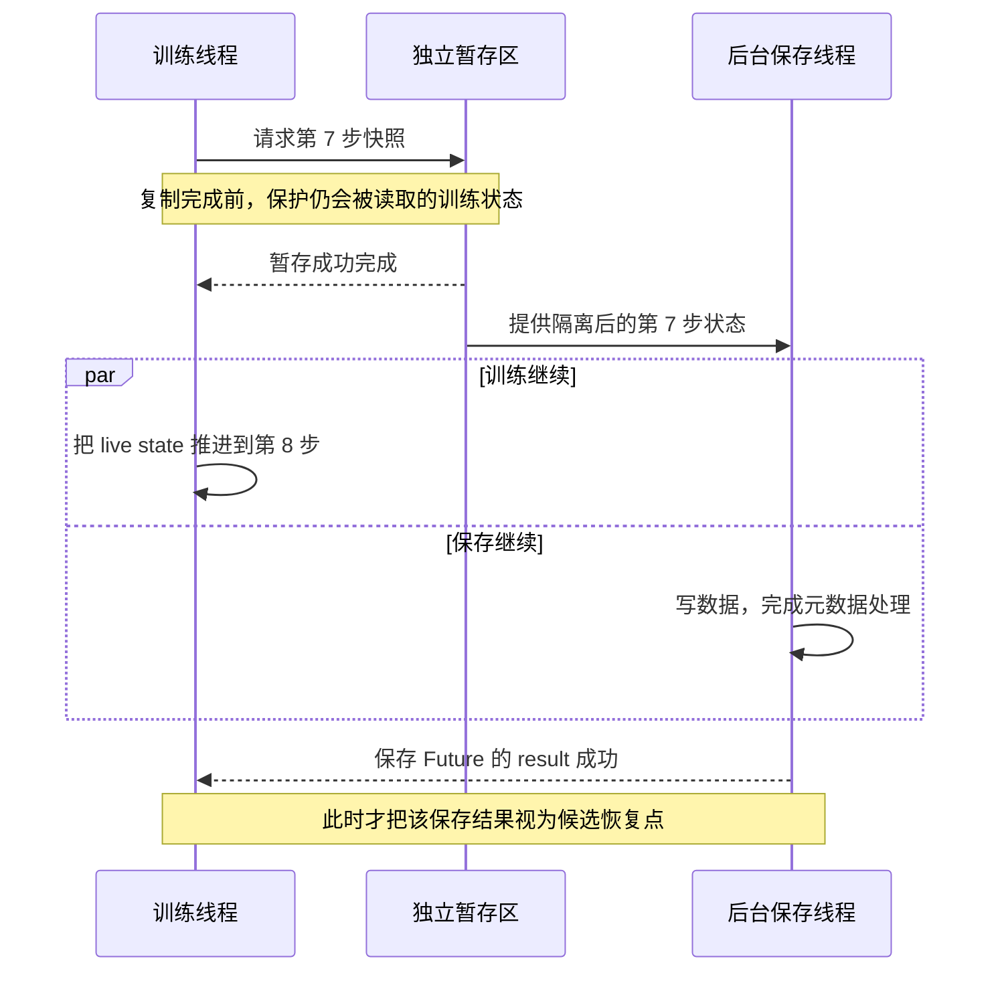

# 异步 checkpoint 怎样与训练重叠，何时才算保存完成？

> 异步 checkpoint 把部分保存工作移到后台，但训练何时能安全继续，取决于快照是否已经与后续修改隔离；checkpoint 何时能作为恢复点，则取决于保存流程是否成功完成。
>
> 本篇从一份会被训练覆盖的小张量出发，讲清暂存、后台保存、背压和退出前等待。用固定时间模型计算重叠收益，再用真实的 CPU Distributed Checkpoint（DCP）保存、修改与读回来核验边界。

## 1. 为什么把 `save` 放到后台线程还不够？

训练到第 7 步结束时，假设要保存以下合成状态：

```text
weight   = [1.0, 2.0]
momentum = [0.1, 0.2]
step     = 7
```

下一步会修改权重、优化器状态和进度。如果后台线程还在读取原张量，而主线程已经开始修改，就可能保存到不同时间的混合状态。文件最终能打开，也不代表这些状态来自同一个训练边界。

Python 的 `state.copy()` 只复制最外层字典，里面的 Tensor 仍然可能共用 storage（实际数据所在的存储）。因此，“已经拿到字典”和“已经拥有不可被下一步覆盖的快照”是两回事。本篇练习会真实验证这种别名，以及隔离后的保存结果。

[第 22 篇](../2026-11-10-training-checkpoint-recovery/README.md) 说明了恢复为何需要模型、优化器、随机性和数据进度的一致状态。今天研究的增量是：**保持这种一致性的前提下，哪些保存工作可以与后续训练重叠？** 数据量与内存可参考 [训练显存](../2026-11-04-training-memory-accounting/README.md)，流水线直觉可参考 [输入流水线](../2026-11-06-dataloader-input-pipeline/README.md)，计时口径接续 [profiler 时间轴](../2026-11-23-training-profiler-timeline/README.md)。

## 2. 一次保存至少要区分哪几个边界？

### 2.1 先选定逻辑快照，再隔离数据

快照首先需要一个逻辑边界，例如“第 7 步优化器更新完成，且下一批数据尚未消费”。应用负责让模型、优化器、step、RNG 和数据进度对应这个边界；多 rank（分布式进程）还需对应同一个全局训练进度。

在 CUDA 场景，优化器调用返回不等于设备更新已经完成。要先建立“产生状态的设备工作 → 复制读取”的顺序，再保护“复制读取 → 后续覆盖”的顺序。本文 CPU 实验不验证这些跨 stream 的设备依赖，相关基础见 [异步计时篇](../../10/2026-10-23-gpu-asynchronous-timing/README.md)。

接着是 staging，本文称为“暂存”：创建供保存线程读取的独立表示。对常见 GPU 训练，它可能包括把设备数据复制到 CPU 内存；对本篇 CPU 练习，也需要把 live Tensor 复制到独立 CPU storage。**CPU 上的数据已经位于主机，并不意味着它已经与训练隔离。** 官方 AsyncStager 的契约就是：暂存成功完成后，后续训练修改不应反映到暂存表示里。[官方暂存语义](https://docs.pytorch.org/docs/2.15/distributed.checkpoint.html)、[新 CPU storage 的实现](https://github.com/pytorch/pytorch/blob/0d8b36742ee52e2926f5c349cdae9e57c82ed2f0/torch/distributed/_state_dict_utils.py#L392-L439)

异步复制尚未完成时，需要保护它仍会读取的原始状态。不能仅凭“前向一般只读权重”，就认为可以无条件与下一次前向重叠：模型可能更新 buffer，其他状态也可能变化。具体安全区间必须由应用和后端保证。复制完成前暂停相关写入，或使用经过验证的版本化状态，才有可讨论的隔离基础。

### 2.2 暂存完成后，后台保存仍可能没有结束

后台保存会做计划、序列化、必要的协调、数据写入及元数据完成处理。DCP 的 upload completion 在这里表示这条保存流程的完成，**不专指向远程云存储上传**；本篇的目标就是本地临时目录。

Future 是稍后才能取得结果的任务句柄。对于异步暂存，DCP 可以返回两个句柄：`staging_completion` 用来等待暂存边界，`upload_completion` 用来等待保存边界。同步暂存路径则可以返回一个代表保存任务的 Future。返回类型需要结合版本与 stager 实际判断，不能把“函数返回”一概解释成“两种工作都已完成”。[官方 API](https://docs.pytorch.org/docs/2.15/distributed.checkpoint.html)



这个图表示数据所有权和完成顺序，不是实测耗时时间轴。暂存区在后台还要读取时也不能提前覆盖或复用。图源在 [snapshot-lifecycle.mmd](figures/snapshot-lifecycle.mmd)。

### 2.3 任务结束了，为什么还要调用 `result()`？

`done()` 只能说明 Future 已结束或被取消，失败的任务也会是 done。`result()` 才会交付成功结果，或把任务异常带回调用者。成功暂存只说明有可供保存使用的表示，并不说明数据文件和元数据已经成功保存。[Python Future 语义](https://docs.python.org/3.12/library/concurrent.futures.html#future-objects)

所以训练代码至少要管理两件事：继续修改状态前，满足对应的暂存同步契约；宣布恢复点、复用仍被占用的 buffer 或正常退出前，处理保存 Future 的结果。不能因为主线程已经走到下一步，就把后台异常留在一个从未检查过的 Future 中。

这些动作还要处理异常；后文的版本边界小节给出一个暂存报告与实际失败不同的实测，不把单个状态标志当成无条件承诺。

## 3. 到底能省多少时间，会不会只是在积压写入？

### 3.1 先手算一个固定时间模型

下面是教学假设，不是本机性能测试：训练 300 步，每步计算 `C=100 ms`，每 100 步保存一次；每次暂存 `S=2 s`，完整后台保存 `W=6 s`。先采用容易保证生命周期的策略：**最多一个未完成保存；发起下一次暂存前，先等上一次保存成功。** 暂存仍阻塞训练。

| checkpoint | 暂存区间 | 后台保存区间 | 与保存重叠的后续计算 |
| --- | --- | --- | --- |
| 第 100 步 | `[10,12)` s | `[12,18)` s | 下一组计算在 `[12,22)` s |
| 第 200 步 | `[22,24)` s | `[24,30)` s | 下一组计算在 `[24,34)` s |
| 第 300 步 | `[34,36)` s | `[36,42)` s | 已无后续训练，退出前等待 |

完全同步保存需要：

\[
T_{sync}=300\times0.1+3\times(2+6)=54\text{ s}
\]

本策略训练循环在 36 s 结束，最后的后台保存到 42 s 才成功结束。因此完整任务时间是 **42 s**，不能报告成 36 s。最后的 6 s 称为 drain，即退出前排空尚未完成的保存任务。首个快照前的训练、暂存开销和最后一次保存，都会影响实际收益。

### 3.2 存储变慢后，为什么主线程还会停？

保持其他假设不变，改成 `W=16 s`。第一次后台保存在 `[12,28)` s，但下一组计算在 22 s 已结束。因为只允许一个未完成保存，第二次暂存要等到 28 s，产生 6 s 背压。背压就是下游尚未处理完，上游必须等待或限制继续产生任务。

本例第二次暂存为 `[28,30)` s，保存到 46 s；第三组计算结束在 40 s，又等待 6 s。最终训练在 48 s 结束，保存到 64 s 才全部结束：

\[
T_{async}=30\text{（计算）}+6\text{（暂存）}+12\text{（背压）}+16\text{（最后等待）}=64\text{ s}
\]

同步基线是 `30+3×(2+16)=84 s`。模型仍有重叠收益，但写入时间没有被完全隐藏。

令两次 checkpoint 之间的计算为 `A=kC`。在本策略和固定时长假设下，连续两个暂存起点的间隔为：

\[
P_{one\ pending}=S+\max(A,W)
\]

这里“上一份保存完成后才能暂存下一份”是公式的重要前提，不能把它当成任意多 buffer、异步暂存或共享 I/O 系统的通用公式。实际训练还会受到 CPU、内存带宽、设备传输、网络和文件系统竞争的影响。

### 3.3 再加 buffer 能解决存储吞吐不足吗？

更多 buffer 可以缓冲短时波动，不能提高长期持续写入带宽。设实际快照产生速率为 `λ` 次/s、每份写入量为 `B` 字节、同一存储路径的有效吞吐为 `R` 字节/s，要长期不积压，至少需要 `λB≤R`，工程上还要留波动余量。`W` 也不只是 `B/R`，还可能包含计划、序列化、协调及完成处理。

暂存内存的一个初步预算是：

\[
M_{stage}\approx q\sum_{r\in node}B_r
\]

`q` 是同时持有的快照份数，`B_r` 是本节点 rank `r` 的暂存大小。比如本节点 8 个 rank，每个暂存 8 GiB，单份就需要约 64 GiB，双份约 128 GiB；这还不含其他主机状态、缓存和序列化开销。若该节点共享的有效写带宽为 4 GiB/s，光写 64 GiB 就至少需要 16 s。这些都是明确假设下的容量／带宽估算。

pinned memory 是不能被操作系统随意换出的页锁定主机内存，适当使用有助于设备传输，但它也占用主机资源。不要从“后台保存不占 GPU 计算”推导“对训练没有影响”。官方教程也强调 CPU／pinned memory 成本，并建议通常限制为一个异步保存请求。[官方异步保存教程](https://docs.pytorch.org/tutorials/recipes/distributed_async_checkpoint_recipe.html)

## 4. 从这些边界怎样读到当前 PyTorch 代码？

### 4.1 本次实际核验了哪三个版本？

2026-11-24 实际 fetch 的 PyTorch 默认分支为 `main`，固定到 `0d8b36742ee52e2926f5c349cdae9e57c82ed2f0`。同期核验的最新正式 release 是 `v2.15.0`，tag commit 为 `31a77fc9c0a7c6fff15a1ff58c743f53b1a9d457`，发布于 2026-10-28。

本机已有包为 `torch==2.15.0`，构建 SHA 为 `d0f2af8b66b20da4baa50644c0cd3f887a2eae2e`，并不等于上述 tag 或 main。代码分析按固定源码，实测只归属于记录的 CPU 安装包，不声称已经构建或运行最新 main。[获取命令与结果](evidence/source-update.json)、[真实运行环境](evidence/runs/verification.json)

### 4.2 `async_save` 到底在哪里创建快照？

入口是 `torch.distributed.checkpoint.state_dict_saver.async_save`。它先确定 stager，将支持 `state_dict()` 的对象转换为状态字典，再调用 `async_stager.stage(state_dict)`。

这里有个需要实际读调用路径才能发现的默认值边界：没有显式 stager 时，若提供的 writer 实现了 `AsyncStager`，就选择该 writer；否则函数内部创建的 `DefaultStager` 使用四个 `False` 选项。单独调用 `DefaultStager()` 的构造默认选项却是另一套值。`FileSystemWriter` 本身继承 `BlockingAsyncStager`，其 `stage` 最终进入阻塞暂存路径。因此，**不能仅凭类的默认参数，就声称 `async_save` 默认把 staging 也放到后台或默认使用 pinned memory**。[入口选择](https://github.com/pytorch/pytorch/blob/0d8b36742ee52e2926f5c349cdae9e57c82ed2f0/torch/distributed/checkpoint/state_dict_saver.py#L300-L335)、[选项定义](https://github.com/pytorch/pytorch/blob/0d8b36742ee52e2926f5c349cdae9e57c82ed2f0/torch/distributed/checkpoint/staging.py#L105-L130)、[文件 writer 的继承与配置](https://github.com/pytorch/pytorch/blob/0d8b36742ee52e2926f5c349cdae9e57c82ed2f0/torch/distributed/checkpoint/filesystem.py#L989-L1015)

进一步看 `BlockingAsyncStager.stage`：不缓存时，它先创建新的 CPU state dict storage，再复制数据；启用缓存则复用 `state_dict_cache`。这解释了两件事：CPU 快照为什么也需要独立复制；为什么复用 staging buffer 前必须确认旧保存不会再读取它。本篇显式使用不缓存的 blocking stager，或在其外面包装一个受控 CPU 异步 stager，不测试 pinned、共享内存或 GPU DMA 优化。[暂存与缓存](https://github.com/pytorch/pytorch/blob/0d8b36742ee52e2926f5c349cdae9e57c82ed2f0/torch/distributed/checkpoint/staging.py#L301-L325)

### 4.3 后台线程为什么不会直接写还没复制好的状态？

`async_save` 把 `stage()` 的结果交给线程或进程保存执行器。本文跟踪线程路径：`save_wrapper` 若拿到暂存 Future，会先调用它的 `result()`，取得暂存表示后才调用正常的 `save`。主线程是否已经返回，与保存线程是否已经进入实际写入，是两回事。[提交保存](https://github.com/pytorch/pytorch/blob/0d8b36742ee52e2926f5c349cdae9e57c82ed2f0/torch/distributed/checkpoint/state_dict_saver.py#L341-L362)、[保存线程等待暂存](https://github.com/pytorch/pytorch/blob/0d8b36742ee52e2926f5c349cdae9e57c82ed2f0/torch/distributed/checkpoint/_async_thread_executor.py#L13-L38)

如果 `stage()` 返回 Future，入口构造 `AsyncSaveResponse`，区分暂存与保存；如果返回已暂存字典，则走单 Future 路径，并按 stager 的同步契约处理。在已初始化的分布式环境下，入口还检查相应 process group 是否含 CPU backend。本篇的 `no_dist=True` 实验没有验证多 rank 协调和后台通信顺序。[两种返回路径](https://github.com/pytorch/pytorch/blob/0d8b36742ee52e2926f5c349cdae9e57c82ed2f0/torch/distributed/checkpoint/state_dict_saver.py#L364-L395)

### 4.4 哪一步才完成文件保存？

`save` 在 `write_data` 后等待写入结果，再进入 `storage_writer.finish`；使用协调路径时，这些动作通过分布式封装汇集结果。不能把某个 rank 写完自己的 shard 当成完整全局 checkpoint 已成功。[写入、等待与完成顺序](https://github.com/pytorch/pytorch/blob/0d8b36742ee52e2926f5c349cdae9e57c82ed2f0/torch/distributed/checkpoint/state_dict_saver.py#L494-L519)

文件 writer 会写数据文件，并在 `sync_files=True` 的相应路径 flush／fsync；`finish` 写临时 metadata，处理同步后再 rename 到最终 metadata 名称。它还包含 fsync 不受支持时的告警回退。已有 metadata 的覆盖路径会先删除旧文件，因此不能把重复使用同一目录说成完整的事务回滚。[数据同步](https://github.com/pytorch/pytorch/blob/0d8b36742ee52e2926f5c349cdae9e57c82ed2f0/torch/distributed/checkpoint/filesystem.py#L474-L483)、[metadata 完成路径](https://github.com/pytorch/pytorch/blob/0d8b36742ee52e2926f5c349cdae9e57c82ed2f0/torch/distributed/checkpoint/filesystem.py#L765-L801)

本篇用全新的临时 checkpoint 目录，检查保存 Future 成功、metadata 出现和读回数值。这个证据不等于已经验证断电、网络文件系统、对象存储复制或整机故障下的持久性。稳定 tag 的返回边界、默认选择和 metadata 路径也单独读取了；main 的行为不能仅凭名字视作稳定版承诺。[源码阅读笔记](evidence/source-reading-notes.md)

## 5. 工程上怎样选择与验收？

### 5.1 把“完成”写成具体可检查的状态

| 完成边界 | 能据此做什么 | 还不能据此证明什么 |
| --- | --- | --- |
| 对应逻辑训练边界的状态已选定 | 明确要恢复的是哪一步 | 尚未说明后台不会读到后续修改 |
| 暂存成功，且满足隔离契约 | 在契约允许的范围继续修改 live state | 尚未说明数据与 metadata 保存成功 |
| 保存 Future 的 `result()` 成功 | 按该 writer 的契约处理完成结果；旧暂存区不再供该任务读取 | 尚未证明应用遗漏的状态也一致，或所有故障模型下都持久 |
| 应用恢复验收通过，存储持久性条件满足 | 按明确的故障范围使用恢复点 | 仍不能推广到未经验证的其他存储后端或故障类型 |

checkpoint 使用独立的 step／版本目录，区分“已请求保存的最新步”和“已成功保存的最新步”。如果应用维护 `latest` 指针，应在完整保存成功及必要验证后再发布它；失败时保留此前成功的恢复点。正常退出、销毁进程组或关闭调用者拥有的 stager 前，都要处理仍在使用相关资源的保存任务。等待超时只限制调用者等待，不等于已经取消后台 I/O。

### 5.2 先选容易验证的重叠方式

| 策略 | 适用条件与收益来源 | 代价与验证重点 |
| --- | --- | --- |
| 同步暂存，后台保存 | 写入较慢且有 CPU 内存预算；暂存后可恢复训练 | `S` 仍在训练路径，实际比较完整任务时间与最终 drain |
| 异步暂存，后台保存 | 存在不会覆盖被复制状态的计算区间 | 保护参数、buffer、优化器等状态的读写顺序；复验快照一致性与设备同步 |
| 一次只保留一个未完成保存 | 希望限制 buffer 和任务生命周期复杂度 | 存储慢时主动背压；等待前一次结果再复用 buffer |
| 有界的多份暂存 | 需要吸收波动，或让更多阶段重叠，且有额外内存 | 明确 `q` 上限、拒绝／等待策略和长期存储带宽；不要无上限排队 |

实际测量应包含：状态提取与暂存耗时、后台保存耗时、训练 step 时间变化、CPU／pinned memory 峰值、背压时间、退出前等待、最新成功 checkpoint 的训练进度。用相同模型、优化器、数据推进、硬件和存储条件做无异步基准与恢复对照；不能从本篇 40 字节合成状态的功能验证推算生产吞吐。

### 5.3 一个实际复现的版本边界

在本机记录的 PyTorch 2.15.0 构建中，若自定义 stager 返回的是一个**已经完成且带异常的 Future**，本篇探针观测到：`staging_completion.result()` 报告成功，而 `upload_completion.result()` 抛出 `RuntimeError`，没有 metadata。

固定 main 和稳定 tag 在这个分支都能看到原因线索：staging Future 尚未完成时，回调会读取原 Future 的 `result()`；已完成分支却直接把面向调用者的暂存 Future 设为成功，没有在该分支读取原异常。保存线程仍会读取原始 Future，因而保存任务失败。[main 分支](https://github.com/pytorch/pytorch/blob/0d8b36742ee52e2926f5c349cdae9e57c82ed2f0/torch/distributed/checkpoint/state_dict_saver.py#L364-L395)、[稳定 tag 分支](https://github.com/pytorch/pytorch/blob/31a77fc9c0a7c6fff15a1ff58c743f53b1a9d457/torch/distributed/checkpoint/state_dict_saver.py#L364-L395)

这是一条明确限定版本的实测与源码观察，不是对所有后续版本的断言。它也进一步说明：不能单靠 staging 句柄、`done()` 或目录存在宣布保存成功；应处理保存结果。本文正常异步实验让复制完成后才修改训练状态，没有把这个失败边界包装成可用快照。[版本探针结果](evidence/runs/results.json)

## 6. 两道练习：从时间模型走到真实保存

### 练习一：计算背压与最后一次等待

在 [exercises.py](code/exercises.py) 中实现 `simulate_checkpoints`。输入依次为训练步数、每步计算时间、保存步间隔、暂存时间、保存时间；时间都用整数 ms。策略固定为同步暂存、最多一个未完成保存，在下一次暂存前等待旧保存；结束时要把最后的保存等待算进去。

输出每份 checkpoint 的 step、背压、暂存／保存起止时间，以及训练结束、全部保存结束、同步基线和最终 drain。用 `300,100,100,2000,6000` 与把最后一项改为 `16000` 的两组输入验收，还要处理零步、没有保存、最后一段不满间隔和零暂存／写入成本。具体契约见 [练习说明](code/README.md)。

<details>
<summary>详解与完整答案</summary>

只需在 checkpoint 时刻推进事件。先推进距上一份快照的计算时间，再用 `max(0,旧保存结束-当前时间)` 计算背压，然后安排暂存和新保存。最后推进剩余训练，整体完成时间取训练结束与旧保存结束的较大值。没有落在间隔上的最后一步，不隐式额外保存。

完整代码在 [answers.py](code/answers.py)。实现按 checkpoint 数量循环，使用 Python 整数运算，避免把大整数时间静默转成浮点数。快存储模型结果为训练结束 `36000 ms`、全部保存 `42000 ms`、同步基线 `54000 ms`；慢存储为 `48000 ms`、`64000 ms`、`84000 ms`，背压合计 `12000 ms`。[实际运行输出](evidence/runs/answers-run.txt)

最容易漏算的是最后等待；其次是把模型改成了“旧 buffer 还在写，下一次就直接覆盖”。两者都会给出过于乐观的答案。此模型也没有模拟设备 DMA、文件系统竞争、并行 writer 或实际计时。

</details>

### 练习二：保存第 7 步，继续修改，再读回

实现 [exercises.py](code/exercises.py) 的 `run_checkpoint_case`。使用开头的三项 CPU Tensor 状态，权重和 momentum 为 `float64`，step 为 `int64`，有效载荷总计 40 字节。用 DCP 写入自己创建的临时目录，等待正确边界后把 live state 改成：

```text
weight   = [101.0, 102.0]
momentum = [10.1, 10.2]
step     = 8
```

不要用 `sleep` 猜复制或写入是否结束；用线程 Event 控制暂存和实际写入的入口。至少验证同步暂存、异步暂存、写入失败三种情况。成功时读回第 7 步的三个原始值；写失败时 Future 可以是 done，但 `result()` 必须报告失败，不能视作可恢复快照。

<details>
<summary>详解、命令与真实验证结果</summary>

[dcp_demo.py](code/dcp_demo.py) 提供完整代码。`ControlledStager` 是一个一次性 CPU 教学 stager：它返回待完成 Future，在门控放行后使用 `BlockingAsyncStager` 做真实独立复制。`GateWriter` 在 DCP 调用 `write_data` 时暂停，放行后交给真实 `FileSystemWriter` 保存；失败分支在写入前注入明确异常。它们没有用私有训练数据，也没有冒充 GPU 的异步暂存实现。

先保持复制门关闭，检查 API 返回后两个 Future 未完成；放行复制并等待暂存结果，确认保存仍未结束且无 metadata。此时修改 live state，再放行写入、等待保存结果，用 DCP 读回并逐项 `torch.equal` 比较。同步暂存分支返回单 Future；其 API 返回时本例的快照已经复制完成，但保存仍被门控挡住。

从本篇目录，在已有 PyTorch 2.15 环境执行：

```bash
PYTHONDONTWRITEBYTECODE=1 python -m unittest discover -s code -p test_answers.py -v
PYTHONDONTWRITEBYTECODE=1 python code/run_answers.py --output-dir /tmp/public-async-checkpoint-demo
```

本次真实结果如下：[完整数值与状态](evidence/runs/results.json)、[原始运行输出](evidence/runs/answers-run.txt)。

| 实验 | 暂存与写入边界 | 最终结果 |
| --- | --- | --- |
| CPU 同步暂存 | 返回 `Future`；写门未开时保存未结束 | metadata 出现，恢复值等于第 7 步快照 |
| CPU 自定义异步暂存 | 返回 `AsyncSaveResponse`；先暂存完成，再写入完成 | 三个恢复值都与旧快照完全一致，live state 已变为第 8 步 |
| CPU 写入失败 | 暂存完成，保存 Future 最终 done | `result()` 抛 `CheckpointException`，没有 metadata，未宣称可恢复 |
| 已失败 staging Future 探针 | 暂存句柄报告成功，保存句柄失败 | 保存报 `RuntimeError`，没有 metadata；限定版本观察 |

两条成功路径在临时目录内生成 `.metadata` 和 `__0_0.distcp`，均实际读回验证；临时 checkpoint 随调用清理，不把二进制文件或临时路径当成永久资料。JSON 中保留了公开输入、恢复值、阶段状态和文件名。这里只验证合成的 weight／momentum／step，不是完整模型、真实优化器、RNG、数据加载器或分布式重分片恢复验收。

**18 项测试**在普通和 `-O` 模式均通过，Ruff 检查与格式检查通过。测试包括独立数值期望、时序不变量和上述真实 CPU 保存。独立通用代码复核还用了逐步 oracle、跨代 storage 隔离、两种暂存与成功／失败组合、提前异常清理；详情在 [审查记录](review.md)。[环境、命令、退出码与源码摘要](evidence/runs/verification.json)

本机未初始化分布式进程组；日志里的单进程及 macOS 提示如实保留。没有运行 CUDA、pinned memory、共享内存、后台保存进程、多 rank 或断电测试，也没有根据 Event 等待的时间报告 I/O 性能。

</details>

## 7. 面试官继续追问

| 层次 | 追问 | 参考回答要点 |
| --- | --- | --- |
| 基础解释 | 浅复制 state dict 为什么不够？ | 容器独立不等于 Tensor storage 独立；后台读取可能遇到下一步修改 |
| 基础解释 | staging 完成和 upload 完成各意味着什么？ | 前者针对可安全保存的暂存表示，后者针对保存流程；按实际返回类型和成功／异常结果判断 |
| 实现分析 | 为什么不能用 `DefaultStager()` 的默认值描述 `async_save`？ | 调用路径可能选择 writer 自身的 stager，或用显式参数构造默认 stager；必须读实际分支 |
| 实现分析 | 文件已出现为什么不能宣布完成？ | 可能仍在写数据或 metadata，可能是旧文件；检查对应任务成功并按应用恢复条件验收 |
| 方案选择 | 单 buffer 与双 buffer 的主要取舍是什么？ | 单 buffer 容易限制内存和生命周期；多 buffer 可重叠更多阶段但要有界，不能解决持续带宽不足 |
| 方案选择 | 是否只需在 `optimizer.step()` 前等暂存？ | 不一定，forward 也可能改 buffer，其他状态也会变化；保护所有快照读取涉及的写入 |
| 排障验证 | 训练循环很快，任务退出却很慢，先看什么？ | 检查仍未完成的保存、writer 背压和最终 drain，并区分完整任务与循环计时 |
| 排障验证 | 保存 Future 的 `done()` 为 True 就成功了吗？ | 失败和取消也可能 done；读取 `result()`，处理异常，再按 writer 与应用边界判断 |

## 8. 范围与后续问题

本篇是当前 API 与存储流水线语义主题，没有介绍某篇论文提出的具体算法。固定时间模型是基础事件调度和容量守恒推导，不把它包装成论文算法；官方实现、原始运行和独立 oracle 是本篇证据。[资料与源码笔记](references.md)

技术证据与教学表达经过两轮主执行者自审，代码另经独立通用复核。所需 `python-reviewer` 专项代理在执行前因模型不可用失败，该失败和实际替代范围均已记录，未冒称专项审查成功。

Mermaid 图按数据所有权和顺序检查，保留可重建图源；本次未运行视觉渲染验收。

下一篇候选是：**训练数据怎样分片并 shuffle，才能兼顾吞吐和可复现性？** 保存了 step 之后，怎样恢复正确的数据推进与读取顺序，是训练恢复进入数据层的自然下一步。

资料归档：[参考资料与证据](references.md)。审查与实验：[审查记录](review.md)。返回 [Wiki 索引](../../../index.md)。
