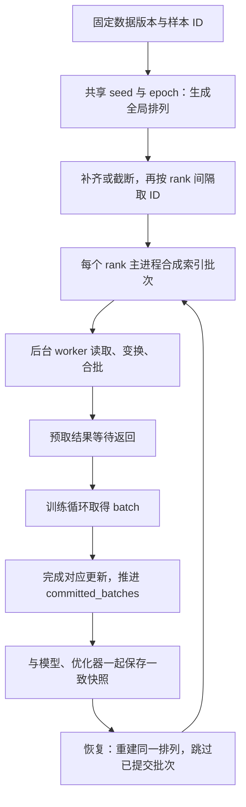

# 训练数据怎样分片并 shuffle，才能兼顾吞吐和可复现性？

10 个样本分给 3 个训练副本，默认 DistributedSampler 会安排 12 次取样，其中两次重复。再让 DataLoader 丢弃不满的尾批，实际训练的样本集合还会变化。要解释吞吐和恢复结果，必须分别数清样本归属、读取任务、返回批次和已经进入 checkpoint 的训练进度。

本篇先手算分片，再沿 PyTorch 当前源码追踪预取，最后用真实 CPU worker 验证“取数走得更远时，怎样从正确位置继续”。输入流水线基础见 [第 20 篇](../2026-11-06-dataloader-input-pipeline/README.md)，训练状态见 [第 22 篇](../2026-11-10-training-checkpoint-recovery/README.md)，保存完成边界见 [第 32 篇](../2026-11-24-async-checkpoint-staging/README.md)。

## 1. 10 个样本怎样交给 3 个 rank？

把一个可索引数据集记为 `0,1,…,9`。一个 ID 指向一个固定样本，样本可以是一张图片及标签，也可以是一段已切分的文本。**rank** 在本文表示数据并行副本的编号；`R` 表示这些副本的数量。混合使用 TP、PP、DP 时，应按实际数据并行组选择副本数和组内编号，不把所有设备数直接当成 `R`。

先关闭 shuffle，也就是暂不打乱顺序。若希望每个副本获得同样多的样本，10 除以 3 有余数。PyTorch DistributedSampler 默认 `drop_last=False`，会从排列开头补足到 12 个位置：

```text
原始顺序：0 1 2 3 4 5 6 7 8 9
补齐顺序：0 1 2 3 4 5 6 7 8 9 0 1
```

随后按位置间隔 3 取样，而非把 12 个位置切成三个连续区间。

| rank | 取得的位置 | 取得的样本 ID |
| --- | --- | --- |
| 0 | 0、3、6、9 | `[0,3,6,9]` |
| 1 | 1、4、7、10 | `[1,4,7,0]` |
| 2 | 2、5、8、11 | `[2,5,8,1]` |

因此“每个 rank 的位置不同”不代表“样本 ID 全局无重复”。本例每轮覆盖全部 10 个原始样本，并重复训练 ID 0 和 1。若在验证集上直接对这 12 次取样求平均，会让这两个样本权重变大；需要去除补齐位置、按真实样本归并，或使用明确支持不等长输入的评估流程。[固定源码：生成、补齐与 rank 切片](https://github.com/pytorch/pytorch/blob/19f0c2704b8086f392172c18d37f3557ecff3aef/torch/utils/data/distributed.py#L107-L141)

把 **Sampler 的** `drop_last` 改为 `True`，则截断到 9 个位置：三个 rank 分别拿到 `[0,3,6]`、`[1,4,7]`、`[2,5,8]`，ID 9 不进入本轮。shuffle 开启后，被丢弃的是本轮排列的尾部，不是固定编号最大的样本。

这两种选择都服务于等长采样，但都改变了“完整遍历每个样本一次”的朴素语义。它们的适用条件应与训练循环、评估统计一起决定。

## 2. Sampler 与 DataLoader 为什么有两个 drop_last？

**Sampler** 决定一个 rank 按什么顺序拿哪些 ID。**batch** 是一次交给模型的一组样本。**BatchSampler** 把这个 rank 的 ID 合成批次；DataLoader 的 `batch_size` 和 `drop_last` 通常会配置它。

令原始样本数为 `N`，数据副本数为 `R≥1`，每个 rank 的样本数为 `L`。在固定大小的数据集上：

\[
L=\begin{cases}
\lceil N/R\rceil,&\text{Sampler 补齐}\\
\lfloor N/R\rfloor,&\text{Sampler 丢尾}
\end{cases},\qquad T=RL.
\]

`T` 是全体 rank 的采样位置总数。补齐会增加 `T−N` 个位置，丢尾会去掉 `N−T` 个位置。再令本地 batch 大小为 `B≥1`，map-style 数据集每个 rank 的批次数为：

\[
K=\begin{cases}
\lceil L/B\rceil,&\text{DataLoader 保留尾批}\\
\lfloor L/B\rfloor,&\text{DataLoader 丢弃尾批}
\end{cases}.
\]

在 `N=10,R=3,B=3` 的同一个例子中：

| Sampler drop_last | DataLoader drop_last | rank 0 的批次 | 全局实际进入模型的样本次数 |
| --- | --- | --- | --- |
| False | False | `[0,3,6]`、`[9]` | 12 次，包含补齐重复 |
| False | True | `[0,3,6]` | 9 次，三个本地尾样本 `9,0,1` 被丢弃 |
| True | False | `[0,3,6]` | 9 次，Sampler 已丢弃 ID 9 |
| True | True | `[0,3,6]` | 9 次，本例不再损失样本 |

最后两行只是这个尺寸恰好一致。例如 `N=7,R=4,B=2`，Sampler 丢尾后每个 rank 只剩 1 个样本；DataLoader 再丢尾，整轮会变成 0 个 batch。不要只看 `len(dataset)` 推算训练更新数。[采样长度源码](https://github.com/pytorch/pytorch/blob/19f0c2704b8086f392172c18d37f3557ecff3aef/torch/utils/data/distributed.py#L92-L103)、[合批源码](https://github.com/pytorch/pytorch/blob/19f0c2704b8086f392172c18d37f3557ecff3aef/torch/utils/data/sampler.py#L333-L354)

## 3. shuffle 在哪里发生，worker 又做什么？

假设本轮全局排列为 `P`。各 rank 必须用相同的数据版本、相同的 seed 和 epoch 生成同一个 `P`，然后按各自 rank 取不同位置。若每个 rank 使用不同 seed，它们从不同排列中抽取位置，原本的全局覆盖关系就被破坏，可能重复或遗漏。

PyTorch 当前实现使用独立的 `torch.Generator`，以 `seed+epoch` 为种子生成 `torch.randperm(N)`。`set_epoch(e)` 只是改变 Sampler 中的 epoch 状态，迭代器不会自动替训练循环递增它：

```python
sampler = DistributedSampler(
    dataset, num_replicas=dp_size, rank=dp_rank, seed=17, shuffle=True
)
loader = DataLoader(dataset, sampler=sampler, batch_size=32, num_workers=4)
for epoch in range(start_epoch, end_epoch):
    sampler.set_epoch(epoch)  # 必须位于创建本轮 iterator 之前
    for batch in loader:
        train_step(batch)
```

这是调用形态示意，不是本篇实际运行的分布式训练。这里不同时设置 `DataLoader(shuffle=True)`，因为已经显式传入 sampler。[官方 set_epoch 说明](https://docs.pytorch.org/docs/main/data.html#torch.utils.data.distributed.DistributedSampler)、[互斥参数检查](https://github.com/pytorch/pytorch/blob/19f0c2704b8086f392172c18d37f3557ecff3aef/torch/utils/data/dataloader.py#L358-L374)

对于 **map-style** 数据集，`dataset[id]` 可以读取指定样本。Sampler／BatchSampler 在该 rank 的主进程中生成索引批次，再把读取任务派给 worker。worker 是后台取数进程，它执行读取、变换和 collate；增加 worker 不会自动增加一层数据并行副本，也无需再把每个 map-style 样本按 worker ID 过滤一次。[官方多进程说明](https://docs.pytorch.org/docs/main/data.html#multi-process-data-loading)



图源见 [data-flow.mmd](figures/data-flow.mmd)。这是一张所有权与进度图，没有表达具体并行耗时。对于 map-style 路径，当前 fetcher 还允许数据集实现批量 `__getitems__`；否则逐个调用 `dataset[idx]`。[实际 fetcher](https://github.com/pytorch/pytorch/blob/19f0c2704b8086f392172c18d37f3557ecff3aef/torch/utils/data/_utils/fetch.py#L48-L57)

## 4. 数据在对象存储上时，为什么还要物理分片？

逻辑样本 ID 的随机排列解决的是“训练看到什么顺序”。磁盘文件、归档块或对象存储对象构成的 **物理 shard** 解决的是“用多大的读取单位搬运字节”。这两个层次可以分别设计。

用一组明确的教学假设估算请求开销：每个样本 1 MiB，共 1,024 个样本；每次读取有 3 ms 固定请求开销，有效带宽为 1 GiB/s；同一时刻只发一个请求，不计解码和缓存。

```text
逐样本读取：1,024 × 3 ms + 1 GiB ÷ (1 GiB/s) = 4.072 s
一次顺序读取 1 GiB shard：3 ms + 1 s = 1.003 s
```

收益来自摊薄请求开销。这是串行成本模型，不是对象存储实测；并发请求、连接复用、本地缓存、小文件布局、压缩格式和实际带宽都会改变结果。大 shard 也会增加首批等待、失败重读成本和调度粒度，不能仅凭这个例子选 1 GiB。

**IterableDataset** 通过 `__iter__()` 持续产出样本，适合顺序流。普通自定义 IterableDataset 在每个 worker 中都有自己的副本，通常需要自己决定 shard 归属。当前 DataLoader 不允许给这条普通路径挂一个 DistributedSampler 来解决所有分片问题；IterDataPipe 的图级特殊处理也不能外推到所有自定义流。[官方数据类型说明](https://docs.pytorch.org/docs/main/data.html#dataset-types)、[当前构造分支](https://github.com/pytorch/pytorch/blob/19f0c2704b8086f392172c18d37f3557ecff3aef/torch/utils/data/dataloader.py#L320-L374)

一个可手算的静态方案：所有 rank 使用相同、固定顺序的 shard manifest（记录 shard 身份、版本和样本数量的清单）。每个 rank 有相同的 `W` 个 worker。把 rank `r`、worker `w` 映射到全局取数槽位：

\[
g=rW+w,\qquad\text{归属的 manifest 位置}=g,g+RW,g+2RW,\ldots
\]

以 8 个 shard、2 个 rank、每 rank 2 个 worker 为例：`(r0,w0)` 得到位置 `[0,4]`，`(r0,w1)` 得到 `[1,5]`，`(r1,w0)` 得到 `[2,6]`，`(r1,w1)` 得到 `[3,7]`。先分配 shard，再打开归属的文件，才能避免每个进程都扫描全部数据后再过滤。若先打乱 manifest，也必须让所有取数槽位对这份排列达成一致。

这里还有三项代价：

- shard 数量不足，部分 worker 就没有工作；即便 shard 数相等，样本数、token 数和解码时间也可能不等，训练副本的批次数仍需另行对齐。
- 每个 rank 的 worker 数不同时，`rW+w` 公式不适用，应按各 rank 的 worker 数做前缀和编号，或采用其他明确的归属协议。
- 只打乱 shard、保持 shard 内顺序，能产生的全局样本排列只是所有排列的子集。再加有限缓冲区的局部打乱也不能直接宣称等同于完整 `randperm(N)`。要检查类别、时间、来源等相关性是否仍集中在一起。

本篇代码验证静态归属与覆盖，不实现生产流式 shuffle，也不评估模型收敛或存储吞吐。

### IterableDataset 的尾批在哪里丢？

仍用 6 个整数样本，单 rank、两个 worker，按上式分成 `[0,2,4]` 与 `[1,3,5]`。当 `batch_size=4,drop_last=True` 时，每个 worker 都不足一批，最终输出 0 批。改为 `num_workers=0`，则得到 `[0,1,2,3]` 一批。

这是本篇真实 CPU 实验结果：IterableDataset 的尾批判断发生在各 worker 的迭代副本中，框架不会自动把两个 worker 剩下的 3 个样本拼成一批。map-style 的批次索引已经在主进程组成，含义不同。[取数与丢尾分支](https://github.com/pytorch/pytorch/blob/19f0c2704b8086f392172c18d37f3557ecff3aef/torch/utils/data/_utils/fetch.py#L20-L45)、[原始结果](evidence/runs/results.json)

## 5. 相同 seed 为什么还不足以恢复？

先区分三种目标：

| 目标 | 至少需要固定什么 | 本篇验证范围 |
| --- | --- | --- |
| 同一个 rank 看到相同样本 ID 顺序 | 数据及 ID 映射、排列规则、seed、epoch、拓扑、两层丢尾、合批规则 | 用教学实现与真实 DistributedSampler 对照 |
| 相同 ID 产生相同输入值 | 变换代码、参数与随机性；可能还需样本出现次数 | 用稳定样本键生成合成值，验证改变 worker 数后仍一致 |
| 继续得到相同训练状态 | 上面两项，加模型、优化器、模型侧 RNG、数值执行与一致保存边界 | 本篇不重新验证，见第 22 篇；跨版本或平台不保证 |

当前 worker 启动代码会用 `base_seed+worker_id` 初始化 Torch 和 Python random，并在 NumPy 可用时生成其种子。`base_seed` 来自主进程 RNG 或传给 DataLoader 的 generator。但这些动作没有替任意第三方随机生成器、打开的流连接和数据集自定义状态建立恢复协议。普通持久 worker 的跨 epoch 重置路径也不会重新执行完整的启动初始化。[种子初始化](https://github.com/pytorch/pytorch/blob/19f0c2704b8086f392172c18d37f3557ecff3aef/torch/utils/data/_utils/worker.py#L274-L282)、[持久 worker 重置分支](https://github.com/pytorch/pytorch/blob/19f0c2704b8086f392172c18d37f3557ecff3aef/torch/utils/data/_utils/worker.py#L338-L355)

因此，固定 worker 的 seed 也不等于能在任意位置接回其 RNG 状态；改变 worker 数、任务分配或重放次数，都可能改变有状态增强消费随机数的顺序。生产实现需要保存并恢复相应状态，或让增强由稳定键决定。本篇合成函数用 `SHA256(变换版本,增强种子,epoch,sample_id)` 生成一个整数值，独立于 worker 调度；不使用会受进程随机化影响的 Python 内置 `hash()`。同一 ID 在同一 epoch 补齐出现两次时，故意得到相同值；若希望两次增强不同，需要把稳定的“出现位置／次数”也加入键。

PyTorch 官方还明确提醒：相同种子不保证跨版本、commit、平台或 CPU／GPU 完全复现。[Reproducibility](https://docs.pytorch.org/docs/main/notes/randomness.html)

### 真正该保存的是哪个游标？

本篇真实 CPU 探针使用 `N=40,R=2,rank=0,B=2,seed=17,epoch=3`，该 rank 一轮有 10 批。两个 worker、每 worker 预取 2 批：

| 时刻 | 主进程已经派发的批次数 | 调用方已处理并声明提交的批次数 |
| --- | --- | --- |
| 创建 iterator 后 | 4 | 0 |
| 取出前两批并完成约定工作后 | 6 | 2 |

前两批 ID 为 `[11,13]`、`[4,23]`。正确恢复从第 3 批 `[19,17]` 继续，共剩 8 批。若把派发数 6 当成已提交数，会跳过 `[19,17,28,32,18,6,14,34]` 这 8 个样本，只剩 4 批。[实际运行结果](evidence/runs/results.json)

“派发”只是 BatchSampler 的 ID 已被 DataLoader 取走并排队，不能推出 worker 已读完，更不能推出模型已计算完。本篇用自己的计数器观察派发，未把私有 `_send_idx` 当成 checkpoint API。源码在初始阶段投递 `W×prefetch_factor` 个任务，返回数据时又补投任务，解释了这个差距。[预取启动](https://github.com/pytorch/pytorch/blob/19f0c2704b8086f392172c18d37f3557ecff3aef/torch/utils/data/dataloader.py#L1234-L1278)、[派发与补投](https://github.com/pytorch/pytorch/blob/19f0c2704b8086f392172c18d37f3557ecff3aef/torch/utils/data/dataloader.py#L1532-L1569)

`committed_batches` 应表示**这份模型／优化器快照已经包含的批次数**。在第 22 篇约定的完整更新边界，先完成对应训练更新，再让数据游标和其他状态共同进入一致快照。DataLoader 返回一批时不能直接认定更新完成；存在梯度累积、跳过更新、异常重试时，需要另定义其含义。异步保存还必须遵守第 32 篇的快照与保存完成条件。

## 6. 从公式追踪到今天核验的代码

本次真实 fetch 官方默认分支 main，固定完整 SHA **`19f0c2704b8086f392172c18d37f3557ecff3aef`**。最新 release 为 **v2.15.0**，tag commit **`31a77fc9c0a7c6fff15a1ff58c743f53b1a9d457`**。所检查的 `distributed.py`、`sampler.py`、`_utils/fetch.py`、`_utils/worker.py` 四个完整文件在两版本间字节相同；没有据此宣称整个框架相同。

| 要回答的问题 | 具体路径与动作 | 本地原样证据 |
| --- | --- | --- |
| 每个 rank 有多少 ID？ | `DistributedSampler.__init__` 计算 num_samples、total_size | [采样片段](evidence/upstream/pytorch/main-distributed.py-L66-L157.txt) |
| 每轮怎样打乱与分片？ | `__iter__`：seed+epoch → randperm → pad／truncate → 间隔切片；`set_epoch` 记录状态 | [稳定版对照片段](evidence/upstream/pytorch/v2.15.0-distributed.py-L66-L157.txt) |
| map-style 批次在哪里形成？ | `BatchSampler.__iter__` 消费本地 Sampler，按 B 合批 | [合批片段](evidence/upstream/pytorch/main-sampler.py-L333-L354.txt) |
| worker 取什么？ | map fetcher 根据主进程传来的索引列表读取；iterable fetcher 消费自己的 iterator | [两种 fetcher](evidence/upstream/pytorch/main-_utils-fetch.py-L20-L57.txt) |
| 为什么预取游标领先？ | `_reset` 提前投递任务；`_try_put_index` 消费索引；`_process_data` 补投 | [启动](evidence/upstream/pytorch/main-dataloader.py-L1234-L1278.txt)、[补投](evidence/upstream/pytorch/main-dataloader.py-L1532-L1569.txt) |
| 谁控制 worker 的随机性？ | 基类生成 base_seed，worker 启动时初始化；持久 worker 重置有独立路径 | [base_seed](evidence/upstream/pytorch/main-dataloader.py-L686-L709.txt)、[worker](evidence/upstream/pytorch/main-_utils-worker.py-L274-L282.txt) |

本机实际运行的是已有 PyTorch 2.15.0，包内构建 SHA 为 **`d0f2af8b66b20da4baa50644c0cd3f887a2eae2e`**，与稳定 tag、当天 main 分开记录。源码解释基于固定 main／tag，CPU 运行结论基于这个安装包，不把源码 checkout 冒充已构建运行。

在线文档提取服务返回的页面有缓存日期：data 页为 2026-08-03，randomness 页为 2026-11-21。当天实现事实另由实际 Git fetch 与上述片段核验；文档页不被标成当天构建。详见 [资料与版本记录](references.md)。本篇是采样接口、基本索引分配与恢复协议教学，没有提出或复述特定论文算法，未强行引入无关论文。

## 7. 练习一：实现并核对一个 rank 的采样计划

**目标**：在 [起始代码](code/exercises.py) 的 `rank_indices` 中实现全局打乱、补齐／截断和 rank 间隔取样。允许使用 `torch.randperm`，不允许直接调用 DistributedSampler 作为答案。随机源必须独立，不消耗默认 Torch RNG。

输入为 `N,R,rank,seed,epoch,shuffle,drop_last`，输出这个 rank 的 ID 列表。教学输入合同限定整数非负，`R≥1,0≤rank<R,seed+epoch<2**63`；bool 不作为整数接受。至少处理 `N=0`、`N<R`、不整除和多 epoch。两层 drop_last 的手算表也应能由结果复算。

<details>
<summary>详解与完整答案</summary>

1. shuffle 开启时用独立 Generator 生成同一个全局排列；关闭时使用原始顺序。
2. 用整数除法计算每 rank 长度，避免用浮点数除法处理长度。
3. 补齐时循环取排列前部，不能假设只重复一遍就够。例如 `N=1,R=4` 要把唯一 ID 重复到 4 个位置。
4. 通过 `order[rank:total:R]` 取得本地顺序，再按本地 B 合批。

完整实现见 [answers.py](code/answers.py) 中的 `rank_indices` 与 `batch_indices`。同一文件的 `assigned_shards` 给出第 4 节静态 shard 归属扩展：6 个 shard、2 rank、每 rank 2 worker 时，四个槽位依次得到 `[0,4]`、`[1,5]`、`[2]`、`[3]`。它们互不重复且完整覆盖，但负载不均衡。

测试逐个对照真实 DistributedSampler，覆盖 7 个 N、4 个 R、开关 shuffle、开关 Sampler drop_last、两个 epoch 和每个 rank，共 616 个采样实例；另用真实单进程 DataLoader 检查两层丢尾。运行命令与完整结果见 [代码说明](code/README.md)、[测试原始记录](evidence/runs/unit-tests.txt)。

这个模型会生成完整排列，时间和内存均为 O(N)，不适合直接充当十亿级样本流的生产实现；它的作用是建立正确性基线。

</details>

## 8. 练习二：从已提交批次恢复，而不是从预取位置恢复

**目标**：补齐 [起始代码](code/exercises.py) 的 `ResumeToken` 与 `DataPlan`。它们描述固定数据版本、固定 rank 拓扑的一轮可重建批次计划。

要求如下：

- 用规范化 JSON 和 SHA-256 记录配置、格式版本及具体批次 ID。配置包含数据版本、seed、epoch、rank、world size、batch 大小、shuffle 和两层 drop_last；配置变化必须拒绝旧 token。
- token 保存 `plan_digest` 与 `committed_batches`。拒绝负数、bool、越界游标和不同计划的 token；允许 0 以及整轮完成位置。
- 在 `40` 个样本、`2` 个 rank、rank `0`、每批 `2` 个样本、seed `17`、epoch `3` 的计划中，分别从 2 和 6 恢复，解释差别。
- 运行已有 [真实 worker 探针](code/runtime_demo.py)，核对从 2 恢复的 ID 和合成变换值与不中断路径后缀完全相同，并解释两个 worker 丢弃 IterableDataset 尾批的结果。

<details>
<summary>详解与完整答案</summary>

完整答案在 [answers.py](code/answers.py) 的 `DataPlan`、`ResumeToken` 和 `sample_value`。计划摘要同时包含配置和实际 ID：即使未来 RNG 实现改变而配置未变，也会因具体批次变化而拒绝静默恢复。摘要负责计划身份核对，不负责认证文件来源；数据版本字符串必须由调用方绑定到真实、不可变的数据清单，本例字符串只代表合成数据。

恢复的核心是验证计划后，返回 `batches[committed_batches:]`。难点在于正确记录提交边界及验证重放条件，而不是列表切片本身。这里直接重建 O(N) 索引并跳过前缀，不重新解码前缀样本；真实流式数据若只能顺序读取，可能仍要扫描、重解码或保存可 seek 的 shard 内位置，不能直接套用这一成本。

真实探针使用 `spawn` 启动两个取数进程，记录创建时派发 4 批、完成前两批时派发 6 批。token 经临时 JSON 文件保存、加载，恢复时用 `num_workers=0`，得到的 8 批与原路径后缀逐项一致，包括合成变换值。例如正确下一批为 `[[19,5991],[17,2026]]`。这是稳定样本键使变换与 worker 调度分离的例子。

探针在记录边界后将原迭代器消费完，既得到不中断对照，也让 worker 正常退出；没有注入进程崩溃。没有实际训练更新、梯度累积、模型侧 RNG、多 rank 通信或 GPU，因而不宣称完成真实训练的全状态恢复验收。[原始 stdout](evidence/runs/answers-run.txt)、[结构化结果](evidence/runs/results.json)

在本篇目录使用现有环境执行：

```bash
PYTHONDONTWRITEBYTECODE=1 python -m unittest discover -s code -p test_answers.py -v
PYTHONDONTWRITEBYTECODE=1 python code/run_answers.py --output-dir /tmp/data-sharding-demo
```

本次归档运行把输出写入 `evidence/runs`；上面的复现命令改用临时目录，便于保留原记录。20 项测试、优化模式与 Ruff 结果，以及实际 Python／Torch 版本见 [verification.json](evidence/runs/verification.json)。

</details>

## 9. 工程上怎样选择，出错时先看什么？

| 场景与选择 | 收益来源 | 条件与代价 | 应检查的量 |
| --- | --- | --- | --- |
| 固定 map-style 数据，统一排列再按 DP rank 分配 | 归属和顺序容易复算 | O(N) 排列开销，补齐／丢尾会改变样本权重 | 每 rank 批次数、全局原始 ID 覆盖及重复次数 |
| 顺序 shard 读取，先分配再打开 | 摊薄请求和元数据开销 | shard 太大增加首批延迟；大小不均造成慢副本 | 请求次数、读取字节、token／样本数和各 rank 步数 |
| 增大 worker 数或 prefetch_factor | 在训练期间准备后续输入 | 更多 CPU／内存与未消费工作，不能突破存储服务能力 | 数据等待与稳态吞吐、队列占用；参照第 20 篇 |
| `in_order=False` 允许快批次先返回 | 条件合适时减少有序等待 | 输入顺序可能受 worker 完成速度影响，慢类别也可能改变前缀分布 | 返回 ID 序列及类别比例，不能只比速度 |
| 固定样本键的无状态增强 | 重放时不依赖 worker RNG 游标 | 需固定键协议；重复出现是否同增强要明确 | ID、出现位置、变换值和变换版本 |
| 重建计划并跳过已提交前缀 | checkpoint 数据状态简单 | 固定数据、固定拓扑；流读取可能有重放成本 | 与同一模型快照一致的 cursor 和计划身份 |

`in_order` 默认及风险见 [官方参数说明](https://docs.pytorch.org/docs/main/data.html)。在相同条件的自动合批路径中，`W×prefetch_factor` 可用于估算在途批次数量级，乘以每批字节量可做容量预算；它不包含所有进程副本、解码临时对象、pinning 或训练持有的 batch，不能当成完整内存峰值。

如果完整一轮的分片没有重复，但训练仍挂起，继续核对每个 DP 副本实际进入模型的步数、过滤坏样本的规则和异常处理。不等长输入与 collective 次序需要训练侧协议支持，不能通过各 worker 随意提前退出解决。若恢复后第一个 ID 就不符，先查数据版本、epoch、DP 拓扑、两层尾批规则和保存的 cursor；ID 相同而输入值不符，再查随机变换与 worker 状态。

## 10. 面试官继续追问

| 层次 | 追问 | 回答要点 |
| --- | --- | --- |
| 基础 | DDP 为什么没有自动替 Dataset 分片？ | 梯度同步与输入归属是不同职责；应检查实际 sampler／流分片协议，明确 DP 组 |
| 计算 | 10 个样本、3 rank 为何可能训练 12 次？ | 每 rank ceil(10/3)=4，头部补齐两个位置；位置不同也可能指向相同 ID |
| 实现 | 增加 worker 是否会让每个样本重复读？ | map-style 主进程派发 ID；普通 IterableDataset 的每个副本需明确归属，不能混用两套解释 |
| 随机性 | 为什么各 rank 要同 seed，却还要每轮 set_epoch？ | 同轮先有同一个排列，再切不同位置；epoch 改变下一轮的排列种子，相同 epoch 重建相同顺序 |
| 恢复 | Sampler 已派发 6 批，为什么 token 可以是 2？ | 4 批尚未属于已保存的训练状态，重启后要重放；派发、返回和完成更新不是同一边界 |
| 取舍 | 分片内顺序读能否叫全局充分 shuffle？ | 访问粒度与随机性分别验证；排列空间、类别相关性和收敛不能只凭 shard 数推断 |
| 排障 | ID 顺序相同为什么 loss 仍不同？ | 检查增强、模型 RNG、优化器、恢复边界和数值执行；样本 ID 对齐只证明其中一层 |

本篇已验证 CPU 采样顺序、静态 shard 归属、真实 worker 预取差距、输入值重放及 IterableDataset 尾批。没有存储、GPU、分布式训练、故障恢复或吞吐性能实测；普通中文问题链与图源已自审，图未进行渲染验收。下一篇候选：变长序列怎样做长度分桶与 packing，padding、吞吐和损失分母有何关系？

资料：[参考资料与证据](references.md)。实验与审查：[review.md](review.md)。完整代码：[代码说明](code/README.md)。返回 [Wiki 索引](../../../index.md)。
