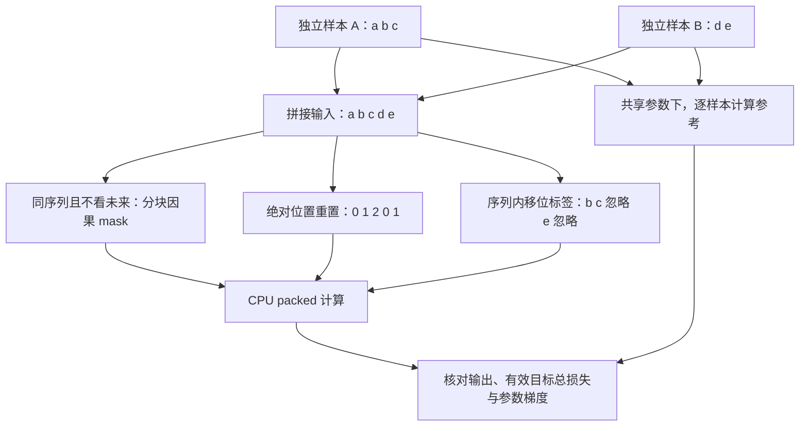

# 变长序列怎样做长度分桶与 packing，padding、吞吐和损失分母有何关系？

长度为 `[8,2,7,3]` 的四条样本，每两条组成一批时，可能要处理 30 个 token 槽；把长度相近的样本放在一起，只需 22 个；把短样本拼入容量为 10 的行，可降到 20 个。但省掉 token 槽并不保证 Attention 更快，也不保证训练目标保持不变。

本篇用同一组样本依次检查容量、Attention 可见范围、位置、标签及损失分母。目标是学会判断一次 packing 优化究竟减少了什么工作，以及如何证明其没有悄悄改变要训练的任务。前置为 [Tensor shape](../../10/2026-10-22-tensor-shape-stride-contiguity/README.md)、[Attention](../../10/2026-10-23-attention-online-softmax/README.md)、[数据并行梯度](../2026-11-03-ddp-gradient-overlap/README.md) 和 [数据采样](../2026-11-25-data-sharding-shuffle/README.md)。

## 1. 为什么只改变合批顺序，就能少处理 8 个槽？

一个 token 是模型输入中的一个离散位置；不同样本的 token 数称为序列长度。普通 dense batch 通常要求行长一致，短行用 padding 补齐到当前批最长的长度。padding 标记并不会自动让所有算子跳过该位置，实际是否少计算取决于执行路径。

假设每批两条，先按原顺序放置：

```text
第一批：[8,2] → 两行各长 8，共 16 槽，其中 6 槽 padding
第二批：[7,3] → 两行各长 7，共 14 槽，其中 4 槽 padding
总计：真实输入 token 20，分配 token 槽 30
```

把相近长度放入同一批，称为**长度分桶**。例如先排成 `[8,7,3,2]`：

```text
第一批：[8,7] → 16 槽
第二批：[3,2] → 6 槽
总计：真实输入 token 仍为 20，分配槽数变成 22
```

输入 token 利用率从 `20/30≈66.7%` 变成 `20/22≈90.9%`。这里统计的是有效**输入** token，不能直接拿它当交叉熵的分母。独立因果语言模型还要考虑 next-token 标签、序列末尾和可能的 prompt 屏蔽，后面会单独数有效监督位置。

若把 `[8,2]` 拼到同一条容量 10 的行、把 `[7,3]` 拼到另一行，就只需 20 个槽，利用率为 100%。这就是本文讨论的 **sequence packing**：在保持原样本边界的前提下，把多条完整序列装进物理行；没有截断样本，也没有把不同文档自动变成同一训练序列。

## 2. padding 减少，为什么 Attention 仍可能更贵？

先固定模型的 head 数和 head dimension，只比较每个 head 上的矩阵面积。长度为 `L` 的 dense Attention 会涉及 `L×L` 的位置组合。这个平方面积是成本代理，不是实测 FLOPs、显存或执行时间。

令第 `i` 条输入长为 `L_i`，第 `b` 批含 `n_b` 条、最长长度为 `M_b`，packing 行容量为 `C`、行数为 `K`。则：

\[
S_{pad}=\sum_b n_bM_b,\qquad A_{pad}=\sum_b n_bM_b^2;
\]
\[
S_{pack}=KC,\qquad A_{dense\ pack}=KC^2.
\]

`S` 的单位是 token 槽，`A` 的单位是每 head 的平方位置数。若真正按原序列边界执行变长 Attention，其对应的方块面积模型为：

\[
A_{blocks}=\sum_i L_i^2.
\]

仍用刚才的四条样本：

| 布局 | token 槽 | token 利用率 | dense 平方面积 |
| --- | --- | --- | --- |
| 原顺序，每批 2 条 | 30 | 66.7% | `2×8²+2×7²=226` |
| 相近长度合批 | 22 | 90.9% | `2×8²+2×3²=146` |
| 两条固定容量 10 的 packing 行 | 20 | 100% | `2×10²=200` |

按独立序列的方块总面积则是 `8²+2²+7²+3²=126`。packing 虽然比长度分桶少了 2 个槽，但若仍执行完整 dense 行，其 Attention 面积反而从 146 增到 200。逐 token 的投影与 MLP、Attention、数据搬运和启动开销各有成本，不能只看利用率决定整体收益。

因果 Attention 还会屏蔽未来位置。本例允许的位置对总数为 `36+3+28+6=73`，即 `Σ L_i(L_i+1)/2`。73 是允许关系的数量；tile 边缘、因果优化和后端选择会影响实际执行，不能直接把它换算成固定加速比。

关键区别在于：**mask 说明哪些结果可以使用，执行算法决定是否真的跳过那些工作。** 本篇强制使用的 PyTorch math 路径先做矩阵乘，再加入 mask，因此显式的分块 mask 不会自动把这一路径变成变长内核。[实际 math 实现](https://github.com/pytorch/pytorch/blob/205e1e1fca6c6634bff5b06691d6648a4f72fe9a/aten/src/ATen/native/transformers/attention.cpp#L979-L1015)

## 3. 拼接两条样本，怎样保持原来的 Attention？

现在把数字缩小到两条独立样本：A 是 `[a,b,c]`，B 是 `[d,e]`。原任务规定：A 只能使用 A 的历史，B 只能使用 B 的历史。将输入放到 `[a,b,c,d,e]` 后，一个全局下三角因果 mask 会允许 `d` 看到 `a,b,c`，这已经改变了任务。

加一个 EOS 或分隔符也不会自动删除这些 Attention 边。对于本文选择的“样本彼此独立”目标，允许关系必须同时满足**同一序列**与**不看未来**。令 `s_i` 为位置 `i` 所属序列编号：

\[
\operatorname{allow}_{ij}=(s_i=s_j)\land(j\le i).
\]

对应的 mask 为：

```text
        a b c d e
a       1 0 0 0 0
b       1 1 0 0 0
c       1 1 1 0 0
d       0 0 0 1 0
e       0 0 0 1 1
```

PyTorch `scaled_dot_product_attention` 的 bool mask 中，`True` 表示**允许**参与 Attention；这与 `MultiheadAttention.key_padding_mask` 的 bool 含义相反。参考代码把完整的分块因果规则放入 `attn_mask`，并显式设置 `is_causal=False,dropout_p=0.0`。[官方语义](https://docs.pytorch.org/docs/main/generated/torch.nn.functional.scaled_dot_product_attention.html)、[bool 转加性 mask 的实现](https://github.com/pytorch/pytorch/blob/205e1e1fca6c6634bff5b06691d6648a4f72fe9a/aten/src/ATen/native/transformers/attention.cpp#L573-L586)

这套隔离目标不是所有预训练数据的默认要求。若原本就想把文档拼成长流并允许跨文档上下文，那是另一种训练目标；不能把其行为一概称为 bug。本篇验证的是**相同原始样本、相同参数下，独立计算与隔离 packing 的等价性**。

原始论文 *Efficient Sequence Packing without Cross-contamination* 的 §3.2.2 讨论了通过 block-diagonal mask 避免跨样本 Attention。论文主要以 BERT 为对象；本篇在块内部再加入因果下三角，作为因果语言模型的教学对照，没有把 BERT 实验结论直接移植到其他模型。[原论文 v2](https://arxiv.org/html/2107.02027v2)

## 4. 为什么有了正确 mask，还不能直接比较 loss？

### 4.1 位置编码也有样本边界

本篇小模型使用学习得到的**绝对位置嵌入**：同一个 token 放在位置 0 和位置 3，会加上不同的向量。为了与独立计算一致，packing 后的位置 ID 应为 `[0,1,2,0,1]`，而不是 `[0,1,2,3,4]`。

这是原论文 §3.2.1 对 BERT 绝对位置提出的调整，也是本篇 CPU 模型实际验证的条件。其他位置编码应按其公式和实现单独检查；本篇没有验证 RoPE 或其他模型的位置处理。[原论文 §3.2.1](https://arxiv.org/html/2107.02027v2)

### 4.2 next-token 标签不能越过边界

让当前位置的 logits 预测本条样本的下一个 token，本例得到：

```text
输入：          a b c | d e
序列编号：      0 0 0 | 1 1
绝对位置：      0 1 2 | 0 1
当前位的标签：  b c × | e ×
```

`×` 表示忽略位置，本篇用 `ignore_index=-100`。`c` 所在位置没有这条样本内的下一个标签，不能让它自动去预测 `d`。若对整个拼接行一次移位，会多出一项 `c→d` 的监督，把有效目标数从 3 变成 4。

这里的标签**已经移到预测位置**，会直接交给 `F.cross_entropy(logits, labels)`。该函数按提供的 logits 与 target 对齐计算，不会再帮我们移动标签。如果使用内部会 shift labels 的语言模型封装，应遵守它的输入约定，不能原样复用本篇标签后再 shift 一次。[CE 入口及调用](https://github.com/pytorch/pytorch/blob/205e1e1fca6c6634bff5b06691d6648a4f72fe9a/torch/nn/functional.py#L3525-L3558)、[native CE 分支](https://github.com/pytorch/pytorch/blob/205e1e1fca6c6634bff5b06691d6648a4f72fe9a/aten/src/ATen/native/LossNLL.cpp#L632-L666)

有 EOS 时也要按任务定义标签：例如把 EOS 放入样本，可以让前一位置学习预测 EOS；EOS 所在的末尾位置是否继续监督，取决于任务，不能由拼接操作擅自决定。SFT 若屏蔽 prompt，则应进一步只数真正参与 loss 的位置。



图源：[packing-semantics.mmd](figures/packing-semantics.mmd)。它表示正确性检查所需的数据关系，没有表示 GPU 时间或加速比例。

## 5. loss 的分母应该是 token、样本，还是 pack？

先决定原目标，再保持它。每个有效 token 等权、每条样本等权是两种不同目标；packing 不应该偷偷把其中一种换成另一种。原论文 §3.2.3 专门讨论 per-sequence 任务不能变成 per-pack 等权，§3.3 还提醒 packing 可能改变一个更新中真实样本与 token 的数量。[原论文 §3.2.3、§3.3](https://arxiv.org/html/2107.02027v2)

本篇选择**有效监督 token 等权**。令 `m_i` 是监督位置有效标记，`ℓ_i` 是该位置的交叉熵，目标为：

\[
S=\sum_i m_i\ell_i,\quad N=\sum_i m_i,\quad \mathcal L=S/N\quad(N>0).
\]

用另一组便于手算的假设值说明权重变化：样本 A 的三个有效 token 损失都是 2，B 的一个有效 token 损失为 6。总损失为 12、有效位置为 4，token 平均为 **3**；先把每条样本取平均再平均，得到 `(2+6)/2=4`。这组数是算术示例，不是下方模型的 loss。

因此，不能直接平均不同 pack 的 mean loss：它们可能装入不同数量的监督位置。参考实现返回 `loss_sum` 和 `valid_count`，在完整更新范围内再归一化。无类别权重、整数类别标签、`label_smoothing=0` 时，当前 native NLL 的 mean 分母是非忽略目标数；若启用类别权重或其他目标，分母必须重新核对。[忽略位置](https://github.com/pytorch/pytorch/blob/205e1e1fca6c6634bff5b06691d6648a4f72fe9a/aten/src/ATen/native/LossNLL.cpp#L246-L271)、[分母与 mean](https://github.com/pytorch/pytorch/blob/205e1e1fca6c6634bff5b06691d6648a4f72fe9a/aten/src/ATen/native/LossNLL.cpp#L288-L304)

单 token 样本在本篇标签约定下没有 next-token 监督，全部位置被忽略时 `N=0`。实际 CPU 测试中，CE 的 sum 为 0、梯度为 0，直接取 mean 则得到 NaN。调用方应明确协调无监督更新策略，而不是执行 `0/0` 后继续训练。

### DDP 平均梯度时，还要补偿哪一层分母？

沿用 [第 17 篇](../2026-11-03-ddp-gradient-overlap/README.md) 的普通 DDP 梯度平均假设：共有 `R` 个数据并行 rank，框架最终把各 rank 梯度相加再除以 `R`，没有自定义通信缩放或不等长 join 改变这个除数。

若 rank `r` 的损失总和为 `S_r`、有效目标数为 `N_r`，全局目标是 `ΣS_r/ΣN_r`。每个 rank 用于 backward 的量应为：

\[
\mathcal L_r^{backward}=\frac{R S_r}{N_{global}},\qquad
N_{global}=\sum_r N_r.
\]

这样框架的 `1/R` 与前面的 `R` 抵消。若两个 rank 的损失总和都是 6、目标数分别为 3 和 1，简单平均本地 mean 得到 4；先用 `R/N_global=2/4` 乘本地 sum，再平均则得到 3。代码练习用 autograd 验证两者导数也不同，没有冒称运行了多 rank 通信。

有效计数须来自与实际 loss 相同的标签 mask，按正确 DP 组汇总。梯度累积时应覆盖完整更新窗口；不能把每个变长 microbatch 的均值再机械平均。公式假定能够取得该更新的总计数，生产系统需安排计数、归约与 backward 的顺序。某个 rank 为 0、全局仍大于 0 时，仍要遵守统一通信与更新协议；全局为 0 时不能使用这个除法。

## 6. 当前源码怎样表示真正的变长 Attention？

本次实际 fetch 官方 PyTorch main，固定 **`205e1e1fca6c6634bff5b06691d6648a4f72fe9a`**。最新 release 为 **v2.15.0**，tag commit **`31a77fc9c0a7c6fff15a1ff58c743f53b1a9d457`**；本机现有安装包也是 2.15.0，但构建 SHA 为 **`d0f2af8b66b20da4baa50644c0cd3f887a2eae2e`**。三种身份分别记录，不把 main 当成本机运行二进制。

这次核对了两条不同路径：

| 路径 | 输入／边界表示 | 实际执行与证据 |
| --- | --- | --- |
| 本篇 CPU 正确性参考 | Q／K／V 为 `[1,1,T,D]`，显式 `[T,T]` bool mask | `F.scaled_dot_product_attention` → 指定 math backend → native 矩阵乘、mask、softmax；已实际运行 |
| 官方 varlen 接口 | Q 为 `[T_q,H_q,D]`，K／V 为相应变长布局，累计边界 `cu_seq_q/cu_seq_k` 与最大长度 | `varlen_attn` → `_select_backend` → `torch_attn._varlen_attn`；源码已核对，本机未运行 GPU 后端 |

累计长度是每条序列的起止偏移。例如 `[3,2]` 对应 `[0,3,5]`，两个区间为 `[0,3)` 和 `[3,5)`，最大长度为 3。它让实现知道各段边界，不必由调用方构造一个完整的 `T×T` mask。当前接口用 `window_size=(-1,0)` 表示因果模式；官方示例把累计长度放在 CUDA 上并使用 int32。本篇 CPU metadata 同样生成 int32 边界用于核对，但没有执行 GPU 变长内核。[接口与形状](https://github.com/pytorch/pytorch/blob/205e1e1fca6c6634bff5b06691d6648a4f72fe9a/torch/nn/attention/varlen.py#L361-L406)、[累计长度示例](https://github.com/pytorch/pytorch/blob/205e1e1fca6c6634bff5b06691d6648a4f72fe9a/torch/nn/attention/varlen.py#L476-L484)

main 的后端选择包括 cuDNN 与 Flash，并受开关、能力和请求功能影响。所核验的 varlen 公共参数列表与稳定 tag 相同，但实现与后端优先逻辑存在差异；不据此宣称不同版本的运行、性能或数值相同。[后端选择](https://github.com/pytorch/pytorch/blob/205e1e1fca6c6634bff5b06691d6648a4f72fe9a/torch/nn/attention/varlen.py#L172-L230)、[进入私有 op 的调用](https://github.com/pytorch/pytorch/blob/205e1e1fca6c6634bff5b06691d6648a4f72fe9a/torch/nn/attention/varlen.py#L487-L546)

边界元数据、张量布局和后端适配必须配套；仅把多条 token 拼平、仍调用普通 dense math 路径，不能称为已经获得上述变长执行收益。本篇也未实现论文的 NNLSHP／SPFHP packing 算法，下一节采用可手算的简单启发式。

## 7. 练习一：选择合批布局，并证明你数对了成本

在 [起始代码](code/exercises.py) 中实现三个函数：`first_fit_decreasing`、`padded_cost` 和 `packed_cost`。

输入为正整数长度列表、正整数容量／batch 大小，以及可选的样本顺序或 pack 分组。输出保留原样本 ID，并给出真实 token、token 槽、dense 平方面积、独立块平方面积和允许的因果位置对数。拒绝重复／遗漏 ID、空 pack、非整数、bool 冒充整数及超容量分组；空数据可以返回零成本，利用率为 `None`。

装箱规则固定为：按长度从大到小、同长按原 ID 排序；逐个放进**第一个**仍有空间的 pack，放不下再开一行。样本比容量还长时直接拒绝，由调用方另选切段／截断策略，不隐式改变任务。

验收：`[8,2,7,3]`、容量 10 应得到 `[[0,1],[2,3]]`；三种布局的槽数为 `30/22/20`、dense 面积为 `226/146/200`，独立块面积均为 126。

<details>
<summary>推导与完整答案</summary>

先排序原 ID，维护每行剩余容量；找到第一个可容纳行后扣除长度。用原 ID 而不是仅输出长度，可以验证样本没有丢失、重复或被替换。成本函数必须独立检查输入分组是否覆盖整个数据集。

完整参考实现见 [answers.py](code/answers.py)。排序成本为 O(n log n)，朴素逐 pack 寻找最坏可达 O(n²)，这里只用作小数据正确性模型。

该启发式不是最优装箱保证。长度 `[6,5,3,2,2,2]`、容量 10 时，它会产生 3 个 pack；但 `[6,2,2]` 与 `[5,3,2]` 两行即可放完。代码保留了这个可复算反例，不把教学函数冒充论文算法。

题目、命令及边界说明见 [代码说明](code/README.md)，真实输出见 [results.json](evidence/runs/results.json)。面积模型不能代替 GPU 测速；若改成按实际剩余长度分配行，须修改对应容量模型，不能仍沿用 `KC²`。

</details>

## 8. 练习二：让 packed 训练计算与独立样本对齐

在 [起始代码](code/exercises.py) 中实现 `pack_batch`、`loss_sum_and_count` 和 `ddp_sum_scale`。

对 `[[1,4,6],[2,5]]`，要求输出拼接 token、序列编号、重置的绝对位置、序列内移位标签、累计长度和分块因果 mask。使用已有 [CPU 小模型](code/toy_model.py) 比较逐条计算与 packed 计算，验证 logits、有效 token 总损失和全部参数梯度，并分别运行三个错误对照：只用全局因果 mask、不重置绝对位置、对拼接行一次移位标签。

小模型固定为词表 8、维度 4、单 head、学习型绝对位置、残差和词表投影；使用 float64 CPU SDPA math、`dropout_p=0.0`。`loss_sum_and_count` 使用无类别权重的整数标签 CE；`ddp_sum_scale` 在普通 R-rank 梯度平均假设下返回 `R/ΣN_r`，全局零计数必须拒绝。

<details>
<summary>推导、完整答案与真实运行</summary>

完整实现见 [answers.py](code/answers.py)。最小正确 metadata 为：

```text
tokens    = [1,4,6,2,5]
positions = [0,1,2,0,1]
segments  = [0,0,0,1,1]
labels    = [4,6,-100,5,-100]
cu_seqlens= [0,3,5]
```

先按序列生成 labels，再拼接；先判断序列相同，再施加因果关系。两条路径使用完全相同的参数，损失均按 3 个有效目标归一化。真实结果如下：

| 核对／错误对照 | CPU 实测 |
| --- | --- |
| 正确 packed logits 与独立结果最大绝对误差 | `5.551115123125783e-17` |
| 正确平均损失绝对误差 | `0.0` |
| 全部参数梯度最大绝对误差 | `1.3877787807814457e-17` |
| 只用全局因果 mask，第二条序列 logits 最大差异 | `0.005140253622220828` |
| 绝对位置不重置，第二条序列 logits 最大差异 | `0.5025739711464893` |
| 标签跨界时的监督位置数 | 从 3 变为 4 |

正确 token 平均 loss 为 `1.9904863512868722`；改为两条样本的 mean 再平均，得到 `1.9765812819020798`；保留正确 mask 但错误监督跨界标签，得到 `2.039891143207308`。三个量来自不同目标，不能只凭数值更低判断优化正确。[原始 stdout](evidence/runs/answers-run.txt)、[结构化结果](evidence/runs/results.json)

在本篇目录用现有环境运行：

```bash
PYTHONDONTWRITEBYTECODE=1 python -m unittest discover -s code -p test_answers.py -v
PYTHONDONTWRITEBYTECODE=1 python code/run_answers.py --output-dir /tmp/sequence-packing-demo
```

本次归档运行使用 `evidence/runs`；复现命令改用临时目录，便于保留原始证据。25 项测试覆盖普通与优化模式、输入边界、丢失／重复样本、非最优装箱反例、bool mask、标签、全零监督和归一化。Ruff 通过，命令与最终源码摘要见 [verification.json](evidence/runs/verification.json)。

这里证明的是这个无 dropout、逐 token 组件加隔离 Attention 模型的 CPU 数值对齐，按 `1e-12` 绝对误差验收，没有要求 bitwise 相同。其他位置编码、随机性、跨样本算子、MoE 容量等可能增加条件，应按真实模型继续验证；不把一个小模型推广成任意训练系统的等价证明。

</details>

## 9. 工程上怎样选，又该测什么？

| 选择 | 收益来源 | 条件与代价 | 验证重点 |
| --- | --- | --- | --- |
| 长度分桶 | 缩小同批最长长度，减少 padding | 需要缓冲和重排；全局固定排序会改变样本顺序 | 槽数、长度分布、样本覆盖及随机性 |
| 固定行 packing 加 dense mask | 减少逐 token 空槽，保留固定行形状 | mask 为 O(T²)，dense Attention 未必省；需要正确边界 | 输出、标签、loss 权重，实际后端与矩阵面积 |
| 变长 Attention 与边界元数据 | 按真实序列段表达工作，减少无效区域的机会 | 布局、硬件、dtype、内核和其他层需配套 | 完整 forward／backward 正确性、真实时间与峰值内存 |
| 按 token 预算合批 | 约束每步输入量，降低长短波动 | 同槽数不代表同 Attention 成本；rank 步数需对齐 | `ΣL`、`ΣL²`、有效监督数、慢 rank 与更新窗口 |
| sum 与全局有效计数归一化 | 保持既定 token 权重 | 计数／通信／累积范围必须一致 | 梯度对照，0 监督与跳步协议 |

与 [第 33 篇](../2026-11-25-data-sharding-shuffle/README.md) 的采样规则配合时，可在已打乱的有限窗口内按长度分桶，再控制桶间顺序。窗口更大通常有更多相近长度可选，也会增加内存、等待和重排范围；本篇不提供无数据依据的最佳窗口值。还要检查跨 rank 的实际更新数、超长样本处理及恢复时合批计划是否可重建。

评估吞吐时，应固定任务目标和真实有效 token 统计口径，分别测取数、前向、反向、优化器及端到端时间，并记录模型、长度分布、软件、硬件和内存。packing 后每个物理 batch 包含更多样本时，要核对一次更新的有效 batch、学习率和累计策略；原论文 §3.3 的提醒不能被简化成“利用率翻倍，学习率自动翻倍”。

## 10. 面试官继续追问

| 层次 | 追问 | 回答要点 |
| --- | --- | --- |
| 基础 | 分桶和 packing 分别改变什么？ | 分桶重排相近长度，packing 让多样本共享物理行；二者都要保留归属和监督语义 |
| 计算 | 为什么 100% token 利用率可能比 90.9% 更慢？ | 本例固定 dense 行的平方面积为 200，对比分桶 146；还要看其他层、实际内核和开销 |
| 实现 | 全局 causal mask 加 EOS 足够吗？ | 对独立样本目标不够；仍有跨段可见边，需要显式边界协议 |
| 接口 | `cu_seqlens=[0,3,5]` 表示什么？ | 两个区间 `[0,3)`、`[3,5)`；它与 Q／K／V 布局及后端配套，不是 loss mask |
| 标签 | 为什么输入有 5 个 token，却只监督 3 个位置？ | 本例两条独立序列各在内部预测下一 token，两个末位忽略；其他任务按自身约定数 |
| 数值 | mean of means 为什么不可靠？ | 有效目标数不等时会改变权重；先确定 token／样本目标，再在完整更新范围归一化 |
| 分布式 | DDP 为什么要乘 `R/N_global`？ | 本地使用 sum，抵消标准梯度平均的 `1/R`；自定义归约、累积和计数范围需另核对 |
| 排障 | loss 更低能证明 packing 正确吗？ | 不能；先查标签集合、mask、位置、分母和梯度，再用相同任务评估性能 |

本篇验证 CPU 语义与成本算术，不含 GPU／varlen 运行、分布式通信、吞吐、训练收敛或真实大模型验收。图源做语义与文本一致检查，没有渲染验收。下一篇候选：混合精度训练中的 loss scaling、溢出检测与跳步，怎样影响梯度和训练进度？

资料：[references.md](references.md)。原始论文笔记：[paper-notes.md](evidence/paper-notes.md)。实验与审查：[review.md](review.md)。练习入口：[代码说明](code/README.md)。返回 [Wiki 索引](../../../index.md)。
