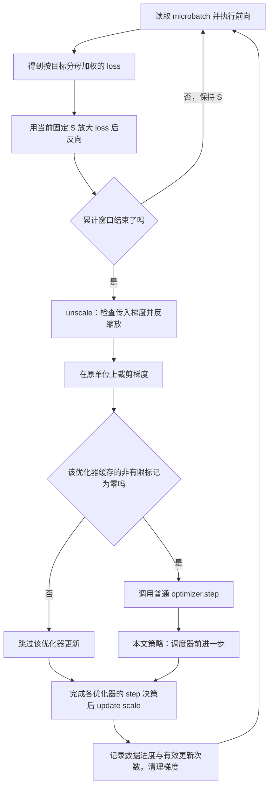

# 混合精度训练中的 loss scaling、溢出检测与跳步，怎样影响梯度和训练进度？

> Loss scaling 在反向传播之前放大 loss（损失函数的输出），让一些原本太小的梯度有机会保留下来；更新参数前再反缩放，恢复梯度的单位。缩放过大也可能溢出，因此普通 GradScaler 路径会根据梯度检查结果决定是否调用优化器，并调整后续的 scale。跳过参数更新不会撤销已经读取的数据或执行过的前向，训练进度必须区分数据批次与有效更新。

## 1. 为什么打开 AMP 后，训练走了 5 个 batch，却只更新 4 次？

自动混合精度（Automatic Mixed Precision，AMP）让不同运算使用合适的浮点类型，目标是在数值可接受的前提下使用低精度计算。假设一次训练依次做前向、反向和参数更新。某个 batch（批次）的梯度出现 Inf（无穷大），训练循环仍然读了这个 batch，也执行了前向和反向，但 GradScaler 没有让优化器更新参数。若学习率调度器仍无条件前进一步，它与参数更新次数就会产生偏差。

本篇要回答的主问题是：**缩放究竟改变了哪些数值，哪些步骤必须保持同一个 scale，跳步以后哪些训练状态已经前进？**

先读 [第 03 篇：浮点范围与精度](../../10/2026-10-22-floating-point-formats/README.md) 可理解 FP16／BF16；[第 18 篇：训练状态显存](../2026-11-04-training-memory-accounting/README.md) 解释参数、梯度和优化器状态。涉及数据并行和累计分母时参考 [第 17 篇](../2026-11-03-ddp-gradient-overlap/README.md)、[第 34 篇](../2026-11-26-length-bucketing-sequence-packing/README.md)，恢复状态参考 [第 22 篇](../2026-11-10-training-checkpoint-recovery/README.md)。

本篇分开使用三类证据：浮点转换的 CPU 数值模型、真实 CPU GradScaler 的状态实验、CPU BF16 autocast 的类型实验。没有 GPU 测量，也没有把手工注入的 Inf 称为真实 FP16 训练溢出。

## 2. 把 loss 放大，会不会把学习率也放大？

### 2.1 先看一个小得装不下的梯度

梯度是 loss 对参数的导数，表示参数稍微变化时 loss 如何变化。假设某个梯度是 `1e-8`，要暂存在 FP16 中；它可以是反向过程的中间梯度，不要求最终参数的 `.grad` 也使用 FP16。FP16 最小正次正规数是 $2^{-24}\approx5.96\times10^{-8}$；在这里的最近舍入模型下，`1e-8` 小于它的一半，转换后成为 `0`。原来的相对大小就丢失了。

先乘 $S=1024$，数值变为 `1.024e-5`，再转换 FP16，最后用较高精度除以 `1024`。本机实际结果如下。

| 路径 | 保存到低精度的值 | 恢复出的梯度 |
| --- | --- | --- |
| 直接转 FP16 | `0.0` | `0.0` |
| 先乘 1024 再转 FP16 | `1.0251998901367188e-5` | `1.0011717677116394e-8` |
| 直接转 BF16 | `1.0011717677116394e-8` | 同左 |

这是 `float64 → FP16/BF16 → float64` 的 CPU 存储舍入实验，不是一次 GPU 反向内核的模拟。真实硬件的次正规数处理和中间运算类型还要核对对应实现。完整数据见 [results.json](evidence/runs/cpu/results.json)。

**必须在信息丢失之前缩放。** 如果梯度已经变成 `0`，此后再乘 `1024` 仍是 `0`。因此框架放大的是反向开始前的 loss，让链式法则把缩放因子传到梯度。这个出发点来自原始论文 [Mixed Precision Training，§3.2](https://arxiv.org/html/1710.03740v3#S3.SS2)。

### 2.2 缩放的是中间数值，优化器要拿到原单位的梯度

令参数为 $\theta$，原始 loss 为 $L(\theta)$，并把 $S$ 当作不参与求导的正常数：

$$
g=\frac{\partial L}{\partial\theta},\qquad
L_s=S L,\qquad
g_s=\frac{\partial L_s}{\partial\theta}=Sg.
$$

更新前做反缩放（unscale）：

$$
g_{\mathrm{update}}=g_s/S=g,\qquad
\theta_{t+1}=\theta_t-\eta g_{\mathrm{update}}.
$$

所以在精确算术且正确反缩放的前提下，学习率 $\eta$ 不变。低精度中仍有舍入误差，不能据此声称与 FP32 逐位相同。

缩放也不会增加 FP16 的尾数位数。它移动可表示的数值区间：`64 × 1024 = 65536` 已超过 FP16 最大有限值 `65504`，本机转换结果为 Inf。$S$ 太小保护不住小值，太大又可能制造非有限值；动态缩放是在这两个约束之间调整。BF16 的指数范围更宽，经常不需要为 FP16 的范围问题使用 loss scaling，但 BF16 计算同样可能产生 Inf／NaN（非数，常见于无效运算）。官方 [AMP 数值说明](https://docs.pytorch.org/docs/2.15/amp.html#gradient-scaling) 也没有保证 scale 始终不小于 `1`。

### 2.3 autocast、GradScaler、优化器各负责什么？

- **autocast**：为适用的运算选择计算类型。它不是把整个模型和每一步都改成 FP16。
- **GradScaler**：放大 loss、反缩放梯度、记录非有限检查结果，并管理动态 scale。
- **优化器**：拿梯度更新参数和动量等状态。普通路径中，GradScaler 决定是否调用它。

论文 §3.1 强调 FP32 主权重，§3.3 强调合适的累加精度；这不等于今天所有 AMP 用法都额外复制一整份主权重。常见的 PyTorch autocast 用法保持模型参数为 FP32，让部分运算使用低精度；不要把手工 `model.half()` 当作等价替换。[原论文笔记](evidence/paper-notes.md)、[官方用法](https://docs.pytorch.org/docs/2.15/notes/amp_examples.html#typical-mixed-precision-training)

本机的固定数据实验中，CPU BF16 `linear` 输出为 BF16，MSE loss、参数和参数梯度都是 FP32。这个类型结果与后面的 FP32 标量 GradScaler 实验分别记录，不能混成一次 GPU FP16 训练证据。[实测类型](evidence/runs/cpu/results.json)

## 3. 为什么必须先反缩放，再裁剪，累计期间还不能改 scale？

### 3.1 裁剪阈值也有梯度单位

梯度裁剪限制向量的范数，避免一次更新过大。以 L2 范数为例，理想化裁剪为：

$$
\operatorname{clip}(g,C)=g\min\left(1,\frac{C}{\lVert g\rVert_2}\right).
$$

取原梯度 $g=[3,4]$，范数为 `5`，scale 为 `8`，裁剪阈值 $C=1$：

| 操作顺序 | 中间结果 | 优化器拿到的梯度 |
| --- | --- | --- |
| 先反缩放，再裁剪 | `[24,32] / 8 = [3,4]`，再除以 5 | `[0.6,0.8]` |
| 先对放大后的梯度按阈值 1 裁剪，再反缩放 | `[24,32] / 40 = [0.6,0.8]`，再除以 8 | `[0.075,0.1]` |

错误顺序把有效裁剪阈值也缩小了 `8` 倍。本机真实 `clip_grad_norm_` 给出约 `[0.5999999,0.7999998]` 和 `[0.0750000,0.1000000]`。与手算的微小差异来自 FP32 舍入，以及源码分母中的 `1e-6`；手算函数明确省略该 epsilon。[固定源码](https://github.com/pytorch/pytorch/blob/26bbfa344f2f4df9b06fcc980dba95fee81d5a19/torch/nn/utils/clip_grad.py#L170-L188)、[本地片段](evidence/upstream/pytorch/main-clip_grad.py-L170-L188.txt)

### 3.2 两个 microbatch 必须使用同一把尺子

梯度累积是先把多个小批次的梯度加起来，再统一更新。若每次反向的目标函数已按正确分母加权，理想梯度是 $\sum_i g_i$。保持同一个 $S$ 时：

$$
\frac{\sum_i Sg_i}{S}=\sum_i g_i.
$$

如果中途把 scale 从 `8` 改成 `16`，两个原梯度都为 `1`，缓冲区得到 `8+16=24`；最后除以 `16` 只剩 `1.5`，目标应是 `2`。单次除法不能还原混合单位的累加结果。我们的错误对照通过公开的 `update(new_scale=16.0)` 人为制造这种误用，真实 CPU GradScaler 得到的也是 `1.5`，不是模型推测。

因此，**累计窗口结束前不改变 scale，不提前反缩放；所有反向完成后，每个优化器至多反缩放一次。** 官方 [梯度累积示例](https://docs.pytorch.org/docs/2.15/notes/amp_examples.html#gradient-accumulation) 明确要求这一点。

这里的 $g_i$ 已包含目标函数应有的权重。长度不同的 batch 不能总靠机械地 `loss / microbatch数` 得到相同训练目标；有效 token 分母先按 [第 34 篇](../2026-11-26-length-bucketing-sequence-packing/README.md) 确定，再应用统一的 scale。

### 3.3 把正确顺序画出来



[可编辑图源](figures/scaling-flow.mmd)。图中检查的是检查时传入的梯度，后续操作不得再引入非有限值；调度器箭头是本文选择的应用策略。图源和正文已核对，没有将此图称为实测 GPU 时间轴。

## 4. PyTorch 的源码究竟在哪一步检查、跳步和更新 scale？

### 4.1 先固定版本，再读普通优化器路径

2026-11-27 实际 fetch 的官方默认分支为 `main`，完整 SHA 为 `26bbfa344f2f4df9b06fcc980dba95fee81d5a19`。最新稳定 release 为 `v2.15.0`，tag SHA 为 `31a77fc9c0a7c6fff15a1ff58c743f53b1a9d457`。本机安装包显示 `torch 2.15.0`，构建 SHA 为 `d0f2af8b66b20da4baa50644c0cd3f887a2eae2e`，不能把它说成已运行上述 main 或 tag 的源码构建。[更新记录](evidence/source-update.json)

版本差异确实存在：main 构造器的 `device=None` 会选择当前 accelerator、没有时回退为 `cuda`；稳定 tag 和本机签名的默认值为 `cuda`。所有实验都显式写 `GradScaler('cpu', ...)`，避免默认值差异。[main 构造器](evidence/upstream/pytorch/main-grad_scaler.py-L125-L156.txt)、[稳定构造器](evidence/upstream/pytorch/v2.15.0-grad_scaler.py-L123-L137.txt)

以下只分析普通 SGD 路径。fused／自定义 AMP 优化器有专门分支，不能套用每一个调用细节；本次没有验证这些路径。

### 4.2 从 loss 到非有限标记

先看“放大在哪里发生”：`GradScaler.scale` 延迟初始化 scale，然后返回乘过 scale 的输出。这对应前面的 $L_s=S L$。[源码 L210—222](https://github.com/pytorch/pytorch/blob/26bbfa344f2f4df9b06fcc980dba95fee81d5a19/torch/amp/grad_scaler.py#L210-L222)

再看“检查哪些梯度”：`unscale_` 求 `1 / S`，`_unscale_grads_` 遍历优化器所管理参数的 `.grad`，按设备和 dtype 分组，调用 `_amp_foreach_non_finite_check_and_unscale_`。普通路径还会拒绝直接反缩放 FP16 参数梯度，实测 `model.half()` 式参数对应的简单对照抛出 `ValueError`。[分组与检查入口](evidence/upstream/pytorch/main-grad_scaler.py-L270-L301.txt)、[反缩放入口](evidence/upstream/pytorch/main-grad_scaler.py-L342-L378.txt)

本次 CPU 内核的相关标量逻辑先检查输入是否有限，发现 Inf／NaN 时设置标记，再乘 inverse scale。相应向量路径服务于同一内核。这里没有调用一个“判断整个训练是否健康”的诊断器，不能据此保证 loss、所有中间激活或后续改写的梯度都正确。[CPU 源码 L97—121](https://github.com/pytorch/pytorch/blob/26bbfa344f2f4df9b06fcc980dba95fee81d5a19/aten/src/ATen/native/cpu/AmpGradScalerKernels.cpp#L97-L121)

### 4.3 为什么重复调用会报错，检查后改坏梯度又不会被自动救回？

每个优化器在一次 scale 更新周期内有三个状态：

| 状态 | 含义 | 本文使用的下一步 |
| --- | --- | --- |
| `READY` | 尚未完成本周期的反缩放 | 调用 `unscale_`，或让 `step` 自动调用它 |
| `UNSCALED` | 已记录非有限标记并反缩放 | 可以在原单位上裁剪，然后 `step` |
| `STEPPED` | 已完成本优化器的 step 决策，可能实际跳过 | 等待 `update` 重置周期 |

重复 `unscale_` 或未 `update` 就对同一优化器再次 `step`，本机都抛出 `RuntimeError`。[状态定义](evidence/upstream/pytorch/main-grad_scaler.py-L43-L55.txt)、[重复 step 检查](evidence/upstream/pytorch/main-grad_scaler.py-L414-L427.txt)

普通 `step` 在状态是 `READY` 时自动反缩放；若已经 `UNSCALED`，它复用缓存的标记，随后 `_maybe_opt_step` 只在标记合计为零时调用优化器。[普通 step 路径](https://github.com/pytorch/pytorch/blob/26bbfa344f2f4df9b06fcc980dba95fee81d5a19/torch/amp/grad_scaler.py#L477-L487)

因此，若先对有限梯度 `unscale_`，随后自己把 `.grad` 改成 Inf，再调用 `step`，不会自动重新检查。本机故意制造该错误后，SGD 确实被调用，参数成为 `-inf`。**非有限检查有时间边界；裁剪和其他梯度变换也必须维持数值有效性。** 这项受控反例不是正常配方，也不是对所有优化器的泛化结论。[真实反例输出](evidence/runs/cpu/results.json)

### 4.4 scale 为什么先长大，遇到 Inf 又缩小？

令 $q$ 为连续无非有限标记的周期数，增长间隔为 $N$，增长系数为 $a$，回退系数为 $b$。对本篇的有限正常输入范围，可把 CPU 状态更新概括为：

$$
(S',q')=\begin{cases}
(bS,0), & \text{存在非有限标记};\\
(aS,0), & \text{本次有限且 }q+1=N;\\
(S,q+1), & \text{其他有限周期}.
\end{cases}
$$

真实内核还有 FP32 的增长防溢出检查，不能把以上数学分段式当作所有浮点边界的完整实现。main 中默认 `a=2`、`b=0.5`、`N=2000`、初始 scale `65536`；实验故意使用初始 `8`、间隔 `2`，便于手算。`S<1` 是允许出现的状态，实测初始 `0.5` 遇到注入的 Inf 后降为 `0.25`。[CPU scale 更新](evidence/upstream/pytorch/main-AmpGradScalerKernels.cpp-L168-L190.txt)

`update` 汇集本周期各优化器的检查标记，调用 scale 更新内核，再清空每个优化器的周期状态。[Python 更新路径](evidence/upstream/pytorch/main-grad_scaler.py-L516-L564.txt)

**多个优化器的 step 决策是各自的，scale 更新则在这些 step 之后进行一次。** 本机两个参数分别交给两个 SGD，只向第二个梯度注入 Inf：step 调用数为 `[1,0]`，参数约为 `[0.8,1.0]`，共享 scale 从 `8` 降到 `4`。所以“scale 下降了”不能证明所有优化器都跳步。[官方多优化器用法](https://docs.pytorch.org/docs/2.15/notes/amp_examples.html#working-with-multiple-models-losses-and-optimizers)

## 5. 跳过更新以后，怎样记进度、排障与恢复？

### 5.1 用一个带动量的标量走五次

取 FP32 参数 $w_0=1$，loss 为 $w^2/2$，所以 $g=w$。SGD 使用学习率 `0.1`、动量 `0.9`：首次动量为梯度，随后 $v_t=0.9v_{t-1}+g_t$，参数更新为 $w_t=w_{t-1}-0.1v_t$。第三次在反向后、检查前把梯度改成 Inf。

| 数据批次 | 输入 scale | 注入 Inf | 调用 SGD | 输出 scale | 连续有限计数 | 累计有效更新 | 参数约值 |
| --- | --- | --- | --- | --- | --- | --- | --- |
| 1 | 8 | 否 | 是 | 8 | 1 | 1 | 0.9000 |
| 2 | 8 | 否 | 是 | 16 | 0 | 2 | 0.7200 |
| 3 | 16 | 是 | 否 | 8 | 0 | 2 | 0.7200 |
| 4 | 8 | 否 | 是 | 8 | 1 | 3 | 0.4860 |
| 5 | 8 | 否 | 是 | 16 | 0 | 4 | 0.2268 |

第三次参数和动量都未改变。这里统计实际进入 `SGD.step` 的调用数；不能用返回值 `None` 判断，因为该普通 SGD 在成功调用时也返回 `None`。参数值是否变化也不是通用判据，例如零梯度的一次合法更新可能保持参数值不变。完整实现与逐次状态在 [runtime_demo.py](code/runtime_demo.py) 和 [真实输出](evidence/runs/cpu/results.json)。

### 5.2 先确定调度器采用哪一种时间

- **数据进度**：已读取或已处理多少 batch／样本／有效 token。
- **优化进度**：有多少次实际参数更新。
- **调度器进度**：学习率策略按哪种计数前进。

本篇选择“成功调用普通 SGD 才推进一次调度器”，因此数据 batch 为 `5`，有效更新与调度器步数均为 `4`。这是应用层政策，不是 GradScaler 自动提供的调度器管理。其他训练系统可以按 token 数设计学习率曲线，但必须明确跳步时的含义，并在日志和恢复状态中保持一致。

GradScaler 没有回滚数据加载、前向、随机数生成器（RNG）的消耗或前向更新的缓冲区。这个结论来自它只控制本优化器 step 的调用边界；本篇没有运行带随机层或可变缓冲区的完整网络。不要把参数未变解读为整次迭代从未发生。

### 5.3 保存 scale 这个数字就够了吗？

不够。当前 `state_dict()` 还包括 `growth_factor`、`backoff_factor`、`growth_interval` 和 `_growth_tracker`。只恢复 `S=8`，却漏掉已经累计的连续有限次数，下一次增长时机可能不同。官方建议在本轮 `update()` 后保存 scaler 状态，和模型、优化器等一起恢复。[源码及保存时机说明](evidence/upstream/pytorch/main-grad_scaler.py-L632-L684.txt)

本例在完成 `update`、清理梯度的边界，深拷贝并恢复参数、优化器、scaler、调度器以及应用层的数据／更新计数。在第 `0、1、2、3、5` 个边界恢复后，后续逐次记录与不断点基线一致。故障注入顺序是固定的外部输入，不是靠 RNG 重现。

这验证的是同进程 CPU 内存中的 `state_dict` 重载，不是落盘原子性、崩溃重启或完整分布式恢复。真实任务还要处理 RNG、采样器、数据游标、保存完成边界等，详见 [第 22 篇](../2026-11-10-training-checkpoint-recovery/README.md)。

### 5.4 工程选择和排障顺序

| 选择或现象 | 适用条件／收益 | 代价或需要检查的条件 |
| --- | --- | --- |
| FP16 配合动态 scaling | 一些低精度中间梯度需要更大的表示范围 | scale 不增加尾数精度；缩放过大可能非有限，跳步浪费已完成工作 |
| BF16 autocast | 硬件与算子支持，主要担心 FP16 指数范围 | 仍有舍入和非有限风险；是否更快须在目标硬件测量 |
| unscale 后裁剪 | 阈值按原梯度单位定义 | 只能在累计结束后做，之后不得引入非有限值 |
| 长期连续跳步、scale 持续下降 | 应当触发数值排查 | 查输入、前向 loss、算子中间值、参数格式、梯度变换和检查顺序；不能只不断调低 scale |
| 统计有效更新与数据进度 | 能解释曲线偏差和恢复位置 | 需要训练框架提供适合其优化器的接受／跳过信号，不能普遍依赖返回值或 scale 变化 |
| DDP／FSDP 和多个优化器 | 多设备或多个参数更新域 | 要额外核对溢出标记、通信组和更新一致性；本篇没有验证跨 rank 的整体跳步协议 |

没有 GPU 吞吐、显存收益、分布式通信或训练收敛测量。源码和 CPU 功能实验支持的是调用与数值机制，不能代替目标硬件上的正确性和性能验收。

## 6. 两道代码练习

### 练习一：证明缩放保护小值，却也会改变错误裁剪的含义

起始代码在 [exercises.py](code/exercises.py)。实现前三个函数，使用显式 CPU 张量，不改变全局 dtype、设备或 RNG：

1. `quantized_gradient(g,S,dtype=...)`：比较直接转换与先缩放再转换，返回低精度保存值和恢复值。`g` 必须有限，`S` 必须有限且大于零，拒绝布尔值；只支持 FP16／BF16，允许缩放结果溢出作为观察结果。
2. `unscale_and_clip(gs,S,C)`：非空有限向量，先除以正数 `S`，再按正阈值 `C` 做理想 L2 裁剪。零向量保持零；不用原生 epsilon。
3. `unscale_accumulated(gs,scales,Sfinal)`：计算 $\sum_i S_i g_i/S_{final}$，要求输入非空等长；解释何时等于原梯度之和。

验收：`1e-8` 直接 FP16 为零，先乘 `1024` 后恢复值误差小于 `2e-11`；`64 × 1024` 溢出；`[24,32]` 正确反缩放裁剪约为 `[0.6,0.8]`；两个 `1` 使用 `[8,16]` 的混合 scale 后除以 `16` 得到 `1.5`。

<details>
<summary>详解与完整答案</summary>

[answers.py](code/answers.py) 保存完整实现。转换模型先以 float64 保存原值，分别做 `g → dtype` 和 `S*g → dtype → float64 / S`，因此没有假装恢复已经舍入成零的数据。FP16 的 overflow 和小值恢复分别说明 scale 的上、下界压力。

裁剪先恢复单位，再用 `math.hypot` 求 L2 范数，乘以 `min(1,C/norm)`；零范数时系数取 `1`。错误顺序相当于在原单位中使用阈值 `C/S`。累计函数特意允许各次 scale 不同，便于构造反例，并不推荐这样训练。

从本篇目录运行：

```bash
PYTHONDONTWRITEBYTECODE=1 python -m unittest discover -s code -p test_answers.py -v
```

本机对应环境的完整命令和输出在 [运行清单](evidence/runs/manifest.json)、[测试原文](evidence/runs/unittest.txt)。浮点近似用容差比较，不能把 `0.07500000000000001` 误判为裁剪机制错误。NaN、无效 scale、布尔值、空向量及不等长输入有拒绝用例。

</details>

### 练习二：实现真实跳步和能够一致恢复的训练计数

实现 [exercises.py](code/exercises.py) 中的 `training_trace`。规则如下：

- 用 FP32 CPU 标量参数 `w=1`、`loss=w*w/2`，普通 SGD 的 `lr=0.1`、`momentum=0.9`；scaler 显式使用 `cpu`，初始 `8`，增长间隔 `2`。
- 输入故障序列 `[False,False,True,False,False]`。仅在 `True` 时、反向之后且 `unscale_` 之前把梯度设为 Inf。
- 每次顺序为反向、反缩放、`scaler.step`、按本例策略推进调度器、`scaler.update`。记录数据 batch、实际优化器调用、scale、连续有限计数、参数和动量；清理梯度。
- 调度器使用常数 `LambdaLR`，只在实际优化器调用后前进。不得用 `None` 返回值或参数是否改变作通用检测器。
- 在可选的完成边界 `restore_after` 保存并重载公开状态及应用计数。第 `0` 个边界代表尚未处理任何 batch。

验收：输出 scale 为 `[8,16,8,8,16]`，累计有效更新为 `[1,2,2,3,4]`，最后 `w≈0.2268`。第三次参数与动量不变，数据进度仍加一；五个指定恢复边界与连续基线逐条一致。输出合同见 [代码说明](code/README.md)。

<details>
<summary>详解与完整答案</summary>

完整实现是 [runtime_demo.py](code/runtime_demo.py)。`CountingSGD` 在普通 `SGD.step` 真正返回后增加应用计数，`scaler.step` 跳过它时计数不动；这是受控普通优化器实验中的直接观察方式，不是 fused／任意自定义优化器的统一接口。

`TrainingHarness.attempt` 先算缩放梯度，必要时注入 Inf，再反缩放；比较本优化器调用计数来决定是否推进调度器。无论是否更新，都增加已处理 batch 数。检查第三次的动量缓冲区，能排除“只保护参数却仍更新动量”的错误理解。

`checkpoint` 深拷贝所有公共状态和应用计数，`restore` 重建对象后分别载入；保存发生在完成 scale 更新且无待累积梯度的边界。不要只保存参数和 scale，也不要忘掉 step 计数这个本例新增的应用状态。

额外真实对照验证：重复反缩放／step 报错；普通 FP16 参数梯度反缩放报错；多个优化器分别决策；检查后篡改梯度不会重新检查；累计中改 scale 得到错误梯度 `1.5`；初始 `0.5` 可回退到 `0.25`。

运行完整示例，输出目录需尚无 `results.json`，避免覆盖先前证据：

```bash
PYTHONDONTWRITEBYTECODE=1 python code/run_answers.py --output-dir /tmp/amp-wiki-nov27-example
```

`run_answers.py` 同时把严格 JSON 输出到 stdout 和指定目录；有意产生的 Inf 用字符串 `"inf"`／`"-inf"` 表示，没有写非法 JSON 数值。归档的 [stdout](evidence/runs/cli.txt) 与 [results.json](evidence/runs/cpu/results.json) 内容一致。23 项测试在普通和 `-O` 模式均通过，类型实验、协议实验、CPU 默认设备覆盖和 RNG 不变性均在其范围内。

</details>

## 7. 面试官继续追问

| 层次 | 追问 | 参考回答要点 |
| --- | --- | --- |
| 基础 | 为什么 loss scaling 不等于调大学习率？ | 反向得到 `Sg`，更新前除以 `S`；精确算术下恢复 `g`，低精度仍会舍入 |
| 数值 | 已经下溢成零，再乘 scale 能补回来吗？ | 不能，所以缩放发生在反向之前；也不能扩大格式尾数精度 |
| 操作顺序 | 为什么裁剪阈值不能直接套在缩放梯度上？ | 阈值按原梯度单位定义，否则有效阈值成为 `C/S` |
| 累积 | 为什么一个有效更新的 microbatch 不能各用不同 scale？ | 累加缓冲区混合 `S_i g_i`，一次除法无法恢复原和 |
| 实现 | `step` 会不会每次重新检查梯度？ | 普通路径 READY 时检查并反缩放，UNSCALED 时复用标记；检查后改坏梯度是反例 |
| 实现 | scale 降低能说明两个优化器都跳步吗？ | 不能，step 各自决策，共享 scale 更新汇集标记 |
| 训练策略 | 跳步后要不要推进 scheduler？ | 先定义按更新还是数据／token 计时；本文按实际普通 SGD 调用推进，GradScaler 不代管 |
| 恢复 | 为什么同样恢复 scale，增长时机仍会不同？ | 还需要连续有限计数和增长策略；优化器、调度器及数据状态也要一致 |
| 排障 | scale 一直降低，是不是继续降低就能解决？ | 不一定，先查输入、loss、算子范围和梯度改写；检查器不是全训练数值诊断器 |
| 边界 | CPU 的这套实验能证明 GPU FP16 训练稳定吗？ | 不能，证明数学关系及安装包的 CPU 协议；真实 GPU、中间 dtype、通信和收敛还要测 |

## 8. 适用范围与下一步

本文分析普通优化器、单进程 CPU 的调用协议和有界数值例子。没有运行 GPU FP16 反向、fused optimizer、DDP／FSDP、多进程 overflow 协同、磁盘崩溃恢复或训练性能／收敛验收。原论文、稳定文档、默认分支源码和本机安装包分别标明，没有将它们当作同一个版本。

接下来可讨论：**AdamW 的动量、权重衰减与更新精度，怎样影响显存和训练行为？** 它能进一步解释，本篇被跳过的优化器更新到底还维护了哪些状态。

资料归档：[参考资料与证据](references.md)。真实验证与审查：[审查记录](review.md)。返回 [Wiki 索引](../../../index.md)。
